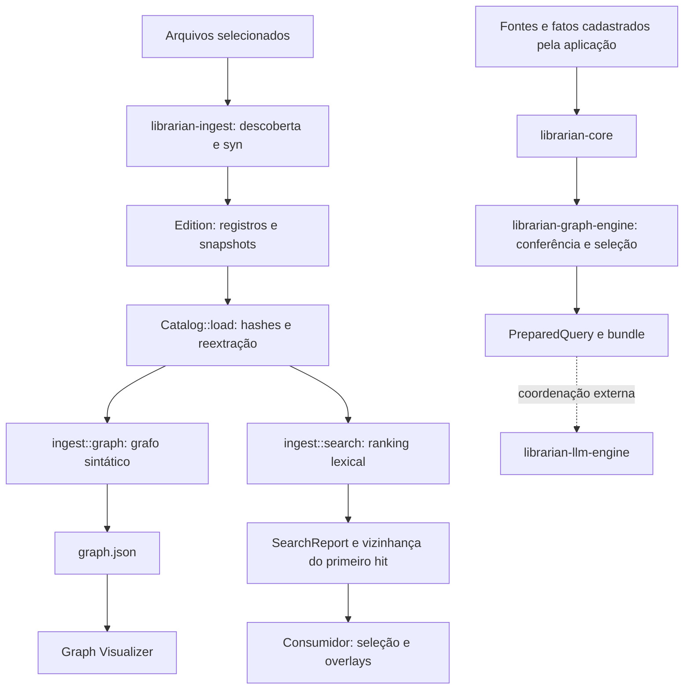

# Librarian: diagnóstico e plano de evolução

Data: 27/09/2026.

**Status: ETAPA 1 concluída. Plano validado pelo usuário em 19/10/2026; somente a ETAPA 2 (2A regressão v1 e 2B abstração do extractor Rust) está autorizada. As etapas seguintes dependem de nova validação.**

Este documento preserva a análise da arquitetura atual e o plano incremental para extração multilinguagem e evolução do Graph Visualizer. O código existente é a referência do diagnóstico; as propostas abaixo ainda não representam capacidades implementadas.

## Princípios preservados

- Evidência não é conclusão.
- Toda aresta deve permitir responder: “Qual evidência autorizou esta ligação?”.
- Hash comprova consistência, não autenticidade.
- Código descreve estrutura/procedimento; não prova execução.
- `#[test]` observado não comprova que um teste foi executado.
- Graph Engine testa/relaciona sem explicar; LLM Engine explica sem extrapolar as evidências.
- Mais contexto não implica mais certeza.
- Referência sintática, candidato por nome e resolução comprovada permanecem distintos.
- O viewer projeta relações existentes; proximidade visual não cria relações.
- Librarian não conhece os domínios de Renderer, xadrez ou outros consumidores.

## Leitura e verificação realizadas

Foram examinados README.md, TESTME.md, Cargo.toml do workspace, contratos e implementação de librarian-core, librarian-ingest e librarian-graph-engine, incluindo cli.rs, extract.rs, graph.rs, search.rs e lib.rs; testes, exemplos e documentação dos formatos; e a fronteira do librarian-llm-engine.

Foram lidos integralmente os seis arquivos do viewer: README.md, INTEGRATION.md, package.json, index.html, src/main.js e src/style.css. Também foram consultados o produtor do trace no PLAYME do checkout vizinho e um grafo real do consumidor.

Baseline executada:

```sh
cargo test --workspace --locked --offline
```

Resultado: **50 testes aprovados, zero falhas e um gravador de experimento ignorado**. Isso descreve essa execução, não prova geral de ausência de defeitos.

Não houve alteração de código durante o diagnóstico. As alterações locais preexistentes foram preservadas. Não foi executada uma sessão interativa do viewer no navegador; o erro de carregamento descrito abaixo foi reproduzido isoladamente com Node.js.

## 1. Arquitetura real existente

Há dois fluxos distintos:



**O grafo de código está em librarian-ingest/src/graph.rs, não no crate librarian-graph-engine.**

| Parte | Responsabilidade atual |
| --- | --- |
| librarian-core | Contratos de fatos, fontes textuais, seleções e dossiês. |
| librarian-graph-engine | Validação de dossiês, referências, arquivos, capturas e exportação de PreparedQuery. |
| librarian-ingest | Descoberta, snapshots, extração Rust, editions, verifier, grafo sintático e busca. |
| librarian-llm-engine | Preparação e transporte Ollama; não extrai estrutura nem valida semanticamente respostas. |
| tools/graph-visualizer | Protótipo WebGL independente do workspace Cargo. |

Existem conceitos distintos chamados Source e Evidence nos contratos de dossiês e nos registros de ingestão/proveniência. Não devem ser unificados apenas por semelhança de nomes.

A documentação principal conduz ao Renderer. Esse acoplamento está no roteiro de uso: ingestão e busca já recebem caminhos e vocabulário como argumentos. A ponte automática entre recuperação de código e PreparedQuery permanece pendente.

## 2. Garantias atuais das editions

Em [lib.rs](crates/librarian-ingest/src/lib.rs), generate:

- Descobre entradas ordenadas e deduplicadas.
- Lê cada fonte e preserva seus bytes.
- Produz sources.jsonl, symbols.jsonl, chunks.jsonl e diagnostics.json.
- Deduplica snapshots pelo hash do conteúdo.
- Publica manifest.json por último e recusa destino existente.

O modelo preserva caminho, identidade da fonte, linguagem, SHA-256, tamanho, intervalos de bytes e linhas, hash do chunk e snapshot original.

Catalog::load reexecuta a extração sobre os snapshots e compara símbolos, chunks e diagnósticos, além de conferir hashes e metadados. A verificação histórica não precisa do projeto original.

Limites: não há snapshot atômico do repositório, autenticação de autoria, prova de execução ou garantia de completude quando há diagnósticos.

Detalhes de compatibilidade:

- Bytes começam em zero, com fim exclusivo; linhas começam em um, com fim inclusivo.
- Símbolo e chunk correspondente têm hoje o mesmo ID, em coleções diferentes.
- IDs incluem identidade da Source e intervalo; não representam continuidade histórica automática.
- Metadados Git podem mudar independentemente dos registros de conteúdo.

## 3. Acoplamentos de Rust

| Local | Acoplamento observado |
| --- | --- |
| lib.rs / walk | Diretórios contribuem somente .rs; arquivos explícitos podem ser auxiliares. Não há exclusões internas. |
| source | Classifica apenas rust ou auxiliary. |
| generate e Catalog::load | Extraem somente quando language == rust. |
| Manifest, EXTRACTOR e limits | Identidade global do extractor e limites específicos de macros/cfg. |
| extract.rs | AST/visitor de syn; spans de proc-macro2; BOM/shebang; escopo com ::. |
| Symbol | is_test significa presença literal de #[test]; qualified_name é escopo sintático local. |
| graph.rs | rust-syntax-graph-v1, novo parsing por syn e observer Rust. |
| Observer | Tipos, retornos, chamadas e bindings definidos por AST Rust; candidatos limitados a struct, enum, trait, type e union. |
| search.rs | Exclui module/impl do ranking, penaliza is_test e descreve limites de macros/cfg. |
| Graph Engine de dossiês | Tratamento de kind == rust_source para omitir alegações de execução; é outro contrato. |
| Viewer | Convenções de ID, fallback .rs e exemplos de interface específicos do Renderer. |

A CLI é principalmente orquestração. O executável atual é librarian_ingest; generate exige raiz, configuração e destino. O comando simplificado librarian generate projeto ainda não existe.

O extractor Rust usa span.byte_range(), com compensação de BOM/shebang. Não deve ser substituído por busca textual de offsets.

O grafo distingue corretamente:

- declares e contains: structural;
- tipos, chamadas, retornos e bindings observados: syntax_only;
- correspondências entre nomes de tipos: name_candidate.

Chamadas observadas não são ligadas a destinos presumidos. Candidatos homônimos podem existir entre arquivos, mas não representam resolução de imports ou tipos.

## 4. Diagnóstico do viewer existente

A implementação contém Three.js, WebGL, iluminação, OrbitControls, layout com d3-force-3d, File API, busca textual com destaque, filtros de categorias, centralização, limpeza de seleção, raycasting de nós, painel lateral e alternadores de trace/E1.

O layout executa 320 ticks sincronamente e para. O movimento posterior é rotação discreta do conjunto e pulsação dos nós, não uma simulação de forças contínua.

### Incompatibilidade bloqueante

O Rust serializa nodes como objeto indexado por ID. O viewer executa:

```js
(state.graph.nodes ?? []).map(enrichNode)
```

Contra o grafo real de renderer/ai/consultas/policy-camera-20260927-02, com **8.656 nós e 9.837 arestas**, a expressão falhou com `map is not a function`. A presença das funcionalidades no código não demonstra funcionamento de ponta a ponta com a saída atual.

### Outros pontos

| Área | Estado real |
| --- | --- |
| Entrada | Somente graph.json é obrigatório no código; JSONL e overlays são opcionais. A interface anuncia pasta PLAYME. |
| Localização | Primeira correspondência por nome/sufixo; pode misturar execuções numa pasta maior. |
| Trace | Associação por labels e kind, ignorando resolução/evidência na identificação; homônimos podem ser destacados indevidamente. |
| E1 | Usa symbol_id, mas também faz associação por nome/caminho, mesmo havendo ID; pode destacar vários símbolos. |
| Chunks | Tenta criar nós/arestas sintéticos, mas os IDs coincidentes com símbolos fazem os chunks serem pulados. |
| Arestas | Não há seleção ou painel de inspeção. |
| Inspeção | Faltam language/byte_len, vínculo completo com chunk, evidência de occurrence e score/motivos de E1. |
| Filtros | Não há filtro por tipo de aresta ou resolution. |
| Trace visual | Destaca participantes, mas não atenua especificamente os nós restantes. |
| Navegação | Há centralização global; falta foco no nó selecionado. |
| Performance | Esfera/material por nó, linha/material por aresta, layout síncrono e buscas repetidas com find. |
| Verificação | Não verifica edition nem vínculo de catálogo dos overlays. |

As arestas sintéticas têm synthetic: true, mas também resolution: structural. Isso precisa ser corrigido, mesmo que a colisão de IDs impeça seu uso normal atual.

Reaproveitar: cena, câmera, controles, File API, base do layout, identidade visual, HUD e interação.

Refatorar: carregamento/validação, normalização dos contratos, índices, identidade de overlays, inspeção e representação WebGL em lotes. Não há justificativa para iniciar outro viewer.

## 5. Contrato principal e overlays

graph.json é suficiente como contrato principal inicial de nós, relações e evidências de arestas. O viewer deve funcionar sem PLAYME, pergunta ou Ollama.

Limitações atuais:

- Node contém somente id, kind e label.
- kind mistura categoria e subtipo: source, struct, method, call_observed.
- Metadados completos exigem os JSONL.
- Evidência de occurrence está nas arestas.
- Arestas não têm ID próprio.

Proposta: adapter de rust-syntax-graph-v1 e, em versão nova, category separada de kind:

```text
category: source | symbol | occurrence | chunk
kind: class | method | type_reference | ...
```

IDs são opacos. Identidade determinística de aresta deve considerar endpoints, tipo, resolução e evidência.

Chunks começam como registros de inspeção associados, sem arestas sintéticas. A camada de nós exige identidade distinta e contrato explícito; chunk_id não deve virar silenciosamente uma relação do grafo.

### Trace do PLAYME

O produtor atual substitui IDs por labels e preserva apenas tipo, resolução, caminho e linha inicial. Essa perda foi conferida no PLAYME.ps1 do checkout vizinho.

search.json já contém graph.nodes, graph.edges e catalog_sha256. Ordem proposta:

1. Usar a vizinhança com IDs para destaque exato.
2. Suportar trace legado somente quando a correspondência for inequívoca.
3. Informar ambiguidades sem promover candidatos a participantes comprovados.
4. Propor posteriormente um overlay versionado com IDs e identidade do catálogo.

E1 é política opcional do adapter PLAYME, baseada em hits[0], não propriedade obrigatória do grafo. Metadados ausentes não serão inventados.

## 6. Fronteira proposta dos extractors

Introduzir primeiro módulos internos em librarian-ingest, preservando caminhos públicos:

```text
discovery / language registry
             ↓
Extractor
├── Rust: syn
├── Python: Tree-sitter
├── Java: Tree-sitter
├── TypeScript / TSX: Tree-sitter
├── JavaScript / JSX: Tree-sitter
└── HTML: Tree-sitter, capacidades delimitadas
             ↓
Extraction
  symbols / chunks / diagnostics
  occurrences / structural references
             ↓
edition → verified Catalog → graph builder → search
```

Contrato conceitual, ainda não implementado:

```rust,ignore
trait Extractor {
    fn descriptor(&self) -> ExtractorDescriptor;
    fn extract(&self, source: &Source, bytes: &[u8]) -> Extraction;
}
```

Regras:

- Nenhum tipo syn ou Tree-sitter sai do adapter.
- Extractor não lê outros arquivos por conta própria.
- Geração e verificação usam o mesmo registry versionado.
- Hashes e evidências vêm dos bytes preservados.
- Referências por nome e referências explícitas a arquivos são distintas.
- Builder aplica regras documentadas às observações verificadas.
- Candidatos não devem criar correspondências acidentais entre linguagens em projetos mistos.
- O observer Rust hoje em graph.rs entra nessa fronteira; abstrair só extract.rs seria insuficiente.

Manter inicialmente os módulos no ingest. Transferir tipos para librarian-core::catalog ou mover o grafo entre crates é uma etapa posterior, com reexports de compatibilidade e análise de dependências.

### Taxonomia

Preservar valores Rust na compatibilidade v1. Acrescentar somente tipos necessários, como class, interface, constructor, field e template.

Para Angular, preferir kind: class e papéis/decorators observados com evidência, sem apagar a identidade estrutural da classe.

is_test permanece no legado. No modelo novo, registrar explicitamente marcadores observados; falta de suporte não deve ser confundida com comprovação de que algo não é teste.

## 7. Tree-sitter e segunda linguagem

| Opção | Avaliação |
| --- | --- |
| Rust com syn; novos adapters com Tree-sitter | Recomendada: preserva spans, diagnósticos, IDs e comportamento Rust já testados. |
| Migração futura de tudo para Tree-sitter | Pode uniformizar infraestrutura, mas muda potencialmente spans, comentários, recuperação de erros e registros. Exige nova identidade e comparação extensa. |

Tree-sitter fornece posições em bytes e coordenadas de linhas. Sua recuperação pode produzir ERROR e MISSING; uma árvore não comprova parsing completo. Referências oficiais: [posições](https://tree-sitter.github.io/tree-sitter/using-parsers/2-basic-parsing.html) e [erros](https://tree-sitter.github.io/tree-sitter/using-parsers/queries/1-syntax.html).

Proposta inicial conservadora: preservar bytes e diagnosticar erro, sem publicar extração parcial como completa. Fixar e registrar runtime, gramáticas e regras do adapter.

**Python é a segunda linguagem proposta**: class, função e método testam a fronteira sem começar por framework ou resolução de pacotes. Não classificar testes por test_* nem inferir atributos dinâmicos ou destinos de chamadas.

Depois: Java; TypeScript/JavaScript; Angular/HTML. TypeScript e TSX exigem seleção explícita de gramática: [gramáticas oficiais](https://github.com/tree-sitter/tree-sitter-typescript).

## 8. Angular e templates

Angular será uma capacidade do adapter TypeScript, não uma linguagem independente.

- Preservar imports, decorators, classes, métodos e funções.
- Distinguir nome Component de associação sintática a import explícito de @angular/core.
- Suportar aliases apenas com mecanismo local implementado e testado.
- Não atribuir service por sufixo de nome; registrar Injectable sem afirmar registro ou execução de DI.
- Não resolver reexports, aliases de caminhos ou expressões computadas implicitamente.

Para templateUrl literal, registrar o valor e sua evidência. Regra posterior poderá resolver esse caminho explícito relativamente à Source, contra fontes presentes na edition. Isso autoriza referência a recurso, não prova compilação Angular. Arquivo ausente gera referência observada e diagnóstico, sem destino inventado.

Template inline deve apontar ao intervalo original do literal. Parsing de conteúdo escapado exige mapeamento exato entre texto decodificado e bytes originais; não emitir ranges internos aproximados enquanto isso não existir.

Não presumir que gramática HTML cobre toda a sintaxe Angular. Bindings, expressões e controle de fluxo exigem capacidades/fixtures próprias. Não ligar automaticamente expressões de template a métodos.

Nomes semelhantes, como foo.component.ts e foo.component.html, não autorizam ligação.

## 9. Compatibilidade e versionamento

O verifier exige igualdade exata de schema_version, EXTRACTOR, limits, conjunto de arquivos e registros reextraídos.

Identidade atual:

```text
librarian-ingest/0.1.0;syn/3.0.5;rust-structural-v1
```

source() recalcula a linguagem. Adicionar .py à classificação atual pode invalidar uma edition antiga que preservou esse arquivo como auxiliary.

Plano:

1. Congelar perfil v1: descoberta, classificação, extractor Rust, limites, serialização e grafo.
2. Dispatcher por versão, sem tentar automaticamente o extractor mais recente.
3. Formato novo apenas quando entrar o contrato multilinguagem.
4. Separar versões de formato, pipeline, descoberta, adapters/gramáticas e algoritmo do grafo.
5. Manter verificação v1 e recusar explicitamente versões desconhecidas.
6. Não reescrever editions antigas para fazê-las passar.

compare_current deve usar a política da edition, para não reportar Java/Python como arquivos novos de uma seleção Rust histórica apenas porque o executável mudou.

catalog_sha256 vem da serialização do manifesto desserializado, não necessariamente dos bytes formatados de manifest.json. Converter v1 para um novo modelo antes de calcular esse hash pode quebrar grafos e buscas antigos.

### Descoberta nova

Registry explícito para .rs, .java, .py, .ts, .tsx, .js, .jsx e .html. Arquivos explícitos desconhecidos continuam auxiliares.

Proposta de exclusões padrão por componente de diretório: node_modules, dist, build, coverage, target, .git, .venv e __pycache__. Documentar e registrar a política versionada e suas exceções explícitas. Não alterar silenciosamente a descoberta v1.

## 10. Plano incremental

| Etapa | Mudança | Critério de saída |
| --- | --- | --- |
| 2A — regressão | Fixtures históricas v1, incluindo auxiliar com extensão futuramente suportada. | Mesmos bytes históricos aceitos; adulterações rejeitadas. |
| 2B — abstração Rust | Contrato/registry e encapsulamento de extractor e observer. | Mesmos registros, IDs, grafo e ranking; suíte atual passando; nenhuma linguagem nova. |
| 3A — Python | Formato multilinguagem e adapter mínimo. | Classes/funções/métodos, ranges, hashes, determinismo e reextração sem projeto original. |
| 3B — Java | Adapter de classes, campos, métodos e construtores. | Mesma bateria contratual, sem resolução presumida. |
| 4 — TS/JS e Angular/HTML | Adapters, decorators e referências explícitas. | Testes positivos/negativos de imports, aliases e templates; nenhuma ligação por convenção. |
| 5A — viewer básico | graph.json, identidade, seleção de arestas e filtros. | Grafo sozinho abre; aresta mostra sua evidência. |
| 5B — enriquecimento | Metadados de edition associados por IDs. | Painéis completos; ausência de informação explícita. |
| 5C — overlays | Trace/E1 opcionais e identidade conferida. | Homônimos e catálogos divergentes não recebem destaque indevido. |
| 6 — documentação | Roteiro independente, exemplos e guia de adapters. | Uso não exige Renderer/PLAYME. |

### Arquivos previstos

- crates/librarian-ingest/src/lib.rs: geração, verifier e compatibilidade.
- extract.rs → extractors/mod.rs, extractors/rust.rs e adapters posteriores.
- Novos módulos de linguagem, descoberta e formato versionado.
- graph.rs: separar observação de montagem do grafo.
- search.rs: preservar política v1 e explicitar políticas novas.
- cli.rs: despacho/documentação, preservando comandos.
- Cargo.toml do ingest e Cargo.lock: dependências na etapa pertinente.
- tests/editions.rs e novas fixtures históricas e por linguagem.
- tools/graph-visualizer/src/main.js: dividir carregamento, modelo, overlays, cena e inspeção.
- HTML, CSS, package e documentação do viewer.
- README, TESTME, WORKFLOW e referências técnicas da ingestão.

### Performance do viewer

Direção proposta: InstancedMesh para nós e LineSegments/buffers para arestas, com mapas para seleção. Layout em worker ou lotes para evitar bloqueio da interface. O grafo real examinado já justifica evitar milhares de objetos e materiais individuais. DOM permanece para HUD e painel.

### Regressões e aceitação

Fixtures mínimas:

- Rust: struct, impl, method.
- Java: class, field, method.
- Python: class, function, method.
- TypeScript: class, interface, function, method.
- Angular: Component, templateUrl explícito, método e template.
- JavaScript/JSX, TSX e HTML: cobertura própria das capacidades declaradas.

Para cada linguagem: Source/Symbol corretos, bytes/linhas exatos, hashes, relações estruturais, reextração pelo verifier e determinismo.

Além disso: Unicode/CRLF, erros de parser, ranges adulterados com hashes recalculados, projeto original removido, homônimos, templates ausentes/computados, arquivos de nomes semelhantes sem referência e compatibilidade de editions/grafos v1.

No viewer: grafos reais e fixtures de contrato, ausência de overlays, metadados opcionais, seleção de arestas, ambiguidades e divergência de catálogo. A contagem de arestas exibíveis deve corresponder exclusivamente às arestas importadas, sem relações fabricadas.

### Documentação a entregar

Formatos e linguagens suportados; limites/capacidades de cada extractor; relações sintáticas e candidates; ausência de resolução; execução do viewer; abertura opcional de PLAYME; e processo de extensão:

1. Implementar Extractor.
2. Registrar extensões.
3. Criar fixtures e testes contratuais.
4. Registrar capacidades, limites e versão.

## ETAPA 2 — resultado (19/10/2026)

**2A.** Edition v1 congelada em `crates/librarian-ingest/tests/fixtures/v1`, gerada uma única vez pelo código anterior à refatoração e commitada antes de qualquer mudança em `src/`. Goldens de grafo e de três buscas, incluindo uma com símbolo `#[test]`. `tests/v1_regression.rs` cobre aceitação, reextração byte a byte, classificação/descoberta v1 (`.py` explícito como `auxiliary`, `.py` em diretório não descoberto), `nodes` como objeto e seis adulterações. Mutações manuais no grafo, na penalidade de teste e na taxonomia foram detectadas e revertidas.

**2B.** `extract.rs` virou `extractors/rust.rs` (declarações e ocorrências, únicos usuários de `syn`). `extractors/mod.rs` define `Extractor`, `Extraction`, `Occurrence` e `Registry`. O perfil v1 congelado reúne identidade, extensões, extractors e limits. `generate` usa o perfil atual; `Catalog::load` usa o perfil da identidade gravada e recusa as desconhecidas; `compare_current` usa a descoberta da edition. `graph.rs` só monta o grafo a partir das ocorrências; os tipos candidatos vêm do extractor. `search.rs` apenas marca a política v1. A API pública não mudou.

Verificação: fixtures e goldens da 2A sem alteração; `cargo test --workspace --locked --offline` com 72 aprovados e 1 ignorado; clippy do ingest sem avisos; `catalog_sources` do renderer com 3 aprovados e `prepare_ollama`/`send_ollama`/`explain_evidence` passando em `cargo check`. Isso descreve essas execuções, não prova ausência geral de defeitos.

Ainda não feito, de propósito: filtro de candidatos por linguagem (sem efeito na v1, necessário na 3A), formato multilinguagem, `category`, política de exclusões e Tree-sitter.

## Roteiro validado em 19/10/2026: fechar o Graph Engine sem linguagem

O Graph Engine é tudo o que testa e relaciona sem explicar: catalog, grafo, busca e dossiês. Linguagem entra somente por extractors e perfis do registry. Ordem: **G1 → G2 → G3 → G5 → G4**, seguida dos limites do LLM Engine (fase L).

| Passo | Mudança | Critério de saída |
| --- | --- | --- |
| G1 | Política de linguagem sai de grafo e busca para extractor/perfil; candidatos restritos à mesma linguagem | Fixture v1 intacta; `tests/agnostic.rs` sem nomes de linguagem em `graph.rs`/`search.rs` |
| G2 | Contrato neutro do grafo em formato novo: `category` separada de `kind`, ID de aresta, taxonomia neutra; v1 lida como hoje | Grafo v1 idêntico; grafo novo derivável sem nomes de linguagem |
| G3 | Engine de dossiês sem `rust_source`: propriedade declarada da fonte (código não comprova execução) | Testes de dossiê sem strings de linguagem |
| G5 | Python como prova da fronteira (antiga 3A) | Adicionar Python altera só `extractors/`, registry e fixtures |
| G4 | Ponte busca → dossiê/`PreparedQuery` | PLAYME envia bundle verificável em vez de envelope manual |

### G1 — resultado (19/10/2026)

O registry v1 passou a declarar `graph_version` (`rust-syntax-graph-v1`) e `search_limits` (texto com macros/cfg). Cada extractor declara `navigation_kinds` (Rust: `module`, `impl`), que a busca não ranqueia. A penalidade de marcador de teste continua genérica sobre o campo `is_test` do registro v1. Candidatos por nome passaram a exigir a mesma linguagem da ocorrência: na v1 isso não tem efeito, e será exercitado pela fixture mista do G5.

Verificação: fixture e goldens v1 sem alteração; suíte do workspace com 73 testes aprovados e 1 ignorado; clippy sem avisos; `catalog_sources` do renderer com 3 aprovados. `tests/agnostic.rs` passa no código novo e falha no anterior (`graph.rs mentions "rust"`).

O teste de fronteira cobre só nomes e sintaxe conhecidos; ele não prova ausência de suposições implícitas de linguagem, por exemplo na forma das ocorrências.

### G2 — resultado (19/10/2026)

Decisão do usuário: opção A, ou seja, formato novo exportável a partir de qualquer edition verificada, inclusive v1. `graph::v2` (`syntax-graph-v2`) é uma projeção do grafo do perfil:

- nós com `category` (source/symbol/occurrence), `kind` do extractor e `language`;
- arestas com ID determinístico (`edge:` + SHA-256 de from/to/kind/resolution/evidence) e somente `declares`, `contains`, `observes` e `name_candidate`;
- topo com `derived_from` e `profile`.

A CLI `graph` aceita `v1|v2` (padrão v1) e `verify-graph` escolhe o contrato pela versão do arquivo. Chunks continuam fora dos nós.

Verificação:

- `tests/graph_v2.rs` cobre golden, projeção 1:1 sem relações novas, categorias e linguagens vindas do catálogo, IDs únicos e recomputáveis, recusa de candidato promovido a `structural` e recusa de campos desconhecidos;
- `graph/v2.rs` entrou no teste de fronteira;
- suíte com 78 testes aprovados e 1 ignorado; grafo e buscas v1 sem alteração;
- no grafo real do renderer (8.045 nós, 9.153 arestas), geração em cerca de 1,8 s e verificação em cerca de 1,7 s (debug).

O viewer ainda lê só o formato antigo; usar a v2 nele é a etapa 5A.

### G3 — resultado (19/10/2026)

Antes da mudança, as exportações de dossiês v0.1 foram congeladas em `crates/librarian-graph-engine/tests/fixtures/legacy-v0.1` (commit c1dd24f): `rust_source`, `test_run` com e sem `execution`, texto comum e conferência de captura.

Mudanças:

- `librarian-core::Source` ganhou `content` opcional (`code`, `execution_record`, `document`), omitido na serialização quando ausente.
- O engine decide por `nature::of(source)`. `rust_source` e `test_run` viraram aliases legados isolados em `graph_engine/nature.rs`.
- `content` desconhecido ou contrário ao `kind` legado é recusado.
- Fontes sem `content` mantêm exatamente o texto anterior de `metadata_scope`; fontes com `content` usam texto neutro e exportam o campo.

Verificação:

- goldens legados sem alteração; `tests/content.rs` com código em várias linguagens, registros de execução, documentos e recusas;
- `tests/agnostic.rs` do engine sem nomes de linguagem nem `kind` legado fora de `nature.rs`;
- workspace com 85 testes aprovados e 1 ignorado; exemplo `maintenance` executado de ponta a ponta com `content: "document"`.

Compatibilidade (G3 e G4): o renderer fixa core/engine em `a009af8` e não muda até atualizar a revisão. Ao atualizar, as cerca de 10 construções literais de `Source` em `renderer/src/bin/validate_evidence.rs` precisam de `content: None`; os dossiês do `renderer-v1` continuam válidos pelos aliases.

### G4 — resultado (19/10/2026)

A ponte busca → dossiê → `PreparedQuery` passou do PowerShell para Rust (`librarian-ingest::prepare`). Com ela, **o Graph Engine está fechado para Rust**: uma edition verificada entra e sai um bundle conferido. Python e outras linguagens ficam para o futuro (G5), entrando somente por extractors.

Mudanças:

- `librarian-core::LibrarianFact` ganhou `end_line` opcional (fichas de intervalo), omitido quando ausente.
- O engine valida o intervalo, usa `last_line()` nas janelas e exporta `end_line` quando presente.
- `prepare_query_with`/`query_json_with` aceitam as instruções do consumidor; `DEFAULT_INSTRUCTIONS` preserva as anteriores.
- `prepare <edition> <request.json> <novo-dir>`:
  - pedido autocontido;
  - fichas estruturais `E<n>` ("kind `escopo` declarado em path, linhas a–b", autoria do perfil);
  - fontes `content: code` conferidas contra os snapshots;
  - grava `request.json`, `search.json` e `bundle/`.
- `verify-prepared` refaz tudo e compara byte a byte. Edition com diagnósticos é recusada sem `accept_diagnostics`.
- O PLAYME não reconstrói mais E1 nem monta o envelope: chama `prepare`, envia `bundle/query.json` e roda `verify-prepared` imediatamente antes do envio. O perfil ganhou `search.hits` (padrão 1) e `prepare.radius` (padrão 0).

Verificação:

- goldens legados v0.1 e v1 sem alteração;
- `tests/prepare.rs` com golden (`prepare-camera/`), fichas como intervalos lastreados em snapshots, quatro adulterações recusadas, recusas de pedido e instruções padrão;
- `prepare.rs` no teste de fronteira;
- workspace com 90 testes aprovados e 1 ignorado;
- PLAYME real: prepare, verify-prepared, 4 hashes e `completed`.

**Achado da execução real.** A query nova traz o contexto como lista de linhas sem numeração. A resposta citou "linha 11" (posição na lista), quando o cálculo está na linha 86 de `src/camera.rs`. Também declarou como lacuna `origin`/`pixel`, que estão no contexto. Não repetiu "espaço do mundo". Uma execução não mede tendência.

A mudança de formato da query interrompe a comparabilidade com as tentativas anteriores. A correção pertence à fase L: contexto com linhas numeradas (como o `line_map` do contrato de afirmações), definido antes de nova avaliação.

Pendências registradas:

- vínculo do bundle no registro do envio (`attempt_linked` sem uso pela CLI);
- ao atualizar o renderer para a revisão nova, acrescentar `content: None`/`end_line: None` nas construções literais de `Source`/`Fact`.

## Renderer como fonte e viewer (19/10/2026)

**Renderer.** Por decisão do usuário, o renderer passou a ser somente fonte.

- Foram removidos o Bibliotecário antigo (`validate_evidence`, `explain_evidence`, `bench_evidence`, `catalog_sources`, wrappers Ollama, `capture_execution`, `core`, `adapters`, `extractors`), as aulas, os experimentos, os acervos antigos e os roteiros.
- O renderer não depende mais de nenhum crate do Librarian; `scene.rs` ficou independente. 210 testes aprovados.
- Ficam no renderer: o perfil `playme.json`, as fontes, o léxico, o Modelfile, as instruções e os critérios.
- O histórico está linkado em `HISTORICO.md` (commit publicado `a6e56ba`).
- A captura de execução será refeita, genérica e multiplataforma, na fase de performance.

**Etapa 5A — viewer.** `tools/graph-viewer/index.html` substitui o protótipo Vite: um único HTML, sem build, com Three.js 0.180.0 e d3-force-3d 3.0.6 fixados no jsDelivr.

- Lê somente `syntax-graph-v2` e recusa outras versões com instrução.
- Desenha com `InstancedMesh` por categoria (formato e cor) e `LineSegments` por tipo de aresta (`name_candidate` tracejada).
- Layout com orçamento de tempo por quadro e início próximo à estrutura.
- Inspeção de nós e de arestas com a evidência que autorizou cada ligação; filtros por categoria e por tipo de aresta; busca; foco animado; tema claro/escuro.
- Sobreposição de `search.json` e `request.json` associada apenas por ID e recusada se o catálogo divergir.
- Paleta: slots 1–3 da referência, validados em todos os pares nos dois modos.

Verificação: Edge headless pelo protocolo DevTools com o grafo real do renderer (5.824 nós, 6.797 arestas). Carregamento, sobreposição (E1 e vizinhança de 29 nós), inspeção de nó e de aresta, foco da câmera e console sem erros. O PLAYME passou a gravar e verificar `graph-v2.json`. Ainda não foi feita sessão manual num navegador com GPU; o layout no renderizador por software é lento.

## Fase L — limites do LLM Engine

Ordem combinada: L1 linhas numeradas → L2 studio com `claims::query` e checker → L3 vínculo do bundle no envio → L4 portões até a promoção de afirmação aprovada a Fact.

### L1 — resultado (20/10/2026)

Decisão do usuário: opção A, ou seja, numeração como opt-in da trilha `prepare`. Os exports anteriores não mudam.

Mudanças:

- O Graph Engine ganhou `LineFormat` (`Plain` padrão, `Numbered`) e `prepare_query_formatted`. As funções públicas anteriores delegam com `Plain`.
- Em `Numbered`, cada linha de contexto, na seleção única ou nos blocos `contexts[]`, vira `{"number", "text"}`. `number` é a linha original do arquivo. Ao lado das linhas vai uma nota `numbering` com essa definição. Seleções que apontam para um bloco não repetem a nota.
- O pedido do `prepare` ganhou `numbered_lines` (padrão `false`). Pedidos e bundles gravados antes continuam verificáveis.
- O PLAYME lê `prepare.numbered_lines` do perfil. O renderer passou a usar `true`.
- As instruções do consumidor não mudaram, para que a única variável fosse o formato.

Verificação:

- goldens legados v0.1 e v1 e `prepare-camera/` sem alteração;
- novo golden `prepare-camera-numbered/` gerado uma vez a partir de `prepare-request-numbered.json`, com busca e dossiê idênticos ao golden simples;
- testes: cada `number` corresponde à linha da fonte conferida; o primeiro e o último número coincidem com `start_line`/`end_line`; trocar 21 por 11 no `query.json` é recusado por `verify-prepared`; no engine, `Numbered` difere de `Plain` só nas linhas e na nota;
- workspace com 93 testes aprovados e 1 ignorado. O clippy acusa os mesmos avisos e o mesmo erro (`send_ollama.rs`) de antes da mudança;
- PLAYME real com `renderer-analyst:latest` e a pergunta do G4: prepare, verify-prepared, 4 hashes e `completed`.

**Execução real.** A resposta citou "linha 86 do arquivo `src/camera.rs`" e a expressão `(pixel - origin).normalize()`, ambas corretas, e não declarou lacunas. Problemas restantes:

- não nomeou a função (`ray_from_pixel`);
- copiou o objeto `{number, text}` como bloco de evidência em vez de citar o trecho.

Uma execução não mede tendência, e a avaliação semântica contra `criteria-before.md` não foi feita. O formato novo interrompe a comparabilidade com as tentativas anteriores à L1.

## Librarian Studio substitui o PLAYME (20/10/2026)

Antes da L2, por decisão do usuário, o Graph Viewer virou produto: o [Librarian Studio](STUDIO.md) (`crates/librarian-studio`, `STUDIO.md`).

- Servidor local em Rust sobre `std`, só em `127.0.0.1`, que recusa `Host` e `Origin` de fora. Ele serve o mesmo `index.html` em modo studio.
- Na página: projeto por pasta, geração e conferência do grafo v2, perguntas que acendem no grafo o que o léxico tocou e query preparada e conferida.
- Envio a Ollama (Modelfile) ou Claude Code CLI, ou só a exibição da query. Claude API e DeepSeek aparecem listados, sem envio.
- `verify-prepared` roda antes de cada envio.

Decisões do usuário:

- Claude pela CLI;
- Modelfiles na biblioteca `modelfiles/`, fora dos crates. O Modelfile do renderer virou `analista.Modelfile`;
- dados em `.studio/`, fora do Git e fora do projeto analisado;
- PLAYME removido (`tools/playme` e os atalhos do renderer);
- perfil renomeado para `librarian.json`, e `ai/playme/` para `ai/librarian/`;
- critérios prévios gravados pelo studio em cada pergunta, antes da query, com hash no registro da pergunta e de cada envio.

Verificação:

- 7 testes do studio, entre eles um de ponta a ponta sem rede (abrir, gerar, perguntar, conferir o bundle, pergunta sem alcance) e um de importação do perfil com critérios. Workspace com 100 aprovados e 1 ignorado;
- pela API, com o renderer real: Ollama com `analista` e Claude CLI com Haiku (US$ 0,0016). Ambos `completed` e com a linha 86 citada;
- Edge headless pelo protocolo DevTools: abrir, gerar, perguntar no modo manual, critérios, Modelfile, seletor de pastas e envio ao Ollama pela página, sem erros no console;
- modo `file://` intacto.

A L2 passa a ser feita no studio.

Em seguida, também por decisão do usuário, `tools/graph-viewer` foi removido: a página passou para `crates/librarian-studio/web/index.html`, ainda abrível com duplo clique como visualizador avulso. O conteúdo do README dela foi para o `STUDIO.md`.

## G5 — Python (20/10/2026)

Decisões do usuário: `rustpython-parser` 0.4.0 (Rust puro), perfil v2 para todas as editions novas e teste com o [TheAlgorithms/Python](https://github.com/TheAlgorithms/Python).

Mudanças (só em `extractors/`, no registry e em testes, mais a geração com perfil explícito):

- `extractors/python.rs`:
  - um visitor que coleta declarações (class, function, method) e ocorrências (`call_observed`, `method_call_observed`, `type_reference`, `declared_return`, `local_binding`);
  - completa os métodos que o visitor gerado deixa vazios (argumentos, keywords, `with`, `match`, comprehensions);
  - o trecho começa no primeiro decorator e preserva o BOM;
  - a classe é navegação e é o único alvo de candidato.
- Registry v2 (`EXTRACTOR_V2`): Rust (mesmo adaptador) e Python, `graph_version` `rust-python-syntax-graph-v1` e `skipped_dirs` para venvs, caches e VCS. O v1 continua congelado e `generate_with_profile` o reproduz.
- `suggested_inputs`: pastas e arquivos do topo para projetos sem `Cargo.toml`. O studio usa isso e marca as pastas `Cargo`/`Python`.

Verificação:

- `tests/python.rs` (projeto misto): decorators, BOM, escopos, linhas, diagnóstico de arquivo quebrado, pastas ignoradas, candidatos só da mesma linguagem, grafo v1/v2 conferido, busca (o método vence a classe) e `prepare` com `kind: python` e linhas numeradas. Golden v1 sem alteração; workspace com 103 aprovados e 1 ignorado. `graph.rs`, `search.rs` e `prepare.rs` não mudaram, e `tests/agnostic.rs` continua passando.
- TheAlgorithms/Python (`6e03a48`, 1.608 arquivos):
  - 5.105 símbolos, 59.013 nós e 75.381 arestas; geração em 13 s (release);
  - 20 diagnósticos, todos de sintaxe nova demais para o parser: `except A, B:` (3.14) e `{**x for …}`;
  - "where does dijkstra compute the shortest distance?" toca os quatro termos, e os resultados são `johnson`, `Graph.minimum_distance`, `Graph.dijkstra` e dois `dijkstra`;
  - o `prepare` recusa sem `accept_diagnostics`, como previsto. Sem léxico, a pergunta em português não alcança nada.
- Página (Edge headless): grafo de 107 MB carregado em cerca de 1,5 s e layout estabilizado em cerca de 62 s, com os rótulos curtos dos resultados e sem erros no console.

Limites: sem resolução de imports, despacho dinâmico ou avaliação de decorators; arquivos com sintaxe acima de cerca do 3.12 viram diagnóstico.

## L2 — resultado (22/10/2026)

Decisões do usuário:

- **A:** formato `claims` opt-in por projeto, com a prosa mantida. Projetos novos começam em `claims`; os existentes ficam em `prose`.
- **B:** as instruções fixas do checker valem sempre; as do projeto vão à parte, em `project_instructions`.
- **C:** `claims::check` continua estrito. O studio aceita uma única cerca de Markdown e registra `extracted_from_fence`.
- **D:** `allow_inference` e `allow_hypothesis` configuráveis, desligadas por padrão.

Mudanças:

- `claims::Context` ganhou `limits` e `project_instructions`, opcionais. Sem eles, a query é idêntica byte a byte à anterior.
- `claims::extract_fenced`: devolve o corpo de uma resposta que é exatamente uma cerca `json` ou sem rótulo, com nada fora dela.
- `crates/librarian-studio/src/claims.rs`: o contexto de claims é derivado do bundle já conferido (janelas de contexto, `unknowns` como `limits`) e dos símbolos da edition cujo chunk cabe na janela. A linha da declaração é a primeira linha do chunk com o nome como identificador inteiro.
- Na pergunta, `claims/context.json` e `claims/query.json`. Antes de cada envio, os dois são re-derivados com a política e as instruções gravadas e comparados byte a byte, depois do `verify-prepared`.
- Em cada envio, `check.json` com o relatório, os claims lidos e o limite.
- Página: formato e política nas configurações, selo mecânico, issues e claims na resposta.
- Uma resposta colada de fora do Studio (`POST /api/check`) também era conferida. **Removida em 22/10/2026 por decisão do usuário**, que não via uso para ela; a conferência continua nos testes por um auxiliar que grava o envio como o studio grava.

Verificação:

- testes: extração de cerca (aceitas e recusadas, `check` estrito), `limits` e `project_instructions` só quando presentes, a ordem das instruções fixas preservada; no studio, uma pergunta em claims com símbolo e coluna, resposta cercada aprovada, quote errado recusado, contexto adulterado recusado e pergunta em prosa sem conferência. Workspace com 111 aprovados e 1 ignorado; nenhum aviso novo do clippy;
- renderer real (`8487126`), pergunta "Onde a câmera calcula a direção dos raios?", em `claims`:
  - Ollama com `analista` (qwen2.5-coder 14B): `ray_from_pixel`, linha 86 e quote corretos, mas **recusado** por `location_declaration_not_cited` (não citou a linha 75);
  - Claude Haiku: **aprovado**, com dois claims que citam a declaração e a operação. Custou US$ 0,0029;
  - uma execução de cada; a avaliação semântica não foi feita.
- Página: checagem de sintaxe do script e uso pelo usuário (Ollama e Claude Sonnet), com o selo, os issues e os claims exibidos.

Limites: a linha da declaração é achada no texto; o SYSTEM do `analista` foi escrito para prosa; a avaliação semântica continua manual.

### L2 — `strict_text` (22/10/2026)

No teste do usuário pela página, o Claude Sonnet passou na mecânica citando as linhas 75 e 84–86, mas o texto também dizia "o raio é construído na linha 88 com `Ray::new(origin, direction)`". O checker só conferia `citations` e ignorava o que o `text` afirmava. Decisão do usuário: fechar isso antes da L2b.

Mudanças:

- `claims/text.rs`, ligado pelo campo opcional `strict_text` do contexto: números de linha no texto precisam estar nas citações do claim (`text_cites_uncited_line`), e trechos entre crases precisam aparecer nas linhas citadas da fonte (`text_quotes_uncited_code`), com `...` como salto. Com o campo ausente, query e checagem não mudam.
- O studio liga `strict_text` nas perguntas novas. As anteriores são re-derivadas com o valor gravado e continuam verificáveis.
- Correção: o número de uma pergunta apagada não volta a ser usado (`last-turn.txt` no run). Antes, apagar todas as perguntas fazia a próxima receber `01`.

Verificação:

- testes do parser de linhas (português, inglês, `arquivo.rs:86`; horas e versões ignoradas) e da comparação com `...`; a resposta real do Sonnet como fixture, recusada pelas duas regras e aprovada quando cita a linha 88; um quote errado não serve de prova para o texto. Workspace com 114 aprovados e 1 ignorado;
- numa cópia do `.studio` do usuário: a pergunta antiga continua passando como antes; numa pergunta nova, a mesma resposta do Sonnet, colada pelo recurso depois removido, é recusada pelas duas regras; o qwen (`analista`) continua recusado só por não citar a declaração; o Haiku passa, com dois claims que citam o que afirmam (US$ 0,0030).

Limite: uma paráfrase sem número nem crase passa sem ser vista; o checker também não confere se há uma só afirmação por claim.

### L2b — comparação por conteúdo (22/10/2026)

Decisões do usuário: todas as respostas entram, com as recusadas marcadas; igual, parcial e divergente sem tolerância; só respostas da mesma pergunta, que receberam a mesma query.

Mudanças:

- `claims::compare`: conteúdo = tipo + `location` (evidência, função, declaração, linhas da operação) ou, sem ela, as linhas citadas. Cada conteúdo distinto vira uma linha, com `equal`, `partial` ou `absent` por resposta.
- Studio: `turn()` devolve `comparison`, recalculada dos `check.json`; nada novo é gravado. A página mostra o bloco **Comparar respostas** com `=`, `≈` e `·`.

Verificação:

- testes do comparador (qwen e Haiku iguais na linha 86, Haiku sozinho em 84–85, uma INFERENCE em 85–86 parcial nas duas, resposta ilegível ausente; sem `location`, a ordem das citações e o texto não importam) e do studio (quatro respostas com redação e resultado mecânico diferentes e o mesmo conteúdo; uma quinta com outra linha vira outro conteúdo). Workspace com 116 aprovados e 1 ignorado;
- na cópia do `.studio` do usuário, pergunta 03 (Sonnet colado, qwen e Haiku): os três iguais em `ray_from_pixel` linha 86; só o Haiku em 84–85.

### Ajustes depois do teste do usuário (22/10/2026)

- **Comparação depois do envio:** a página só acrescentava a resposta nova e não buscava a comparação, que é calculada pelo servidor; ela só aparecia ao recarregar. Agora a pergunta é buscada de novo após cada envio.
- **Linha da declaração:** linhas de atributo (`#[...]`), comentário (`//`, `///`, `#`) e decorator (`@`) são puladas. Continua sendo heurística de texto.
- **`verificavel.Modelfile`:** SYSTEM curto para o formato claims, com a regra de que cada item carrega a própria prova (o `analista` foi escrito para prosa).
- Decisão do usuário: manter a regra de que a declaração é citada **em cada item**, para que um item passado adiante na cadeia leve a prova junto.

Execução real (cópia do `.studio`, pergunta da câmera, uma de cada):

- Sonnet com `verificavel`: **aprovado**, com dois itens que citam a linha 75. Antes, com o `analista`, o segundo item não citava. US$ 0,031.
- qwen 14B com `verificavel`: **recusado** por quatro regras, pior que com o `analista` (uma regra). O SYSTEM não corrige o formato do qwen 14B.
- Comparação: os dois iguais em `ray_from_pixel` 84–86; o qwen parcial na linha 86.

Uma execução não mede tendência. Para modelos locais, o próximo teste é o DeepSeek no Ollama.

### `precise_location` (22/10/2026)

No teste do usuário com a pergunta "Onde a esfera calcula a interseção com o raio?", o qwen (`verificavel`) passou na mecânica apontando `local_intersect` inteira (32–50) como a operação: válido pelas regras, mas sem localizar nada. Decisão do usuário: recusar.

- `precise_location`, opt-in no contexto e ligado pelo studio nas perguntas novas: `location_operation_includes_declaration` (a operação começa na declaração) e `location_operation_is_whole_body` (cobre todo o corpo). Exceções para função ou corpo de uma linha.
- Execução real na cópia do `.studio`: com só a primeira regra, o qwen respondeu 33–50 e passou; com as duas, foi recusado por `location_operation_is_whole_body`.
- Limite: uma faixa quase inteira passa; o tamanho certo da operação é questão de sentido.
- Workspace com 118 aprovados e 1 ignorado.

### L3 — vínculo do bundle no envio (22/10/2026)

Antes, o studio conferia o bundle e os arquivos de claims, e o provedor relia a `query.json` sem comparar com o que foi conferido. O `send.json` também não dizia qual bundle tinha sido conferido.

- `Store::verify_for_send` reúne a conferência que estava no `main.rs` (`prepare::verify` e, em claims, `claims::verify`) e acrescenta os critérios: um `criteria-before.md` com hash diferente do gravado na pergunta recusa o envio.
- O vínculo (`studio_send_link`, versão 1) registra o arquivo e o hash da query enviada, `dossier_origin` (`edition:<hash>`), a seleção de fichas, os hashes de `origin.json`, do dossiê e da query do bundle, o hash do `context.json` (claims), os critérios, as conferências feitas e o instante.
- O Ollama recebe o vínculo pelo `attempt_linked` (`evidence_rechecked: true`, `integration` no `result.json`). O Claude CLI faz a mesma comparação de hash. Query alterada entre a conferência e o envio vira `input_rejected`, e nada é enviado.
- O vínculo fica no `send.json`, e a resposta na página mostra o arquivo e o hash enviados.

Verificação: testes do vínculo em prosa e em claims, da query e dos critérios alterados, da comparação de hash e do transporte Ollama sem rede (hash errado vira `input_rejected`; com o hash certo, o vínculo é gravado no `result.json`). Workspace com 124 aprovados e 1 ignorado. Execução real numa cópia do `.studio` (renderer, "Onde a esfera calcula a interseção com o raio?", haiku com `verificavel`): o hash da `query.json` enviada é igual ao do vínculo, e a resposta foi aprovada na mecânica (US$ 0,0036). Na mesma pergunta, qwen 14B com `verificavel` pelo Ollama: a query da tentativa, o `query_sha256` do `result.json` e o do vínculo são iguais; `evidence_rechecked: true` e `integration` igual ao vínculo do `send.json`. A resposta foi recusada por `location_operation_is_whole_body` (32–50), como no teste anterior do usuário. A recusa por hash no transporte só foi exercida nos testes, porque exige alterar a query entre a conferência e o envio.

Limites: o vínculo é registro do studio, sem assinatura. Ele não é snapshot atômico, porque a edition pode mudar depois do envio, e não diz nada do sentido da resposta. A CLI `send_ollama` continua sem vínculo. Envios anteriores não têm `link`.

### DeepSeek local no Ollama — primeiro teste (22/10/2026)

Modelo escolhido pelo usuário: `deepseek-coder-v2:16b` (DeepSeek Coder V2 Lite, MoE, cerca de 8,9 GB), numa RTX 5070 de 12 GB. Ele usa o `verificavel-deepseek.Modelfile`, cópia do `verificavel` com outro `FROM` e o mesmo SYSTEM e parâmetros, para que só o modelo mude. Teste numa cópia do `.studio` (renderer), formato claims, uma execução de cada:

| Pergunta | DeepSeek Coder V2 16B | qwen 14B | haiku |
| --- | --- | --- | --- |
| Esfera: interseção com o raio | recusado: função inteira 32–50 (`location_operation_includes_declaration`) e `quote_mismatch` (diz 32–50 e copia a partir da 33), 28,8 s | recusado: função inteira 32–50 (`location_operation_is_whole_body`) | aprovado: 33–36 e 38 |
| Câmera: direção dos raios | recusado: `location_declaration_not_cited` e `quote_mismatch` (diz 86–89 e copia 86–88), 7,0 s | recusado: `location_declaration_not_cited`, 15,7 s | aprovado: linha 86 com a declaração 75 citada, US$ 0,0031 |

- A comparação (L2b) da câmera junta os três em `ray_from_pixel` (declaração 75): qwen e haiku iguais na linha 86, o DeepSeek parcial (86–89).
- O DeepSeek acertou o lugar nas duas perguntas, mas não seguiu duas regras do SYSTEM: citar a declaração em cada item e fazer a faixa citada bater com o trecho copiado. O erro de faixa é novo: o qwen não errou a contagem de linhas nessas perguntas.
- Foi mais rápido que o qwen na câmera (7,0 s contra 15,7 s). A entrada não foi truncada (4.156 tokens de cerca de 3.855 estimados, `num_ctx` 16384).
- Uma execução de cada não mede tendência. Até aqui, nenhum modelo local passou na mecânica do formato claims.

### L4 — portões até o acervo de fatos revisados (22/10/2026)

Decisões do usuário: os fatos formam um **acervo consultável** (ainda não entram nas queries; a forma fica para a cadeia); **só FACT** é promovido; a validade entre editions é **reconferida por texto**; a revisão é **por item**.

Portões, refeitos no momento da aprovação, sem confiar nos registros gravados:

1. **Mecânico:** o `response.txt` preservado tem o hash registrado no `check.json` e passa de novo em `claims::check` contra o contexto conferido agora.
2. **Vínculo:** o `send.json` tem o vínculo da L3, `verify_for_send` passa (bundle, claims e critérios), a query da pergunta tem o hash do vínculo, e a query preservada no envio também.
3. **Revisão humana:** aprovação com nota obrigatória, por item. Recusa não passa pelos portões; ela registra a decisão e revoga a promoção anterior.
4. **Registro:** `facts.jsonl` no projeto, só acrescentado. A promoção `F<n>` leva enunciado, `path`, símbolo, declaração, `line`/`end_line` da operação, citações com os trechos, autoria "revisão humana no Librarian Studio", edition, execução, pergunta, envio, item, `claim_sha256`, `response_sha256`, vínculo, nota e portões. A revogação é outro evento, e o número nunca é reutilizado.

- `src/facts.rs` no studio; `POST /api/review` e `GET /api/facts`; `reviews.jsonl` em cada envio (a última decisão por item aparece na conversa).
- Reconferência: cada citação é comparada com as mesmas linhas do mesmo arquivo na edition escolhida. Ela não procura o trecho em outra linha. Os estados são vigente, desatualizado (com o motivo) e revogado.
- `librarian-ingest::Catalog::snapshot` (só leitura) para a reconferência; na cadeia, substituído por `prepare::check_quote`, a mesma regra usada pelo `prepare`.
- Página: **Aprovar como fato**, **Recusar** e **Revogar** em cada item, com o motivo quando o item não pode virar fato, e o painel **Acervo de fatos** no bloco do projeto.

Verificação: teste do studio com resposta recusada barrada no portão 1, nota vazia, item desconhecido, promoção dupla, envio sem vínculo, query preservada alterada, resposta alterada depois da conferência, revogação e nova promoção (F2), e reconferência numa execução nova com a linha editada (desatualizado) e na antiga (vigente). Workspace com 125 aprovados e 1 ignorado. Execução real numa cópia do `.studio` (renderer): o envio do qwen foi barrado no portão 1; o `claim-2` do haiku ("discriminante na linha 38"), aprovado num teste do Claude com nota que o identifica, virou F1, vigente na execução da pergunta e na anterior (outra edition, `sphere.rs` igual). A página no Edge headless mostrou o acervo, os botões por item e nenhum erro no console.

Limites: a revisão não tem autenticação (quem usa a página é quem aprova). Vigente quer dizer só que os trechos continuam iguais nas mesmas linhas, não que o sentido foi revisto. Apagar uma pergunta não apaga os fatos promovidos dela, que guardam os trechos e as hashes mas perdem os arquivos de origem. Os fatos ainda não são evidência: nenhuma query os lê.

### Cadeia — resultado (22/10/2026)

Decisão do usuário: uma etapa passa à seguinte **as locations conferidas e os fatos vigentes do acervo** sobre elas. O texto dos claims anteriores não passa.

- **`prepare`, modo cadeia:** o pedido traz `targets` (arquivo, nome e linha da declaração) no lugar da busca, e `reviewed_facts`. Cada target é achado na edition (o símbolo mais interno cujo chunk cobre a linha), e não achar é recusa, nunca palpite. Os fatos revisados viram fichas F, que precisam estar dentro de um target e ter os trechos iguais na edition (`check_quote`). O `search.json` vira um relatório `chain-step-v1` (os targets como hits, sem pontuação, com a vizinhança do primeiro para a página). O dossiê é `chain:<hash>`. Pedido, bundle e `verify` continuam autocontidos e reproduzíveis.
- **Contrato de claims:** campo opcional `reviewed_facts` no contexto, mostrado em `evidence.reviewed_facts` com a instrução de que orienta, mas não é citável. Ausente, a query sai idêntica.
- **Studio:** `continue_turn` (`POST /api/continue`) usa só as respostas que passam **de novo** em `claims::check` contra a pergunta conferida agora, junta as locations dos FACT sem repetir e leva os fatos com estado vigente. O `question.json` guarda `chain` (pergunta de origem, hash da query dela, envios com os itens usados e o hash da resposta, targets e fatos). A criação de pergunta (`new_turn`) é a mesma do `ask`. Na página: **Continuar em cadeia** e a faixa **cadeia ← NN**.

Verificação: teste do `prepare` (target no lugar da busca, F1 no mesmo bloco de contexto, `verify`, recusas de trecho mudado, fato fora do target, declaração inexistente, targets repetidos, fatos sem cadeia e pedido adulterado) e do studio (nada a continuar sem resposta aprovada, só a resposta aprovada usada e ligada por hash, F1 em `evidence.reviewed_facts`, pergunta nova conferida e vinculada antes do envio, fato revogado não levado e o texto junto, prosa recusada). Workspace com 127 aprovados e 1 ignorado. Execução real numa cópia do `.studio` (renderer): a pergunta da esfera continuou com "Onde local_intersect usa o discriminante para decidir se há interseção?", com a evidência `local_intersect` (32–50) e o F1. O haiku (`verificavel`) passou e respondeu as linhas 40–41 (condição) e 43–44 (raízes), US$ 0,0039. O DeepSeek copiou o F1 como resposta, com o id "F1", o mesmo texto e a função inteira como operação, e foi recusado na mecânica. A página no Edge headless mostrou a faixa da cadeia e os botões, sem erros no console.

Limites: a cadeia passa declarações inteiras, e não só as linhas da operação; o recorte fino fica para quem responde. Um fato revisado é mostrado ao modelo, que pode repeti-lo (aconteceu com o DeepSeek), e só a conferência mecânica e a revisão seguram isso. Os Modelfiles por tarefa (`performance`, `impacto`) ainda não existem.

### Performance — patch conferido (22/10/2026)

Decisões do usuário: performance antes do impacto; a mudança vem como **claims + patch conferido**; no impacto, a evidência virá do "Onde é usado?".

- **Contrato de claims, perfil `allow_patch`:** campo opcional `patch` (diff unificado) numa HYPOTHESIS. O checker (`claims/patch.rs`) lê os blocos e confere: contagens do cabeçalho, arquivo e linhas dentro da evidência, linhas de contexto e removidas iguais às da evidência nos mesmos números e cada linha removida citada no item. Códigos: `patch_not_allowed`, `patch_requires_hypothesis`, `patch_malformed`, `patch_unknown_path`, `patch_outside_evidence`, `patch_does_not_apply`, `patch_changes_uncited_lines`. Nada é aplicado, compilado ou executado. Desligado, a query e o schema ficam como antes.
- **Studio:** opção **permitir patch numa HYPOTHESIS**, gravada no `context.json` de cada pergunta (alterar depois recusa o envio) e exportada no perfil. O patch aparece em **Patch proposto**, com explicações para as recusas novas.
- **`performance.Modelfile`:** `deepseek-coder-v2:16b`. FACT para o que o código faz hoje; cada mudança é HYPOTHESIS com `patch` mínimo, plano de medição antes e depois e conferência de que o resultado não muda; sem `location` na hipótese.

Verificação: teste do engine (diff válido aprovado e nunca aceito; uma recusa para cada código; query com e sem a opção), leitor de diff (cabeçalhos, contagens, marcadores) e teste do studio (opção gravada na pergunta, resposta com patch aprovada na mecânica, contexto alterado recusado). Workspace com 130 aprovados e 1 ignorado.

Execução real (cópia do `.studio`, renderer, cadeia a partir da pergunta da câmera: "Como reduzir o custo de ray_from_pixel em cada pixel?", evidência `ray_from_pixel`, uma execução de cada):

| Modelo (`performance`) | Mecânica | Conteúdo |
| --- | --- | --- |
| DeepSeek Coder V2 16B | recusado (função inteira como operação) | um FACT genérico, sem hipótese nem patch |
| haiku | aprovado, US$ 0,0036 | `self.transform.inverse()` recalculada a cada chamada (linha 82) e usada nas linhas 84–85; LACUNA: a definição de `transform` e os chamadores não estão na evidência |
| Sonnet | recusado (`location` na HYPOTHESIS; crase sem citação), US$ 0,043 | mesma conclusão; hipótese de calcular a inversa uma vez, **sem patch** porque guardá-la exige um campo de `Camera` fora da evidência |

Achado: nenhum modelo produziu patch, e os dois Claude explicaram por quê. A melhoria real (guardar a inversa em `Camera`) mexe na struct e no construtor, e a cadeia passou só a função. O checker de patch está coberto por testes, mas ainda não foi exercido por uma resposta real. Próximo passo possível: a cadeia levar também a declaração do tipo dono do método (ou os campos que ele lê), o que cabe no G6d junto com o "Onde é usado?". O SYSTEM do `performance` ganhou depois a regra de `location=null` na hipótese.

### Roteiro seguinte (aprovado em 22/10/2026)

O objetivo é encadear tarefas entre Modelfiles e provedores, por exemplo o `analista` (Ollama) aponta as funções, o `performance` (DeepSeek local no Ollama) propõe a mudança e o `impacto` (Claude) relata o impacto. Uma etapa passa para a seguinte só o que foi conferido, nunca o texto livre.

Conteúdo de um claim = `kind` + `location` + linhas citadas; o `text` é forma. Modelos diferentes podem divergir na forma, e a comparação olha só o conteúdo. Convergência é sinal, não prova.

1. **L2b:** comparação de envios da mesma pergunta por conteúdo (igual, parcial, divergente). Feita.
2. **Cadeia:** as locations aprovadas viram um novo `prepare` (a evidência sai da edition), com a resposta anterior rotulada como "não evidência" e ligada por hash.

   Como o usuário quer usar (22/10/2026): fazer várias perguntas em sequência, cada uma com o seu Modelfile, e usar a resposta de uma no contexto da seguinte. Por exemplo, pergunta ao `analista` quais funções melhorar; com essa resposta, troca para o `performance` para propor a mudança; depois para o `impacto`, com o Claude, para o relatório; e assim por diante.

   Decisão do usuário (22/10/2026): passam as locations conferidas e os fatos vigentes do acervo; o texto dos claims anteriores não passa. Feita (veja "Cadeia — resultado").
3. **Patch:** a etapa de performance devolve um diff unificado, conferido contra o snapshot. Nada é escrito no projeto; ganho de desempenho só como HYPOTHESIS com `verification_plan`, e vira Fact só com registro de execução.
4. Modelfiles `performance` (DeepSeek local) e `impacto`. O `verificavel` (formato claims) já existe. `performance` e patch conferido feitos (veja "Performance — patch conferido"); falta o `impacto`.
5. **L4:** portões até o acervo de fatos revisados. Feita.

## G6 — Impacto (planejado em 21/10/2026)

Origem: no teste do TheAlgorithms, "Onde o dijkstra calcula a menor distância?" não acendeu a ligação entre `dijkstra` e `min_dist`, embora `dijkstra` chame `min_dist` na linha 95. E o caso de uso do usuário: "se `placa` em `Vehicle` passar a aceitar regex, o que quebra? Por exemplo, uma validação na borda que exige números."

Diagnóstico do grafo atual:

- A vizinhança da busca parte só do primeiro resultado e para no nó do arquivo (fontes são folhas).
- Chamadas viram ocorrências `call_observed` sem aresta para a função chamada. Isso é intencional: sintaxe não resolve destino.
- Candidatos por nome existem só para tipos (`candidate_kinds`: struct/enum/trait… em Rust; class em Python).
- Campos e atributos de classe não são símbolos, e acessos como `vehicle.placa` não são registrados.
- Seguir o valor de um campo até uma validação (`isdigit()`, regex) é fluxo de dados. Isso vai além da sintaxe e exige analisador de tipos ou execução de testes.

Etapas (Graph Engine, sem interpretar):

| Passo | Mudança | Critério de saída |
| --- | --- | --- |
| G6a | Campos como símbolos (`field`): atributos de classe e dataclass em Python, campos de struct em Rust | Fixtures das duas linguagens; perfil novo (v3); v1/v2 intactos |
| G6b | Acessos (`attribute_access`) e chamadas com candidato por nome para campos e funções da mesma linguagem; arestas `name_candidate`, nunca resolução | Homônimos aparecem como vários candidatos, sem escolher um; `tests/agnostic.rs` continua passando |
| G6c | "Onde é usado?" no studio: a partir de um nó escolhido, travessia reversa com depth configurável e teto explícito, atravessando arquivos quando pedido | O caminho `min_dist` ← `dijkstra` acende; cada aresta mostra a evidência |
| G6d | Relatório de impacto: a cadeia acesa vira dossiê ("o que pode quebrar se X mudar?") | Riscos só como HYPOTHESIS com `verification_plan` (por exemplo, quais testes rodar); depende do contrato da L2 |

Modelfiles por tarefa (biblioteca `modelfiles/`, fora dos crates):

- `analista`: explica a evidência (existente).
- `lexico`: propõe vocabulário (existente).
- `impacto`: relatório de impacto. Lista os pontos alcançados, separa uso direto de candidato por nome e escreve riscos como hipótese com plano de verificação. Ele nunca afirma que algo quebra sem teste.
- `performance`: proposta de otimização com benchmark de antes e depois (fase de performance), possivelmente com DeepSeek, via Ollama ou API.

Ordem sugerida: L2 antes da G6d, porque o formato de afirmações com `verification_plan` e o checker são o que torna o relatório verificável. A G6a–c pode avançar em paralelo.

### G6a–c — resultado (22/10/2026)

Decisões do usuário: o Graph Engine fecha antes de seguir no LLM (cadeia e impacto dependem de "quem usa quem"); atributos do `__init__` viram campos; teto de 8 homônimos; bases de classe registradas como escritas. Testes no renderer e no [full-stack-fastapi-template](https://github.com/fastapi/full-stack-fastapi-template) (`b1125d8`), uma API em Python com models, crud e rotas.

Mudanças:

- **Perfil v3** (`rust-structural-v2`, `python-structural-v2`), o novo atual; v1 e v2 continuam lidos e reproduzíveis. Os extractors ganharam um modo G6 ligado só no v3.
- **G6a:** símbolos `field`. Rust: campos nomeados de struct. Python: atribuições no corpo da classe (com ou sem anotação) e `self.<nome>` no `__init__`, declarado uma vez por classe; com vários alvos (`x = y = 0`) cada campo usa o trecho do próprio nome.
- **G6b:** ocorrências `attribute_access` (`a.b`) e `base_class`; chamadas, acessos e bases com candidato pelo nome escrito. Uma chamada de atributo é chamada, não também acesso. Acima de 8 candidatos, nenhuma aresta e `ambiguous_candidates` no nó (campo opcional do contrato v2).
- **G6c:** `v2::Graph::used_by` e `GET /api/used-by` (grafo do run em cache no studio). Na página, **Onde é usado?** na inspeção abre a **vista Caminho**: camadas da esquerda para a direita (ELK, algoritmo layered), caixas por classe ou arquivo, tracejado para homônimos, clique na linha mostra onde o nome está escrito, duplo clique reinicia a partir do ponto. Filtros: esconder testes (convenção de nomes) e só usos sem homônimos.

Verificação:

- `tests/g6.rs`: campos nas duas linguagens e o v2 sem eles; candidatos de acesso, chamada e base só na mesma linguagem; teto com contagem e contagem forjada recusada; `used_by` em camadas (`placa` ← `validate`/`Defaults.default` ← `save`/`patch`), homônimos contados, limites e recusas. Os testes do G5 passaram a gerar com o perfil v2. Workspace com 122 aprovados e 1 ignorado; `tests/agnostic.rs` continua passando.
- Projetos reais (release):
  - renderer: 7.152 nós, 13.636 arestas, 126 campos, 914 ocorrências ambíguas; `ray_from_pixel` ← `render` ← os `main` dos capítulos;
  - FastAPI: 2.414 nós, 3.331 arestas, 71 campos, 881 ligações candidatas; `get_user_by_email` ← `create_user`, `update_user_me`, `register_user`, `update_user` (as quatro rotas) e o login; 1 diagnóstico de sintaxe nova;
  - TheAlgorithms: 68.334 nós e 93.574 arestas (antes 59.013 e 75.381), 131 MB (antes 107), geração e grafo em cerca de 6 s; `min_dist` ← `dijkstra` (linha 95). O primeiro teste revelou o ID duplicado de `x = y = 0`, corrigido.
- Vista Caminho no Edge headless com o FastAPI, a partir de `UserBase.email`: com testes escondidos, 13 pontos e 33 usos em profundidade 2, sem erros no console. Duas correções durante o teste: coordenadas das ligações dentro de uma caixa (o ELK as devolve relativas à caixa) e ligações de um ponto para ele mesmo.

Limites: nada é resolvido, só o nome escrito; `crud.create_user` liga também à rota `create_user`, que tem o mesmo nome. Receptores e tipos não são inferidos, e a herança registrada não é usada para escolher: `User.email` combina com os cinco campos `email` pelo nome, entre eles o de `UserBase`, e não por `User` herdar de `UserBase`. O filtro de testes é convenção de nomes. Falta a G6d (relatório de impacto), que vai junto com a cadeia, no LLM.

Formas de uso que o perfil v3 **não registra**, e que fazem a vista mostrar menos do que existe (pergunta do usuário em 22/10/2026, ao ver projetos em que "Onde é usado?" não mostrava nada):

- Rust: usos dentro de macros (`assert_eq!`, `println!`, `vec!`), porque o parser não abre o corpo da macro; campo preenchido em literal (`Vehicle { placa: x }`) ou desestruturado em padrão; constantes, `static` e variantes de enum, que não viram candidatos.
- Python: argumentos nomeados (`User(email=...)`, comum em SQLModel e Pydantic), `getattr` e nomes em texto.
- Nos dois: nomes com mais de 8 homônimos (no renderer, 914 ocorrências, como `new`).

Ausência na vista não prova que ninguém usa. Registrar literais de struct, padrões e argumentos nomeados é extensão possível do v3 em um perfil seguinte. Os literais de struct entraram no perfil v4 (veja "G6d-1 — resultado"); padrões e argumentos nomeados continuam fora.

### G6d-1 — contexto do dono — resultado (23/10/2026)

Origem: na cadeia da câmera, nenhum modelo produziu patch, porque guardar `transform.inverse()` em `Camera` mexe na struct e no construtor, e a cadeia passava só `ray_from_pixel`. Decisões do usuário: a expansão é automática (dono, campos lidos e quem escreve neles); o literal de struct entra num perfil v4; a declaração do dono vai inteira.

- **Perfil v4** (`librarian-ingest/0.4.0;…;rust-structural-v3;python-structural-v2`, grafo `rust-python-syntax-graph-v3`), o novo atual. Só o adaptador de Rust muda; v1, v2 e v3 continuam lidos e reproduzíveis. Ocorrências novas, todas candidatas pelo nome:
  - `struct_literal` (`Camera { .. }`, `Self { .. }`) e `field_init` (cada campo nomeado que o literal preenche, inclusive a forma curta);
  - `field_assign` (`x.campo = …`, `x.campo += …`), que deixa de ser também `attribute_access`;
  - `impl_self_type` (o tipo escrito no `impl`, `impl<T> Shape for Sphere<T>` → `Sphere`), que deixa de ser também `type_reference`.
- **`OwnerSyntax`** no contrato do extractor: que contêiner é o dono (classe em Python) ou o nomeia (`impl` em Rust), o receptor (`self`), os tipos de ocorrência de leitura, escrita e literal. O `owner.rs` aplica a regra sem nomear linguagem e entrou na cerca do `agnostic.rs`.
- **`prepare`, opção `owner_context`** (só no passo de cadeia, só em edition v4; ausente, o pedido sai idêntico). Para cada target que é método:
  1. o dono: em Python, a classe que contém o método; em Rust, o tipo com o nome escrito no `impl`, preferindo o do mesmo arquivo; homônimos em outros arquivos deixam o dono sem escolha, com nota;
  2. os campos que o método lê (`self.<campo>`, só campos do dono);
  3. quem escreve esses campos: outro método do mesmo dono por `self.<campo> = …`, ou um literal do tipo (`Camera { campo: .. }`, ou `Self { .. }` num `impl` dele).

  As declarações entram depois dos targets, no máximo 8 (`truncated` acima disso), cada uma como ficha E com o motivo e as linhas da ligação. Escritas por outro receptor (`camera.transform = …`) não entram, porque o tipo do receptor é desconhecido; são contadas e listadas (até 20) no `search.json` (`owner_context`) e citadas em `unknowns`.
- **Studio:** a cadeia liga o contexto do dono sozinha quando a edition é v4 (`chain.owner_context` no `question.json`). A faixa da cadeia ganha **contexto do dono**, com o que entrou, por quê e quantas escritas não foram seguidas. A vista Caminho nomeia os usos novos (escreve, preenche, constrói, implementa).
- **Modelfiles:** o `performance` explica que uma mudança com campo novo usa um bloco `@@` por declaração; `performance-qwen` é o mesmo SYSTEM com o qwen, para comparar.

Verificação: `tests/g6d.rs` (ocorrências novas e o v3 sem elas; `s.transform += 1.0` casando os dois campos `transform` sem escolher; "Onde é usado?" de `Camera` mostrando o `impl` e o literal; contexto do dono com tipo, `new` pelo literal `Self`, `with_transform` pela atribuição e `scene` pelo literal `Camera { .. }`, nessa ordem; `with_depth` fora, porque escreve campo que o método não lê; `Sphere::set` fora, porque o `self` é de outro tipo; as duas escritas por outro receptor contadas; Python com a classe inteira; recusas em edition v3 e fora da cadeia; método livre sem acréscimo). O teste do studio confere `chain.owner_context` e o dono na cadeia. Os testes da G6 passaram a gerar com o perfil v3. Workspace com 134 aprovados e 1 ignorado.

Conferência no renderer real (edition v4 no scratchpad, sem LLM): a cadeia de `ray_from_pixel` levou `Camera` (24–34, campos lidos `half_height`, `half_width`, `pixel_size`, `transform`), `Camera::new` (literal `Self { .. }`, linhas 57–60) e `Camera::with_transform` (linha 66). Ficaram de fora, contadas, 32 escritas `x.transform = …` dos `bin/cap*.rs`, todas de formas (`transform` tem 14 homônimos). Um patch montado à mão com quatro blocos (campo `inverse_transform` na struct, preenchido em `new` e em `with_transform`, usado na linha 82) passou na conferência mecânica contra essa evidência. Sem o contexto do dono, o mesmo patch cairia em `patch_outside_evidence`. Falta ver se um modelo local chega lá (roteiro de teste do usuário).

Limites: tudo é pelo nome escrito. O dono em Rust é o tipo com o nome do `impl`, não o tipo resolvido; um `impl` de trait conta igual. Escritas por outro receptor, por referência mutável devolvida (`fn transform_mut(&mut self) -> &mut Matrix`), em macros e em padrões não são vistas. Em Python a classe inteira entra como dono, então classes grandes pesam no contexto. Campos com mais de 8 homônimos ainda aparecem no contexto do dono, porque a regra usa `self.<campo>` e o tipo do `impl`, não as arestas candidatas.

## G7 — Infraestrutura como código (planejado em 21/10/2026)

Pedido do usuário: um extrator de IaC. Ele entra como qualquer linguagem, com extractor, perfil novo e fixtures, sem mudar grafo, busca, dossiês ou studio.

Primeiro alvo provável: Terraform/OpenTofu (HCL), com parser em Rust puro e posições no texto (por exemplo, `hcl-edit`). A ferramenta ainda será confirmada com o usuário.

| Grafo | HCL |
| --- | --- |
| Símbolos | `resource`, `data`, `module`, `variable`, `output`, `locals`, `provider` (nome qualificado pelo endereço, por exemplo `aws_s3_bucket.logs`) |
| Ocorrências | Referências escritas: `aws_s3_bucket.logs.id`, `var.region`, `module.vpc.subnet_ids`, `local.tags` |
| Candidatos | Referência → símbolo com o mesmo endereço, ainda `name_candidate`: módulos, workspaces e `count`/`for_each` podem mudar o que se resolve |
| Limites | Sem avaliar expressões, `count`/`for_each` ou o estado real da nuvem; o código descreve a infraestrutura, não prova o que existe |

Outros formatos possíveis: CloudFormation (`!Ref`/`!GetAtt`) e Kubernetes, em YAML/JSON com parser que preserve posições, e Ansible, com referências mais implícitas (Jinja). Pulumi e CDK dependem dos extratores de TypeScript ou Python.

Relação com a G6: as referências por endereço tornam o relatório de impacto ("o que depende do bucket `logs`?") mais preciso que em linguagens de propósito geral. O Modelfile `impacto` serve aos dois casos.

## Roteiro a partir de 30/10/2026: do grafo à investigação

Ideia central (do usuário): antes de automatizar as perguntas, automatizar a descoberta dos lugares onde vale a pena perguntar. O grafo não diz que algo é lento; ele aponta características verificáveis no código. "Consulta ao banco dentro de um laço" é estrutura; "é o gargalo" exige medição.

Feito antes deste roteiro: envelope sugerido (`cdb7eb0`), Régua com projeto numa pasta do repositório e `--unidiff-zero` (`278ee5b`), ajustes do studio (`ae49e6f`).

1. **O grafo vê mais usos.** Python: `Depends(x)` como uso de `x`, argumentos nomeados, `import` ligado ao símbolo. Estado de módulo: quem lê e quem escreve uma variável global; `with lock:` e `.acquire()`. Rust: padrões, constantes, `static`, variantes de enum. Os extractors passam a registrar **laços** (`for`, `while`, `loop`, compreensões), que hoje não existem no grafo. Perfil novo, os anteriores continuam lidos. Aceitação: no logistica-api, `get_db` mostra as rotas que o usam, e um cache de módulo mostra quem lê e quem escreve.
2. **Inventário de operações** (`librarian investigate inventory`). Artefato novo, derivado da edition e do grafo e ligado a eles por hash, sem extractor, grafo ou modelo novos. Cada registro: tipo de operação, arquivo e linhas, símbolo responsável, evidência estrutural (a ocorrência que casou), regra que a identificou e relações com outras operações (quem a chama, o que ela chama). As regras são declaradas, não adivinhadas: as genéricas por linguagem (I/O de arquivo, rede, `math`) e as do projeto no `librarian.json` (por exemplo, `session.exec`, `session.get` e `select` como acesso ao banco). O que nenhuma regra cobre fica fora e é contado. No studio, uma aba com o catálogo e navegação até o código. Aceitação: no logistica-api, `zone_of`, `address_of` e `list_for_day` como acesso ao banco, `haversine` como cálculo, cada um com a regra e a linha.
3. **Operações dentro de laços e chamadas repetidas.** Uma operação dentro de um laço, direta ou pela cadeia de chamadas (`list_for_day` → laço → `address_of` → `zone_of` → banco), com o caminho e as linhas de cada passo. Laço dentro de laço e a mesma chamada repetida no mesmo corpo. Ainda pelo nome escrito: o caminho é candidato, não prova de execução. Aceitação: o N+1 em dois níveis plantado em `cd15515` aparece com o caminho completo.
   - **3b. A mesma coleção percorrida a cada volta.** Um laço alcançado pela cadeia cujo iterável é um parâmetro, quando o argumento no ponto da chamada não usa a variável do laço de fora: a função percorre a coleção inteira a cada volta do laço externo. Só sintaxe (nome do parâmetro, argumento, variável do laço). Aceitação (logistica-api `651ce8a`): a compreensão da linha 12 de `driver_indicators` marcada como "percorre `deliveries` inteira a cada volta de `for driver in drivers`" (`daily_report.py:68`).
   - **3c. Busca por pertença em lista dentro de laço.** O extractor registra `x in nome` (e `not in`) e se o nome foi atribuído na mesma função por uma lista literal ou compreensão; dentro de um laço, isso vira operação `membership` (cada teste percorre a lista). Muda o extractor Python, então é perfil novo; os anteriores continuam lidos. Aceitação: `delivery.id in routed` (`daily_report.py:54`) aparece no laço da linha 44, com a atribuição de `routed` na linha 36.
4. **Cruzamento com a Régua.** Duas fontes independentes: o grafo (o que o código faz) e o aferidor (o que aconteceu na execução). A ligação entre uma medida e o código é **declarada** no `librarian.json` (a medida `lista` cobre a rota `list_for_day`), e o grafo leva às operações alcançáveis dela. O inventário ordena por medida, sem dizer que a operação é a causa. Aceitação: 406 consultas e 12,5 s ao lado das operações de banco em laço alcançáveis da lista.
   - **Medida por origem.** A Régua aceita medidas com `arquivo:linha` (por exemplo, consultas por linha que as emitiu, contadas pelo projeto) e o Librarian junta cada uma à operação do inventário naquela linha. Quem conta é o projeto; o Librarian só lê e cruza. Aceitação: as 805 consultas do relatório repartidas em `list_for_delivery` (400), `delivery.address` (200), `address.area` (200) e 5 fora de laço, cada parcela ao lado do laço e da cadeia que o inventário já mostra. Sem essa medida, a conta "200 × 4 + 5" depende de saber que `mine` reparte as entregas entre os motoristas, o que não é estrutura.
   - **O contrário também.** Uma medida pequena ao lado de uma operação assustadora pela estrutura: `two_opt` (três laços, 10 operações de matemática) ao lado de `routing_cpu_p50_ms` 47 ms numa requisição de 8,6 s.
5. **Perguntas geradas e investigação com o LLM.** Uma operação escolhida vira pergunta, com o envelope sugerido e as medidas. A resposta continua no contrato de claims (FACT, INFERENCE, HYPOTHESIS), com o que foi identificado, o que não está explicado, que evidência falta e a pergunta seguinte. Nada vira fato sozinho.
   - **Linha citada no texto.** A conferência mecânica hoje confere a faixa citada, não um número escrito no texto da afirmação dentro dela. Nova regra: "linha N" no texto precisa estar dentro da faixa citada **e** a linha N precisa conter ao menos um dos nomes de código que a afirmação menciona. Aceitação: a resposta do qwen no ensaio de 30/10 ("`address_of`, `zone_of`, `driver_name` e `history_of` na linha 46", faixa 44–57) é reprovada; as do Haiku continuam passando.

O que fica com o humano, mesmo com tudo isso: escolher qual achado investigar (a ordem pode vir da medida, a escolha não), decidir o que é constatação e o que é hipótese, e aprovar uma mudança.
6. **Avaliação humana e registro (o ciclo).** Mudança aprovada vira fato com a execução que a comprovou (linha de base, medida, hash da saída). Autoria registra quem revisou e qual modelo propôs (hoje sai sempre "revisão humana"). Fatos que a mudança aplicada desatualiza são marcados, e a pergunta seguinte parte dos fatos vigentes.
7. **Menos ligações só pelo nome.** Tipo do receptor quando está escrito (anotação de parâmetro, `x = Tipo(...)`, `let x = Tipo::new(...)`), herança registrada na escolha, força da ligação (resolvida, candidata, ambígua) na vista, no envelope e no inventário, e a linha da declaração vinda do parser.
8. **Relatório de impacto** (G6d): Modelfile `impacto` e o passo na cadeia, com o que foi visto, o que é candidato e o que o grafo não vê.
9. **Léxico em português** sugerido pelo próprio projeto (comentários, docstrings, nomes compostos).
10. **Linguagens novas:** Terraform/HCL (G7), depois TypeScript.

A **fase R** (31/10/2026, seção própria no fim) aplica as etapas 2 a 7 ao renderer: testes por trecho, medidas e otimização com portão. Ela puxa a etapa 7 para o Rust antes das 5 e 6.

### Etapa 1 — resultado (30/10/2026)

Commit `4fe8a58`. **Perfil v5** (`librarian-ingest/0.5.0;…;rust-structural-v4;python-structural-v3`, grafo `rust-python-syntax-graph-v4`), o novo atual. v1–v4 continuam lidos e reproduzíveis.

- **Contrato do extractor:** a ocorrência ganha `label_end` (um bloco cobre o corpo, mas o rótulo é só o cabeçalho), e o extractor declara `matched_only` (tipos guardados só quando o nome casa com uma declaração) e `file_scoped` (o nome liga à declaração de topo do mesmo arquivo quando ela existe). O construtor do grafo aplica as duas regras sem nomear linguagem.
- **Python:** variáveis de módulo (`variable`, pela primeira atribuição); `name_reference` (nome lido como valor, fora os locais da função: parâmetros, atribuições, laços, `with … as`, `except … as`, imports, definições aninhadas, menos o que é `global`/`nonlocal`); `name_write` (`global x; x = …` e `x[k] = v`); `keyword_argument` (candidato a campo); `type_reference` também casa com variáveis (`session: SessionDep`); um nome chamado é só `call_observed`, não também `name_reference`.
- **Rust:** `variant` como declaração; `name_reference` para caminhos usados como valor ou em padrões (`MAX`, `Shape::Plane`, `let f = helper`), fora os locais da função; `struct_pattern` e `field_pattern`; chamadas e literais também casam com variantes.
- **Laços:** `loop` (`for`, `while`, `loop`, compreensões) e, em Python, `with_block`. Cobrem o corpo, então "está dentro de um laço" é conta de bytes. São estrutura: não dizem quantas vezes nem quanto tempo.
- **Studio:** rótulos dos usos novos na vista Caminho; a mensagem de grafo antigo reconhece o v5.

Verificação: `tests/v5.rs` (variáveis de módulo; `get_db` ← `SessionDep` ← rota pela anotação, com o parâmetro homônimo de outra função fora; `_lock` de dois arquivos separados; escrita por item e por `global`; argumento nomeado casando campo e o que não casa sem nó; nome chamado só como chamada; rótulos dos laços e do `with`, e a escrita dentro do corpo; em Rust, constante, variante por padrão, chamada e caminho, função usada como valor, campo lido ao desmontar, locais fora; v4 reproduzido sem nada disso). Os testes do g6d passaram a fixar o v4. Workspace com 153 aprovados e 1 ignorado.

Projetos reais (release):

- logistica-api: 414 símbolos (66 variáveis de módulo), 4.509 nós, 6.700 arestas. **"Onde é usado?" de `get_db` mostra o `SessionDep` e, por ele, as 23 rotas e o `get_current_user`**; antes, nada. 321 `name_reference`, 218 `keyword_argument`, 54 laços, 13 `with`. A regra do mesmo arquivo derrubou as ligações do `router` (um por arquivo de rotas) de 175 para 25.
- renderer: 7.596 nós e 14.747 arestas (antes 7.152 e 13.636, +6% e +8%).
- TheAlgorithms: 80.301 nós e 110.696 arestas (antes 68.334 e 93.574, +18%), 155 MB (antes 131), geração 2,7 s e grafo 4,2 s.

Limites: tudo continua pelo nome escrito. O `import` não é seguido: um nome importado casa com todos os homônimos do projeto, não com o do arquivo de origem. Uma chamada que muda o objeto (`_cache.update(...)`, `lista.append(...)`) conta como leitura do nome. Locais são por função inteira, como no Python; em Rust, um nome ligado em qualquer padrão da função conta como local na função toda, o que pode esconder um uso real de uma constante homônima. Variáveis de módulo entram na busca como qualquer declaração.

### Etapas 2 e 3 — resultado (30/10/2026)

Commit `d1f8ab0`. Um artefato novo, `operation-inventory-v1`, derivado da edition e do grafo (leva o `catalog_sha256`), sem extractor, grafo ou modelo novos (`librarian-ingest::inventory`).

- **Regras declaradas**, três formas: `call` (nome escrito da chamada e, opcional, o nome escrito logo antes, o receptor; `""` é sem receptor e `()` é um receptor que é resultado de chamada), `field_declared_with` (leitura ou escrita de um campo cuja declaração chama um destes nomes, como `Relationship`) e `module_write`. As do bibliotecário, por linguagem: matemática, arquivo, rede, `sleep`, processo, trava e estado do módulo. As de banco dependem das bibliotecas e ficam no projeto (`librarian.json` → `inventory`, ou um arquivo na linha de comando). Ids repetidos ou iguais aos embutidos, e regras sem nome, são recusados.
- **Registro de cada operação:** tipo, regra, declaração, arquivo e linhas, texto escrito, ocorrência, evidência (bytes e hashes), os campos ou nomes que a regra casou (`through`) e se está em laço da própria declaração. **Relações:** entre as declarações com operação, quem chama quem, só por chamadas sem homônimos (a regra de "O que ele chama?").
- **Etapa 3, laços:** para cada laço, as operações dentro dele, direto ou pela cadeia de chamadas sem homônimos (até 4 chamadas, uma declaração visitada uma vez, a cadeia mais curta por operação), com cada passo e a linha; quantos laços o envolvem e quantos ele tem dentro; se a operação alcançada também está em laço lá; nomes chamados mais de uma vez dentro dele; chamadas não seguidas por homônimos. Laços sem nada disso são só contados.
- **Saídas:** `librarian_ingest investigate inventory <edition> [regras.json|-] [saida.json]` (resumo com `caminho:linha` e o JSON completo) e a aba **Investigar** do studio (sob demanda, filtro por tipo de operação, nomes que levam ao mapa). **Exportar perfil** preserva `inventory`.

Verificação: `tests/inventory.rs` (leitura do nome e do receptor; operações por regra do projeto e embutidas, campo comum fora da regra da relação, escrita do módulo em laço; relações; o N+1 em dois níveis com a compreensão e o laço externo, laço interno com chamada repetida, operação Rust em laço; regras recusadas) e teste do studio (regras lidas do perfil a cada uso, regra inválida recusada com o nome do arquivo). Workspace com 158 aprovados e 1 ignorado. A aba testada no Edge headless com uma cópia do backend do logistica-api: 191 operações, filtro `database` com 5 laços, clique no nome levando ao mapa; o único erro do console é o `favicon.ico`, que o studio nunca teve.

Projetos reais (release):

- logistica-api, com `db.session` e `db.relationship`: 191 operações em 97 declarações; 13 laços com operação (41 sem); 1.088 chamadas sem regra. **Os dois níveis do N+1 aparecem no `plan_route`:** a compreensão da linha 40 → `address_of` → `delivery.address`, e o laço da linha 58 → `zone_of` (linha 74) → `address.area`, as duas relações. `read_deliveries` → `address_of` → relação. `two_opt`: três laços aninhados, `haversine_km` chamada 4 vezes no de dentro, chegando a 10 operações de matemática. Também os `session.*` dentro dos laços do seed e as requisições do teste de carga.
- renderer: 111 operações, 23 laços; por exemplo `benchmark_render` → `render` → `canvas_mutex.lock()`. 0,2 s.
- TheAlgorithms: 594 operações, 990 laços com operação, 4,3 s (a maior parte é montar o grafo).

Limites: as regras olham nomes escritos; o receptor não é resolvido (`session` é o nome, não o tipo). Uma relação acessada por um nome homônimo de campo casa com todos os campos que a regra marcou. Uma operação dentro de um laço não diz quantas vezes o laço roda nem quanto custa: isso é a etapa 4, com a Régua. Cadeias param em homônimos (listados como não seguidos) e em 4 chamadas.

### Etapas 3b, 3c, 4 (medida por origem) e 5 (linha no texto) — resultado (30/10/2026)

Os quatro pontos em que o ensaio do vídeo 9 mostrou trabalho mecânico feito à mão.

- **Linha citada no texto** (`text_line_lacks_named_code`, perfil `strict_text`): uma frase que nomeia código e linhas é recusada quando nenhuma dessas linhas tem nenhum dos nomes. Conta como código o que a frase escreve como código (crases, `.`/`::`, `(`, `_`, camelCase) e que aparece nas linhas citadas; "o canvas" e "cada pixel" são prosa. O nome da declaração de que o claim fala vale na sua linha, mas sozinho não faz a frase ser julgada. Conferida contra as 395 respostas gravadas no studio: recusa só três que antes passavam ou falhavam por outro motivo, as três com a linha errada (o qwen no ensaio de 30/10, "`zone_of` … em `daily_report.py:46`"; a "linha 74" do especular no renderer; "a cor de cada pixel na linha 92, chamando `ray_from_pixel` e `color_at`"). As respostas do Haiku do ensaio continuam passando. Três versões da regra recusavam respostas certas no meio do caminho (uma frase com duas linhas, o sujeito na declaração, palavra comum igual a um nome); cada uma virou caso de teste.
- **Perfil v6** (`librarian-ingest/0.6.0;…;rust-structural-v4;python-structural-v4`, grafo `rust-python-syntax-graph-v5`): o Python registra `parameter` e `keyword_parameter` (pelo nome, na ordem), `membership` (`x in nome`, `x not in nome`, com um nome simples à direita) e `list_binding` (um nome atribuído numa função a `[...]`, compreensão de lista, `list()` ou `sorted()`). O adaptador Rust é o do v5. v1–v5 continuam lidos; os testes do v5 fixam o v5. No TheAlgorithms o grafo passa de 80.301 para 93.211 nós (+16%).
- **3b, percorre inteira a cada volta** (`whole_each_turn` em cada laço alcançado pela cadeia): a uma chamada de distância, o laço alcançado itera um parâmetro, e o argumento escrito para ele (por nome, por posição, `self` descontado num método) não usa nada atribuído dentro do laço de fora (`local_binding`, que já existia). Os argumentos de uma chamada simples são lidos da fonte preservada, logo depois do nome. Quando o mesmo laço é alcançado por mais de uma chamada, fica a marcada.
- **3c, busca em lista** (regra embutida `collection.list_membership`, operação `list_scan`): `x in nome` quando a função atribui `nome` só a listas e ele não é parâmetro; a operação guarda as linhas da atribuição (`bound_lines`).
- **4, medida por origem:** a Régua aceita `at=caminho:linha` numa linha `librarian-measure` (caminho relativo, sem `..`), e cada origem vira uma série `nome@caminho:linha` ao lado do total. A aba Investigar põe a mediana ao lado da operação daquela linha (da última execução sem mudança de cada comando) e lista as linhas medidas sem operação. No logistica-api (`63ce7d9`), a API anota em cada consulta a linha mais interna do app na pilha (`X-Query-Origins`) e o teste de carga imprime a mediana por linha.

Verificação: testes novos em `claims.rs` (a resposta do qwen, frases que passam e que não passam), `inventory.rs` (um fixture com coleção inteira por posição, por nome e por método, argumento atribuído dentro do laço, chamada preferida, lista, parâmetro e lista reatribuída a `set`) e `execution.rs` (`at=` válido e inválido, séries por origem). Workspace com 162 aprovados e 1 ignorado.

logistica-api (`651ce8a` + `63ce7d9`):

- Inventário v6: 212 operações em 107 declarações; 19 laços com operação (69 sem). No laço da linha 44 de `daily_report`: **direto, `delivery.id in routed` (linha 54), lista da linha 36**; `driver_name` (linha 52) → `for driver in drivers`, **percorre `drivers` inteira a cada volta**. Na compreensão da linha 68: `driver_indicators` → linha 12, **percorre `deliveries` inteira a cada volta**. O `for delivery in mine` (filtrada) e a compreensão de `history_of` (sobre o resultado de uma consulta) não são marcados.
- Medida curta (2 planejadores, 1 leitor, 2 relatórios, 15 s, Postgres em `localhost`): `queries_per_report` 805 = 400 em `attempts.py:15` + 200 em `route_planner.py:26` (`delivery.address`) + 200 em `route_planner.py:32` (`address.area`) + 1 em cada uma de `deps.py:41`, `reports.py:25`, `deliveries.py:18`, `drivers.py:11` e `routes.py:27`. A conta "200 × 4 + 5" que eu fazia à mão, agora medida. `queries_per_plan` 406 = 200 + 200 + 6.

TheAlgorithms: 627 operações, 79 buscas em lista (43 dentro de laço), 7 marcas de coleção inteira, todas verdadeiras pela leitura (o `path` do ciclo hamiltoniano, as tabelas de permutação do DES); inventário em 4,8 s (antes 4,3).

Limites: a coleção inteira só é vista a uma chamada de distância, e só quando o laço itera o parâmetro pelo nome; não sabe o tamanho da coleção. Uma lista construída por `append` a partir de `[]` é vista; uma que chega por outra chamada ou como parâmetro, não. A medida por origem é o que o projeto contou: a linha mais interna do app junta todos os caminhos que chegam nela (os 400 de `attempts.py:15` são as duas buscas do histórico, no laço principal e nos indicadores), e o Librarian não confere o `at`.

## Fase R — testes por trecho e desempenho no renderer (31/10/2026)

Objetivo (do usuário): um ray tracer em Rust muito mais rápido antes do capítulo 16 do livro (CSG), com o render do teapot hoje inviável. O caminho: o Librarian aponta os trechos pequenos (funções, cálculos, operações que pesam), cada trecho ganha um teste funcional e uma medida própria, gerados e validados mecanicamente, e só então vêm as otimizações, cada uma passando pelos testes e pelas medidas, com rastreabilidade. LLM leve primeiro (qwen, DeepSeek local); Claude ou outro modelo pago só quando o leve falhar, e a falha fica registrada. Segundo objetivo, depois: mais autonomia (explicar os padrões existentes, propor e construir um padrão Voronoi), com a mesma base de testes, medidas e evidências.

Usa as etapas gerais do roteiro de 30/10: inventário (2, 3), Régua por origem (4), perguntas geradas (5), o ciclo que vira fato (6) e o tipo do receptor (7).

Base: `master` do renderer, que agora junta as duas melhorias (`fd19c0f`, inversa de cada objeto no `World`; `308169a`, inversa na câmera; merge `7775e55`, 206 testes passando), e o `teapot.obj` de Utah (3.644 vértices, 6.320 faces, `7f3b9a6`) ao lado do `suzanne.obj`. Grupos, triângulos, OBJ e uma BVH já existem (`groups.rs`, `triangle.rs`, `cap15`); falta só o CSG.

1. **R1 — Mapa de unidades e cobertura** (determinístico). Cada função com operação do inventário (matemática, trava, alocação) e cada função alcançada pelo render (`render` → `color_at` → `intersect_world` → `intersect`/`normal_at`/`lighting`/`pattern_at`), com os `#[test]` que a chamam, direto ou pela cadeia, e as que não têm teste. Junto, a **etapa 7 no Rust**: o tipo do receptor quando está escrito (`self` num `impl`, `let x = Tipo::new(...)`, parâmetro anotado) e o `match` de um enum que despacha cada variante para o mesmo método (`Object`, `Patterns`). Sem isso, as cadeias do render param nos homônimos (`local_intersect`, `normal_at`, `pattern_at` existem em vários tipos). Aceitação: a cadeia de `render` chega a `Sphere::local_intersect`, `Triangle::local_intersect` e `Checkers::pattern_at` com a força da ligação (resolvida, candidata); a lista de funções sem teste próprio.
2. **R2 — Medida no renderer.** Um comando `medir-malha` no `librarian.json`: o teapot com a BVH a 64×64, cinco repetições, hash da imagem. O renderer conta **chamadas por função** num render e imprime cada contagem com `at=src/arquivo.rs:linha` (a medida por origem da etapa 4); a contagem é exata e se repete, o tempo tem faixa. Quem conta é o projeto, o Librarian só lê e cruza. Aceitação: a aba Investigar mostra, ao lado das operações do caminho do render, quantas vezes cada uma rodou no frame do teapot.
3. **R3 — Teste proposto por unidade.** Uma pergunta por trecho (atomização), com o envelope da unidade e um teste vizinho como exemplo; a resposta é uma edição no contrato de claims. Validação mecânica, nesta ordem: (a) aplica, compila e passa no código atual; (b) o teste chama a unidade, conferido pelo grafo; (c) **mutação**: o Librarian altera a unidade de forma mecânica (troca um operador, devolve um valor fixo, inverte uma comparação) e o teste precisa falhar. Um teste que passa com a função quebrada não testa nada, e isso se descobre sem opinião de modelo. Piloto: os cinco padrões (`Stripe`, `LinearGradient`, `Ring`, `Checkers`, `DefaultPattern`), funções pequenas e puras. Aceitação: para cada unidade, modelo usado, se passou em (a), (b) e (c), quantas mutações o teste matou e quantas sobreviveram.
4. **R4 — Bancada por unidade.** Um binário de bancada, de formato fixo, roda uma unidade com entradas fixas e imprime `ns_por_chamada at=...` e um resumo da saída. O LLM propõe só as entradas. Aceitação: faixa estreita entre as repetições e a mesma saída antes e depois de uma mudança.
5. **R5 — Otimização com portão.** Uma melhoria proposta para uma unidade, com o envelope, as contagens do R2 e a bancada do R4. Passa se: os testes da unidade e a suíte inteira passam, a imagem tem o mesmo hash (ou, quando a mudança troca o arredondamento, a diferença por pixel fica dentro de um limite declarado antes), a bancada da unidade melhora e o render do teapot melhora. Mudança aprovada vira fato com a execução que a comprovou (etapa 6), com o modelo que propôs e quem revisou.
6. **R6 — Exploração.** "Explique os padrões" (claims sobre o código, conferidos), depois "proponha o Voronoi": os testes do R3 servem de modelo para o contrato da funcionalidade nova, que entra pela mesma esteira (testes, mutação, imagem, medida).

O que fica com o humano: escolher a unidade a otimizar (a ordem pode vir das contagens, a escolha não), aceitar um limite de diferença de imagem e aprovar a mudança.

Limites conhecidos de saída: a cobertura por teste é por chamada escrita, não por execução; o R2 conta chamadas, não mede tempo por função (perfilador no Windows é instável, e o tempo vem da bancada do R4); a mutação é sintática e pode gerar mutantes equivalentes (que nenhum teste mata), que precisam ser contados à parte.

### R2, primeira parte — linha de base do teapot (31/10/2026)

Renderer `bbf66ba`: o carregador OBJ e a BVH saem do `cap15` para o módulo `obj`; o binário `librarian_measure_mesh` e o comando `medir-malha` (teapot, 64×64, 5 repetições, hash da imagem). 208 testes passando.

- **Com a BVH:** render de 4,1 a 4,7 ms a 64×64, carga do OBJ e montagem da BVH 29 ms; 1,6 s a 1920×1080.
- **Sem a BVH** (o grupo inteiro de 6.320 triângulos): 111 ms a 64×64, perto de um minuto a 1080p. A imagem é a mesma (hash `93febf29…`).

Leitura: o render inviável é a malha sem BVH, ou em resolução alta com material de vidro (o `cap15` usa vidro e profundidade 2). A 64×64 com a BVH, o tempo de render (4 ms) fica perto do ruído; a contagem de chamadas da segunda parte do R2 é exata e não depende disso. Já visível na leitura, para o R5: `Groups::intersect` calcula `transform.inverse()` em cada nó da BVH, a cada raio.

### Cena da medida — dois teapots (31/10/2026)

Renderer `6ca08c7`: o `medir-malha` passa a ser a cena pedida, um teapot de vidro (com Fresnel: o `shade_hit` usa `schlick` quando o material reflete e transmite) e um teapot espelho ao lado, cada um na sua BVH, sobre o xadrez e diante de uma parede. Render de 10,7 a 10,9 ms a 64×64 e 244 ms a 400×300; carga das duas BVH, 57 a 64 ms. Observado na imagem: o vidro faz sombra cheia (o `is_shadowed` trata todo objeto como opaco).

### R1 — resultado (31/10/2026)

Commit `502a33a`. **Perfil v7** (`librarian-ingest/0.7.0;…;rust-structural-v5;python-structural-v4`, mesmo grafo `-v5`), o novo atual; v1–v6 continuam lidos.

- **Laços de closure (Rust):** um closure passado a `for_each`, `map`, `fold`, `position` e afins é laço quando a cadeia à esquerda é um iterador escrito (`iter()`, `par_bridge()`, um intervalo e adaptadores). `values.first().map(..)` não é. O rótulo vai do nome do método aos parâmetros (`for_each(|(x, y)|`).
- **Tipo escrito do receptor (`receiver_type`):** `self` no `impl`, parâmetro ou `let` anotado, `let x = T::f(..)` ou `T { .. }`, `self.campo` e `for x in &self.campo` (elemento de `Vec<T>`, `[T; N]`), o padrão `Enum::Variante(ref x)`; campos e variantes só quando declarados no mesmo arquivo.
- **Inventário:** com homônimos, segue pelo tipo (`type`), pelo método padrão de um trait que o tipo implementa (`trait_default`) ou, sem tipo, por todas as implementações quando todos os homônimos são do mesmo trait (`trait`, candidatas). Cadeias até 6 chamadas; uma declaração entra uma vez **por chamada que a alcança**, e o resumo guarda uma cadeia por chamada de entrada: o mesmo laço alcançado por um caminho frio e por um quente são dois achados. Studio e terminal mostram como cada passo foi seguido.

Verificação: `tests/v7.rs` (um renderer em miniatura: trait com padrão que inverte a matriz, enum que despacha pelo `match`, grupo com `Vec` de filhos, laço de pixels em closure; o v6 reproduzido sem nada disso). Workspace com 165 aprovados e 1 ignorado. Aba Investigar conferida no Edge com o renderer.

Renderer (release, 0,35 s):

- Antes (v6): o laço de pixels do `render` não existia (closure) e 5 chamadas ficavam sem seguir, entre elas `object.local_intersect` (8 homônimos).
- Agora: o laço `for_each(|(x, y)|` chega a `color_at` → `intersect_world` → `Object::local_intersect` → cada forma pelo `match`, e a **`Groups::intersect` → `Intersectable::intersect` (padrão do trait, `groups.rs:94`) → `Matrix<4>::inverse` (`object.rs:30`) → laços 4×4 com cofatores**: a inversa da transformação de cada triângulo, a cada raio, mesmo sendo a identidade. Nenhuma chamada sem seguir.
- Efeito nos projetos Python (só a regra das cadeias muda): no logistica-api, as quatro chamadas a `haversine_km` do `two_opt` aparecem cada uma com sua linha; no TheAlgorithms, +4% de linhas, 4,4 s.

Limites: o tipo vale só quando escrito; a resolução por campo e por variante não atravessa arquivos; uma ligação nova de um nome substitui a anterior na função inteira (blocos não são escopo); `trait` é candidata, não prova qual implementação roda. A estrutura diz onde está o trabalho repetido, não quanto custa: é o R2 (contagem de chamadas) e o R4 (bancada).

### R2, segunda parte — contagem de chamadas (31/10/2026)

Renderer `b7ab925`: feature `librarian-count` (sem ela, nada é gerado: mesmo tempo e mesma imagem). `count!()` conta as passagens por uma linha e `report()` imprime `librarian-measure calls=N at=src/arquivo.rs:linha`; o `librarian_measure_mesh` zera antes do render e imprime no fim. Contadores nas funções que o R1 mostrou no caminho do render; comando `medir-contagem` no perfil. Librarian `7126664`: o inventário exporta onde fica cada declaração que ele nomeia, e o studio põe uma linha medida sem operação ao lado da declaração mais interna que a contém.

Teapots a 64×64 (contagens iguais nas duas repetições, mesma imagem `b986c80c…`):

| Linha | Função | Chamadas | Por raio |
|---|---|---|---|
| `world.rs:110` | `color_at` (raios) | 6.098 | 1 |
| `world.rs:46` / `:93` | `shade_hit` / `is_shadowed` | 5.924 | ~1 |
| `groups.rs:87` / `bounds.rs:60` | `Groups::intersect` / `Bounds::intersects` (nós da BVH) | 363.580 | ~60 |
| `object.rs:30` / `triangle.rs:32` | `intersect` padrão do trait / `Triangle::local_intersect` | 212.761 | ~35 |
| `matrix.rs:194` | `Matrix<4>::inverse` | **597.067** | **~98** |

As inversas: 363.580 nos nós da BVH (`groups.rs:88`) + 212.761 nos triângulos (`object.rs:31`) + ~20.700 no resto. As cadeias mostram onde: o `normal_at` do trait, duas por acerto (`object.rs:36` e `:38`), e o padrão xadrez, duas por ponto sombreado (`patterns.rs:14` e `:15`). Todas de transformações que não mudam durante o render. Primeiro alvo do R5.

Limite: a contagem é da linha, soma todos os caminhos que chegam a ela; a repartição por chamador acima é conta feita com as outras contagens, não medida.

### R3 — resultado do piloto (31/10/2026)

Commits `bc808ce` e `45b280d`. O R3 ficou mais forte que "escreva um teste": o Librarian quebra a declaração de propósito, e o alvo do modelo é uma lacuna medida.

- **Mutantes** (`mutation.rs` no studio): trocas escritas no corpo da declaração (operadores, `floor`/`ceil`, literal + 1), até 12, rodadas com o comando de testes do projeto numa cópia só (aplica, roda, desfaz; compila incrementalmente, cerca de 2 s por mutante no renderer). Sobreviventes viram a pergunta e a evidência sugerida (a declaração e o módulo de testes).
- **Conferência do teste proposto:** só acrescenta linhas, acrescenta `#[test]` que chama a declaração, passa no código atual, e com ele cada sobrevivente faz os testes falharem nomeando o teste novo. Veredito aprovado, parcial ou recusado.
- **Studio:** seção Testes por trecho na Régua e o botão Conferir teste (mutação) na resposta. Modelfiles `teste-<modelo>`.
- **Correções que o piloto pediu:** cópias da Régua sem conversão CRLF; o diff derivado escreve `\ No newline at end of file` quando a evidência termina o arquivo; o schema do Ollama sai por diretiva no Modelfile (`# librarian: structured-output off`, só no gpt-oss).

Patterns do renderer (`color_at` de Stripe, LinearGradient, Ring e Checkers): 17 mutantes, 4 sobreviventes.

| Unidade | Sobreviventes | qwen3-coder 30B | gemma4 12B | gpt-oss 20B | Claude |
|---|---|---|---|---|---|
| Ring | `% 2.` → `% 3.` | não passa hoje (valor esperado errado) | não passa hoje | fora do formato | **aprovado** (mata 1 de 1) |
| Checkers | dois `+` → `-` (equivalentes) e `% 2.` → `% 3.` | **parcial: mata o `% 3`** | repetiu um teste existente (não compila) | fora do formato | parcial: mata o `% 3` |

No xadrez, o modelo local empatou com o Claude: os dois mataram a única lacuna real; os dois `+` → `-` são equivalentes pela paridade. No anel, só o Claude acertou o valor esperado. O Claude respondeu em 10 a 16 s por pergunta.

Limites: mutantes são trocas escritas, não todas as maneiras de errar; a equivalência não é provada, só explicada; a morte pelo teste novo é lida no texto da saída.

### Passos 2 e 3 do ensaio — tempo por função e segunda rodada do R5 (31/10/2026)

Na branch `librarian-ensaio` do renderer (sem push; a `master` fica para o vídeo).

- **Tempo por função** (`b2d703b`): o `count!()` mede também o tempo inclusivo de cada função contada (`cpu_ms`, somado das threads; numa recursão, só a chamada mais externa). Teapots a 64×64: `color_at` 741 ms, `Groups::intersect` 714, `shade_hit` 652, `is_shadowed` 293, `intersect` do trait 200, **`Matrix::inverse` 124**, `Bounds::intersects` 12, **`Triangle::local_intersect` 8**. O render invertia matrizes 15 vezes mais tempo do que testava triângulos. A medição infla os totais; a ordem é o que vale.
- **Rodada 1 reaplicada** (`0290d09`): 597.067 → 233.487 inversões, mesma imagem.
- **Rodada 2** (`ab0387d`), sobre as 212.761 inversões do `intersect` padrão do trait:
  1. Com o envelope sugerido, o Claude respondeu **LACUNA**: a evidência não mostrava onde guardar a inversa. Os locais propuseram sem os construtores na evidência e foram recusados.
  2. Com `Triangle` juntado à mão: o Claude passou nos testes e na imagem, mas **as inversões não caíram** (sobrescreveu o `intersect` do `Triangle`, que não é chamado: os filhos do grupo são `Object`). O portão recusou pelas contagens.
  3. Com o `impl Intersectable for Object` e o caminho do inventário na pergunta (`child: Object` → padrão do trait): **233.487 → 20.726 inversões** (−91%), mesma imagem, 208 testes. Os locais: o qwen3-coder não compilou ou errou o formato; o gemma4 errou o formato.
- **Acumulado** (master → ensaio): inversões 597.067 → 20.726 (−96,5%); render a 400×300 de **250 ms para ~96 ms** (2,6×), mesma imagem (`f90d345d2c09`).

Lacuna do Librarian que a rodada mostrou: para um método padrão de trait, o envelope sugerido não traz as implementações nem o tipo por onde a chamada passa, que o inventário já conhece. A pessoa completou duas vezes.

### Passo 4 — mudança aprovada vira fato, e os custos por modelo (31/10/2026)

Commit `5b0ebf8` (etapa 6 do roteiro de 30/10). Uma HYPOTHESIS com mudança derivada pode ser aprovada como fato do tipo **CHANGE**, com um portão a mais que o FACT: a mudança rodou na Régua com sucesso ao menos uma vez. O fato guarda o diff, os arquivos, quem propôs (provedor, Modelfile, custo, modelos), cada execução com a mudança e a comparação com a linha de base, e as conferências por mutação. No acervo: **aplicada** (as linhas que a mudança acrescenta estão na edition), **proposta** (o código citado não mudou) ou **desatualizada**. Ensaio: a rodada 2 do R5 virou F1, proposta na edition da rodada 1 e aplicada na da rodada 2, com as inversões em −91,1%.

Custo de cada envio ao Claude (o `total_cost_usd` do Claude CLI; com assinatura, é o preço de API equivalente):

| Pergunta | Haiku | Sonnet | Resultado (igual nos dois) |
|---|---|---|---|
| Otimização, rodada 1 (inversa do grupo) | US$ 0,010 | US$ 0,102 | 597.067 → 233.487 inversões, mesma imagem |
| Otimização, rodada 2, tentativa 3 | US$ 0,011 | US$ 0,111 | 233.487 → 20.726 inversões, mesma imagem |
| Teste do anel | US$ 0,007 | US$ 0,084 | aprovado |
| Teste do xadrez | US$ 0,008 | US$ 0,086 | parcial (o `% 3`; os outros dois são equivalentes) |

Com o envelope e o portão do Librarian, o Haiku fez o mesmo que o Sonnet por um décimo do custo. Render dos teapots a 2048×1080: 6,2 s na `master` → 2,0 s com as duas rodadas, mesma imagem (`6805550f…`).

Renderer `02a21f8` (`master`): a medição de tempo por função entrou na `master`, para o vídeo partir dela; as rodadas ficam para serem refeitas no vídeo. Branch `cena-video` (`dec254c`, local): smooth triangles e a correção da normal de triângulos em grupo (a normal ignorava a transformação do grupo), para a cena de abertura; vão entrar pelo processo depois do vídeo.

## Vídeo 11 — a pessoa pergunta, o Librarian mede, separa e sobe a escada (01/11/2026)

O vídeo 10 mostrou o problema: o Librarian ainda dependia de quem conhece o código. A pessoa escolhia onde olhar, montava o envelope, e a pergunta já trazia a solução. Diante de um prompt que lê o projeto sozinho, isso é uma desvantagem enorme. O objetivo desta etapa: a pessoa faz três perguntas em linguagem natural ("quais funções consomem mais tempo?", "onde estão os cálculos que podem ser otimizados?", "otimize esse trecho") e o Librarian faz o mecânico; o qwen (local) responde o que der, o Claude Haiku só o que o qwen não resolver, e o portão decide.

Commits locais, sem push: `0118309`, `0e52c4f`, `c976d79`, `3b51f15`, o das fontes do valor e `b7a853f`.

- **Medir tudo** (`instrument.rs`): o projeto declara a instrução de contagem no perfil (`instrument`); o Librarian a põe depois da chave do corpo de cada função Rust, na mesma linha, numa cópia, e roda o comando aprovado. O registro nunca é linha de base de uma mudança.
- **Onde pesa** (`/api/hotspots`): cada linha contada com a função (a menor declaração que a contém), chamadas, tempo, **quem chama** (pelo nome, com as chamadas contadas do chamador) e as chamadas escritas no corpo. Mais as **operações estruturais**: operação do inventário que não é matemática, em laço, numa função que rodou.
- **Fontes do valor** (`values.rs`, `/api/value-sources`): numa linha que lê algo de `self`, quem escreve esse campo (contexto do dono); por um método de trait, nos tipos que mais rodaram pelo trait. O escritor conta mesmo que rode só no carregamento.
- **Envelope de método padrão de trait:** o passo da cadeia do inventário guarda o tipo do receptor (`receiver_types`); o envelope traz o `impl Trait for T` desse tipo.
- **Escada** (`ladder.rs`, `/api/ladder`): modelos em ordem; portão com os comandos aprovados (saída igual; contagem −5% ou tempo do projeto −10% com faixas separadas; nenhuma contagem +5%; `wall_ms` não conta); várias HYPOTHESIS por resposta, cada uma pelo portão; LACUNA com nomes entre crases resolvidos no catálogo (tipos que rodaram primeiro, variantes de enum, até 16 declarações); nova tentativa com as propostas recusadas e o motivo. A Régua aplica a mudança de uma proposta que passou sozinha na conferência.
- **Contrato:** perguntas novas pedem que a LACUNA nomeie o que falta (`name_gaps`); idioma do contrato por projeto (`language`, inglês com `english.rs`); Modelfiles `performance-qwen3coder-en` e `verificavel-qwen3coder-en`.
- **Studio:** cartão Onde pesa, Separar para o qwen, Aprovar em lote, Otimizar, opção de escada no compositor e o registro da escada.

Renderer (branches locais): `video-11` (`02a21f8` + a cena da Suzanne + comandos da cena + `instrument`; a cena zera a contagem antes do render; `medir-cena-grande` em 512×288), `video-11-cego` (o mesmo código sem contagem, perfil e acervo, para o prompt às cegas) e `video-11-ciclo` (as mudanças aprovadas pelo ciclo).

**Resultados (cena 2048×1080, mesma imagem `a89f4e1d…` em todos, 212 testes):**

| | Tempo em 2K | Custo | Observação |
|---|---|---|---|
| `video-11` (base) | 9,3 s | — | |
| Só o Claude Haiku, prompt "Esse projeto é pesado demais, ache melhorias e implemente." | 2,0 s | US$ 0,28 | 55 passos em 3 min; 7 arquivos: identidade no `inverse`, BVH, mutex da câmera, `normal_at` |
| Librarian, 3 primeiras rodadas | 3,0 s | US$ 0,056 | quase todo o ganho |
| Librarian, ciclo longo + rodada só nos que falharam | 2,6 s | ~US$ 0,34 | 22 fatos do qwen; mudanças: `inverse`, `Groups::intersect` (inversa guardada), `Matrix<4>::minor`, `Intersectable::intersect` (pula a identidade), câmera (`into_par_iter`, −11% medido sozinho) |

O que se aprendeu:
- O qwen acerta fichas quando a pergunta é uma linha só (todas passaram); falha nas mudanças (formato, compilação). Em inglês passou mais na conferência, mas nenhuma mudança dele passou no portão: fica o português.
- O que fechou a distância para o prompt foi dar ao Haiku o que ele descobria lendo: o valor do campo (a transformação é identidade) como ficha, e várias propostas por chamada.
- Onde ainda perde: o portão em 128×72 não vê custos que crescem com a resolução (a trava da câmera); "função chamada muitas vezes" não enxerga alocação e ordenação por raio (as listas da BVH); cada recusa custa, e depois de três rodadas o retorno cai e o custo passa o do prompt.
- O portão aprovou a câmera pelo `wall_ms` dos testes (corrigido em `b7a853f`); medida sozinha em 2K, a mudança vale (2,84 → 2,53 s).

Próximos passos, decididos:
1. ~~Remover os testes por trecho (R3, mutação): não ajudaram a otimizar.~~ Feito: saíram do studio (`mutation.rs`, rotas, Régua, fato CHANGE) e os Modelfiles `teste-*`. Fatos antigos podem ainda trazer `mutation_checks`; a página ignora esse campo.
2. Perguntas de quem conhece o fluxo, não o código: "o render usa todos os núcleos?" (CPU somado ÷ tempo de parede ÷ núcleos; travas em laço) e "o que é criado ou ordenado a cada raio?" (regras de alocação e ordenação no inventário).
3. Reconhecer as perguntas digitadas (regras e léxico) e escrever as perguntas derivadas em linguagem natural; orçamento por ciclo.
4. ~~Lado do prompt mais justo~~ feito; veja abaixo.
5. Vídeo 11 com o código das mudanças legível na tela (no vídeo 10 os diffs ficaram cortados).

**Lado do prompt, A/B (01/11):** o mesmo clone às cegas e o mesmo portão, Claude Haiku.

| Versão | 2K | Custo | Passos |
|---|---|---|---|
| A: "Esse projeto é pesado demais, ache melhorias e implemente." | 2,0 s | US$ 0,28 | 55 em 3 min |
| B: as três perguntas num texto natural | 1,9 s | US$ 0,84 | 127 em 9 min |
| C: B com o [Ponytail](https://github.com/DietrichGebert/ponytail) (o SKILL.md no prompt de sistema, sem instalar o plugin) | 1,9 s | US$ 0,28 | 62 em 5 min |

As perguntas sozinhas deixaram o Claude mais minucioso e três vezes mais caro; o Ponytail trouxe o custo de volta sem perder resultado. O vídeo 11 usa a versão C.

## Evidence Builder — escolher as fontes pelo que explicam (04/11/2026)

O problema não parece ser falta de contexto, e sim como as fontes são escolhidas. O grafo responde bem "quais fontes estão relacionadas a esta função?". Falta responder "quais são necessárias para compreendê-la?". Não muda o fluxo de nove etapas e não cria agentes: a seleção continua determinística, e o LLM entra só onde interpretar agrega valor.

**O que os envios da gravação do vídeo 12 mostraram:**

- 11 de 14 envelopes estavam no teto de 16 declarações, e o corte não era registrado.
- O Haiku citou ou editou de 1 a 6 declarações por envelope (mediana 2). Não citar não prova que a fonte foi inútil.
- `parse_obj_smooth` ocupava 43% do código no envelope de `inverse`: entrou por chamar `inverse` e não aparece na contagem do render.
- A rodada 3 editou 6 declarações e só uma tem contagem. **Selecionar só por custo cortaria onde o valor foi guardado.**
- O código é 7,1 KB de uma query de 33,5 KB; `line_map` (11,9 KB) repete o `excerpt`.
- O qwen passou em 9 de 10 fatos e em 0 de 8 mudanças, recusadas por forma. Fontes melhores provavelmente não resolvem isso.

**Decisões:** papéis por regras, em vez de pontuação com pesos sem dados para calibrar; limite em bytes, porque 16 itens tratam 65 bytes e 3 KB como iguais; gabarito antes de mexer na seleção; fatos por último.

### Feito (`a979f60`, sem push)

- **Gabarito** (`tests/gabarito.rs`): 6 mudanças que passaram na Régua, 3 do renderer e 3 do `logistica-api`, com a edition, a medição e as declarações editadas de cada uma. Os dados ficam em `.studio/gabarito`, fora do Git; roda com `--ignored`.
- **Seleção** (`envelope::candidates` e `select`): todas as candidatas são listadas; cada uma recebe o papel de alvo, origem do valor, custo, caminho, apoio ou restrição; os papéis preenchem 6 KB, com no máximo 16 declarações. O que a medição contou e não rodou sai, salvo se for origem de um valor. Teste fica para o portão.
- **Relatório:** por que cada item ficou de fora, com a opção de marcá-lo de volta na tela. A pergunta grava o orçamento, o que saiu e as lacunas.
- **Lacunas sem depender do modelo:** chamada e tipo com homônimos, campo escrito por receptor de tipo desconhecido, campo lido sem quem escreva, origem que não coube. Quando a medição viu só um dos homônimos rodar, a chamada é seguida.
- **Comportamento, a primeira parte:** laços, operações do inventário, escritas de campo e testes dos alvos e dos custos.

Na reprodução sem LLM, todas as declarações editadas continuam no envelope nos 6 casos, e os envelopes de `inverse` caem de 7,2 KB para 5,4 KB. Nos casos de `inverse` a declaração editada é uma só, então eles exigem pouco do seletor; só `r3-groups` testa a origem do valor de verdade.

**Retirar fontes e reenviar** (Haiku e portão, numa cópia dos dados; 63 envios, US$ 0,51, 63 min). Mesma pergunta, envelopes diferentes. Mudanças que passaram no portão, de quantos envios:

| Variante | `r1-inversa` | `r2-inversa` | `r3-groups` | Total |
|---|---|---|---|---|
| Gravado | 5/6 | 5/6 | 5/6 | 15/18 |
| Nova | 6/6 | 5/6 | 4/6 | 15/18 |
| Sem custo | 3/3 | 3/3 | 3/3 | 9/9 |
| Sem origem | 3/3 | 2/3 | **0/3** | 5/9 |
| Só o alvo | 3/3 | 2/3 | **0/3** | 5/9 |

Quantas das aprovadas guardaram a inversa em `Groups` (contagem de `inverse` −62%; as outras só mexem na própria `inverse` ou numa função vizinha, sem queda de contagem acima de 5%):

| Variante | `r1-inversa` | `r2-inversa` | `r3-groups` |
|---|---|---|---|
| Gravado | 0/5 | 4/5 | 5/5 |
| Nova | 0/6 | 4/5 | 4/4 |
| Sem custo | 2/3 | 2/3 | 3/3 |
| Sem origem | 0/3 | 0/2 | — |
| Só o alvo | 0/3 | 0/2 | — |

O que isso mostra:

- **A seleção nova empatou com o envelope gravado,** com custo por envio cerca de 8% menor. Não melhorou a aprovação. Antes da tabela houve uma passada de teste com a nova, fora da conta, que deu 1 de 3, com um erro de compilação de campo privado em `r3-groups`, tipo de falha que não reapareceu nos 6 envios seguintes.
- **A origem do valor é o que decide.** Sem ela, a mudança grande nunca aparece, em nenhum caso. É o resultado mais forte da medição.
- **O custo parece atrapalhar.** Sem esse papel, passou 9 de 9, e em `r1` a mudança grande apareceu 2 vezes em 3, contra 0 em 11 nas variantes com ele. Uma hipótese: o corpo de `cofactor` e `determinant` leva o modelo a otimizar a própria `inverse`. São só 3 envios por caso: é uma pista, não uma conclusão.
- **A escada pode estar aceitando a mudança menor.** Ela para na primeira proposta que passa, então uma mudança pequena encerra a rodada mesmo que a seguinte fosse maior. Falta conferir.

Limites: poucos envios e um só projeto; as variantes rodaram em sequência, com a máquina em uso em parte do tempo, então a contagem é confiável, mas o tempo de render não serve para comparar variantes. Esta medição usa a seleção de antes das lacunas, que ainda não seguia homônimos pela medição. Os casos de Python só passaram pela reprodução sem LLM.

### Escada e papel do custo (`75d8a1a`, sem push)

A escada parava na primeira proposta aprovada, e 39 propostas ficaram sem testar nos envios aprovados da medição acima. Agora ela testa todas as propostas da resposta e fica com a de maior ganho. Nova medição, com a seleção atual e essa escada: 8 envios por caso, 48 no total, US$ 0,39, 51 min.

| Variante | Aprovadas, por caso (r1, r2, r3) | Total | Com a mudança grande (r1, r2, r3) |
|---|---|---|---|
| Nova | 7/8, 8/8, 8/8 | 23/24 | 2/7, 6/8, 8/8 |
| Sem custo | 8/8, 8/8, 4/8 | 20/24 | 6/8, 6/8, 4/4 |

- **A escada corrigida vale a pena.** Com as mesmas respostas, em 11 de 43 aprovações ela escolheu uma proposta melhor que a primeira, como 43% em vez de 15%. Esse é o efeito mais claro, porque não depende de comparar envios diferentes.
- **O custo fica.** Tirar esse papel melhora `r1` (mudança grande em 6 de 8, contra 2 de 7) e piora `r3` (4 de 8 aprovadas, contra 8 de 8). Um caso a favor e outro contra não justificam uma regra; ajustar a ordem aos três casos seria sob medida para eles.
- **O ruído é grande.** O mesmo envelope de `r3` deu 4 de 6 na medição anterior e 8 de 8 nesta. Diferenças de um ou dois envios não querem dizer nada aqui.

### Envelope novo: compacta ligada, notas desligadas

Cada mudança medida separadamente, contra a seleção com a escada corrigida: 8 envios por caso, 48 no total, US$ 0,39, 50 min.

| Variante | Aprovadas (r1, r2, r3) | Total | Com a mudança grande (r1, r2, r3) | Ganho mediano no tempo (r1, r2, r3) | Query |
|---|---|---|---|---|---|
| Base | 7/8, 8/8, 8/8 | 23/24 | 2/7, 6/8, 8/8 | 27%, 40%, 24% | 44–48 KB |
| Compacta | 8/8, 8/8, 8/8 | 24/24 | 0/8, 5/8, 8/8 | 29%, 42%, 23% | 38–42 KB |
| Notas | 8/8, 8/8, 5/8 | 21/24 | 0/8, 2/8, 5/5 | 26%, 15%, 25% | 49–53 KB |

- **A query compacta fica ligada** para as perguntas novas: a query cai cerca de 13% e o ganho mediano não muda. A mudança grande caiu de 2/7 para 0/8 em `r1`, o que pode ser ruído; fica para acompanhar.
- **As notas ficam desligadas: pioraram.** Em `r2`, a mudança grande caiu de 6/8 para 2/8 e o ganho mediano, de 40% para 15%. Em `r3`, as aprovações caíram de 8/8 para 5/8. **Dar ao modelo o papel de cada fonte, as lacunas e o comportamento, tudo junto, atrapalhou nesses casos.** Isso vai contra a expectativa do plano original para a etapa 7. O código fica, sem efeito, porque a tela não as manda. Falta saber qual parte atrapalha: como foi medido o conjunto, não dá para culpar uma parte. Só volta a ser testado em partes e menor.

### Caso sem resposta conhecida: `Intersectable::intersect`

A rodada 5 da gravação, que não aprovou nenhuma mudança. Com a escada corrigida, o Haiku e a query compacta, sem medir quanto cada coisa contribuiu:

| Variante | Aprovadas | Recusadas no portão | Sem proposta | Ganho mediano |
|---|---|---|---|---|
| Gravado | 10/16 | 2 | 4 | 26% |
| Nova | 8/16 | 4 | 4 | 26% |
| Nova, trocando `Bounds::intersects` por `inverse` | 6/16 | 5 | 5 | 25% |
| Nova com `impl Intersectable for Object`, 9,6 KB | 5/8 | 3 | 0 | 24% |

- **Empate, sem mudança de regra.** Nos primeiros 8 envios a nova deu 2/8 e o gravado 6/8, o que parecia uma piora e sugeria a causa `inverse`. Nos 8 seguintes deu 6/8 e 4/8. A troca por `inverse` também não ajudou. **Com 8 envios, uma diferença de 2/8 para 6/8 ainda pode ser ruído:** nenhuma regra deve mudar por menos que isso repetido.
- **Incluir a origem cortada eliminou as respostas sem proposta,** 0 de 8 contra 4 de 16, mas a aprovação não mudou de forma clara, e o envelope quase dobra. Não justifica deixar a origem passar do limite.
- **Até aqui, a seleção nova não aprova mais que o envelope gravado, em nenhum caso.** O que ela trouxe é a seleção automática, sem depender de escolha manual, query menor e o registro do que ficou de fora. O ganho maior medido veio da escada.

### Python com LLM: a seleção automática não quebra, e o portão não vê memória

`logistica-api` no commit `cd15515`, sem o Medir tudo, com um banco temporário e linhas de base novas; 3 envios por variante e caso, 18 no total, US$ 0,08, 50 min. Nos casos de Python, o envelope gravado foi escolhido à mão.

| Caso | Gravado | Nova | O que a medição mostrou |
|---|---|---|---|
| Memória (`lru_cache`) | 0/3 | 1/3 | memória −77% em todas as 5 propostas testadas |
| N+1 | 3/3 | 3/3 | consultas por rota −49%, rota cerca de −34% |
| `async` na rota | 3/3 | 3/3 | rota cerca de −39%, leitura cerca de −65% |

- **A seleção automática chegou ao mesmo resultado que a escolha à mão,** sem nenhuma declaração editada de fora. Com 3 envios, isso só mostra que ela não quebra em Python.
- **O portão não vê memória:** ele recusou 4 das 5 mudanças do caso de memória, todas com −77%, porque nem contagem nem tempo caíram. A aprovada passou só por uma queda de tempo.
- **O portão também não vê subidas fora do que mede:** nos casos de N+1 e `async`, ele aprovou com a memória subindo de 16% a 22%. Num caso de memória, a leitura subiu 38% sem efeito no veredito, embora o portão a tenha recusado por outro motivo. E `queries_per_plan`, sem `at=`, não conta como contagem.

### Portão com as medidas do projeto (decidido em 04/11/2026)

Com o que foi medido, a prioridade passou a ser o portão, que mostrou falhas concretas, e não mais fontes, porque nenhum caso mostrou falta de informação.

O perfil ganha `measures`: o que cada número significa e para que lado é melhor. Uma medida declarada vale como um tempo (10%, com as faixas separadas). Um número que piora assim aparece na decisão e **não recusa**: um cache pode gastar memória de propósito, e só o projeto sabe o quanto aceita. Sem declaração, nada muda; as rodadas gravadas do vídeo seguem com o mesmo veredito.

**Reprodução sem LLM,** com o portão novo sobre as 17 propostas gravadas de Python, sem custo, declarando `memory_end_mb`, `queries_per_plan`, `queries_per_read` e `plans_per_s`:

| Caso | Aprovadas antes | Aprovadas agora | O que aparece na decisão |
|---|---|---|---|
| Memória (`lru_cache`) | 1 de 5 | 5 de 5 | uma delas com `plan_p95_ms` +244% |
| N+1 | 6 de 6 | 6 de 6 | 2 com memória +17–18% |
| `async` na rota | 6 de 6 | 6 de 6 | todas com memória +20–22% |

- **O portão passa a ver memória,** e nenhuma mudança antes aprovada foi recusada.
- **A aprovação fica mais fácil:** a mudança com `plan_p95_ms` +244% antes era recusada, por outro motivo, e agora passa com o aviso. Quem olha só o "passou" não vê isso.
- **O ganho mistura unidades:** ele compara a maior melhora em %, então consultas −99% valem mais que uma rota −35%. Nesta reprodução, cada envio teve uma só proposta testada, então a escolha entre propostas não mudou; isso continua sem medir.

As medidas estão declaradas no perfil do `logistica-api`, sem commit naquele projeto. O aviso foi visto no navegador, nos temas claro e escuro e em tela estreita, com a resposta da escada simulada.

**Defeito encontrado na limpeza e corrigido:** uma cópia apagada cujo `.diff` ficou era recriada sem a mudança, e a linha de base era medida como se fosse a mudança. O teste reproduziu o defeito antes da correção (100 em vez de 20).

**Quatro responsabilidades que não se misturam:**

- **Seleção:** quais informações são necessárias.
- **Investigação:** quais relações existem entre elas.
- **Medição:** o que aconteceu na execução.
- **Decisão:** se a mudança é aceitável diante dos resultados.

As medidas declaradas são um contrato de avaliação: o Librarian conhece o significado de cada uma e apresenta os efeitos, sem saber se memória vale mais que velocidade. Aceitar essa troca continua sendo uma decisão humana.

**O que foi medido são hipóteses, não regras.** O mesmo envelope deu 4/6 e 8/8 em medições diferentes. O objetivo não é fazer o LLM pensar mais, e sim entregar informações melhores, suficientes e verificáveis, para que ele tenha menos espaço para inventar.

### Portão com o modelo no `logistica-api` (04/11/2026)

Com as medidas declaradas, 18 envios ao Haiku em `cd15515`, 3 por variante da seleção (gravada e nova) em cada caso, US$ 0,084, 59 min, sem erros:

| Caso | Aprovadas, gravada | Aprovadas, nova | O que aparece na decisão |
|---|---|---|---|
| Memória | 2/3 (antes 0/3) | 3/3 (antes 1/3) | −77% nas aprovadas; 3 das 5 escolhidas com outras pioras |
| N+1 | 3/3 | 3/3 | 4 de 6 com memória +15–19% |
| `async` na rota | 3/3 | 3/3 | todas com memória +19–21% |

O portão vê memória também com o modelo, e cada piora aparece ao lado da decisão.

**Problema na escolha, observado em um envio da pergunta sobre memória:**

| Proposta | `memory_end_mb` | `routing_cpu_p50_ms` | `plan_p95_ms` | `plans_per_s` | Resultado |
|---|---|---|---|---|---|
| A | **−77%** | piorou 166% | +267% | −57% | escolhida |
| B | +11%, faixas sobrepostas | **−33,5%** | −4%, sem contar | +4%, sem contar | "ganho menor", sem piora registrada |

A resolve o que foi perguntado, com um custo alto. B não tem piora, mas também não resolve: a memória não caiu. Nenhuma das duas é melhor em tudo, e a maior % elegeu A misturando unidades, numa troca que é da pessoa.

**Hipótese, sem regra por enquanto:** quando há trocas entre medidas, não eleger vencedora e mostrar lado a lado as propostas que nenhuma outra supera em todas as medidas (fronteira de Pareto), com ganhos e pioras de cada uma, indicando as superadas. Sem pesos entre memória, tempo e vazão. Fica para o ajuste da tela; falta medir quantas vezes isso acontece, porque aqui foi um envio.

### Condições e invariantes, com e sem (04/11/2026)

**Pergunta:** o modelo propõe melhor quando recebe, em texto, o que guarda uma chamada e quem escreve um campo? Os fatos foram escritos à mão a partir do código, sem sugestão, como notas da query. O extractor não mudou.

88 envios ao Haiku em duas rodadas, US$ 0,69, 95 min, sem erros, mesmo envelope e variantes alternadas. "Grande" é reduzir ao menos 50% das chamadas de `inverse` (`r1`, a inversa, e `r5`, o caso difícil).

| Caso | Variante | Aprovadas | Grande, 1ª rodada | Grande, 2ª rodada | Grande, total | Ganho mediano |
|---|---|---|---|---|---|---|
| `r1` | Sem fatos | 16/16 | 2/8 | 1/8 | **3/16** | 26% |
| `r1` | Condição e invariante | 15/16 | 6/8 | 7/8 | **13/16** | 44% |
| `r1` | Só condição | 8/8 | | 5/8 | 5/8 | 44% |
| `r1` | Só invariante | 8/8 | | 2/8 | 2/8 | 28% |
| `r1` | Condição e todos os campos lidos | 8/8 | | 4/8 | 4/8 | 42% |
| `r5` | Sem fatos | 7/16 | 3/8 | 4/8 | 7/16 | 17% |
| `r5` | Condição e invariante | 11/16 | 5/8 | 6/8 | 11/16 | 18% |

- **Em `r1` o efeito se repetiu:** 3/16 × 13/16, teste exato de Fisher p = 0,001. É o primeiro caso em que dar mais informação mudou o resultado de forma repetível. A mudança passa de acelerar `matrix.rs` para guardar a inversa em `groups.rs` e `obj.rs`.
- **A condição parece fazer o trabalho:** só o invariante fica igual à base (2/8), e só a condição chega a 5/8 (p = 0,06).
- **Parte do efeito pode vir de ter apontado o campo:** a versão com todos os campos lidos, sem destacar `transform`, ficou em 4/8. Com 8 envios, não se separa nem da base nem da versão completa (p = 0,17 nos dois).
- **Em `r5` não há conclusão:** 7/16 × 11/16, p = 0,29. As recusas do portão são iguais (3 e 3); as respostas sem proposta caíram de 6 para 2.
- **O invariante não foi necessário para a mudança ficar correta:** nas 27 mudanças que guardam a inversa, inclusive nas 8 sem a nota do invariante (3 sem fatos e 5 só com a condição), uma busca no texto das cópias encontrou a atualização junto de `group.transform` em `load_model` e de `model.transform` em `load_bvh`. Foi só uma busca, não um teste de valor velho.

**Limites:**

- Todas as variantes que ajudaram trazem uma condição escrita por mim, que nomeia `inverse` e diz que ela roda antes do `if`. Eu já sabia a resposta. Um extractor teria de produzir isso para as chamadas medidas sem saber qual importa, e isso não foi testado.
- São um projeto, um modelo e dois casos, um deles sem conclusão. Os valores de p não têm correção por 9 comparações; o de `r1` continua abaixo de 0,05 com ela, os outros não chegariam lá.
- O perfil do `renderer` não declara memória, então o custo de guardar a inversa não foi medido.

**Próximo passo, decidido em 04/11/2026:** antes de mudar o extractor, gerar as notas por script e comparar com a base em `r1`, para ver se o efeito se repete, em `r5`, outro contexto, e em `r3-groups`, caso para o qual nenhum fato foi escrito. O script usa só o que o projeto oferece: não lê o gabarito nem as propostas e os resultados anteriores. Condições, invariantes e campos lidos ficam separados, e cada nota diz de onde veio. Extractor, perfis e grafos não mudam até lá. A pergunta é se o Librarian consegue produzir sozinho o que foi útil quando dado à mão.

Propostas e resultados em `.studio/arquivo-copias/condicoes-20261104`, que o Git ignora.

### Notas geradas por script (04/11/2026)

**Resultado: as notas geradas não repetiram o efeito das manuais. O extractor não muda por este sinal.**

120 envios ao Haiku, US$ 0,86, 115 min, sem erros. Critérios e notas congelados, com hash, antes do primeiro envio. O gerador lê o código da base, o Medir tudo e o envelope: escolhe as 5 funções mais contadas do envelope e, para cada uma, diz onde é chamada (em funções que rodam ao menos 1% das vezes), em que `if`, `match` ou laço, quais campos lê e onde são escritos, com arquivo e linha.

"Grande": `inverse` cai ao menos 50% em `r1` e `r5`; `Groups::intersect` cai ao menos 50% em `r3`.

| Variante | `r1`: grande | `r1`: aprovadas | `r3`: grande | `r3`: aprovadas | `r5`: grande | `r5`: aprovadas |
|---|---|---|---|---|---|---|
| Sem notas | 1/8 | 8/8 | 0/8 | 6/8 | 3/8 | 4/8 |
| Condições | 1/8 | 7/8 | 0/8 | 7/8 | 2/8 | 3/8 |
| Campos | 0/8 | 7/8 | 0/8 | 6/8 | 2/8 | 2/8 |
| Invariantes | 0/8 | 8/8 | 0/8 | 8/8 | 0/8 | 0/8 |
| Tudo | 1/8 | 8/8 | 0/8 | 8/8 | 1/8 | 1/8 |

- **`r1` não repetiu:** condições 1/8 contra 1/8 sem notas. As manuais deram 13/16 (contra as geradas com tudo, 1/8: p = 0,002). A base ficou estável (3/16 antes, 1/8 agora), então não parece efeito de hora ou máquina, embora as duas medições não tenham sido feitas juntas.
- **O fato estava na nota e não bastou.** A nota gerada de `r1` traz o mesmo "`inverse` em `Groups::intersect`, em toda chamada, antes do `if`". A diferença é o entorno: é a quarta de cinco notas de condição, depois de `cofactor`, `determinant` e `is_invertible`, e `Groups::intersect` não entrou no top 5. Só a condição manual, sozinha, deu 5/8. **Hipótese, não medida:** o que ajuda é o fato certo isolado, e o gerador não sabe qual é. A comparação 5/8 × 1/8 sozinha não conclui (p = 0,12).
- **`r3` não serviu de teste:** o critério fixado foi ruim. Nenhuma mudança corta as chamadas de `Groups::intersect`, porque o que elas propõem é guardar a inversa. Já sem notas, 6 de 8 fazem isso, o que deixa pouca margem. Na medida secundária (`inverse` cai 50%), 6/8 sem notas e 7 a 8/8 com invariantes, condições ou tudo. Aprovadas 6/8 × 8/8, p = 0,47. **Sem conclusão,** e não é prova de generalização nem de falta dela.
- **Em `r5` as notas podem atrapalhar:** aprovadas 4/8 sem notas e 6/32 somando as variantes com notas (p = 0,09); invariantes 0/8 (p = 0,08). Sem correção por comparações, não chega a conclusão, mas a direção é oposta à das manuais (7/16 × 11/16). As notas compactas do envelope também pioraram `r2` numa medição anterior.
- **Pista no portão:** a recusa por apagar o contador apareceu em 1 proposta sem notas, 3 com condições e 4 com tudo, as variantes em que as notas citam `calls@`. O portão pegou todas. São poucos casos.

**Limites:** regras escritas depois de ver a nota manual, um só projeto, só Rust, por texto e por nome, 8 envios por variante.

**O que isto muda:** gerar fatos não basta; falta decidir quais entregar. A informação existe e o extractor conseguiria produzi-la, mas despejar tudo o que se sabe sobre as funções mais contadas não ajudou e pode atrapalhar. Isso combina com o princípio de entregar informação suficiente, não mais informação.

Propostas e resultados em `.studio/arquivo-copias/notas-geradas-20261104`, que o Git ignora.

### Condição só da função perguntada (04/11/2026)

**Resultado: pelo critério fixado antes do primeiro envio, não recuperou o efeito. A linha de condições fica encerrada por enquanto, e o extractor não muda.**

Rodada exploratória, porque a regra nasceu depois de ver o resultado anterior. A nota é a condição da primeira função `Tipo::nome` no texto da pergunta: onde é chamada e dentro de que `if`, `match` ou laço. Nada de campos, invariantes ou outras funções. 48 envios ao Haiku, US$ 0,37, 52 min, sem erros. "Grande": `inverse` cai ao menos 50%, nos três casos.

| Caso | Grande, sem nota | Grande, com nota | Aprovadas, sem nota | Aprovadas, com nota | Ganho mediano, sem e com |
|---|---|---|---|---|---|
| `r1` | 2/8 | 4/8 | 8/8 | 8/8 | 31% e 42% |
| `r3` | 7/8 | 7/8 | 7/8 | 7/8 | 15% e 19% |
| `r5` | 4/8 | 6/8 | 4/8 | 7/8 | 20% e 20% |

**O critério** era `r1` com nota em 5/8 ou mais e a base em 2/8 ou menos, sem `r5` piorar. `r1` ficou em 4/8. Nenhuma comparação contra a base é conclusiva (p = 0,61 em `r1` e em `r5`, p = 0,28 nas aprovadas de `r5`). Em `r3`, a base já chega a 7/8, sem margem.

**O que fica como pista, sem virar regra:**

- **A nota isolada não atrapalhou:** em `r5`, as aprovadas foram 7/8, contra 6/32 somando as notas acumuladas (p < 0,001). A comparação foi feita depois de ver os dados e entre rodadas diferentes, então é só indício. A direção combina com a hipótese de que a quantidade atrapalha.
- **A direção em `r1` é positiva, mas fraca:** 4/8, entre as geradas com tudo (1/8) e as manuais (13/16). Somando as bases das três rodadas (6/32), daria p = 0,09: ainda sem conclusão, e o critério fixado não muda por isso.
- **Apagar o contador:** 1 vez com a nota e 1 sem, em `r5`. A pista da rodada anterior não se repetiu aqui, e são poucos casos nas duas.

**Conclusão desta sequência (hipótese, não regra):** extrair fatos do código é a parte fácil; quantidade de informação não é qualidade de contexto. O desafio é selecionar o fato certo para a pergunta certa. A manual ganhou de todas as geradas, e ainda não sabemos dizer por uma regra o que ela tinha a mais. Só voltar às condições com evidência nova.

Propostas e resultados em `.studio/arquivo-copias/foco-20261104`, que o Git ignora.

### Tempo na seleção, sem LLM (04/11/2026)

**Resultado: ordenar por tempo praticamente não muda o que a seleção escolhe, e o tempo disponível não é confiável para ordenar. A seleção não muda, e nenhum envio foi feito.**

Rodei a seleção real, sem alterar o código dela, trocando só o número que ela usa para ordenar, com o Medir tudo gravado de cada caso. Sem custo. O mapeamento de linha para função bateu com o gabarito em todas as funções de `r1`, `r2` e `r3` (121, 119 e 119). Ordens comparadas: contagem (a atual), tempo inclusivo, tempo por chamada e camadas de Pareto entre contagem e tempo, sem pesos.

| Caso | Correlação de postos, contagem × tempo | Vagas de custo, de 16 | O que muda em relação à contagem |
|---|---|---|---|
| `r1` | 0,52 | 4 | Nada; o tempo por chamada só reordena as mesmas 4 |
| `r2` | 0,50 | 3 | Nada |
| `r3` | 0,44 | 2 | Nada |
| `r5` | 0,44 | 1 | Com as três ordens, entram `inverse` e `World::color_at`; saem `Bounds::intersects` e `Matrix` |

Nenhuma declaração editada no gabarito se perde, em nenhuma ordem.

- **As ordens discordam muito, mas a seleção quase não percebe.** Alvo, origem e apoio vêm antes do custo e ocupam de 12 a 15 das 16 vagas. O papel e o orçamento decidem, não o número.
- **A única mudança já foi testada com o modelo:** a troca de `Bounds::intersects` por `inverse` em `r5` deu 6/16, contra 8/16 da seleção sem a troca, sem ajudar. Por isso não há caso novo para enviar. A troca de agora também traz `World::color_at`, o que não foi medido; não parece motivo suficiente para uma rodada.
- **O caso "rara e pesada" não apareceu:** o tempo por chamada e as camadas de Pareto escolhem o mesmo conjunto que o tempo total.

**Achado que importa mais: o tempo do Medir tudo muda a ordem entre as funções.** O contador em toda função infla mais quem chama muitas funções contadas. Em `r1`:

| Função | Tempo com 8 contadores | Tempo com todos | Inflação |
|---|---|---|---|
| `Bounds::intersects` | 81 ms | 78 ms | 1× |
| `Triangle::local_intersect` | 55 ms | 1.255 ms | 23× |
| `World::color_at` | 4.835 ms | 498.966 ms | 103× |
| `Groups::intersect` | 4.631 ms | 482.541 ms | 104× |
| `Intersectable::intersect` | 1.260 ms | 175.575 ms | 139× |
| `Matrix<4>::inverse` | 809 ms | 492.456 ms | 609× |

- Com todos os contadores, `inverse` passa à frente de `Groups::intersect`; com 8, ela pesa menos de um quinto. O render vai de 55 ms sem contar nada para 213 ms com 8 contadores e 20,8 s com todos.
- Nenhum dos dois está certo: `inverse` aparece com 99% e com 17% de `color_at`, e guardar a inversa rende cerca de 44% no portão.
- Só a contagem é exata. **"A ordem é o que vale" não se sustenta:** a frase está no [STUDIO.md](STUDIO.md), em `instrument.rs` e no `count.rs` do `renderer`, e a tela "Onde pesa" ordena por esse tempo. Corrigir o texto e rever a ordem da tela fica como proposta, sem mudar nada agora.

**Limites:**

- Quatro casos de um só projeto, os mesmos de antes.
- Sem tempo próprio por função: o tempo medido é inclusivo, então os valores se sobrepõem e não dá para somar quanto do total as funções selecionadas representam.
- Benchmarks não entraram: em Python não há tempo por função, só números do projeto inteiro (`plan_p95_ms`, por exemplo), que não ordenam funções. Avaliar isso exige outra fonte.

**Conclusão, decidida em 04/11/2026:** a contagem continua sendo a medida confiável, e o tempo instrumentado é só referência. A linha de seleção por tempo fica suspensa e só reabre com uma medição independente e confiável, como um profiler por amostragem. Resultados em `.studio/arquivo-copias/tempo-20261104`, que o Git ignora.

**Especificação para o próximo ajuste do front, sem mudar código agora:**

- **Tela "Onde pesa":** quantidade de chamadas como ordenação principal, tempo instrumentado como referência experimental e um aviso explícito de que esse tempo é inflado pela contagem e pode mudar a ordem entre funções. Isso vale também para o que usa o mesmo tempo como calor, nos mapas da tela.
- **Texto:** corrigir "a ordem é o que vale" em `STUDIO.md`, `crates/librarian-studio/src/instrument.rs` e `src/count.rs` do `renderer`.
- **Escada:** a hipótese da fronteira de Pareto, registrada acima, entra na mesma conversa.

### O que ficou de fora do envelope, sem LLM (04/11/2026)

**Resultado: quase toda lacuna declarada está em um caso (`r5`), o mecanismo de lacunas não funciona com o envelope cheio, e ser citado pelo modelo não prova que algo faz falta. Nenhuma ausência está comprovada ainda.**

Análise dos 516 envios gravados desta frente, em 7 casos (`r1`, `r2`, `r3`, `r5` e os 3 de Python), sem custo. Nenhum código mudou: os testes temporários foram removidos.

**Comparar só as mudanças aprovadas não mostra lacuna, por construção.** O validador recusa edição fora das linhas enviadas: nas 394 mudanças guardadas que chegaram ao portão, nenhuma linha fora do envelope. Por isso olhei o que o modelo disse que faltou, o que tentou citar e por que o portão recusou.

- **Tentativas de sair do envelope:** 11 problemas de citação ou edição fora do que foi enviado, em 516 envios.
- **Lacunas:** 41 envios terminaram assim, 40 em `r5`, cujo alvo é um método de trait, e 1 em `r1`. `r2`, `r3` e os casos Python não têm nenhuma.
- **Recusas do portão:** das 167, só 5 não compilaram, e nenhuma por falta de informação (campo privado, `OnceCell` entre threads). Em 129, nada melhorou.

**O que as 40 lacunas de `r5` pedem,** em 144 envios desse caso:

| Pedido | Citado em | Tamanho | Situação na seleção | Com ele no envelope | Sem ele |
|---|---|---|---|---|---|
| `transform` | 40 | 33 B (no trait) | Nunca candidato | não medido | |
| `inverse` | 25 | 936 B | Corte por orçamento | lacuna em 9/32 (28%) | 31/112 (28%) |
| `Intersectable` (o trait) | 22 | 1.082 B | Nunca candidato | nunca esteve | |
| `Object` (o enum) | 21 | 185 B | Nunca candidato | nunca esteve | |
| `local_intersect` | 21 | 59 B | Fora, por limite de itens | lacuna em 4/16 (25%) | 36/128 (28%) |
| `impl Intersectable for Object` | não citado por esse nome | 3.948 B | Corte por orçamento | lacuna em **0/8** | 40/136 (29%) |

**Classificação, na regra decidida em 04/11:**

- **Irrelevante até aqui:** `inverse` em `r5`, citada em 25 lacunas e sem efeito nenhum na taxa (p = 1,0). `local_intersect` também, por ora. O que fica de fora em `r1`, `r2` e `r3`, onde não há lacuna e quase tudo que chega ao portão em `r1` e `r2` passa.
- **Potencialmente importante:** `impl Intersectable for Object`, com 0/8 contra 40/136 (p = 0,11; p = 0,18 só na mesma rodada, 0/8 × 13/48). `Object` e o trait `Intersectable`: pedidos em cerca de metade das lacunas e nunca testados.
- **Comprovadamente relevante:** nenhuma ainda. Sabemos que a lacuna acaba com o envio e que acontece em cerca de 28% de `r5`, mas não qual ausência causa isso.

**Defeitos observados, todos no caminho da lacuna:**

1. **A rodada de lacuna não tem espaço.** `main.rs:404` calcula `room = 16 - declarações`, e as 41 lacunas aconteceram com 16 declarações: o espaço é 0, nada é acrescentado e a rodada termina sem novo envio. A tela pede 2 rodadas, mas elas ficam inertes desde que a seleção passou a encher as 16 vagas. Os experimentos desta frente rodaram com 0 rodadas, então não mediram isso.
2. **O nome certo chega à declaração errada.** Com espaço, o `resolve` traria algo em 40 das 41, mas para `transform` traz `Incuse::transform` em 33 lacunas: o primeiro trait que tem o método, e não `Intersectable`.
3. **O trait pedido é descartado.** `Intersectable` é citado entre crases e não é trazido, porque o filtro do que rodou procura `impl Intersectable::`, e o método de um trait não tem esse nome.
4. **O dono de um método de trait não é candidato.** O alvo `Groups::intersect` traz a struct `Groups`, mas o alvo `Intersectable::intersect` não traz o trait. É uma assimetria observada na lista de candidatas de `r5`; a causa no código ainda não foi confirmada.

**Limites:** o efeito se concentra em um caso. A comparação de `impl` é natural, não planejada: os 8 envios são de uma variante de outra rodada. O texto da lacuna é o que o modelo diz, não prova de necessidade, como `inverse` mostra.

**Próximo passo, decidido em 04/11/2026:** teste só em `r5`, 16 envios por variante e cerca de US$ 0,25, comparando a seleção de hoje com a troca de `Bounds::intersects` (1.174 B, sem nenhuma citação nas lacunas) e da struct `Matrix` (109 B, para ficar em 16 declarações) por `Object` e o trait (1.267 B), com critérios fixados antes. Medida principal: taxa de lacuna. Corrigir os defeitos do mecanismo só depois, porque sem saber o que faz falta não se sabe o que a rodada deve trazer. O que o modelo pede, o que está ausente e o que melhora o resultado quando fornecido são coisas diferentes. Resultados em `.studio/arquivo-copias/lacunas-20261104`, que o Git ignora.

### O que falta, em ordem

1. **Busca por lacunas:** a análise sem LLM está feita (acima). Falta o teste em `r5` e decidir o que fazer com o mecanismo de rodadas, que hoje não atua com o envelope cheio.
2. **Homônimos por identidade:** resolver além da medição, pelo tipo do receptor, principalmente em Python, onde o Medir tudo não conta.
3. **Cascata qwen → Haiku (etapa 5):** complementar fatos ausentes sem repetir trabalho, só se o gabarito mostrar que faltam fatos. Perguntas por tema (entrada, estado, dependências, execução, repetição, efeitos) e novos estados de fato. O Claude nunca transforma um fato inconclusivo em comprovado.

**Separados, sem prioridade até haver evidência de que a seleção atual não fornece os fatos necessários:** as etapas 1 a 4 (validar a configuração, instrumentar outras linguagens, reconhecer melhor as intenções e tornar configuráveis os critérios do alvo).

**Só com um caso que mostre a necessidade:** alvo por pergunta e limite de piora no portão; notas em partes.

### O qwen nas mudanças (decidido em 04/11/2026)

**Decisão:** o qwen sai da escada de mudanças, que vai direto ao Haiku, e continua nos fatos, onde passou em 9 de 10. Não é desistir do modelo local: é tirá-lo de onde hoje só gasta tempo, enquanto se investiga o motivo. O fine-tune continua sendo uma frente à parte.

Nos 8 envios de mudança da gravação do vídeo 12, das 24 propostas só 1 saiu sem problema de forma, e o portão a recusou porque nem a contagem nem o tempo caíram. Ele gastou 10 min 21 s, cerca de um terço do tempo de máquina, antes de cada pergunta subir ao Haiku. A query não foi cortada: o Ollama processou praticamente o tamanho estimado.

| Recusa | Vezes |
|---|---|
| `location_requires_fact` | 15 |
| `edits_unbalanced` | 14 |
| `edits_rewrite_not_whole_declaration` | 10 |
| `edits_no_change` | 10 |
| `edits_malformed` | 3 |
| `quote_mismatch` | 2 |

**Investigação, depois da medição do envelope novo e sem custo de nuvem:**

1. ~~Remover `location` de uma HYPOTHESIS antes de conferir.~~ Descartado sem escrever código: o `location` é a única recusa de só 1 das 24 propostas. Nas outras 22 recusadas, a edição ou a citação também falha: `edits_unbalanced`, `edits_rewrite_not_whole_declaration`, `edits_no_change`, `edits_malformed` ou `quote_mismatch`. O problema é editar código nesse formato.
2. ~~Pedir menos: uma mudança só e só `replace` em poucas linhas, com um Modelfile próprio.~~ Testado nos 3 casos, 8 envios por caso, com temperatura 0,3, porque com temperatura 0 e semente fixa ele tende a repetir a resposta: **0 de 24, e nenhuma proposta chegou ao portão.** O tempo caiu de cerca de 75 s para cerca de 15 s por resposta, mas todas as 24 trazem `location` numa HYPOTHESIS, apesar de o SYSTEM pedir `null`, e 19 delas também erram a edição ou a citação. Só em 5 o `location` é a única recusa.

**Critério para voltar:** nos 3 casos do gabarito, com 8 envios por caso, ao menos 1 proposta passa no portão em cada caso, e o ganho compensa o tempo gasto. **Não atingido: o qwen fica fora das mudanças até o fine-tune,** e o Modelfile do teste não entra na biblioteca. Remover o `location` não mudaria isso: em `r1` nenhuma proposta seria salva.
