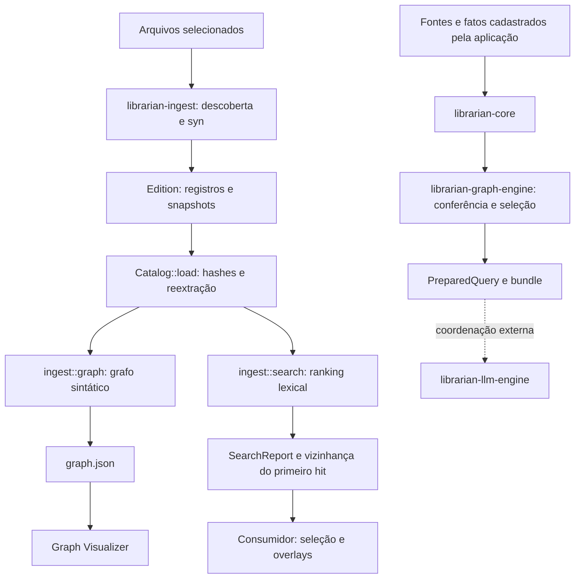

# Librarian: diagnóstico e plano de evolução

Data: 27/09/2026.

**Status: ETAPA 1 concluída. Plano validado pelo usuário em 19/10/2026; somente a ETAPA 2 (2A regressão v1 e 2B abstração do extractor Rust) está autorizada. As etapas seguintes dependem de nova validação.**

Este documento preserva a análise da arquitetura atual e o plano incremental para extração multilinguagem e evolução do Graph Visualizer. O código existente é a referência do diagnóstico; as propostas abaixo ainda não representam capacidades implementadas.

## Princípios preservados

- Evidência não é conclusão.
- Toda aresta deve permitir responder: “Qual evidência autorizou esta ligação?”.
- Hash comprova consistência, não autenticidade.
- Código descreve estrutura/procedimento; não prova execução.
- `#[test]` observado não comprova que um teste foi executado.
- Graph Engine testa/relaciona sem explicar; LLM Engine explica sem extrapolar as evidências.
- Mais contexto não implica mais certeza.
- Referência sintática, candidato por nome e resolução comprovada permanecem distintos.
- O viewer projeta relações existentes; proximidade visual não cria relações.
- Librarian não conhece os domínios de Renderer, xadrez ou outros consumidores.

## Leitura e verificação realizadas

Foram examinados README.md, TESTME.md, Cargo.toml do workspace, contratos e implementação de librarian-core, librarian-ingest e librarian-graph-engine, incluindo cli.rs, extract.rs, graph.rs, search.rs e lib.rs; testes, exemplos e documentação dos formatos; e a fronteira do librarian-llm-engine.

Foram lidos integralmente os seis arquivos do viewer: README.md, INTEGRATION.md, package.json, index.html, src/main.js e src/style.css. Também foram consultados o produtor do trace no PLAYME do checkout vizinho e um grafo real do consumidor.

Baseline executada:

```sh
cargo test --workspace --locked --offline
```

Resultado: **50 testes aprovados, zero falhas e um gravador de experimento ignorado**. Isso descreve essa execução, não prova geral de ausência de defeitos.

Não houve alteração de código durante o diagnóstico. As alterações locais preexistentes foram preservadas. Não foi executada uma sessão interativa do viewer no navegador; o erro de carregamento descrito abaixo foi reproduzido isoladamente com Node.js.

## 1. Arquitetura real existente

Há dois fluxos distintos:



**O grafo de código está em librarian-ingest/src/graph.rs, não no crate librarian-graph-engine.**

| Parte | Responsabilidade atual |
| --- | --- |
| librarian-core | Contratos de fatos, fontes textuais, seleções e dossiês. |
| librarian-graph-engine | Validação de dossiês, referências, arquivos, capturas e exportação de PreparedQuery. |
| librarian-ingest | Descoberta, snapshots, extração Rust, editions, verifier, grafo sintático e busca. |
| librarian-llm-engine | Preparação e transporte Ollama; não extrai estrutura nem valida semanticamente respostas. |
| tools/graph-visualizer | Protótipo WebGL independente do workspace Cargo. |

Existem conceitos distintos chamados Source e Evidence nos contratos de dossiês e nos registros de ingestão/proveniência. Não devem ser unificados apenas por semelhança de nomes.

A documentação principal conduz ao Renderer. Esse acoplamento está no roteiro de uso: ingestão e busca já recebem caminhos e vocabulário como argumentos. A ponte automática entre recuperação de código e PreparedQuery permanece pendente.

## 2. Garantias atuais das editions

Em [lib.rs](crates/librarian-ingest/src/lib.rs), generate:

- Descobre entradas ordenadas e deduplicadas.
- Lê cada fonte e preserva seus bytes.
- Produz sources.jsonl, symbols.jsonl, chunks.jsonl e diagnostics.json.
- Deduplica snapshots pelo hash do conteúdo.
- Publica manifest.json por último e recusa destino existente.

O modelo preserva caminho, identidade da fonte, linguagem, SHA-256, tamanho, intervalos de bytes e linhas, hash do chunk e snapshot original.

Catalog::load reexecuta a extração sobre os snapshots e compara símbolos, chunks e diagnósticos, além de conferir hashes e metadados. A verificação histórica não precisa do projeto original.

Limites: não há snapshot atômico do repositório, autenticação de autoria, prova de execução ou garantia de completude quando há diagnósticos.

Detalhes de compatibilidade:

- Bytes começam em zero, com fim exclusivo; linhas começam em um, com fim inclusivo.
- Símbolo e chunk correspondente têm hoje o mesmo ID, em coleções diferentes.
- IDs incluem identidade da Source e intervalo; não representam continuidade histórica automática.
- Metadados Git podem mudar independentemente dos registros de conteúdo.

## 3. Acoplamentos de Rust

| Local | Acoplamento observado |
| --- | --- |
| lib.rs / walk | Diretórios contribuem somente .rs; arquivos explícitos podem ser auxiliares. Não há exclusões internas. |
| source | Classifica apenas rust ou auxiliary. |
| generate e Catalog::load | Extraem somente quando language == rust. |
| Manifest, EXTRACTOR e limits | Identidade global do extractor e limites específicos de macros/cfg. |
| extract.rs | AST/visitor de syn; spans de proc-macro2; BOM/shebang; escopo com ::. |
| Symbol | is_test significa presença literal de #[test]; qualified_name é escopo sintático local. |
| graph.rs | rust-syntax-graph-v1, novo parsing por syn e observer Rust. |
| Observer | Tipos, retornos, chamadas e bindings definidos por AST Rust; candidatos limitados a struct, enum, trait, type e union. |
| search.rs | Exclui module/impl do ranking, penaliza is_test e descreve limites de macros/cfg. |
| Graph Engine de dossiês | Tratamento de kind == rust_source para omitir alegações de execução; é outro contrato. |
| Viewer | Convenções de ID, fallback .rs e exemplos de interface específicos do Renderer. |

A CLI é principalmente orquestração. O executável atual é librarian_ingest; generate exige raiz, configuração e destino. O comando simplificado librarian generate projeto ainda não existe.

O extractor Rust usa span.byte_range(), com compensação de BOM/shebang. Não deve ser substituído por busca textual de offsets.

O grafo distingue corretamente:

- declares e contains: structural;
- tipos, chamadas, retornos e bindings observados: syntax_only;
- correspondências entre nomes de tipos: name_candidate.

Chamadas observadas não são ligadas a destinos presumidos. Candidatos homônimos podem existir entre arquivos, mas não representam resolução de imports ou tipos.

## 4. Diagnóstico do viewer existente

A implementação contém Three.js, WebGL, iluminação, OrbitControls, layout com d3-force-3d, File API, busca textual com destaque, filtros de categorias, centralização, limpeza de seleção, raycasting de nós, painel lateral e alternadores de trace/E1.

O layout executa 320 ticks sincronamente e para. O movimento posterior é rotação discreta do conjunto e pulsação dos nós, não uma simulação de forças contínua.

### Incompatibilidade bloqueante

O Rust serializa nodes como objeto indexado por ID. O viewer executa:

```js
(state.graph.nodes ?? []).map(enrichNode)
```

Contra o grafo real de renderer/ai/consultas/policy-camera-20260927-02, com **8.656 nós e 9.837 arestas**, a expressão falhou com `map is not a function`. A presença das funcionalidades no código não demonstra funcionamento de ponta a ponta com a saída atual.

### Outros pontos

| Área | Estado real |
| --- | --- |
| Entrada | Somente graph.json é obrigatório no código; JSONL e overlays são opcionais. A interface anuncia pasta PLAYME. |
| Localização | Primeira correspondência por nome/sufixo; pode misturar execuções numa pasta maior. |
| Trace | Associação por labels e kind, ignorando resolução/evidência na identificação; homônimos podem ser destacados indevidamente. |
| E1 | Usa symbol_id, mas também faz associação por nome/caminho, mesmo havendo ID; pode destacar vários símbolos. |
| Chunks | Tenta criar nós/arestas sintéticos, mas os IDs coincidentes com símbolos fazem os chunks serem pulados. |
| Arestas | Não há seleção ou painel de inspeção. |
| Inspeção | Faltam language/byte_len, vínculo completo com chunk, evidência de occurrence e score/motivos de E1. |
| Filtros | Não há filtro por tipo de aresta ou resolution. |
| Trace visual | Destaca participantes, mas não atenua especificamente os nós restantes. |
| Navegação | Há centralização global; falta foco no nó selecionado. |
| Performance | Esfera/material por nó, linha/material por aresta, layout síncrono e buscas repetidas com find. |
| Verificação | Não verifica edition nem vínculo de catálogo dos overlays. |

As arestas sintéticas têm synthetic: true, mas também resolution: structural. Isso precisa ser corrigido, mesmo que a colisão de IDs impeça seu uso normal atual.

Reaproveitar: cena, câmera, controles, File API, base do layout, identidade visual, HUD e interação.

Refatorar: carregamento/validação, normalização dos contratos, índices, identidade de overlays, inspeção e representação WebGL em lotes. Não há justificativa para iniciar outro viewer.

## 5. Contrato principal e overlays

graph.json é suficiente como contrato principal inicial de nós, relações e evidências de arestas. O viewer deve funcionar sem PLAYME, pergunta ou Ollama.

Limitações atuais:

- Node contém somente id, kind e label.
- kind mistura categoria e subtipo: source, struct, method, call_observed.
- Metadados completos exigem os JSONL.
- Evidência de occurrence está nas arestas.
- Arestas não têm ID próprio.

Proposta: adapter de rust-syntax-graph-v1 e, em versão nova, category separada de kind:

```text
category: source | symbol | occurrence | chunk
kind: class | method | type_reference | ...
```

IDs são opacos. Identidade determinística de aresta deve considerar endpoints, tipo, resolução e evidência.

Chunks começam como registros de inspeção associados, sem arestas sintéticas. A camada de nós exige identidade distinta e contrato explícito; chunk_id não deve virar silenciosamente uma relação do grafo.

### Trace do PLAYME

O produtor atual substitui IDs por labels e preserva apenas tipo, resolução, caminho e linha inicial. Essa perda foi conferida no PLAYME.ps1 do checkout vizinho.

search.json já contém graph.nodes, graph.edges e catalog_sha256. Ordem proposta:

1. Usar a vizinhança com IDs para destaque exato.
2. Suportar trace legado somente quando a correspondência for inequívoca.
3. Informar ambiguidades sem promover candidatos a participantes comprovados.
4. Propor posteriormente um overlay versionado com IDs e identidade do catálogo.

E1 é política opcional do adapter PLAYME, baseada em hits[0], não propriedade obrigatória do grafo. Metadados ausentes não serão inventados.

## 6. Fronteira proposta dos extractors

Introduzir primeiro módulos internos em librarian-ingest, preservando caminhos públicos:

```text
discovery / language registry
             ↓
Extractor
├── Rust: syn
├── Python: Tree-sitter
├── Java: Tree-sitter
├── TypeScript / TSX: Tree-sitter
├── JavaScript / JSX: Tree-sitter
└── HTML: Tree-sitter, capacidades delimitadas
             ↓
Extraction
  symbols / chunks / diagnostics
  occurrences / structural references
             ↓
edition → verified Catalog → graph builder → search
```

Contrato conceitual, ainda não implementado:

```rust,ignore
trait Extractor {
    fn descriptor(&self) -> ExtractorDescriptor;
    fn extract(&self, source: &Source, bytes: &[u8]) -> Extraction;
}
```

Regras:

- Nenhum tipo syn ou Tree-sitter sai do adapter.
- Extractor não lê outros arquivos por conta própria.
- Geração e verificação usam o mesmo registry versionado.
- Hashes e evidências vêm dos bytes preservados.
- Referências por nome e referências explícitas a arquivos são distintas.
- Builder aplica regras documentadas às observações verificadas.
- Candidatos não devem criar correspondências acidentais entre linguagens em projetos mistos.
- O observer Rust hoje em graph.rs entra nessa fronteira; abstrair só extract.rs seria insuficiente.

Manter inicialmente os módulos no ingest. Transferir tipos para librarian-core::catalog ou mover o grafo entre crates é uma etapa posterior, com reexports de compatibilidade e análise de dependências.

### Taxonomia

Preservar valores Rust na compatibilidade v1. Acrescentar somente tipos necessários, como class, interface, constructor, field e template.

Para Angular, preferir kind: class e papéis/decorators observados com evidência, sem apagar a identidade estrutural da classe.

is_test permanece no legado. No modelo novo, registrar explicitamente marcadores observados; falta de suporte não deve ser confundida com comprovação de que algo não é teste.

## 7. Tree-sitter e segunda linguagem

| Opção | Avaliação |
| --- | --- |
| Rust com syn; novos adapters com Tree-sitter | Recomendada: preserva spans, diagnósticos, IDs e comportamento Rust já testados. |
| Migração futura de tudo para Tree-sitter | Pode uniformizar infraestrutura, mas muda potencialmente spans, comentários, recuperação de erros e registros. Exige nova identidade e comparação extensa. |

Tree-sitter fornece posições em bytes e coordenadas de linhas. Sua recuperação pode produzir ERROR e MISSING; uma árvore não comprova parsing completo. Referências oficiais: [posições](https://tree-sitter.github.io/tree-sitter/using-parsers/2-basic-parsing.html) e [erros](https://tree-sitter.github.io/tree-sitter/using-parsers/queries/1-syntax.html).

Proposta inicial conservadora: preservar bytes e diagnosticar erro, sem publicar extração parcial como completa. Fixar e registrar runtime, gramáticas e regras do adapter.

**Python é a segunda linguagem proposta**: class, função e método testam a fronteira sem começar por framework ou resolução de pacotes. Não classificar testes por test_* nem inferir atributos dinâmicos ou destinos de chamadas.

Depois: Java; TypeScript/JavaScript; Angular/HTML. TypeScript e TSX exigem seleção explícita de gramática: [gramáticas oficiais](https://github.com/tree-sitter/tree-sitter-typescript).

## 8. Angular e templates

Angular será uma capacidade do adapter TypeScript, não uma linguagem independente.

- Preservar imports, decorators, classes, métodos e funções.
- Distinguir nome Component de associação sintática a import explícito de @angular/core.
- Suportar aliases apenas com mecanismo local implementado e testado.
- Não atribuir service por sufixo de nome; registrar Injectable sem afirmar registro ou execução de DI.
- Não resolver reexports, aliases de caminhos ou expressões computadas implicitamente.

Para templateUrl literal, registrar o valor e sua evidência. Regra posterior poderá resolver esse caminho explícito relativamente à Source, contra fontes presentes na edition. Isso autoriza referência a recurso, não prova compilação Angular. Arquivo ausente gera referência observada e diagnóstico, sem destino inventado.

Template inline deve apontar ao intervalo original do literal. Parsing de conteúdo escapado exige mapeamento exato entre texto decodificado e bytes originais; não emitir ranges internos aproximados enquanto isso não existir.

Não presumir que gramática HTML cobre toda a sintaxe Angular. Bindings, expressões e controle de fluxo exigem capacidades/fixtures próprias. Não ligar automaticamente expressões de template a métodos.

Nomes semelhantes, como foo.component.ts e foo.component.html, não autorizam ligação.

## 9. Compatibilidade e versionamento

O verifier exige igualdade exata de schema_version, EXTRACTOR, limits, conjunto de arquivos e registros reextraídos.

Identidade atual:

```text
librarian-ingest/0.1.0;syn/3.0.5;rust-structural-v1
```

source() recalcula a linguagem. Adicionar .py à classificação atual pode invalidar uma edition antiga que preservou esse arquivo como auxiliary.

Plano:

1. Congelar perfil v1: descoberta, classificação, extractor Rust, limites, serialização e grafo.
2. Dispatcher por versão, sem tentar automaticamente o extractor mais recente.
3. Formato novo apenas quando entrar o contrato multilinguagem.
4. Separar versões de formato, pipeline, descoberta, adapters/gramáticas e algoritmo do grafo.
5. Manter verificação v1 e recusar explicitamente versões desconhecidas.
6. Não reescrever editions antigas para fazê-las passar.

compare_current deve usar a política da edition, para não reportar Java/Python como arquivos novos de uma seleção Rust histórica apenas porque o executável mudou.

catalog_sha256 vem da serialização do manifesto desserializado, não necessariamente dos bytes formatados de manifest.json. Converter v1 para um novo modelo antes de calcular esse hash pode quebrar grafos e buscas antigos.

### Descoberta nova

Registry explícito para .rs, .java, .py, .ts, .tsx, .js, .jsx e .html. Arquivos explícitos desconhecidos continuam auxiliares.

Proposta de exclusões padrão por componente de diretório: node_modules, dist, build, coverage, target, .git, .venv e __pycache__. Documentar e registrar a política versionada e suas exceções explícitas. Não alterar silenciosamente a descoberta v1.

## 10. Plano incremental

| Etapa | Mudança | Critério de saída |
| --- | --- | --- |
| 2A — regressão | Fixtures históricas v1, incluindo auxiliar com extensão futuramente suportada. | Mesmos bytes históricos aceitos; adulterações rejeitadas. |
| 2B — abstração Rust | Contrato/registry e encapsulamento de extractor e observer. | Mesmos registros, IDs, grafo e ranking; suíte atual passando; nenhuma linguagem nova. |
| 3A — Python | Formato multilinguagem e adapter mínimo. | Classes/funções/métodos, ranges, hashes, determinismo e reextração sem projeto original. |
| 3B — Java | Adapter de classes, campos, métodos e construtores. | Mesma bateria contratual, sem resolução presumida. |
| 4 — TS/JS e Angular/HTML | Adapters, decorators e referências explícitas. | Testes positivos/negativos de imports, aliases e templates; nenhuma ligação por convenção. |
| 5A — viewer básico | graph.json, identidade, seleção de arestas e filtros. | Grafo sozinho abre; aresta mostra sua evidência. |
| 5B — enriquecimento | Metadados de edition associados por IDs. | Painéis completos; ausência de informação explícita. |
| 5C — overlays | Trace/E1 opcionais e identidade conferida. | Homônimos e catálogos divergentes não recebem destaque indevido. |
| 6 — documentação | Roteiro independente, exemplos e guia de adapters. | Uso não exige Renderer/PLAYME. |

### Arquivos previstos

- crates/librarian-ingest/src/lib.rs: geração, verifier e compatibilidade.
- extract.rs → extractors/mod.rs, extractors/rust.rs e adapters posteriores.
- Novos módulos de linguagem, descoberta e formato versionado.
- graph.rs: separar observação de montagem do grafo.
- search.rs: preservar política v1 e explicitar políticas novas.
- cli.rs: despacho/documentação, preservando comandos.
- Cargo.toml do ingest e Cargo.lock: dependências na etapa pertinente.
- tests/editions.rs e novas fixtures históricas e por linguagem.
- tools/graph-visualizer/src/main.js: dividir carregamento, modelo, overlays, cena e inspeção.
- HTML, CSS, package e documentação do viewer.
- README, TESTME, WORKFLOW e referências técnicas da ingestão.

### Performance do viewer

Direção proposta: InstancedMesh para nós e LineSegments/buffers para arestas, com mapas para seleção. Layout em worker ou lotes para evitar bloqueio da interface. O grafo real examinado já justifica evitar milhares de objetos e materiais individuais. DOM permanece para HUD e painel.

### Regressões e aceitação

Fixtures mínimas:

- Rust: struct, impl, method.
- Java: class, field, method.
- Python: class, function, method.
- TypeScript: class, interface, function, method.
- Angular: Component, templateUrl explícito, método e template.
- JavaScript/JSX, TSX e HTML: cobertura própria das capacidades declaradas.

Para cada linguagem: Source/Symbol corretos, bytes/linhas exatos, hashes, relações estruturais, reextração pelo verifier e determinismo.

Além disso: Unicode/CRLF, erros de parser, ranges adulterados com hashes recalculados, projeto original removido, homônimos, templates ausentes/computados, arquivos de nomes semelhantes sem referência e compatibilidade de editions/grafos v1.

No viewer: grafos reais e fixtures de contrato, ausência de overlays, metadados opcionais, seleção de arestas, ambiguidades e divergência de catálogo. A contagem de arestas exibíveis deve corresponder exclusivamente às arestas importadas, sem relações fabricadas.

### Documentação a entregar

Formatos e linguagens suportados; limites/capacidades de cada extractor; relações sintáticas e candidates; ausência de resolução; execução do viewer; abertura opcional de PLAYME; e processo de extensão:

1. Implementar Extractor.
2. Registrar extensões.
3. Criar fixtures e testes contratuais.
4. Registrar capacidades, limites e versão.

## ETAPA 2 — resultado (19/10/2026)

**2A.** Edition v1 congelada em `crates/librarian-ingest/tests/fixtures/v1`, gerada uma única vez pelo código anterior à refatoração e commitada antes de qualquer mudança em `src/`. Goldens de grafo e de três buscas, incluindo uma com símbolo `#[test]`. `tests/v1_regression.rs` cobre aceitação, reextração byte a byte, classificação/descoberta v1 (`.py` explícito como `auxiliary`, `.py` em diretório não descoberto), `nodes` como objeto e seis adulterações. Mutações manuais no grafo, na penalidade de teste e na taxonomia foram detectadas e revertidas.

**2B.** `extract.rs` virou `extractors/rust.rs` (declarações e ocorrências, únicos usuários de `syn`). `extractors/mod.rs` define `Extractor`, `Extraction`, `Occurrence` e `Registry`. O perfil v1 congelado reúne identidade, extensões, extractors e limits. `generate` usa o perfil atual; `Catalog::load` usa o perfil da identidade gravada e recusa as desconhecidas; `compare_current` usa a descoberta da edition. `graph.rs` só monta o grafo a partir das ocorrências; os tipos candidatos vêm do extractor. `search.rs` apenas marca a política v1. A API pública não mudou.

Verificação: fixtures e goldens da 2A sem alteração; `cargo test --workspace --locked --offline` com 72 aprovados e 1 ignorado; clippy do ingest sem avisos; `catalog_sources` do renderer com 3 aprovados e `prepare_ollama`/`send_ollama`/`explain_evidence` passando em `cargo check`. Isso descreve essas execuções, não prova ausência geral de defeitos.

Ainda não feito, de propósito: filtro de candidatos por linguagem (sem efeito na v1, necessário na 3A), formato multilinguagem, `category`, política de exclusões e Tree-sitter.

## Roteiro validado em 19/10/2026: fechar o Graph Engine sem linguagem

O Graph Engine é tudo o que testa e relaciona sem explicar: catalog, grafo, busca e dossiês. Linguagem entra somente por extractors e perfis do registry. Ordem: **G1 → G2 → G3 → G5 → G4**, seguida dos limites do LLM Engine (fase L).

| Passo | Mudança | Critério de saída |
| --- | --- | --- |
| G1 | Política de linguagem sai de grafo e busca para extractor/perfil; candidatos restritos à mesma linguagem | Fixture v1 intacta; `tests/agnostic.rs` sem nomes de linguagem em `graph.rs`/`search.rs` |
| G2 | Contrato neutro do grafo em formato novo: `category` separada de `kind`, ID de aresta, taxonomia neutra; v1 lida como hoje | Grafo v1 idêntico; grafo novo derivável sem nomes de linguagem |
| G3 | Engine de dossiês sem `rust_source`: propriedade declarada da fonte (código não comprova execução) | Testes de dossiê sem strings de linguagem |
| G5 | Python como prova da fronteira (antiga 3A) | Adicionar Python altera só `extractors/`, registry e fixtures |
| G4 | Ponte busca → dossiê/`PreparedQuery` | PLAYME envia bundle verificável em vez de envelope manual |

### G1 — resultado (19/10/2026)

O registry v1 passou a declarar `graph_version` (`rust-syntax-graph-v1`) e `search_limits` (texto com macros/cfg). Cada extractor declara `navigation_kinds` (Rust: `module`, `impl`), que a busca não ranqueia. A penalidade de marcador de teste continua genérica sobre o campo `is_test` do registro v1. Candidatos por nome passaram a exigir a mesma linguagem da ocorrência: na v1 isso não tem efeito, e será exercitado pela fixture mista do G5.

Verificação: fixture e goldens v1 sem alteração; suíte do workspace com 73 testes aprovados e 1 ignorado; clippy sem avisos; `catalog_sources` do renderer com 3 aprovados. `tests/agnostic.rs` passa no código novo e falha no anterior (`graph.rs mentions "rust"`).

O teste de fronteira cobre só nomes e sintaxe conhecidos; ele não prova ausência de suposições implícitas de linguagem, por exemplo na forma das ocorrências.
