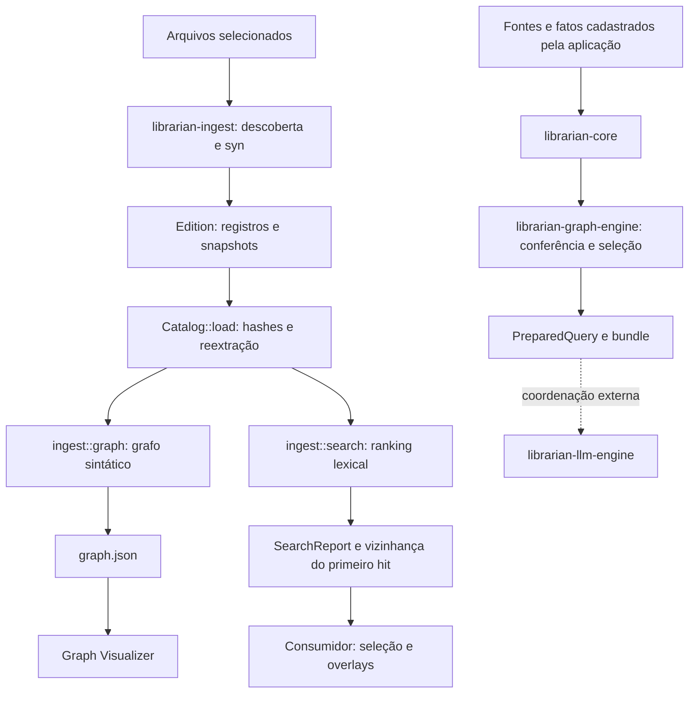

# Librarian: diagnóstico e plano de evolução

Data: 27/09/2026.

**Status: ETAPA 1 concluída. Plano validado pelo usuário em 19/10/2026; somente a ETAPA 2 (2A regressão v1 e 2B abstração do extractor Rust) está autorizada. As etapas seguintes dependem de nova validação.**

Este documento preserva a análise da arquitetura atual e o plano incremental para extração multilinguagem e evolução do Graph Visualizer. O código existente é a referência do diagnóstico; as propostas abaixo ainda não representam capacidades implementadas.

## Princípios preservados

- Evidência não é conclusão.
- Toda aresta deve permitir responder: “Qual evidência autorizou esta ligação?”.
- Hash comprova consistência, não autenticidade.
- Código descreve estrutura/procedimento; não prova execução.
- `#[test]` observado não comprova que um teste foi executado.
- Graph Engine testa/relaciona sem explicar; LLM Engine explica sem extrapolar as evidências.
- Mais contexto não implica mais certeza.
- Referência sintática, candidato por nome e resolução comprovada permanecem distintos.
- O viewer projeta relações existentes; proximidade visual não cria relações.
- Librarian não conhece os domínios de Renderer, xadrez ou outros consumidores.

## Leitura e verificação realizadas

Foram examinados README.md, TESTME.md, Cargo.toml do workspace, contratos e implementação de librarian-core, librarian-ingest e librarian-graph-engine, incluindo cli.rs, extract.rs, graph.rs, search.rs e lib.rs; testes, exemplos e documentação dos formatos; e a fronteira do librarian-llm-engine.

Foram lidos integralmente os seis arquivos do viewer: README.md, INTEGRATION.md, package.json, index.html, src/main.js e src/style.css. Também foram consultados o produtor do trace no PLAYME do checkout vizinho e um grafo real do consumidor.

Baseline executada:

```sh
cargo test --workspace --locked --offline
```

Resultado: **50 testes aprovados, zero falhas e um gravador de experimento ignorado**. Isso descreve essa execução, não prova geral de ausência de defeitos.

Não houve alteração de código durante o diagnóstico. As alterações locais preexistentes foram preservadas. Não foi executada uma sessão interativa do viewer no navegador; o erro de carregamento descrito abaixo foi reproduzido isoladamente com Node.js.

## 1. Arquitetura real existente

Há dois fluxos distintos:



**O grafo de código está em librarian-ingest/src/graph.rs, não no crate librarian-graph-engine.**

| Parte | Responsabilidade atual |
| --- | --- |
| librarian-core | Contratos de fatos, fontes textuais, seleções e dossiês. |
| librarian-graph-engine | Validação de dossiês, referências, arquivos, capturas e exportação de PreparedQuery. |
| librarian-ingest | Descoberta, snapshots, extração Rust, editions, verifier, grafo sintático e busca. |
| librarian-llm-engine | Preparação e transporte Ollama; não extrai estrutura nem valida semanticamente respostas. |
| tools/graph-visualizer | Protótipo WebGL independente do workspace Cargo. |

Existem conceitos distintos chamados Source e Evidence nos contratos de dossiês e nos registros de ingestão/proveniência. Não devem ser unificados apenas por semelhança de nomes.

A documentação principal conduz ao Renderer. Esse acoplamento está no roteiro de uso: ingestão e busca já recebem caminhos e vocabulário como argumentos. A ponte automática entre recuperação de código e PreparedQuery permanece pendente.

## 2. Garantias atuais das editions

Em [lib.rs](crates/librarian-ingest/src/lib.rs), generate:

- Descobre entradas ordenadas e deduplicadas.
- Lê cada fonte e preserva seus bytes.
- Produz sources.jsonl, symbols.jsonl, chunks.jsonl e diagnostics.json.
- Deduplica snapshots pelo hash do conteúdo.
- Publica manifest.json por último e recusa destino existente.

O modelo preserva caminho, identidade da fonte, linguagem, SHA-256, tamanho, intervalos de bytes e linhas, hash do chunk e snapshot original.

Catalog::load reexecuta a extração sobre os snapshots e compara símbolos, chunks e diagnósticos, além de conferir hashes e metadados. A verificação histórica não precisa do projeto original.

Limites: não há snapshot atômico do repositório, autenticação de autoria, prova de execução ou garantia de completude quando há diagnósticos.

Detalhes de compatibilidade:

- Bytes começam em zero, com fim exclusivo; linhas começam em um, com fim inclusivo.
- Símbolo e chunk correspondente têm hoje o mesmo ID, em coleções diferentes.
- IDs incluem identidade da Source e intervalo; não representam continuidade histórica automática.
- Metadados Git podem mudar independentemente dos registros de conteúdo.

## 3. Acoplamentos de Rust

| Local | Acoplamento observado |
| --- | --- |
| lib.rs / walk | Diretórios contribuem somente .rs; arquivos explícitos podem ser auxiliares. Não há exclusões internas. |
| source | Classifica apenas rust ou auxiliary. |
| generate e Catalog::load | Extraem somente quando language == rust. |
| Manifest, EXTRACTOR e limits | Identidade global do extractor e limites específicos de macros/cfg. |
| extract.rs | AST/visitor de syn; spans de proc-macro2; BOM/shebang; escopo com ::. |
| Symbol | is_test significa presença literal de #[test]; qualified_name é escopo sintático local. |
| graph.rs | rust-syntax-graph-v1, novo parsing por syn e observer Rust. |
| Observer | Tipos, retornos, chamadas e bindings definidos por AST Rust; candidatos limitados a struct, enum, trait, type e union. |
| search.rs | Exclui module/impl do ranking, penaliza is_test e descreve limites de macros/cfg. |
| Graph Engine de dossiês | Tratamento de kind == rust_source para omitir alegações de execução; é outro contrato. |
| Viewer | Convenções de ID, fallback .rs e exemplos de interface específicos do Renderer. |

A CLI é principalmente orquestração. O executável atual é librarian_ingest; generate exige raiz, configuração e destino. O comando simplificado librarian generate projeto ainda não existe.

O extractor Rust usa span.byte_range(), com compensação de BOM/shebang. Não deve ser substituído por busca textual de offsets.

O grafo distingue corretamente:

- declares e contains: structural;
- tipos, chamadas, retornos e bindings observados: syntax_only;
- correspondências entre nomes de tipos: name_candidate.

Chamadas observadas não são ligadas a destinos presumidos. Candidatos homônimos podem existir entre arquivos, mas não representam resolução de imports ou tipos.

## 4. Diagnóstico do viewer existente

A implementação contém Three.js, WebGL, iluminação, OrbitControls, layout com d3-force-3d, File API, busca textual com destaque, filtros de categorias, centralização, limpeza de seleção, raycasting de nós, painel lateral e alternadores de trace/E1.

O layout executa 320 ticks sincronamente e para. O movimento posterior é rotação discreta do conjunto e pulsação dos nós, não uma simulação de forças contínua.

### Incompatibilidade bloqueante

O Rust serializa nodes como objeto indexado por ID. O viewer executa:

```js
(state.graph.nodes ?? []).map(enrichNode)
```

Contra o grafo real de renderer/ai/consultas/policy-camera-20260927-02, com **8.656 nós e 9.837 arestas**, a expressão falhou com `map is not a function`. A presença das funcionalidades no código não demonstra funcionamento de ponta a ponta com a saída atual.

### Outros pontos

| Área | Estado real |
| --- | --- |
| Entrada | Somente graph.json é obrigatório no código; JSONL e overlays são opcionais. A interface anuncia pasta PLAYME. |
| Localização | Primeira correspondência por nome/sufixo; pode misturar execuções numa pasta maior. |
| Trace | Associação por labels e kind, ignorando resolução/evidência na identificação; homônimos podem ser destacados indevidamente. |
| E1 | Usa symbol_id, mas também faz associação por nome/caminho, mesmo havendo ID; pode destacar vários símbolos. |
| Chunks | Tenta criar nós/arestas sintéticos, mas os IDs coincidentes com símbolos fazem os chunks serem pulados. |
| Arestas | Não há seleção ou painel de inspeção. |
| Inspeção | Faltam language/byte_len, vínculo completo com chunk, evidência de occurrence e score/motivos de E1. |
| Filtros | Não há filtro por tipo de aresta ou resolution. |
| Trace visual | Destaca participantes, mas não atenua especificamente os nós restantes. |
| Navegação | Há centralização global; falta foco no nó selecionado. |
| Performance | Esfera/material por nó, linha/material por aresta, layout síncrono e buscas repetidas com find. |
| Verificação | Não verifica edition nem vínculo de catálogo dos overlays. |

As arestas sintéticas têm synthetic: true, mas também resolution: structural. Isso precisa ser corrigido, mesmo que a colisão de IDs impeça seu uso normal atual.

Reaproveitar: cena, câmera, controles, File API, base do layout, identidade visual, HUD e interação.

Refatorar: carregamento/validação, normalização dos contratos, índices, identidade de overlays, inspeção e representação WebGL em lotes. Não há justificativa para iniciar outro viewer.

## 5. Contrato principal e overlays

graph.json é suficiente como contrato principal inicial de nós, relações e evidências de arestas. O viewer deve funcionar sem PLAYME, pergunta ou Ollama.

Limitações atuais:

- Node contém somente id, kind e label.
- kind mistura categoria e subtipo: source, struct, method, call_observed.
- Metadados completos exigem os JSONL.
- Evidência de occurrence está nas arestas.
- Arestas não têm ID próprio.

Proposta: adapter de rust-syntax-graph-v1 e, em versão nova, category separada de kind:

```text
category: source | symbol | occurrence | chunk
kind: class | method | type_reference | ...
```

IDs são opacos. Identidade determinística de aresta deve considerar endpoints, tipo, resolução e evidência.

Chunks começam como registros de inspeção associados, sem arestas sintéticas. A camada de nós exige identidade distinta e contrato explícito; chunk_id não deve virar silenciosamente uma relação do grafo.

### Trace do PLAYME

O produtor atual substitui IDs por labels e preserva apenas tipo, resolução, caminho e linha inicial. Essa perda foi conferida no PLAYME.ps1 do checkout vizinho.

search.json já contém graph.nodes, graph.edges e catalog_sha256. Ordem proposta:

1. Usar a vizinhança com IDs para destaque exato.
2. Suportar trace legado somente quando a correspondência for inequívoca.
3. Informar ambiguidades sem promover candidatos a participantes comprovados.
4. Propor posteriormente um overlay versionado com IDs e identidade do catálogo.

E1 é política opcional do adapter PLAYME, baseada em hits[0], não propriedade obrigatória do grafo. Metadados ausentes não serão inventados.

## 6. Fronteira proposta dos extractors

Introduzir primeiro módulos internos em librarian-ingest, preservando caminhos públicos:

```text
discovery / language registry
             ↓
Extractor
├── Rust: syn
├── Python: Tree-sitter
├── Java: Tree-sitter
├── TypeScript / TSX: Tree-sitter
├── JavaScript / JSX: Tree-sitter
└── HTML: Tree-sitter, capacidades delimitadas
             ↓
Extraction
  symbols / chunks / diagnostics
  occurrences / structural references
             ↓
edition → verified Catalog → graph builder → search
```

Contrato conceitual, ainda não implementado:

```rust,ignore
trait Extractor {
    fn descriptor(&self) -> ExtractorDescriptor;
    fn extract(&self, source: &Source, bytes: &[u8]) -> Extraction;
}
```

Regras:

- Nenhum tipo syn ou Tree-sitter sai do adapter.
- Extractor não lê outros arquivos por conta própria.
- Geração e verificação usam o mesmo registry versionado.
- Hashes e evidências vêm dos bytes preservados.
- Referências por nome e referências explícitas a arquivos são distintas.
- Builder aplica regras documentadas às observações verificadas.
- Candidatos não devem criar correspondências acidentais entre linguagens em projetos mistos.
- O observer Rust hoje em graph.rs entra nessa fronteira; abstrair só extract.rs seria insuficiente.

Manter inicialmente os módulos no ingest. Transferir tipos para librarian-core::catalog ou mover o grafo entre crates é uma etapa posterior, com reexports de compatibilidade e análise de dependências.

### Taxonomia

Preservar valores Rust na compatibilidade v1. Acrescentar somente tipos necessários, como class, interface, constructor, field e template.

Para Angular, preferir kind: class e papéis/decorators observados com evidência, sem apagar a identidade estrutural da classe.

is_test permanece no legado. No modelo novo, registrar explicitamente marcadores observados; falta de suporte não deve ser confundida com comprovação de que algo não é teste.

## 7. Tree-sitter e segunda linguagem

| Opção | Avaliação |
| --- | --- |
| Rust com syn; novos adapters com Tree-sitter | Recomendada: preserva spans, diagnósticos, IDs e comportamento Rust já testados. |
| Migração futura de tudo para Tree-sitter | Pode uniformizar infraestrutura, mas muda potencialmente spans, comentários, recuperação de erros e registros. Exige nova identidade e comparação extensa. |

Tree-sitter fornece posições em bytes e coordenadas de linhas. Sua recuperação pode produzir ERROR e MISSING; uma árvore não comprova parsing completo. Referências oficiais: [posições](https://tree-sitter.github.io/tree-sitter/using-parsers/2-basic-parsing.html) e [erros](https://tree-sitter.github.io/tree-sitter/using-parsers/queries/1-syntax.html).

Proposta inicial conservadora: preservar bytes e diagnosticar erro, sem publicar extração parcial como completa. Fixar e registrar runtime, gramáticas e regras do adapter.

**Python é a segunda linguagem proposta**: class, função e método testam a fronteira sem começar por framework ou resolução de pacotes. Não classificar testes por test_* nem inferir atributos dinâmicos ou destinos de chamadas.

Depois: Java; TypeScript/JavaScript; Angular/HTML. TypeScript e TSX exigem seleção explícita de gramática: [gramáticas oficiais](https://github.com/tree-sitter/tree-sitter-typescript).

## 8. Angular e templates

Angular será uma capacidade do adapter TypeScript, não uma linguagem independente.

- Preservar imports, decorators, classes, métodos e funções.
- Distinguir nome Component de associação sintática a import explícito de @angular/core.
- Suportar aliases apenas com mecanismo local implementado e testado.
- Não atribuir service por sufixo de nome; registrar Injectable sem afirmar registro ou execução de DI.
- Não resolver reexports, aliases de caminhos ou expressões computadas implicitamente.

Para templateUrl literal, registrar o valor e sua evidência. Regra posterior poderá resolver esse caminho explícito relativamente à Source, contra fontes presentes na edition. Isso autoriza referência a recurso, não prova compilação Angular. Arquivo ausente gera referência observada e diagnóstico, sem destino inventado.

Template inline deve apontar ao intervalo original do literal. Parsing de conteúdo escapado exige mapeamento exato entre texto decodificado e bytes originais; não emitir ranges internos aproximados enquanto isso não existir.

Não presumir que gramática HTML cobre toda a sintaxe Angular. Bindings, expressões e controle de fluxo exigem capacidades/fixtures próprias. Não ligar automaticamente expressões de template a métodos.

Nomes semelhantes, como foo.component.ts e foo.component.html, não autorizam ligação.

## 9. Compatibilidade e versionamento

O verifier exige igualdade exata de schema_version, EXTRACTOR, limits, conjunto de arquivos e registros reextraídos.

Identidade atual:

```text
librarian-ingest/0.1.0;syn/3.0.5;rust-structural-v1
```

source() recalcula a linguagem. Adicionar .py à classificação atual pode invalidar uma edition antiga que preservou esse arquivo como auxiliary.

Plano:

1. Congelar perfil v1: descoberta, classificação, extractor Rust, limites, serialização e grafo.
2. Dispatcher por versão, sem tentar automaticamente o extractor mais recente.
3. Formato novo apenas quando entrar o contrato multilinguagem.
4. Separar versões de formato, pipeline, descoberta, adapters/gramáticas e algoritmo do grafo.
5. Manter verificação v1 e recusar explicitamente versões desconhecidas.
6. Não reescrever editions antigas para fazê-las passar.

compare_current deve usar a política da edition, para não reportar Java/Python como arquivos novos de uma seleção Rust histórica apenas porque o executável mudou.

catalog_sha256 vem da serialização do manifesto desserializado, não necessariamente dos bytes formatados de manifest.json. Converter v1 para um novo modelo antes de calcular esse hash pode quebrar grafos e buscas antigos.

### Descoberta nova

Registry explícito para .rs, .java, .py, .ts, .tsx, .js, .jsx e .html. Arquivos explícitos desconhecidos continuam auxiliares.

Proposta de exclusões padrão por componente de diretório: node_modules, dist, build, coverage, target, .git, .venv e __pycache__. Documentar e registrar a política versionada e suas exceções explícitas. Não alterar silenciosamente a descoberta v1.

## 10. Plano incremental

| Etapa | Mudança | Critério de saída |
| --- | --- | --- |
| 2A — regressão | Fixtures históricas v1, incluindo auxiliar com extensão futuramente suportada. | Mesmos bytes históricos aceitos; adulterações rejeitadas. |
| 2B — abstração Rust | Contrato/registry e encapsulamento de extractor e observer. | Mesmos registros, IDs, grafo e ranking; suíte atual passando; nenhuma linguagem nova. |
| 3A — Python | Formato multilinguagem e adapter mínimo. | Classes/funções/métodos, ranges, hashes, determinismo e reextração sem projeto original. |
| 3B — Java | Adapter de classes, campos, métodos e construtores. | Mesma bateria contratual, sem resolução presumida. |
| 4 — TS/JS e Angular/HTML | Adapters, decorators e referências explícitas. | Testes positivos/negativos de imports, aliases e templates; nenhuma ligação por convenção. |
| 5A — viewer básico | graph.json, identidade, seleção de arestas e filtros. | Grafo sozinho abre; aresta mostra sua evidência. |
| 5B — enriquecimento | Metadados de edition associados por IDs. | Painéis completos; ausência de informação explícita. |
| 5C — overlays | Trace/E1 opcionais e identidade conferida. | Homônimos e catálogos divergentes não recebem destaque indevido. |
| 6 — documentação | Roteiro independente, exemplos e guia de adapters. | Uso não exige Renderer/PLAYME. |

### Arquivos previstos

- crates/librarian-ingest/src/lib.rs: geração, verifier e compatibilidade.
- extract.rs → extractors/mod.rs, extractors/rust.rs e adapters posteriores.
- Novos módulos de linguagem, descoberta e formato versionado.
- graph.rs: separar observação de montagem do grafo.
- search.rs: preservar política v1 e explicitar políticas novas.
- cli.rs: despacho/documentação, preservando comandos.
- Cargo.toml do ingest e Cargo.lock: dependências na etapa pertinente.
- tests/editions.rs e novas fixtures históricas e por linguagem.
- tools/graph-visualizer/src/main.js: dividir carregamento, modelo, overlays, cena e inspeção.
- HTML, CSS, package e documentação do viewer.
- README, TESTME, WORKFLOW e referências técnicas da ingestão.

### Performance do viewer

Direção proposta: InstancedMesh para nós e LineSegments/buffers para arestas, com mapas para seleção. Layout em worker ou lotes para evitar bloqueio da interface. O grafo real examinado já justifica evitar milhares de objetos e materiais individuais. DOM permanece para HUD e painel.

### Regressões e aceitação

Fixtures mínimas:

- Rust: struct, impl, method.
- Java: class, field, method.
- Python: class, function, method.
- TypeScript: class, interface, function, method.
- Angular: Component, templateUrl explícito, método e template.
- JavaScript/JSX, TSX e HTML: cobertura própria das capacidades declaradas.

Para cada linguagem: Source/Symbol corretos, bytes/linhas exatos, hashes, relações estruturais, reextração pelo verifier e determinismo.

Além disso: Unicode/CRLF, erros de parser, ranges adulterados com hashes recalculados, projeto original removido, homônimos, templates ausentes/computados, arquivos de nomes semelhantes sem referência e compatibilidade de editions/grafos v1.

No viewer: grafos reais e fixtures de contrato, ausência de overlays, metadados opcionais, seleção de arestas, ambiguidades e divergência de catálogo. A contagem de arestas exibíveis deve corresponder exclusivamente às arestas importadas, sem relações fabricadas.

### Documentação a entregar

Formatos e linguagens suportados; limites/capacidades de cada extractor; relações sintáticas e candidates; ausência de resolução; execução do viewer; abertura opcional de PLAYME; e processo de extensão:

1. Implementar Extractor.
2. Registrar extensões.
3. Criar fixtures e testes contratuais.
4. Registrar capacidades, limites e versão.

## ETAPA 2 — resultado (19/10/2026)

**2A.** Edition v1 congelada em `crates/librarian-ingest/tests/fixtures/v1`, gerada uma única vez pelo código anterior à refatoração e commitada antes de qualquer mudança em `src/`. Goldens de grafo e de três buscas, incluindo uma com símbolo `#[test]`. `tests/v1_regression.rs` cobre aceitação, reextração byte a byte, classificação/descoberta v1 (`.py` explícito como `auxiliary`, `.py` em diretório não descoberto), `nodes` como objeto e seis adulterações. Mutações manuais no grafo, na penalidade de teste e na taxonomia foram detectadas e revertidas.

**2B.** `extract.rs` virou `extractors/rust.rs` (declarações e ocorrências, únicos usuários de `syn`). `extractors/mod.rs` define `Extractor`, `Extraction`, `Occurrence` e `Registry`. O perfil v1 congelado reúne identidade, extensões, extractors e limits. `generate` usa o perfil atual; `Catalog::load` usa o perfil da identidade gravada e recusa as desconhecidas; `compare_current` usa a descoberta da edition. `graph.rs` só monta o grafo a partir das ocorrências; os tipos candidatos vêm do extractor. `search.rs` apenas marca a política v1. A API pública não mudou.

Verificação: fixtures e goldens da 2A sem alteração; `cargo test --workspace --locked --offline` com 72 aprovados e 1 ignorado; clippy do ingest sem avisos; `catalog_sources` do renderer com 3 aprovados e `prepare_ollama`/`send_ollama`/`explain_evidence` passando em `cargo check`. Isso descreve essas execuções, não prova ausência geral de defeitos.

Ainda não feito, de propósito: filtro de candidatos por linguagem (sem efeito na v1, necessário na 3A), formato multilinguagem, `category`, política de exclusões e Tree-sitter.

## Roteiro validado em 19/10/2026: fechar o Graph Engine sem linguagem

O Graph Engine é tudo o que testa e relaciona sem explicar: catalog, grafo, busca e dossiês. Linguagem entra somente por extractors e perfis do registry. Ordem: **G1 → G2 → G3 → G5 → G4**, seguida dos limites do LLM Engine (fase L).

| Passo | Mudança | Critério de saída |
| --- | --- | --- |
| G1 | Política de linguagem sai de grafo e busca para extractor/perfil; candidatos restritos à mesma linguagem | Fixture v1 intacta; `tests/agnostic.rs` sem nomes de linguagem em `graph.rs`/`search.rs` |
| G2 | Contrato neutro do grafo em formato novo: `category` separada de `kind`, ID de aresta, taxonomia neutra; v1 lida como hoje | Grafo v1 idêntico; grafo novo derivável sem nomes de linguagem |
| G3 | Engine de dossiês sem `rust_source`: propriedade declarada da fonte (código não comprova execução) | Testes de dossiê sem strings de linguagem |
| G5 | Python como prova da fronteira (antiga 3A) | Adicionar Python altera só `extractors/`, registry e fixtures |
| G4 | Ponte busca → dossiê/`PreparedQuery` | PLAYME envia bundle verificável em vez de envelope manual |

### G1 — resultado (19/10/2026)

O registry v1 passou a declarar `graph_version` (`rust-syntax-graph-v1`) e `search_limits` (texto com macros/cfg). Cada extractor declara `navigation_kinds` (Rust: `module`, `impl`), que a busca não ranqueia. A penalidade de marcador de teste continua genérica sobre o campo `is_test` do registro v1. Candidatos por nome passaram a exigir a mesma linguagem da ocorrência: na v1 isso não tem efeito, e será exercitado pela fixture mista do G5.

Verificação: fixture e goldens v1 sem alteração; suíte do workspace com 73 testes aprovados e 1 ignorado; clippy sem avisos; `catalog_sources` do renderer com 3 aprovados. `tests/agnostic.rs` passa no código novo e falha no anterior (`graph.rs mentions "rust"`).

O teste de fronteira cobre só nomes e sintaxe conhecidos; ele não prova ausência de suposições implícitas de linguagem, por exemplo na forma das ocorrências.

### G2 — resultado (19/10/2026)

Decisão do usuário: opção A, ou seja, formato novo exportável a partir de qualquer edition verificada, inclusive v1. `graph::v2` (`syntax-graph-v2`) é uma projeção do grafo do perfil:

- nós com `category` (source/symbol/occurrence), `kind` do extractor e `language`;
- arestas com ID determinístico (`edge:` + SHA-256 de from/to/kind/resolution/evidence) e somente `declares`, `contains`, `observes` e `name_candidate`;
- topo com `derived_from` e `profile`.

A CLI `graph` aceita `v1|v2` (padrão v1) e `verify-graph` escolhe o contrato pela versão do arquivo. Chunks continuam fora dos nós.

Verificação:

- `tests/graph_v2.rs` cobre golden, projeção 1:1 sem relações novas, categorias e linguagens vindas do catálogo, IDs únicos e recomputáveis, recusa de candidato promovido a `structural` e recusa de campos desconhecidos;
- `graph/v2.rs` entrou no teste de fronteira;
- suíte com 78 testes aprovados e 1 ignorado; grafo e buscas v1 sem alteração;
- no grafo real do renderer (8.045 nós, 9.153 arestas), geração em cerca de 1,8 s e verificação em cerca de 1,7 s (debug).

O viewer ainda lê só o formato antigo; usar a v2 nele é a etapa 5A.

### G3 — resultado (19/10/2026)

Antes da mudança, as exportações de dossiês v0.1 foram congeladas em `crates/librarian-graph-engine/tests/fixtures/legacy-v0.1` (commit 3f17e4a): `rust_source`, `test_run` com e sem `execution`, texto comum e conferência de captura.

Mudanças:

- `librarian-core::Source` ganhou `content` opcional (`code`, `execution_record`, `document`), omitido na serialização quando ausente.
- O engine decide por `nature::of(source)`. `rust_source` e `test_run` viraram aliases legados isolados em `graph_engine/nature.rs`.
- `content` desconhecido ou contrário ao `kind` legado é recusado.
- Fontes sem `content` mantêm exatamente o texto anterior de `metadata_scope`; fontes com `content` usam texto neutro e exportam o campo.

Verificação:

- goldens legados sem alteração; `tests/content.rs` com código em várias linguagens, registros de execução, documentos e recusas;
- `tests/agnostic.rs` do engine sem nomes de linguagem nem `kind` legado fora de `nature.rs`;
- workspace com 85 testes aprovados e 1 ignorado; exemplo `maintenance` executado de ponta a ponta com `content: "document"`.

Compatibilidade (G3 e G4): o renderer fixa core/engine em `a009af8` e não muda até atualizar a revisão. Ao atualizar, as cerca de 10 construções literais de `Source` em `renderer/src/bin/validate_evidence.rs` precisam de `content: None`; os dossiês do `renderer-v1` continuam válidos pelos aliases.

### G4 — resultado (19/10/2026)

A ponte busca → dossiê → `PreparedQuery` passou do PowerShell para Rust (`librarian-ingest::prepare`). Com ela, **o Graph Engine está fechado para Rust**: uma edition verificada entra e sai um bundle conferido. Python e outras linguagens ficam para o futuro (G5), entrando somente por extractors.

Mudanças:

- `librarian-core::LibrarianFact` ganhou `end_line` opcional (fichas de intervalo), omitido quando ausente.
- O engine valida o intervalo, usa `last_line()` nas janelas e exporta `end_line` quando presente.
- `prepare_query_with`/`query_json_with` aceitam as instruções do consumidor; `DEFAULT_INSTRUCTIONS` preserva as anteriores.
- `prepare <edition> <request.json> <novo-dir>`:
  - pedido autocontido;
  - fichas estruturais `E<n>` ("kind `escopo` declarado em path, linhas a–b", autoria do perfil);
  - fontes `content: code` conferidas contra os snapshots;
  - grava `request.json`, `search.json` e `bundle/`.
- `verify-prepared` refaz tudo e compara byte a byte. Edition com diagnósticos é recusada sem `accept_diagnostics`.
- O PLAYME não reconstrói mais E1 nem monta o envelope: chama `prepare`, envia `bundle/query.json` e roda `verify-prepared` imediatamente antes do envio. O perfil ganhou `search.hits` (padrão 1) e `prepare.radius` (padrão 0).

Verificação:

- goldens legados v0.1 e v1 sem alteração;
- `tests/prepare.rs` com golden (`prepare-camera/`), fichas como intervalos lastreados em snapshots, quatro adulterações recusadas, recusas de pedido e instruções padrão;
- `prepare.rs` no teste de fronteira;
- workspace com 90 testes aprovados e 1 ignorado;
- PLAYME real: prepare, verify-prepared, 4 hashes e `completed`.

**Achado da execução real.** A query nova traz o contexto como lista de linhas sem numeração. A resposta citou "linha 11" (posição na lista), quando o cálculo está na linha 86 de `src/camera.rs`. Também declarou como lacuna `origin`/`pixel`, que estão no contexto. Não repetiu "espaço do mundo". Uma execução não mede tendência.

A mudança de formato da query interrompe a comparabilidade com as tentativas anteriores. A correção pertence à fase L: contexto com linhas numeradas (como o `line_map` do contrato de afirmações), definido antes de nova avaliação.

Pendências registradas:

- vínculo do bundle no registro do envio (`attempt_linked` sem uso pela CLI);
- ao atualizar o renderer para a revisão nova, acrescentar `content: None`/`end_line: None` nas construções literais de `Source`/`Fact`.

## Renderer como fonte e viewer (19/10/2026)

**Renderer.** Por decisão do usuário, o renderer passou a ser somente fonte.

- Foram removidos o Bibliotecário antigo (`validate_evidence`, `explain_evidence`, `bench_evidence`, `catalog_sources`, wrappers Ollama, `capture_execution`, `core`, `adapters`, `extractors`), as aulas, os experimentos, os acervos antigos e os roteiros.
- O renderer não depende mais de nenhum crate do Librarian; `scene.rs` ficou independente. 210 testes aprovados.
- Ficam no renderer: o perfil `playme.json`, as fontes, o léxico, o Modelfile, as instruções e os critérios.
- O histórico está linkado em `HISTORICO.md` (commit publicado `a6e56ba`).
- A captura de execução será refeita, genérica e multiplataforma, na fase de performance.

**Etapa 5A — viewer.** `tools/graph-viewer/index.html` substitui o protótipo Vite: um único HTML, sem build, com Three.js 0.180.0 e d3-force-3d 3.0.6 fixados no jsDelivr.

- Lê somente `syntax-graph-v2` e recusa outras versões com instrução.
- Desenha com `InstancedMesh` por categoria (formato e cor) e `LineSegments` por tipo de aresta (`name_candidate` tracejada).
- Layout com orçamento de tempo por quadro e início próximo à estrutura.
- Inspeção de nós e de arestas com a evidência que autorizou cada ligação; filtros por categoria e por tipo de aresta; busca; foco animado; tema claro/escuro.
- Sobreposição de `search.json` e `request.json` associada apenas por ID e recusada se o catálogo divergir.
- Paleta: slots 1–3 da referência, validados em todos os pares nos dois modos.

Verificação: Edge headless pelo protocolo DevTools com o grafo real do renderer (5.824 nós, 6.797 arestas). Carregamento, sobreposição (E1 e vizinhança de 29 nós), inspeção de nó e de aresta, foco da câmera e console sem erros. O PLAYME passou a gravar e verificar `graph-v2.json`. Ainda não foi feita sessão manual num navegador com GPU; o layout no renderizador por software é lento.

## Fase L — limites do LLM Engine

Ordem combinada: L1 linhas numeradas → L2 studio com `claims::query` e checker → L3 vínculo do bundle no envio → L4 portões até a promoção de afirmação aprovada a Fact.

### L1 — resultado (20/10/2026)

Decisão do usuário: opção A, ou seja, numeração como opt-in da trilha `prepare`. Os exports anteriores não mudam.

Mudanças:

- O Graph Engine ganhou `LineFormat` (`Plain` padrão, `Numbered`) e `prepare_query_formatted`. As funções públicas anteriores delegam com `Plain`.
- Em `Numbered`, cada linha de contexto, na seleção única ou nos blocos `contexts[]`, vira `{"number", "text"}`. `number` é a linha original do arquivo. Ao lado das linhas vai uma nota `numbering` com essa definição. Seleções que apontam para um bloco não repetem a nota.
- O pedido do `prepare` ganhou `numbered_lines` (padrão `false`). Pedidos e bundles gravados antes continuam verificáveis.
- O PLAYME lê `prepare.numbered_lines` do perfil. O renderer passou a usar `true`.
- As instruções do consumidor não mudaram, para que a única variável fosse o formato.

Verificação:

- goldens legados v0.1 e v1 e `prepare-camera/` sem alteração;
- novo golden `prepare-camera-numbered/` gerado uma vez a partir de `prepare-request-numbered.json`, com busca e dossiê idênticos ao golden simples;
- testes: cada `number` corresponde à linha da fonte conferida; o primeiro e o último número coincidem com `start_line`/`end_line`; trocar 21 por 11 no `query.json` é recusado por `verify-prepared`; no engine, `Numbered` difere de `Plain` só nas linhas e na nota;
- workspace com 93 testes aprovados e 1 ignorado. O clippy acusa os mesmos avisos e o mesmo erro (`send_ollama.rs`) de antes da mudança;
- PLAYME real com `renderer-analyst:latest` e a pergunta do G4: prepare, verify-prepared, 4 hashes e `completed`.

**Execução real.** A resposta citou "linha 86 do arquivo `src/camera.rs`" e a expressão `(pixel - origin).normalize()`, ambas corretas, e não declarou lacunas. Problemas restantes:

- não nomeou a função (`ray_from_pixel`);
- copiou o objeto `{number, text}` como bloco de evidência em vez de citar o trecho.

Uma execução não mede tendência, e a avaliação semântica contra `criteria-before.md` não foi feita. O formato novo interrompe a comparabilidade com as tentativas anteriores à L1.

## Librarian Studio substitui o PLAYME (20/10/2026)

Antes da L2, por decisão do usuário, o Graph Viewer virou produto: o [Librarian Studio](STUDIO.md) (`crates/librarian-studio`, `STUDIO.md`).

- Servidor local em Rust sobre `std`, só em `127.0.0.1`, que recusa `Host` e `Origin` de fora. Ele serve o mesmo `index.html` em modo studio.
- Na página: projeto por pasta, geração e conferência do grafo v2, perguntas que acendem no grafo o que o léxico tocou e query preparada e conferida.
- Envio a Ollama (Modelfile) ou Claude Code CLI, ou só a exibição da query. Claude API e DeepSeek aparecem listados, sem envio.
- `verify-prepared` roda antes de cada envio.

Decisões do usuário:

- Claude pela CLI;
- Modelfiles na biblioteca `modelfiles/`, fora dos crates. O Modelfile do renderer virou `analista.Modelfile`;
- dados em `.studio/`, fora do Git e fora do projeto analisado;
- PLAYME removido (`tools/playme` e os atalhos do renderer);
- perfil renomeado para `librarian.json`, e `ai/playme/` para `ai/librarian/`;
- critérios prévios gravados pelo studio em cada pergunta, antes da query, com hash no registro da pergunta e de cada envio.

Verificação:

- 7 testes do studio, entre eles um de ponta a ponta sem rede (abrir, gerar, perguntar, conferir o bundle, pergunta sem alcance) e um de importação do perfil com critérios. Workspace com 100 aprovados e 1 ignorado;
- pela API, com o renderer real: Ollama com `analista` e Claude CLI com Haiku (US$ 0,0016). Ambos `completed` e com a linha 86 citada;
- Edge headless pelo protocolo DevTools: abrir, gerar, perguntar no modo manual, critérios, Modelfile, seletor de pastas e envio ao Ollama pela página, sem erros no console;
- modo `file://` intacto.

A L2 passa a ser feita no studio.

Em seguida, também por decisão do usuário, `tools/graph-viewer` foi removido: a página passou para `crates/librarian-studio/web/index.html`, ainda abrível com duplo clique como visualizador avulso. O conteúdo do README dela foi para o `STUDIO.md`.

## G5 — Python (20/10/2026)

Decisões do usuário: `rustpython-parser` 0.4.0 (Rust puro), perfil v2 para todas as editions novas e teste com o [TheAlgorithms/Python](https://github.com/TheAlgorithms/Python).

Mudanças (só em `extractors/`, no registry e em testes, mais a geração com perfil explícito):

- `extractors/python.rs`:
  - um visitor que coleta declarações (class, function, method) e ocorrências (`call_observed`, `method_call_observed`, `type_reference`, `declared_return`, `local_binding`);
  - completa os métodos que o visitor gerado deixa vazios (argumentos, keywords, `with`, `match`, comprehensions);
  - o trecho começa no primeiro decorator e preserva o BOM;
  - a classe é navegação e é o único alvo de candidato.
- Registry v2 (`EXTRACTOR_V2`): Rust (mesmo adaptador) e Python, `graph_version` `rust-python-syntax-graph-v1` e `skipped_dirs` para venvs, caches e VCS. O v1 continua congelado e `generate_with_profile` o reproduz.
- `suggested_inputs`: pastas e arquivos do topo para projetos sem `Cargo.toml`. O studio usa isso e marca as pastas `Cargo`/`Python`.

Verificação:

- `tests/python.rs` (projeto misto): decorators, BOM, escopos, linhas, diagnóstico de arquivo quebrado, pastas ignoradas, candidatos só da mesma linguagem, grafo v1/v2 conferido, busca (o método vence a classe) e `prepare` com `kind: python` e linhas numeradas. Golden v1 sem alteração; workspace com 103 aprovados e 1 ignorado. `graph.rs`, `search.rs` e `prepare.rs` não mudaram, e `tests/agnostic.rs` continua passando.
- TheAlgorithms/Python (`6e03a48`, 1.608 arquivos):
  - 5.105 símbolos, 59.013 nós e 75.381 arestas; geração em 13 s (release);
  - 20 diagnósticos, todos de sintaxe nova demais para o parser: `except A, B:` (3.14) e `{**x for …}`;
  - "where does dijkstra compute the shortest distance?" toca os quatro termos, e os resultados são `johnson`, `Graph.minimum_distance`, `Graph.dijkstra` e dois `dijkstra`;
  - o `prepare` recusa sem `accept_diagnostics`, como previsto. Sem léxico, a pergunta em português não alcança nada.
- Página (Edge headless): grafo de 107 MB carregado em cerca de 1,5 s e layout estabilizado em cerca de 62 s, com os rótulos curtos dos resultados e sem erros no console.

Limites: sem resolução de imports, despacho dinâmico ou avaliação de decorators; arquivos com sintaxe acima de cerca do 3.12 viram diagnóstico.

## L2 — resultado (22/10/2026)

Decisões do usuário:

- **A:** formato `claims` opt-in por projeto, com a prosa mantida. Projetos novos começam em `claims`; os existentes ficam em `prose`.
- **B:** as instruções fixas do checker valem sempre; as do projeto vão à parte, em `project_instructions`.
- **C:** `claims::check` continua estrito. O studio aceita uma única cerca de Markdown e registra `extracted_from_fence`.
- **D:** `allow_inference` e `allow_hypothesis` configuráveis, desligadas por padrão.

Mudanças:

- `claims::Context` ganhou `limits` e `project_instructions`, opcionais. Sem eles, a query é idêntica byte a byte à anterior.
- `claims::extract_fenced`: devolve o corpo de uma resposta que é exatamente uma cerca `json` ou sem rótulo, com nada fora dela.
- `crates/librarian-studio/src/claims.rs`: o contexto de claims é derivado do bundle já conferido (janelas de contexto, `unknowns` como `limits`) e dos símbolos da edition cujo chunk cabe na janela. A linha da declaração é a primeira linha do chunk com o nome como identificador inteiro.
- Na pergunta, `claims/context.json` e `claims/query.json`. Antes de cada envio, os dois são re-derivados com a política e as instruções gravadas e comparados byte a byte, depois do `verify-prepared`.
- Em cada envio, `check.json` com o relatório, os claims lidos e o limite.
- Página: formato e política nas configurações, selo mecânico, issues e claims na resposta.
- Uma resposta colada de fora do Studio (`POST /api/check`) também era conferida. **Removida em 22/10/2026 por decisão do usuário**, que não via uso para ela; a conferência continua nos testes por um auxiliar que grava o envio como o studio grava.

Verificação:

- testes: extração de cerca (aceitas e recusadas, `check` estrito), `limits` e `project_instructions` só quando presentes, a ordem das instruções fixas preservada; no studio, uma pergunta em claims com símbolo e coluna, resposta cercada aprovada, quote errado recusado, contexto adulterado recusado e pergunta em prosa sem conferência. Workspace com 111 aprovados e 1 ignorado; nenhum aviso novo do clippy;
- renderer real (`428220e`), pergunta "Onde a câmera calcula a direção dos raios?", em `claims`:
  - Ollama com `analista` (qwen2.5-coder 14B): `ray_from_pixel`, linha 86 e quote corretos, mas **recusado** por `location_declaration_not_cited` (não citou a linha 75);
  - Claude Haiku: **aprovado**, com dois claims que citam a declaração e a operação. Custou US$ 0,0029;
  - uma execução de cada; a avaliação semântica não foi feita.
- Página: checagem de sintaxe do script e uso pelo usuário (Ollama e Claude Sonnet), com o selo, os issues e os claims exibidos.

Limites: a linha da declaração é achada no texto; o SYSTEM do `analista` foi escrito para prosa; a avaliação semântica continua manual.

### L2 — `strict_text` (22/10/2026)

No teste do usuário pela página, o Claude Sonnet passou na mecânica citando as linhas 75 e 84–86, mas o texto também dizia "o raio é construído na linha 88 com `Ray::new(origin, direction)`". O checker só conferia `citations` e ignorava o que o `text` afirmava. Decisão do usuário: fechar isso antes da L2b.

Mudanças:

- `claims/text.rs`, ligado pelo campo opcional `strict_text` do contexto: números de linha no texto precisam estar nas citações do claim (`text_cites_uncited_line`), e trechos entre crases precisam aparecer nas linhas citadas da fonte (`text_quotes_uncited_code`), com `...` como salto. Com o campo ausente, query e checagem não mudam.
- O studio liga `strict_text` nas perguntas novas. As anteriores são re-derivadas com o valor gravado e continuam verificáveis.
- Correção: o número de uma pergunta apagada não volta a ser usado (`last-turn.txt` no run). Antes, apagar todas as perguntas fazia a próxima receber `01`.

Verificação:

- testes do parser de linhas (português, inglês, `arquivo.rs:86`; horas e versões ignoradas) e da comparação com `...`; a resposta real do Sonnet como fixture, recusada pelas duas regras e aprovada quando cita a linha 88; um quote errado não serve de prova para o texto. Workspace com 114 aprovados e 1 ignorado;
- numa cópia do `.studio` do usuário: a pergunta antiga continua passando como antes; numa pergunta nova, a mesma resposta do Sonnet, colada pelo recurso depois removido, é recusada pelas duas regras; o qwen (`analista`) continua recusado só por não citar a declaração; o Haiku passa, com dois claims que citam o que afirmam (US$ 0,0030).

Limite: uma paráfrase sem número nem crase passa sem ser vista; o checker também não confere se há uma só afirmação por claim.

### L2b — comparação por conteúdo (22/10/2026)

Decisões do usuário: todas as respostas entram, com as recusadas marcadas; igual, parcial e divergente sem tolerância; só respostas da mesma pergunta, que receberam a mesma query.

Mudanças:

- `claims::compare`: conteúdo = tipo + `location` (evidência, função, declaração, linhas da operação) ou, sem ela, as linhas citadas. Cada conteúdo distinto vira uma linha, com `equal`, `partial` ou `absent` por resposta.
- Studio: `turn()` devolve `comparison`, recalculada dos `check.json`; nada novo é gravado. A página mostra o bloco **Comparar respostas** com `=`, `≈` e `·`.

Verificação:

- testes do comparador (qwen e Haiku iguais na linha 86, Haiku sozinho em 84–85, uma INFERENCE em 85–86 parcial nas duas, resposta ilegível ausente; sem `location`, a ordem das citações e o texto não importam) e do studio (quatro respostas com redação e resultado mecânico diferentes e o mesmo conteúdo; uma quinta com outra linha vira outro conteúdo). Workspace com 116 aprovados e 1 ignorado;
- na cópia do `.studio` do usuário, pergunta 03 (Sonnet colado, qwen e Haiku): os três iguais em `ray_from_pixel` linha 86; só o Haiku em 84–85.

### Ajustes depois do teste do usuário (22/10/2026)

- **Comparação depois do envio:** a página só acrescentava a resposta nova e não buscava a comparação, que é calculada pelo servidor; ela só aparecia ao recarregar. Agora a pergunta é buscada de novo após cada envio.
- **Linha da declaração:** linhas de atributo (`#[...]`), comentário (`//`, `///`, `#`) e decorator (`@`) são puladas. Continua sendo heurística de texto.
- **`verificavel.Modelfile`:** SYSTEM curto para o formato claims, com a regra de que cada item carrega a própria prova (o `analista` foi escrito para prosa).
- Decisão do usuário: manter a regra de que a declaração é citada **em cada item**, para que um item passado adiante na cadeia leve a prova junto.

Execução real (cópia do `.studio`, pergunta da câmera, uma de cada):

- Sonnet com `verificavel`: **aprovado**, com dois itens que citam a linha 75. Antes, com o `analista`, o segundo item não citava. US$ 0,031.
- qwen 14B com `verificavel`: **recusado** por quatro regras, pior que com o `analista` (uma regra). O SYSTEM não corrige o formato do qwen 14B.
- Comparação: os dois iguais em `ray_from_pixel` 84–86; o qwen parcial na linha 86.

Uma execução não mede tendência. Para modelos locais, o próximo teste é o DeepSeek no Ollama.

### `precise_location` (22/10/2026)

No teste do usuário com a pergunta "Onde a esfera calcula a interseção com o raio?", o qwen (`verificavel`) passou na mecânica apontando `local_intersect` inteira (32–50) como a operação: válido pelas regras, mas sem localizar nada. Decisão do usuário: recusar.

- `precise_location`, opt-in no contexto e ligado pelo studio nas perguntas novas: `location_operation_includes_declaration` (a operação começa na declaração) e `location_operation_is_whole_body` (cobre todo o corpo). Exceções para função ou corpo de uma linha.
- Execução real na cópia do `.studio`: com só a primeira regra, o qwen respondeu 33–50 e passou; com as duas, foi recusado por `location_operation_is_whole_body`.
- Limite: uma faixa quase inteira passa; o tamanho certo da operação é questão de sentido.
- Workspace com 118 aprovados e 1 ignorado.

### L3 — vínculo do bundle no envio (22/10/2026)

Antes, o studio conferia o bundle e os arquivos de claims, e o provedor relia a `query.json` sem comparar com o que foi conferido. O `send.json` também não dizia qual bundle tinha sido conferido.

- `Store::verify_for_send` reúne a conferência que estava no `main.rs` (`prepare::verify` e, em claims, `claims::verify`) e acrescenta os critérios: um `criteria-before.md` com hash diferente do gravado na pergunta recusa o envio.
- O vínculo (`studio_send_link`, versão 1) registra o arquivo e o hash da query enviada, `dossier_origin` (`edition:<hash>`), a seleção de fichas, os hashes de `origin.json`, do dossiê e da query do bundle, o hash do `context.json` (claims), os critérios, as conferências feitas e o instante.
- O Ollama recebe o vínculo pelo `attempt_linked` (`evidence_rechecked: true`, `integration` no `result.json`). O Claude CLI faz a mesma comparação de hash. Query alterada entre a conferência e o envio vira `input_rejected`, e nada é enviado.
- O vínculo fica no `send.json`, e a resposta na página mostra o arquivo e o hash enviados.

Verificação: testes do vínculo em prosa e em claims, da query e dos critérios alterados, da comparação de hash e do transporte Ollama sem rede (hash errado vira `input_rejected`; com o hash certo, o vínculo é gravado no `result.json`). Workspace com 124 aprovados e 1 ignorado. Execução real numa cópia do `.studio` (renderer, "Onde a esfera calcula a interseção com o raio?", haiku com `verificavel`): o hash da `query.json` enviada é igual ao do vínculo, e a resposta foi aprovada na mecânica (US$ 0,0036). Na mesma pergunta, qwen 14B com `verificavel` pelo Ollama: a query da tentativa, o `query_sha256` do `result.json` e o do vínculo são iguais; `evidence_rechecked: true` e `integration` igual ao vínculo do `send.json`. A resposta foi recusada por `location_operation_is_whole_body` (32–50), como no teste anterior do usuário. A recusa por hash no transporte só foi exercida nos testes, porque exige alterar a query entre a conferência e o envio.

Limites: o vínculo é registro do studio, sem assinatura. Ele não é snapshot atômico, porque a edition pode mudar depois do envio, e não diz nada do sentido da resposta. A CLI `send_ollama` continua sem vínculo. Envios anteriores não têm `link`.

### Roteiro seguinte (aprovado em 22/10/2026)

O objetivo é encadear tarefas entre Modelfiles e provedores, por exemplo o `analista` (Ollama) aponta as funções, o `performance` (DeepSeek local no Ollama) propõe a mudança e o `impacto` (Claude) relata o impacto. Uma etapa passa para a seguinte só o que foi conferido, nunca o texto livre.

Conteúdo de um claim = `kind` + `location` + linhas citadas; o `text` é forma. Modelos diferentes podem divergir na forma, e a comparação olha só o conteúdo. Convergência é sinal, não prova.

1. **L2b:** comparação de envios da mesma pergunta por conteúdo (igual, parcial, divergente). Feita.
2. **Cadeia:** as locations aprovadas viram um novo `prepare` (a evidência sai da edition), com a resposta anterior rotulada como "não evidência" e ligada por hash.

   Como o usuário quer usar (22/10/2026): fazer várias perguntas em sequência, cada uma com o seu Modelfile, e usar a resposta de uma no contexto da seguinte. Por exemplo, pergunta ao `analista` quais funções melhorar; com essa resposta, troca para o `performance` para propor a mudança; depois para o `impacto`, com o Claude, para o relatório; e assim por diante.

   **A decidir antes de implementar:** se faz sentido levar a resposta de uma pergunta para o contexto de outra, e em que forma. As opções vão de passar só as locations conferidas (a evidência sai de novo da edition) a passar também os claims aprovados como "resposta anterior, não evidência". Nunca o texto livre como evidência.
3. **Patch:** a etapa de performance devolve um diff unificado, conferido contra o snapshot. Nada é escrito no projeto; ganho de desempenho só como HYPOTHESIS com `verification_plan`, e vira Fact só com registro de execução.
4. Modelfiles `performance` (DeepSeek local) e `impacto`. O `verificavel` (formato claims) já existe.
5. **L4:** portões até Fact.

## G6 — Impacto (planejado em 21/10/2026)

Origem: no teste do TheAlgorithms, "Onde o dijkstra calcula a menor distância?" não acendeu a ligação entre `dijkstra` e `min_dist`, embora `dijkstra` chame `min_dist` na linha 95. E o caso de uso do usuário: "se `placa` em `Vehicle` passar a aceitar regex, o que quebra? Por exemplo, uma validação na borda que exige números."

Diagnóstico do grafo atual:

- A vizinhança da busca parte só do primeiro resultado e para no nó do arquivo (fontes são folhas).
- Chamadas viram ocorrências `call_observed` sem aresta para a função chamada. Isso é intencional: sintaxe não resolve destino.
- Candidatos por nome existem só para tipos (`candidate_kinds`: struct/enum/trait… em Rust; class em Python).
- Campos e atributos de classe não são símbolos, e acessos como `vehicle.placa` não são registrados.
- Seguir o valor de um campo até uma validação (`isdigit()`, regex) é fluxo de dados. Isso vai além da sintaxe e exige analisador de tipos ou execução de testes.

Etapas (Graph Engine, sem interpretar):

| Passo | Mudança | Critério de saída |
| --- | --- | --- |
| G6a | Campos como símbolos (`field`): atributos de classe e dataclass em Python, campos de struct em Rust | Fixtures das duas linguagens; perfil novo (v3); v1/v2 intactos |
| G6b | Acessos (`attribute_access`) e chamadas com candidato por nome para campos e funções da mesma linguagem; arestas `name_candidate`, nunca resolução | Homônimos aparecem como vários candidatos, sem escolher um; `tests/agnostic.rs` continua passando |
| G6c | "Onde é usado?" no studio: a partir de um nó escolhido, travessia reversa com depth configurável e teto explícito, atravessando arquivos quando pedido | O caminho `min_dist` ← `dijkstra` acende; cada aresta mostra a evidência |
| G6d | Relatório de impacto: a cadeia acesa vira dossiê ("o que pode quebrar se X mudar?") | Riscos só como HYPOTHESIS com `verification_plan` (por exemplo, quais testes rodar); depende do contrato da L2 |

Modelfiles por tarefa (biblioteca `modelfiles/`, fora dos crates):

- `analista`: explica a evidência (existente).
- `lexico`: propõe vocabulário (existente).
- `impacto`: relatório de impacto. Lista os pontos alcançados, separa uso direto de candidato por nome e escreve riscos como hipótese com plano de verificação. Ele nunca afirma que algo quebra sem teste.
- `performance`: proposta de otimização com benchmark de antes e depois (fase de performance), possivelmente com DeepSeek, via Ollama ou API.

Ordem sugerida: L2 antes da G6d, porque o formato de afirmações com `verification_plan` e o checker são o que torna o relatório verificável. A G6a–c pode avançar em paralelo.

### G6a–c — resultado (22/10/2026)

Decisões do usuário: o Graph Engine fecha antes de seguir no LLM (cadeia e impacto dependem de "quem usa quem"); atributos do `__init__` viram campos; teto de 8 homônimos; bases de classe registradas como escritas. Testes no renderer e no [full-stack-fastapi-template](https://github.com/fastapi/full-stack-fastapi-template) (`b1125d8`), uma API em Python com models, crud e rotas.

Mudanças:

- **Perfil v3** (`rust-structural-v2`, `python-structural-v2`), o novo atual; v1 e v2 continuam lidos e reproduzíveis. Os extractors ganharam um modo G6 ligado só no v3.
- **G6a:** símbolos `field`. Rust: campos nomeados de struct. Python: atribuições no corpo da classe (com ou sem anotação) e `self.<nome>` no `__init__`, declarado uma vez por classe; com vários alvos (`x = y = 0`) cada campo usa o trecho do próprio nome.
- **G6b:** ocorrências `attribute_access` (`a.b`) e `base_class`; chamadas, acessos e bases com candidato pelo nome escrito. Uma chamada de atributo é chamada, não também acesso. Acima de 8 candidatos, nenhuma aresta e `ambiguous_candidates` no nó (campo opcional do contrato v2).
- **G6c:** `v2::Graph::used_by` e `GET /api/used-by` (grafo do run em cache no studio). Na página, **Onde é usado?** na inspeção abre a **vista Caminho**: camadas da esquerda para a direita (ELK, algoritmo layered), caixas por classe ou arquivo, tracejado para homônimos, clique na linha mostra onde o nome está escrito, duplo clique reinicia a partir do ponto. Filtros: esconder testes (convenção de nomes) e só usos sem homônimos.

Verificação:

- `tests/g6.rs`: campos nas duas linguagens e o v2 sem eles; candidatos de acesso, chamada e base só na mesma linguagem; teto com contagem e contagem forjada recusada; `used_by` em camadas (`placa` ← `validate`/`Defaults.default` ← `save`/`patch`), homônimos contados, limites e recusas. Os testes do G5 passaram a gerar com o perfil v2. Workspace com 122 aprovados e 1 ignorado; `tests/agnostic.rs` continua passando.
- Projetos reais (release):
  - renderer: 7.152 nós, 13.636 arestas, 126 campos, 914 ocorrências ambíguas; `ray_from_pixel` ← `render` ← os `main` dos capítulos;
  - FastAPI: 2.414 nós, 3.331 arestas, 71 campos, 881 ligações candidatas; `get_user_by_email` ← `create_user`, `update_user_me`, `register_user`, `update_user` (as quatro rotas) e o login; 1 diagnóstico de sintaxe nova;
  - TheAlgorithms: 68.334 nós e 93.574 arestas (antes 59.013 e 75.381), 131 MB (antes 107), geração e grafo em cerca de 6 s; `min_dist` ← `dijkstra` (linha 95). O primeiro teste revelou o ID duplicado de `x = y = 0`, corrigido.
- Vista Caminho no Edge headless com o FastAPI, a partir de `UserBase.email`: com testes escondidos, 13 pontos e 33 usos em profundidade 2, sem erros no console. Duas correções durante o teste: coordenadas das ligações dentro de uma caixa (o ELK as devolve relativas à caixa) e ligações de um ponto para ele mesmo.

Limites: nada é resolvido, só o nome escrito; `crud.create_user` liga também à rota `create_user`, que tem o mesmo nome. Receptores e tipos não são inferidos, e a herança registrada não é usada para escolher: `User.email` combina com os cinco campos `email` pelo nome, entre eles o de `UserBase`, e não por `User` herdar de `UserBase`. O filtro de testes é convenção de nomes. Falta a G6d (relatório de impacto), que vai junto com a cadeia, no LLM.

Formas de uso que o perfil v3 **não registra**, e que fazem a vista mostrar menos do que existe (pergunta do usuário em 22/10/2026, ao ver projetos em que "Onde é usado?" não mostrava nada):

- Rust: usos dentro de macros (`assert_eq!`, `println!`, `vec!`), porque o parser não abre o corpo da macro; campo preenchido em literal (`Vehicle { placa: x }`) ou desestruturado em padrão; constantes, `static` e variantes de enum, que não viram candidatos.
- Python: argumentos nomeados (`User(email=...)`, comum em SQLModel e Pydantic), `getattr` e nomes em texto.
- Nos dois: nomes com mais de 8 homônimos (no renderer, 914 ocorrências, como `new`).

Ausência na vista não prova que ninguém usa. Registrar literais de struct, padrões e argumentos nomeados é extensão possível do v3 em um perfil seguinte.

## G7 — Infraestrutura como código (planejado em 21/10/2026)

Pedido do usuário: um extrator de IaC. Ele entra como qualquer linguagem, com extractor, perfil novo e fixtures, sem mudar grafo, busca, dossiês ou studio.

Primeiro alvo provável: Terraform/OpenTofu (HCL), com parser em Rust puro e posições no texto (por exemplo, `hcl-edit`). A ferramenta ainda será confirmada com o usuário.

| Grafo | HCL |
| --- | --- |
| Símbolos | `resource`, `data`, `module`, `variable`, `output`, `locals`, `provider` (nome qualificado pelo endereço, por exemplo `aws_s3_bucket.logs`) |
| Ocorrências | Referências escritas: `aws_s3_bucket.logs.id`, `var.region`, `module.vpc.subnet_ids`, `local.tags` |
| Candidatos | Referência → símbolo com o mesmo endereço, ainda `name_candidate`: módulos, workspaces e `count`/`for_each` podem mudar o que se resolve |
| Limites | Sem avaliar expressões, `count`/`for_each` ou o estado real da nuvem; o código descreve a infraestrutura, não prova o que existe |

Outros formatos possíveis: CloudFormation (`!Ref`/`!GetAtt`) e Kubernetes, em YAML/JSON com parser que preserve posições, e Ansible, com referências mais implícitas (Jinja). Pulumi e CDK dependem dos extratores de TypeScript ou Python.

Relação com a G6: as referências por endereço tornam o relatório de impacto ("o que depende do bucket `logs`?") mais preciso que em linguagens de propósito geral. O Modelfile `impacto` serve aos dois casos.
