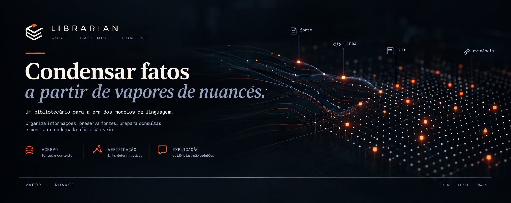
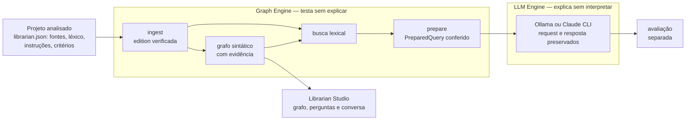

<p align="center">
  
</p>

# Librarian

**Um bibliotecário para a era dos modelos de linguagem.** O Librarian organiza as
fontes de um projeto, preserva seus bytes, relaciona o que está escrito, prepara
consultas conferidas e mostra de onde veio cada afirmação.

O objetivo é **condensar fatos a partir de vapores de nuances**. Código, perguntas
e respostas de modelos são vapor. Fato é só aquilo que tem fonte, linha e hash
verificáveis, e que passou por avaliação explícita.

## Motivação

A inspiração vem do Bibliotecário de *Snow Crash*, de Neal Stephenson: um assistente
que ajuda a encontrar e relacionar informações sem perder o caminho até as fontes.
Uma resposta convincente não substitui uma verificação, e uma informação não deve
perder a origem ao ser usada numa conversa.

## Princípios

> **Graph Engine → testa sem explicar.**
> **LLM Engine → explica sem interpretar.**

- Evidência não é conclusão. Toda aresta responde: *qual evidência autorizou esta ligação?*
- Hash comprova consistência, não autenticidade. Código descreve um procedimento, não prova execução.
- Referência sintática, candidato por nome e resolução comprovada são coisas distintas.
- Mais contexto não implica mais certeza. `completed` é transporte, não aprovação.
- Nenhuma resposta de modelo vira fato automaticamente.
- O Librarian não conhece o domínio dos projetos que o consomem.

## Como funciona



| Componente | Papel |
| --- | --- |
| [`librarian-ingest`](crates/librarian-ingest/README.md) | Edition verificável de fontes (snapshots, símbolos, trechos e hashes), extractors por linguagem, grafo sintático (`syntax-graph-v2`), busca lexical e a ponte `prepare` até o `PreparedQuery` |
| [`librarian-graph-engine`](crates/librarian-graph-engine/WORKFLOW-V0.1.md) | Dossiês: conferência de fontes e fichas, seleção, contexto por linhas e bundle com registro de origem |
| [`librarian-core`](crates/librarian-core/src/lib.rs) | Contratos de fontes, fichas (inclusive de intervalo) e dossiês |
| [`librarian-llm-engine`](crates/librarian-llm-engine/README.md) | Preparação e transporte Ollama preservados; [contrato de afirmações](crates/librarian-llm-engine/CLAIMS.md) com checker mecânico |
| [`librarian-studio`](crates/librarian-studio/README.md) | Servidor local e página web: projeto, grafo 3D, perguntas e envio a LLMs ([como usar](STUDIO.md)) |
| [`modelfiles`](modelfiles/README.md) | Biblioteca de Modelfiles, fora dos crates, editável no studio |

## Começar

Requisitos: Rust/Cargo (o Librarian é escrito em Rust e analisa projetos Rust e Python); para enviar consultas, [Ollama](https://ollama.com) e/ou o
Claude Code.

**Pela página:** dê duplo clique em `STUDIO.cmd` e abra <http://127.0.0.1:8765/>. Escolha
a pasta de um projeto Rust ou Python, gere o grafo, pergunte e envie ao LLM. Como iniciar e como
funciona: [STUDIO.md](STUDIO.md).

```sh
cargo test --workspace --locked
```

**Edition, grafo e busca** de qualquer projeto Rust ou Python (destinos novos):

```sh
cargo run --locked -p librarian-ingest --bin librarian_ingest -- generate ../meu-projeto sources-config.json ./edition-nova
cargo run --locked -p librarian-ingest --bin librarian_ingest -- graph ./edition-nova ./graph-v2.json v2
cargo run --locked -p librarian-ingest --bin librarian_ingest -- search ./edition-nova "onde a câmera calcula a direção" - 5 2
```

A trilha completa pela CLI (prepare, verify-prepared e envio) está no [WORKFLOW](WORKFLOW.md).

### Usar em outro projeto

O projeto não depende do Librarian. Basta abrir a pasta no studio; opcionalmente, ela
traz um perfil `librarian.json` com fontes, léxico, instruções e critérios. O formato está
no [STUDIO.md](STUDIO.md#perfil-do-projeto-librarianjson), e o
[renderer](https://github.com/ViniciusSJV/renderer) é o exemplo de referência. Hoje há
extractors de Rust e Python; outras linguagens entram somente por novos extractors, sem mudar
grafo, busca ou dossiês.

## Librarian Studio

<p align="center">
  
</p>

Dê duplo clique em `STUDIO.cmd` e abra <http://127.0.0.1:8765/>. O fluxo é:

1. escolher a pasta de um projeto Rust ou Python e gerar o grafo;
2. perguntar e ver os termos que o léxico tocou acenderem no grafo;
3. enviar a query conferida ao Ollama, com o Modelfile escolhido, ou ao Claude Code
   CLI, ou só mostrar o que seria enviado.

No grafo, fontes, símbolos e ocorrências aparecem com formas e cores próprias. Clicar
numa aresta mostra **a evidência que autorizou a ligação**: arquivo, linhas, bytes e
hashes. Os destaques usam somente IDs. As respostas ficam na conversa, com o transporte
registrado e a avaliação pendente. Os detalhes estão no [STUDIO.md](STUDIO.md).

## Estado atual

- **Graph Engine para Rust e Python.**
  - Edition v1 congelada com goldens.
  - Grafo e busca sem conhecimento de linguagem, com testes de fronteira.
  - Contrato neutro `syntax-graph-v2`.
  - Dossiês decididos pela natureza declarada da fonte (`content`).
  - Ponte busca → `PreparedQuery` em Rust, com `verify-prepared` byte a byte.
  - Python entrou só por extractor e pelo perfil v2 (G5), testado com o TheAlgorithms/Python (1.608 arquivos).
- **LLM Engine:** o transporte funciona e preserva tudo. A explicação **ainda não está
  aprovada**. Com o contexto numerado (fase L, passo 1), a resposta da câmera cita a
  linha 86 do arquivo, onde antes citava "linha 11", a posição no trecho. Foi uma
  execução só; ela não mede tendência e não houve avaliação semântica. As séries de
  afirmações seguem reprovadas pelo checker. Veja os [experimentos](experiments/).
- **Ainda não existem:** promoção de afirmação aprovada a fato, captura de performance
  e outras linguagens além de Rust e Python.

## Roteiro

1. **Limites do LLM Engine:** contexto com linhas numeradas (feito), studio usando
   afirmações e checker, vínculo do bundle no registro do envio e portões até a
   promoção a fato.
2. **Performance com evidência:** captura multiplataforma de benchmark antes e depois,
   para que "ficou mais rápido" seja medido, não afirmado.
3. **Alteração de código assistida:** o modelo propõe um patch citando evidências;
   testes e benchmark decidem.
4. **Outras linguagens** (Java, TypeScript/Angular), apenas por extractors, como o Python.

O diagnóstico e as etapas concluídas estão no [plano](PLANO-MULTILINGUAGEM-E-VISUALIZADOR.md).

## Documentação

| Documento | Conteúdo |
| --- | --- |
| [STUDIO](STUDIO.md) | Como iniciar a página, como ela funciona, perfil e dados |
| [WORKFLOW](WORKFLOW.md) | A mesma trilha pela CLI e a fronteira atual |
| [TESTME](TESTME.md) | Passos da trilha em resumo |
| [SEARCH](crates/librarian-ingest/SEARCH.md) | Busca, grafo, contrato v2 e `prepare` |
| [CLAIMS](crates/librarian-llm-engine/CLAIMS.md) | Contrato experimental de afirmações |
| [WORKFLOW-V0.1](crates/librarian-graph-engine/WORKFLOW-V0.1.md) | Referência formal de dossiês e `PreparedQuery` |
| [V0.1](V0.1.md) | Critérios e auditoria da versão 0.1 |
| [Exemplo maintenance](examples/maintenance/README.md) | Dossiê manual fictício, sem LLM |
| [HISTORICO](HISTORICO.md) | Aulas, experimentos e ferramentas de quando o Librarian vivia no renderer |

## Limites

- Uma referência válida não comprova a verdade da afirmação.
- Hashes conferem bytes; não autenticam autoria nem execução.
- Não há resolução de tipos ou chamadas por compilador, banco de grafos nem embeddings.
- Respostas de LLM não são promovidas automaticamente a fatos.
