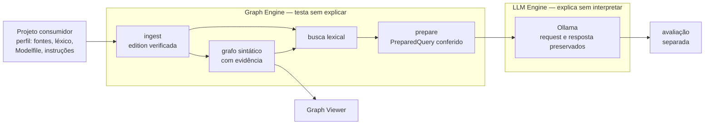
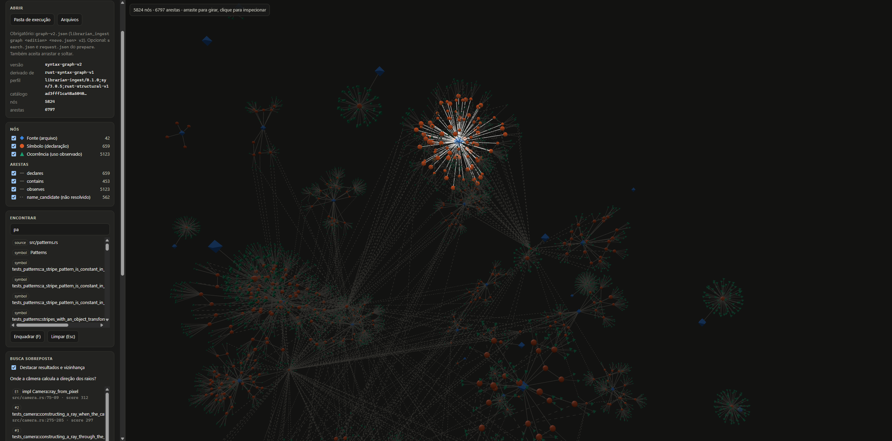

<p align="center">
  
</p>

# Librarian

**Um bibliotecário para a era dos modelos de linguagem.** O Librarian organiza as
fontes de um projeto, preserva seus bytes, relaciona o que está escrito, prepara
consultas conferidas e mostra de onde veio cada afirmação.

O objetivo é **condensar fatos a partir de vapores de nuances**. Código, perguntas
e respostas de modelos são vapor. Fato é só aquilo que tem fonte, linha e hash
verificáveis, e que passou por avaliação explícita.

## Motivação

A inspiração vem do Bibliotecário de *Snow Crash*, de Neal Stephenson: um assistente
que ajuda a encontrar e relacionar informações sem perder o caminho até as fontes.
Uma resposta convincente não substitui uma verificação, e uma informação não deve
perder a origem ao ser usada numa conversa.

## Princípios

> **Graph Engine → testa sem explicar.**
> **LLM Engine → explica sem interpretar.**

- Evidência não é conclusão. Toda aresta responde: *qual evidência autorizou esta ligação?*
- Hash comprova consistência, não autenticidade. Código descreve um procedimento, não prova execução.
- Referência sintática, candidato por nome e resolução comprovada são coisas distintas.
- Mais contexto não implica mais certeza. `completed` é transporte, não aprovação.
- Nenhuma resposta de modelo vira fato automaticamente.
- O Librarian não conhece o domínio dos projetos que o consomem.

## Como funciona



| Componente | Papel |
| --- | --- |
| [`librarian-ingest`](crates/librarian-ingest/README.md) | Edition verificável de fontes (snapshots, símbolos, trechos e hashes), extractors por linguagem, grafo sintático (`syntax-graph-v2`), busca lexical e a ponte `prepare` até o `PreparedQuery` |
| [`librarian-graph-engine`](crates/librarian-graph-engine/WORKFLOW-V0.1.md) | Dossiês: conferência de fontes e fichas, seleção, contexto por linhas e bundle com registro de origem |
| [`librarian-core`](crates/librarian-core/src/lib.rs) | Contratos de fontes, fichas (inclusive de intervalo) e dossiês |
| [`librarian-llm-engine`](crates/librarian-llm-engine/README.md) | Preparação e transporte Ollama preservados; [contrato de afirmações](crates/librarian-llm-engine/CLAIMS.md) com checker mecânico |
| [`tools/playme`](tools/playme/README.md) | Trilha completa a partir do perfil de um consumidor |
| [`tools/graph-viewer`](tools/graph-viewer/README.md) | Visualizador 3D do grafo num único HTML |

## Começar

Requisitos: Rust/Cargo; Windows PowerShell 5.1 para o PLAYME; [Ollama](https://ollama.com) para enviar consultas.

```sh
cargo test --workspace --locked
```

**Edition, grafo e busca** de qualquer projeto Rust (destinos novos):

```sh
cargo run --locked -p librarian-ingest --bin librarian_ingest -- generate ../meu-projeto sources-config.json ./edition-nova
cargo run --locked -p librarian-ingest --bin librarian_ingest -- graph ./edition-nova ./graph-v2.json v2
cargo run --locked -p librarian-ingest --bin librarian_ingest -- search ./edition-nova "onde a câmera calcula a direção" - 5 2
```

**Trilha completa** com um consumidor. O [renderer](https://github.com/ViniciusSJV/renderer)
é o de referência, com o checkout ao lado:

```powershell
..\renderer\PLAYME.cmd -Question 'Onde a câmera calcula a direção dos raios?'
```

O PLAYME gera e verifica a edition e o grafo, busca e prepara um `PreparedQuery`
conferido contra os snapshots. Depois reconfere o bundle, envia ao Ollama, preserva
tudo com hashes e deixa a avaliação pendente. Fluxo, perfil e artefatos estão no [WORKFLOW](WORKFLOW.md).

### Usar em outro projeto

O projeto não depende do Librarian. Ele só fornece um perfil `playme.json` com
fontes, léxico, Modelfile, modelo, instruções e critérios. O formato está no
[WORKFLOW](WORKFLOW.md#perfil-do-consumidor). Hoje o extractor é de Rust; outras
linguagens entram somente por novos extractors, sem mudar grafo, busca ou dossiês.

## Graph Viewer

<p align="center">
  
</p>

Abra [`tools/graph-viewer/index.html`](tools/graph-viewer/README.md) no navegador e
escolha uma execução do PLAYME. Fontes, símbolos e ocorrências aparecem com formas
e cores próprias. Clicar numa aresta mostra **a evidência que autorizou a ligação**:
arquivo, linhas, bytes e hashes. Os resultados da busca e a ficha E1 são destacados
somente por ID.

## Estado atual

- **Graph Engine fechado para Rust.**
  - Edition v1 congelada com goldens.
  - Grafo e busca sem conhecimento de linguagem, com testes de fronteira.
  - Contrato neutro `syntax-graph-v2`.
  - Dossiês decididos pela natureza declarada da fonte (`content`).
  - Ponte busca → `PreparedQuery` em Rust, com `verify-prepared` byte a byte.
- **LLM Engine:** o transporte funciona e preserva tudo. A explicação **ainda não está
  aprovada**. A resposta atual da câmera acerta a expressão, mas cita "linha 11"
  (posição no trecho) em vez da linha 86 do arquivo. As séries de afirmações seguem
  reprovadas pelo checker. Veja os [experimentos](experiments/).
- **Ainda não existem:** promoção de afirmação aprovada a fato, captura de performance
  e outras linguagens.

## Roteiro

1. **Limites do LLM Engine:** contexto com linhas numeradas, PLAYME usando afirmações
   e checker, vínculo do bundle no registro do envio e portões até a promoção a fato.
2. **Performance com evidência:** captura multiplataforma de benchmark antes e depois,
   para que "ficou mais rápido" seja medido, não afirmado.
3. **Alteração de código assistida:** o modelo propõe um patch citando evidências;
   testes e benchmark decidem.
4. **Outras linguagens** (Python, Java, TypeScript/Angular), apenas por extractors.

O diagnóstico e as etapas concluídas estão no [plano](PLANO-MULTILINGUAGEM-E-VISUALIZADOR.md).

## Documentação

| Documento | Conteúdo |
| --- | --- |
| [WORKFLOW](WORKFLOW.md) | Perfil do consumidor, fluxo e artefatos de uma execução |
| [TESTME](TESTME.md) | Passos da trilha em resumo |
| [SEARCH](crates/librarian-ingest/SEARCH.md) | Busca, grafo, contrato v2 e `prepare` |
| [CLAIMS](crates/librarian-llm-engine/CLAIMS.md) | Contrato experimental de afirmações |
| [WORKFLOW-V0.1](crates/librarian-graph-engine/WORKFLOW-V0.1.md) | Referência formal de dossiês e `PreparedQuery` |
| [V0.1](V0.1.md) | Critérios e auditoria da versão 0.1 |
| [Exemplo maintenance](examples/maintenance/README.md) | Dossiê manual fictício, sem LLM |
| [HISTORICO](HISTORICO.md) | Aulas, experimentos e ferramentas de quando o Librarian vivia no renderer |

## Limites

- Uma referência válida não comprova a verdade da afirmação.
- Hashes conferem bytes; não autenticam autoria nem execução.
- Não há resolução de tipos ou chamadas por compilador, banco de grafos nem embeddings.
- Respostas de LLM não são promovidas automaticamente a fatos.
