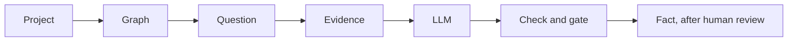

<p align="center">
  
</p>

<h1 align="center">Librarian</h1>

<p align="center">
  <em>Condensing facts from vapors of nuances.</em>
</p>

<p align="center">
  <a href="LICENSE"></a>
  
  
  
</p>

<p align="center">
  <strong>English</strong> · <a href="README.pt-BR.md">Português</a>
</p>

---

Librarian is an evidence librarian for code. It keeps a project's sources byte for byte, relates what is written in them, and assembles the evidence for a question using rules, with no model involved. Only then does a language model interpret that evidence, and nothing it answers becomes a fact without a mechanical check and a person's review.

It is not a chatbot over your repository or a generic RAG pipeline. There are no embeddings and no vector search, and the model does not browse the project. It receives a small selection you can inspect before sending, and every citation in its answer is checked against the lines it was sent.

The name comes from the Librarian in Neal Stephenson's *Snow Crash*, a program that holds knowledge and answers from it. The line above adapts one from the same novel.

## The problem

Asking a model to analyze a project tends to go one of two ways: it gets too much context, or it picks what to read on its own. Either way, the answer can sound right without showing where it came from, and what was read is out of your hands.

Librarian separates mechanical work from interpretation. Finding relations, counting executions and checking citations do not need a model. The model comes in where interpretation adds value, with less room to invent.

## Atomizing information

Rather than treat a project as one large text, Librarian breaks it into units that can be checked one by one:

| Unit | What it is | Produced by |
|---|---|---|
| Structural relation | Something written in the code: calls, writes, has the type | Graph Engine |
| Measure | What a run counted, per line | The project; Librarian reads it |
| Evidence | A verifiable excerpt sent to the model | Evidence Builder |
| Claim | FACT, INFERENCE, HYPOTHESIS or LACUNA (a stated gap), with checked citations | Model and LLM Engine |
| Fact | A claim approved with the reviewer's note | A person |

These categories do not turn into one another on their own. A written name is a candidate, not a resolved call. A valid citation does not prove a claim true. A change that passes the gate remains a hypothesis until a person approves it.

## Architecture



| Component | Responsibility | Where it lives |
|---|---|---|
| **Graph Engine** | Identifies structural relations, references and verifiable information. Tests without explaining. | Edition, graph and search in [`librarian-ingest`](crates/librarian-ingest/README.md); dossiers and the prepared query in [`librarian-graph-engine`](crates/librarian-graph-engine/WORKFLOW-V0.1.md), which `prepare` uses |
| **Evidence Builder** | Selects, organizes and prepares the evidence for a question, using rules and no model. | A layer, not a crate: `envelope.rs` in `librarian-ingest`, and the Studio's **Suggest envelope** panel |
| **LLM Engine** | Interprets and explains the evidence it receives, without inventing sources or relations. That is the contract, checked mechanically as far as it can be. | [`librarian-llm-engine`](crates/librarian-llm-engine/README.md) and the [claims contract](crates/librarian-llm-engine/CLAIMS.md) |

Two more roles follow the answer, and none of the three components takes them on. The **gate** runs a proposed change in a copy of the project, with the project's own commands and measures, and shows the effects without judging their meaning. A **person** decides.

## The Studio

The [Librarian Studio](STUDIO.md) is the normal way to use the project: a local web app, with an English and Portuguese interface, that only accepts connections from `127.0.0.1`. The screen has three columns: the method's tabs, the project map and the conversation.

| Tab | What it is for |
|---|---|
| **Project** | Open a folder, generate the graph, configure questions |
| **Lexicon** | Connect the words in your questions to names in the code |
| **Investigate** | Operation inventory, **Where the time goes** and **Measure everything** |
| **Ruler** | Commands the project declares, runs and comparisons |
| **Facts** | Approved facts, rechecked against the edition |
| **Map** | Inspection and search; the project is drawn as a city where each building is a function |

The question box has two modes. **Locate** asks only for facts: where the code does something, with the line and a copied excerpt. **Improve** also accepts hypotheses with a proposed change, which can go through the gate with the **Ladder** option.

## Traceability

- **Sources:** an *edition* keeps each file's bytes with a SHA-256, and verification redoes the extraction without needing the original project. A hash proves consistency, not authenticity.
- **Relations:** every graph edge points to the file, lines and bytes that authorized it.
- **Sending:** the query is checked against the edition right before each send, and `send.json` records the hashes of what was checked. If the query changed, nothing is sent. This link is a local record, not a signature.
- **Answers:** each citation must exist in the evidence, with the same path, lines and excerpt. The raw answer is preserved.
- **Criteria:** evaluation criteria are recorded before any answer exists.
- **Facts:** a fact keeps its full origin and is rechecked per edition as **current**, **stale** or **revoked**. Current means the cited text is unchanged, not that its meaning was reviewed.

## Controlling the context sent

- **Selection by role, with no scoring:** target, origin of the value, cost, path and support fill 6 KB of code, up to 16 declarations. Targets always go. Tests stay out, because the gate runs them.
- **You see it first:** the panel shows each item with its reason and line, plus what was left out, what the graph did not settle and what must be preserved. Ticking or unticking an item applies immediately.
- **For the person only:** those lists, the justifications and the coverage states do not go to the model. It receives the question, the excerpts, any approved facts you ask for, the limits and the instructions.
- **The record:** the question stores the budget, what was included, what you removed and the gaps. The proof of what was sent is the query itself, which you can open and copy.
- **No send:** with the **None** provider, nothing leaves the machine and the query is available to copy.
- **Ollama truncation:** Ollama silently cuts input beyond `num_ctx`. The Studio asks for confirmation before a large query and flags the answer as possibly truncated.

## What is available today

- Analysis of **Rust** and **Python** projects, including mixed ones.
- Syntax graph with name-based candidates, and the **Where is it used?** and **What does it call?** views.
- Operation inventory from declared rules: database, file, network, lock, operations in loops, a collection walked on every turn, list lookups.
- **Measure everything**, Rust only: inserts a counter in each function in a copy of the project and runs the approved command. The panel tells apart a function counted with passes, a function counted with no passes observed and a function with no coverage.
- Rule-based suggested envelope, questions over hand-gathered declarations, and chained follow-ups.
- **Claims** format with a mechanical check, or prose with none.
- Sending to **Ollama** with editable Modelfiles, to the **Claude Code CLI**, or to nothing. Claude API and DeepSeek are listed and do not send yet.
- A **Ladder** for changes: several proposals per answer, each through the gate, with regressions shown next to the decision. Today changes go to Claude Haiku, and the local model handles facts.
- Comparison of answers by content, and a fact collection with item-by-item approval.

## Install and run

**Requirements:** stable [Rust](https://www.rust-lang.org/tools/install). On first open, a connection to download Three.js and ELK from jsDelivr. To send questions: [Ollama](https://ollama.com) and/or [Claude Code](https://claude.com/product/claude-code), installed and logged in, which bills your account.

```sh
git clone https://github.com/ViniciusSJV/librarian.git
cd librarian
cargo run --release --locked -p librarian-studio
```

Open <http://127.0.0.1:8765/>. For another port, append `-- --port 9000`. On Windows, double-clicking `STUDIO.cmd` builds, starts the server and opens the browser.

Local models used by the bundled [Modelfiles](modelfiles/README.md):

```sh
ollama pull qwen3-coder:30b
ollama pull gemma4:12b
ollama pull gpt-oss:20b
```

**Configuration:** a project opens with no configuration. To declare commands, a lexicon, inventory rules or **Measure everything**, add a [`librarian.json`](STUDIO.md#perfil-do-projeto-librarianjson) to the root of the analyzed project.

**Where data lives:** in `.studio/`, at the Librarian root, outside Git. Librarian only writes to the analyzed project when you use **Save to project…**. Commands run without a shell, after your approval, in a `git worktree` outside Librarian, which the project's Git registers.

## Examples

**Locate some code.** Open a project, click **Generate graph**, pick **Locate** and ask, for example, "Where does the camera compute the ray direction?". The results light up on the map. With the **None** provider you see the query and can copy it; with a model, the answer comes back with the mechanical check. On a FACT that passed the check, **Approve as fact** asks for your note and adds the item to the collection.

**Investigate a change.** In **Investigate**, run **Measure everything** (a Rust project with `instrument` in its profile) and pick a function under **Where the time goes**. **Optimize** builds the envelope and a question from what was counted. Review the suggestion panel, confirm the **Ladder** option and ask. The record shows each proposal, why each was refused and any regressions.

**From the command line**, with no Studio and no model:

```sh
echo '{"project":"my-project","inputs":["src"]}' > sources.json

cargo run --locked -p librarian-ingest --bin librarian_ingest -- generate ../my-project sources.json ./edition
cargo run --locked -p librarian-ingest --bin librarian_ingest -- verify ./edition
cargo run --locked -p librarian-ingest --bin librarian_ingest -- graph ./edition ./graph.json v2
cargo run --locked -p librarian-ingest --bin librarian_ingest -- search ./edition "where is the distance computed"
cargo run --locked -p librarian-ingest --bin librarian_ingest -- investigate inventory ./edition
```

`search` exits with code 2 when nothing is found.

## What has been measured

One case, in a Rust ray tracer: caching an inverse matrix cut the inversions in a frame from 597,067 to 233,487, with the same image and the tests passing. With the same envelope and gate, Claude Haiku and Sonnet reached the same result, at about US$ 0.01 and US$ 0.10 ([record](PLANO-MULTILINGUAGEM-E-VISUALIZADOR.md#passo-4--mudança-aprovada-vira-fato-e-os-custos-por-modelo-31102026)).

Librarian did not always win. On 2026-11-01, before the current selection rules, on a scene taking 9.3 s at 2K, with the same image in every case ([record](PLANO-MULTILINGUAGEM-E-VISUALIZADOR.md#vídeo-11--a-pessoa-pergunta-o-librarian-mede-separa-e-sobe-a-escada-01112026)):

| Path | Final time | Cost |
|---|---|---|
| Claude Haiku alone, with a prompt asking for improvements | 2.0 s | US$ 0.28 |
| Librarian, first 3 rounds | 3.0 s | US$ 0.056 |
| Librarian, long cycle | 2.6 s | about US$ 0.34 |

Role-based selection also [did not get more changes approved](PLANO-MULTILINGUAGEM-E-VISUALIZADOR.md#evidence-builder--escolher-as-fontes-pelo-que-explicam-04112026) than the hand-picked envelope, in any case. What it brought was automatic selection, a smaller query and a record of what was left out. These are few projects, and the same envelope has varied between 4/6 and 8/8 approvals: read these numbers as observations, not guarantees.

## Known limitations

- **Passing the check does not mean correct.** The check says the answer points to real lines in the requested format. A paraphrase with no line number or quoted excerpt gets past it, and meaning stays with the person.
- **No compiler resolution.** Everything goes by the written name, and homonyms stay candidates. Calls inside macros are not seen, Python's `import` is not followed, and conditions and invariants are not extracted. Absence from a view does not prove nothing uses it.
- **No per-function counts in Python.** **Measure everything** only instruments Rust. In a measure of a mixed project, Python functions show as having no coverage.
- **A count is not a cost, and zero does not mean "did not run".** Instrumented time is inclusive, inflated by the counters and can change the order between functions, so it serves only as a reference. The absence of observed counts is not proof of absence of execution.
- **The gate sees what the project measures.** Among proposals that pass, the one chosen has the largest % gain, which compares different units. When measures trade off, the decision is yours.
- **A failure reading the measure** shows as "No measure" in the suggestion panel, although **Where the time goes** shows the error.
- **No dedicated Evidence Builder screen.** Today the selection appears in the suggestion panel, and the performance card and **Separate** send without a prior review of the package.
- **Python above roughly 3.12** becomes a diagnostic, and `prepare` then requires accepting the edition with diagnostics.
- **Local models.** In the recorded tests, qwen passed the check on 9 of 10 facts and had no change approved by the gate.
- **Platform.** Real use is recorded on Windows only. CI runs `cargo test` on Ubuntu and Windows; the Studio's screen test suites stay outside it and depend on local data.

## Technology

A Rust workspace with no database. Extraction uses `syn` (Rust) and `rustpython-parser` (Python), behind an extractor boundary with versioned profiles, so older editions remain verifiable. The Studio server is minimal HTTP over `std`, and the page is a single `index.html`, with version-pinned Three.js and ELK. The Ollama transport uses `reqwest`, and Claude is called through its CLI, with no tools and no MCP.

| Path | Role |
|---|---|
| [`crates/librarian-ingest`](crates/librarian-ingest/README.md) | Edition, extractors, graph, search, inventory, envelope and `prepare` |
| [`crates/librarian-llm-engine`](crates/librarian-llm-engine/README.md) | Ollama transport and the claims contract with its mechanical check |
| [`crates/librarian-studio`](crates/librarian-studio/README.md) | Local server, page, Claude CLI, runs, ladder and fact collection |
| [`crates/librarian-graph-engine`](crates/librarian-graph-engine/WORKFLOW-V0.1.md), `crates/librarian-core` | Dossiers, checks and the prepared query, used by `prepare`, and their contracts |
| [`modelfiles`](modelfiles/README.md) | `<task>-<model>` Modelfiles, editable in the Studio |

## Documentation

The project's internal documentation is in Portuguese: [Studio](STUDIO.md) · [Workflow](WORKFLOW.md) · [Testing](TESTME.md) · [Plan and measurements](PLANO-MULTILINGUAGEM-E-VISUALIZADOR.md) · [History](HISTORICO.md)

## License

[Apache License 2.0](LICENSE).
