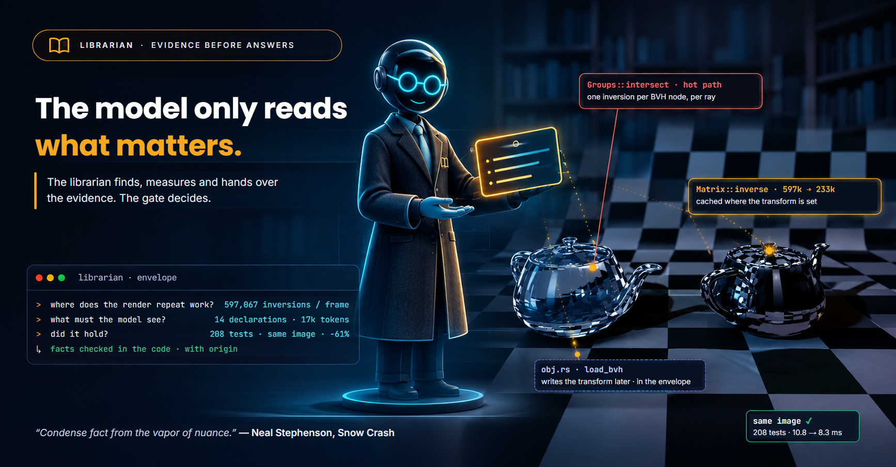
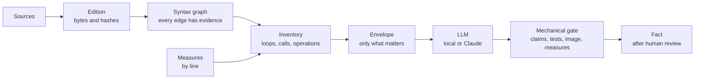

<p align="center">
  
</p>

<h1 align="center">Librarian</h1>

<p align="center">
  <em>Condense fact from the vapor of nuance. — Neal Stephenson, <a href="https://en.wikipedia.org/wiki/Snow_Crash">Snow Crash</a></em>
</p>

<p align="center">
  <a href="LICENSE"></a>
  
  
  
</p>

<p align="center">
  <strong>English</strong> · <a href="README.pt-BR.md">Português</a>
</p>

---

Librarian reads a codebase the way a librarian reads a collection: it keeps the sources byte for
byte, relates what is written, and finds where it is worth asking. A language model only sees
the evidence that matters for the question, and nothing it says becomes a fact until a mechanical
gate and a person agree.

## One change, end to end

A Rust ray tracer rendering two teapots (6,320 triangles each, glass and mirror).

| Step | Who | Result |
| --- | --- | --- |
| Find where the work repeats | Librarian, from the syntax graph | the pixel loop reaches `Matrix::inverse` through the BVH and every triangle |
| Measure it | the project counts, Librarian reads | **597,067** matrix inversions in a 64×64 frame, ~98 per ray |
| Pick the evidence | Librarian, suggested envelope | 14 declarations, including the 2 functions that write the transform later |
| Propose a change | Claude, **17k input tokens, US$ 0.10** | cache the inverse where the transform is set |
| Gate | 208 tests, image hash, counts, timing | same image, **233,487** inversions (−61%), 10.8 → 8.3 ms |

The model never read the whole project (232 KB of Rust): it got the 18% that mattered. Local
models (qwen3-coder 30B, gemma4 12B, gpt-oss 20B) were asked the same question first; their
answers compiled and passed the tests, but changed the image or broke the answer contract, and
the gate refused them.

## How it works



- **Graph Engine** tests without explaining. **LLM Engine** explains without interpreting.
- Evidence is not a conclusion: a written name is a candidate, not a resolved call.
- A hash proves consistency, not authenticity. `completed` is transport, not approval.
- No model answer becomes a fact on its own.

## Quick start

Requirements: Rust (stable). To send questions: [Ollama](https://ollama.com) and/or Claude Code.

```sh
cargo test --workspace --locked
```

On Windows, double-click `STUDIO.cmd` and open <http://127.0.0.1:8765/>. Pick a Rust or Python
project, generate the graph, open **Investigar** to see the inventory, ask, and send.

Local models used by the bundled [Modelfiles](modelfiles/README.md):

```sh
ollama pull qwen3-coder:30b
ollama pull gemma4:12b
ollama pull gpt-oss:20b
```

The same path from the command line:

```sh
cargo run --locked -p librarian-ingest --bin librarian_ingest -- generate ../my-project sources.json ./edition
cargo run --locked -p librarian-ingest --bin librarian_ingest -- investigate inventory ./edition
```

## What's inside

| Crate | Role |
| --- | --- |
| [`librarian-ingest`](crates/librarian-ingest/README.md) | Verifiable edition of the sources, Rust and Python extractors, syntax graph, operation inventory, suggested envelope |
| [`librarian-llm-engine`](crates/librarian-llm-engine/README.md) | Preserved transport (Ollama, Claude CLI) and the [claims contract](crates/librarian-llm-engine/CLAIMS.md) with its mechanical checker |
| [`librarian-studio`](crates/librarian-studio/README.md) | Local web app: graph, inventory, questions, measured runs in a copy of the project |
| [`librarian-graph-engine`](crates/librarian-graph-engine/WORKFLOW-V0.1.md) | Dossiers, selection and prepared queries |
| [`modelfiles`](modelfiles/README.md) | `<task>-<model>` Modelfiles, editable in the studio |

Documentation is in Portuguese: [Studio](STUDIO.md) · [Workflow](WORKFLOW.md) ·
[Plan](PLANO-MULTILINGUAGEM-E-VISUALIZADOR.md) · [History](HISTORICO.md).

## Limits

- A valid citation does not prove the claim is true.
- No compiler resolution, no embeddings: names are matched as written, types only when written.
- A structural finding says where the work is, not what it costs. Measures say that.
- Promotion to fact needs a person, item by item.

## License

[Apache License 2.0](LICENSE).
