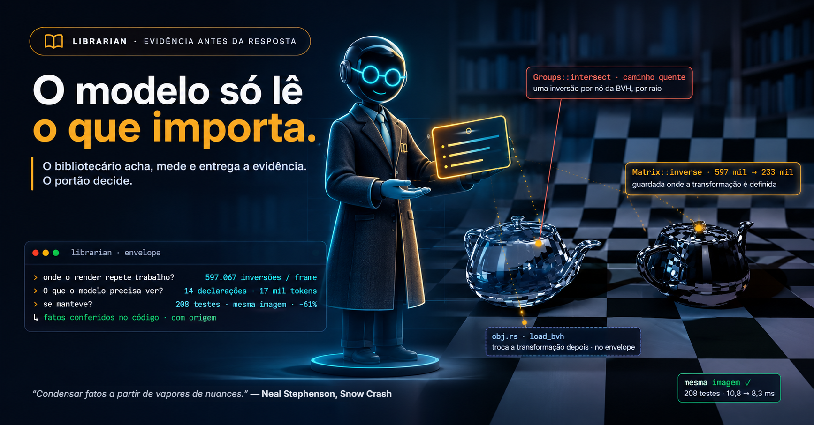
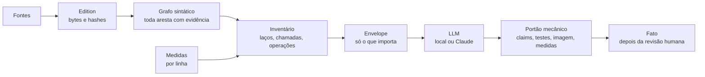

<p align="center">
  
</p>

<h1 align="center">Librarian</h1>

<p align="center">
  <em>Condensar fatos a partir de vapores de nuances. — Neal Stephenson, <a href="https://pt.wikipedia.org/wiki/Snow_Crash">Snow Crash</a></em>
</p>

<p align="center">
  <a href="LICENSE"></a>
  
  
  
</p>

<p align="center">
  <a href="README.md">English</a> · <strong>Português</strong>
</p>

---

O Librarian lê um projeto como um bibliotecário lê um acervo: guarda as fontes byte a byte,
relaciona o que está escrito e acha onde vale a pena perguntar. O modelo de linguagem vê só a
evidência que importa para a pergunta, e nada do que ele diz vira fato até passar por um portão
mecânico e por uma pessoa.

## Uma mudança, do começo ao fim

Um ray tracer em Rust renderizando dois teapots (6.320 triângulos cada, vidro e espelho).

| Passo | Quem | Resultado |
| --- | --- | --- |
| Achar onde o trabalho se repete | Librarian, pelo grafo sintático | o laço de pixels chega a `Matrix::inverse` pela BVH e por cada triângulo |
| Medir | o projeto conta, o Librarian lê | **597.067** inversões de matriz num frame de 64×64, ~98 por raio |
| Escolher a evidência | Librarian, envelope sugerido | 14 declarações, incluindo as 2 funções que trocam a transformação depois |
| Propor a mudança | Claude, **17 mil tokens de entrada, US$ 0,10** | guardar a inversa onde a transformação é definida |
| Portão | 208 testes, hash da imagem, contagens, tempo | mesma imagem, **233.487** inversões (−61%), 10,8 → 8,3 ms |

O modelo não leu o projeto inteiro (232 KB de Rust): recebeu os 18% que importavam. Os modelos
locais (qwen3-coder 30B, gemma4 12B, gpt-oss 20B) receberam a mesma pergunta antes; as respostas
compilaram e passaram nos testes, mas mudaram a imagem ou quebraram o contrato de resposta, e o
portão recusou.

## Como funciona



- **Graph Engine** testa sem explicar. **LLM Engine** explica sem interpretar.
- Evidência não é conclusão: um nome escrito é candidato, não chamada resolvida.
- Hash comprova consistência, não autenticidade. `completed` é transporte, não aprovação.
- Nenhuma resposta de modelo vira fato sozinha.

## Começar

Requisitos: Rust (stable). Para enviar perguntas: [Ollama](https://ollama.com) e/ou o Claude Code.

```sh
cargo test --workspace --locked
```

No Windows, dê duplo clique em `STUDIO.cmd` e abra <http://127.0.0.1:8765/>. Escolha um projeto
Rust ou Python, gere o grafo, abra **Investigar** para ver o inventário, pergunte e envie.

Modelos locais dos [Modelfiles](modelfiles/README.md) da biblioteca:

```sh
ollama pull qwen3-coder:30b
ollama pull gemma4:12b
ollama pull gpt-oss:20b
```

O mesmo caminho pela linha de comando:

```sh
cargo run --locked -p librarian-ingest --bin librarian_ingest -- generate ../meu-projeto sources.json ./edition
cargo run --locked -p librarian-ingest --bin librarian_ingest -- investigate inventory ./edition
```

## O que tem dentro

| Crate | Papel |
| --- | --- |
| [`librarian-ingest`](crates/librarian-ingest/README.md) | Edition verificável das fontes, extractors de Rust e Python, grafo sintático, inventário de operações, envelope sugerido |
| [`librarian-llm-engine`](crates/librarian-llm-engine/README.md) | Transporte preservado (Ollama, Claude CLI) e o [contrato de afirmações](crates/librarian-llm-engine/CLAIMS.md) com a conferência mecânica |
| [`librarian-studio`](crates/librarian-studio/README.md) | Aplicação web local: grafo, inventário, perguntas, execuções medidas numa cópia do projeto |
| [`librarian-graph-engine`](crates/librarian-graph-engine/WORKFLOW-V0.1.md) | Dossiês, seleção e consultas preparadas |
| [`modelfiles`](modelfiles/README.md) | Modelfiles `<tarefa>-<modelo>`, editáveis no studio |

Documentação: [Studio](STUDIO.md) · [Workflow](WORKFLOW.md) ·
[Plano](PLANO-MULTILINGUAGEM-E-VISUALIZADOR.md) · [Histórico](HISTORICO.md).

## Limites

- Uma citação válida não prova que a afirmação é verdadeira.
- Sem resolução por compilador e sem embeddings: nomes casam como estão escritos; tipos, só quando escritos.
- Um achado estrutural diz onde está o trabalho, não quanto custa. Isso é a medida que diz.
- Virar fato exige uma pessoa, item por item.

## Licença

[Apache License 2.0](LICENSE).
