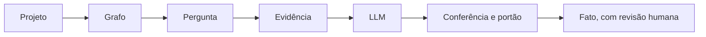

<p align="center">
  
</p>

<h1 align="center">Librarian</h1>

<p align="center">
  <em>Condensar fatos a partir de vapores de nuances.</em>
</p>

<p align="center">
  <a href="LICENSE"></a>
  
  
  
</p>

<p align="center">
  <a href="README.md">English</a> · <strong>Português</strong>
</p>

---

O Librarian é um bibliotecário de evidências para código. Ele guarda as fontes de um projeto byte a byte, relaciona o que está escrito nelas e monta, por regras e sem modelo, a evidência de uma pergunta. Só então um modelo de linguagem interpreta essa evidência, e nada do que ele responde vira fato sem passar por uma conferência mecânica e por uma pessoa.

Não é um chatbot sobre o seu repositório nem um RAG genérico: não há embeddings nem busca vetorial, e o modelo não navega pelo projeto. Ele recebe uma seleção pequena, que você pode inspecionar antes do envio, e cada citação da resposta é conferida contra as linhas enviadas.

O nome vem do Bibliotecário de *Snow Crash*, de Neal Stephenson, um programa que guarda conhecimento e responde a partir dele. A frase acima adapta uma linha do mesmo romance.

## O problema

Pedir a um modelo que analise um projeto costuma terminar de dois jeitos: ele recebe contexto demais, ou escolhe sozinho o que ler. Nos dois casos, a resposta pode soar correta sem que dê para saber de onde ela veio, e o que foi lido fica fora do seu controle.

O Librarian separa o trabalho mecânico do trabalho de interpretação. Encontrar relações, contar execuções e conferir citações não precisa de modelo. O modelo entra onde interpretar agrega valor, com menos espaço para inventar.

## Atomização da informação

Em vez de tratar o projeto como um texto grande, o Librarian o decompõe em unidades que podem ser conferidas uma a uma:

| Unidade | O que é | Quem produz |
|---|---|---|
| Relação estrutural | Algo escrito no código: chama, escreve, tem o tipo | Graph Engine |
| Medição | O que uma execução contou, por linha | O projeto; o Librarian lê |
| Evidência | Um trecho verificável, enviado ao modelo | Evidence Builder |
| Afirmação | FACT, INFERENCE, HYPOTHESIS ou LACUNA, com citações conferidas | Modelo e LLM Engine |
| Fato | Uma afirmação aprovada, com a nota de quem revisou | Pessoa |

Essas categorias não se convertem sozinhas: um nome escrito é candidato, não chamada resolvida; uma citação válida não prova que a afirmação é verdadeira; uma mudança aprovada no portão continua sendo hipótese até uma pessoa aprová-la.

## Arquitetura



| Componente | Responsabilidade | Onde está |
|---|---|---|
| **Graph Engine** | Identifica relações estruturais, referências e informações verificáveis. Testa sem explicar. | Edition, grafo e busca em [`librarian-ingest`](crates/librarian-ingest/README.md); dossiês e query preparada em [`librarian-graph-engine`](crates/librarian-graph-engine/WORKFLOW-V0.1.md), que o `prepare` usa |
| **Evidence Builder** | Seleciona, organiza e prepara as evidências da pergunta, por regras e sem modelo. | Uma camada, não um crate: `envelope.rs`, em `librarian-ingest`, e o painel **Sugerir envelope** do Studio |
| **LLM Engine** | Interpreta e explica as evidências recebidas, sem inventar fontes ou relações: esse é o contrato, conferido mecanicamente até onde dá. | [`librarian-llm-engine`](crates/librarian-llm-engine/README.md) e o [contrato de afirmações](crates/librarian-llm-engine/CLAIMS.md) |

Depois da resposta há mais dois papéis, que nenhum dos três assume. O **portão** roda a mudança proposta numa cópia do projeto, com os comandos e as medidas do próprio projeto, e mostra os efeitos, sem julgar o sentido. A **pessoa** decide.

## O Studio

O [Librarian Studio](STUDIO.md) é o uso normal do projeto: uma aplicação web local, com interface em português e inglês, que só aceita conexões de `127.0.0.1`. A tela tem três colunas: as abas do método, o mapa do projeto e a conversa.

| Aba | Para quê |
|---|---|
| **Projeto** | Abrir uma pasta, gerar o grafo, configurar as perguntas |
| **Léxico** | Ligar as palavras das perguntas aos nomes do código |
| **Investigar** | Inventário de operações, **Onde pesa** e o **Medir tudo** |
| **Régua** | Comandos que o projeto declara, execuções e comparações |
| **Acervo** | Fatos aprovados, reconferidos contra a edition |
| **Mapa** | Inspeção e busca; o projeto aparece como uma cidade, em que cada prédio é uma função |

O campo de pergunta tem dois modos. **Localizar** pede só fatos: onde o código faz algo, com a linha e o trecho copiado. **Melhorar** também aceita hipóteses com uma mudança proposta, que pode passar pelo portão com a opção **Escada**.

## Rastreabilidade

- **Fontes:** a *edition* guarda os bytes de cada arquivo, com SHA-256, e a verificação refaz a extração sem depender do projeto original. Um hash comprova consistência, não autenticidade.
- **Relações:** cada aresta do grafo aponta o arquivo, as linhas e os bytes que a autorizaram.
- **Envio:** a query é conferida contra a edition imediatamente antes de cada envio, e o `send.json` grava os hashes do que foi conferido. Se a query mudou, nada é enviado. Esse vínculo é um registro local, não uma assinatura.
- **Resposta:** cada citação precisa existir na evidência, com o caminho, as linhas e o trecho iguais. A resposta bruta fica preservada.
- **Critérios:** os critérios de avaliação são gravados antes de a resposta existir.
- **Fatos:** um fato guarda a origem completa e é reconferido a cada edition: **vigente**, **desatualizado** ou **revogado**. Vigente quer dizer que o texto citado continua igual, não que o sentido foi revisto.

## Controle do contexto enviado

- **Seleção por papéis, sem pontuação:** alvo, origem do valor, custo, caminho e apoio preenchem 6 KB de código, com no máximo 16 declarações. Os alvos vão sempre. Testes ficam de fora, porque o portão os roda.
- **Você vê antes:** o painel mostra cada item com o motivo e a linha, e também o que ficou de fora, o que o grafo não resolveu e o que precisa ser preservado. Marcar ou desmarcar um item vale na hora.
- **Só a pessoa vê:** essas listas, as justificativas e os estados de cobertura não vão ao modelo. Ele recebe a pergunta, os trechos, os fatos aprovados pedidos, os limites e as instruções.
- **O registro:** a pergunta grava o orçamento, o que foi incluído, o que você tirou e as lacunas. A prova do que foi enviado é a própria query, que você pode abrir e copiar.
- **Sem envio:** com o provedor **Nenhum**, nada sai da máquina, e a query fica disponível para copiar.
- **Corte no Ollama:** o Ollama corta sem erro o que passa do `num_ctx`. O Studio pede confirmação antes de uma query grande e marca a resposta como possivelmente truncada.

## O que está disponível hoje

- Análise de projetos **Rust** e **Python**, inclusive mistos.
- Grafo sintático com candidatos por nome, vistas **Onde é usado?** e **O que ele chama?**.
- Inventário de operações por regras declaradas: banco, arquivo, rede, trava, operações em laço, coleção percorrida a cada volta, busca em lista.
- **Medir tudo**, só em Rust: insere um contador em cada função numa cópia do projeto e roda o comando aprovado. O painel distingue função contada com passagens, função contada sem passagens observadas e função sem cobertura.
- Envelope sugerido por regras, pergunta com declarações juntadas à mão e continuação em cadeia.
- Formato **claims** com conferência mecânica, ou prosa, sem conferência.
- Envio ao **Ollama** com Modelfiles editáveis, ao **Claude Code CLI**, ou nenhum. Claude API e DeepSeek aparecem listados e ainda não enviam.
- **Escada** de mudanças: várias propostas por resposta, cada uma pelo portão, com pioras mostradas ao lado da decisão. Hoje as mudanças vão ao Claude Haiku, e o modelo local fica nos fatos.
- Comparação de respostas por conteúdo, e acervo de fatos com aprovação item a item.

## Instalar e executar

**Requisitos:** [Rust](https://www.rust-lang.org/tools/install) stable. Na primeira abertura, conexão para baixar Three.js e ELK do jsDelivr. Para enviar perguntas: [Ollama](https://ollama.com) e/ou o [Claude Code](https://claude.com/product/claude-code) instalado e logado, que cobra pela sua conta.

```sh
git clone https://github.com/ViniciusSJV/librarian.git
cd librarian
cargo run --release --locked -p librarian-studio
```

Abra <http://127.0.0.1:8765/>. Para outra porta, acrescente `-- --port 9000`. No Windows, um duplo clique em `STUDIO.cmd` compila, sobe o servidor e abre o navegador.

Modelos locais usados pelos [Modelfiles](modelfiles/README.md) da biblioteca:

```sh
ollama pull qwen3-coder:30b
ollama pull gemma4:12b
ollama pull gpt-oss:20b
```

**Configuração:** um projeto sem configuração já abre. Para declarar comandos, léxico, regras do inventário ou o **Medir tudo**, use um [`librarian.json`](STUDIO.md#perfil-do-projeto-librarianjson) na raiz do projeto analisado.

**Onde ficam os dados:** em `.studio/`, na raiz do Librarian, fora do Git. O Librarian só escreve no projeto analisado quando você usa **Salvar no projeto…**. Os comandos rodam sem shell, depois da sua aprovação, em um `git worktree` fora do Librarian, que o Git do projeto registra.

## Exemplos

**Localizar um trecho.** Abra um projeto, clique em **Gerar grafo**, escolha o modo **Localizar** e pergunte, por exemplo, "Onde a câmera calcula a direção dos raios?". Os resultados acendem no mapa. Com o provedor **Nenhum**, você vê a query e pode copiá-la; com um modelo, a resposta volta com a conferência mecânica. Em um FACT aprovado na mecânica, **Aprovar como fato** pede a sua nota e leva o item ao acervo.

**Investigar uma mudança.** Em **Investigar**, rode o **Medir tudo** (projeto Rust com `instrument` no perfil) e escolha uma função em **Onde pesa**. **Otimizar** monta o envelope e uma pergunta com o que foi contado. Revise o painel da sugestão, confirme a opção **Escada** e pergunte. O registro mostra cada proposta, o motivo de cada recusa e as pioras.

**Pela linha de comando**, sem Studio e sem modelo:

```sh
echo '{"project":"meu-projeto","inputs":["src"]}' > sources.json

cargo run --locked -p librarian-ingest --bin librarian_ingest -- generate ../meu-projeto sources.json ./edition
cargo run --locked -p librarian-ingest --bin librarian_ingest -- verify ./edition
cargo run --locked -p librarian-ingest --bin librarian_ingest -- graph ./edition ./graph.json v2
cargo run --locked -p librarian-ingest --bin librarian_ingest -- search ./edition "onde calcula a distância"
cargo run --locked -p librarian-ingest --bin librarian_ingest -- investigate inventory ./edition
```

O `search` termina com o código 2 quando nada é encontrado.

## O que já foi medido

Um caso, em um ray tracer em Rust: guardar uma matriz inversa reduziu as inversões num frame de 597.067 para 233.487, com a mesma imagem e os testes passando. Com o mesmo envelope e o mesmo portão, Claude Haiku e Sonnet chegaram ao mesmo resultado, a cerca de US$ 0,01 e US$ 0,10 ([registro](PLANO-MULTILINGUAGEM-E-VISUALIZADOR.md#passo-4--mudança-aprovada-vira-fato-e-os-custos-por-modelo-31102026)).

O Librarian não ganhou sempre. Em 01/11/2026, antes das regras de seleção atuais, numa cena de 9,3 s em 2K e com a mesma imagem em todos os casos ([registro](PLANO-MULTILINGUAGEM-E-VISUALIZADOR.md#vídeo-11--a-pessoa-pergunta-o-librarian-mede-separa-e-sobe-a-escada-01112026)):

| Caminho | Tempo final | Custo |
|---|---|---|
| Só o Claude Haiku, com um prompt pedindo melhorias | 2,0 s | US$ 0,28 |
| Librarian, 3 primeiras rodadas | 3,0 s | US$ 0,056 |
| Librarian, ciclo longo | 2,6 s | cerca de US$ 0,34 |

A seleção por papéis também [não aprovou mais mudanças](PLANO-MULTILINGUAGEM-E-VISUALIZADOR.md#evidence-builder--escolher-as-fontes-pelo-que-explicam-04112026) que o envelope escolhido à mão, em nenhum caso. O que ela trouxe foi a seleção automática, uma query menor e o registro do que ficou de fora. São poucos projetos, e o mesmo envelope já variou entre 4/6 e 8/8 aprovações: leia esses números como observações, não como garantia.

## Limitações conhecidas

- **Aprovada na mecânica não quer dizer correta.** A conferência diz que a resposta aponta para linhas reais no formato pedido. Uma paráfrase sem número de linha nem trecho citado não é vista por ela, e o sentido fica com a pessoa.
- **Sem resolução por compilador.** Tudo é pelo nome escrito, e homônimos ficam como candidatos. Chamadas dentro de macros não são vistas, em Python o `import` não é seguido, e condições e invariantes não são extraídas. Ausência numa vista não prova que ninguém usa.
- **Python sem contagem por função.** O **Medir tudo** só instrumenta Rust. Numa medição de projeto misto, as funções Python aparecem como sem cobertura.
- **Contagem não é custo, e zero não é "não rodou".** O tempo instrumentado é inclusivo, é inflado pelos contadores e pode mudar a ordem entre as funções: serve só de referência. Ausência de contagem observada não prova ausência de execução.
- **O portão vê o que o projeto mede.** Das propostas que passam, a escolhida é a de maior ganho em %, o que compara unidades diferentes. Quando há troca entre medidas, a decisão é sua.
- **Falha ao ler a medição** aparece como "Sem medição" no painel da sugestão, embora **Onde pesa** mostre o erro.
- **Sem tela dedicada ao Evidence Builder.** Hoje a seleção aparece no painel de sugestão, e o cartão de desempenho e **Separar** enviam sem uma revisão prévia do pacote.
- **Python acima de cerca do 3.12** vira diagnóstico, e o `prepare` exige aceitar a edition com diagnósticos.
- **Modelos locais.** Nos testes registrados, o qwen passou na conferência em 9 de 10 fatos e não teve nenhuma mudança aprovada no portão.
- **Plataforma.** O uso real está registrado só no Windows. O CI roda `cargo test` em Ubuntu e Windows; as baterias de tela do Studio ficam fora dele e dependem de dados locais.

## Tecnologias

Workspace em Rust, sem banco de dados. Extração com `syn` (Rust) e `rustpython-parser` (Python), atrás de uma fronteira de extractors com perfis versionados; editions antigas continuam verificáveis. O servidor do Studio é HTTP mínimo sobre `std`, e a página é um único `index.html`, com Three.js e ELK fixados por versão. O transporte do Ollama usa `reqwest`, e o Claude é chamado pelo CLI, sem ferramentas e sem MCP.

| Caminho | Papel |
|---|---|
| [`crates/librarian-ingest`](crates/librarian-ingest/README.md) | Edition, extractors, grafo, busca, inventário, envelope e `prepare` |
| [`crates/librarian-llm-engine`](crates/librarian-llm-engine/README.md) | Transporte Ollama e contrato de afirmações com a conferência mecânica |
| [`crates/librarian-studio`](crates/librarian-studio/README.md) | Servidor local, página, Claude CLI, execuções, escada e acervo de fatos |
| [`crates/librarian-graph-engine`](crates/librarian-graph-engine/WORKFLOW-V0.1.md), `crates/librarian-core` | Dossiês, conferência e query preparada, usados pelo `prepare`, e seus contratos |
| [`modelfiles`](modelfiles/README.md) | Modelfiles `<tarefa>-<modelo>`, editáveis no Studio |

## Documentação

[Studio](STUDIO.md) · [Workflow](WORKFLOW.md) · [Como testar](TESTME.md) · [Plano e medições](PLANO-MULTILINGUAGEM-E-VISUALIZADOR.md) · [Histórico](HISTORICO.md)

## Licença

[Apache License 2.0](LICENSE).
