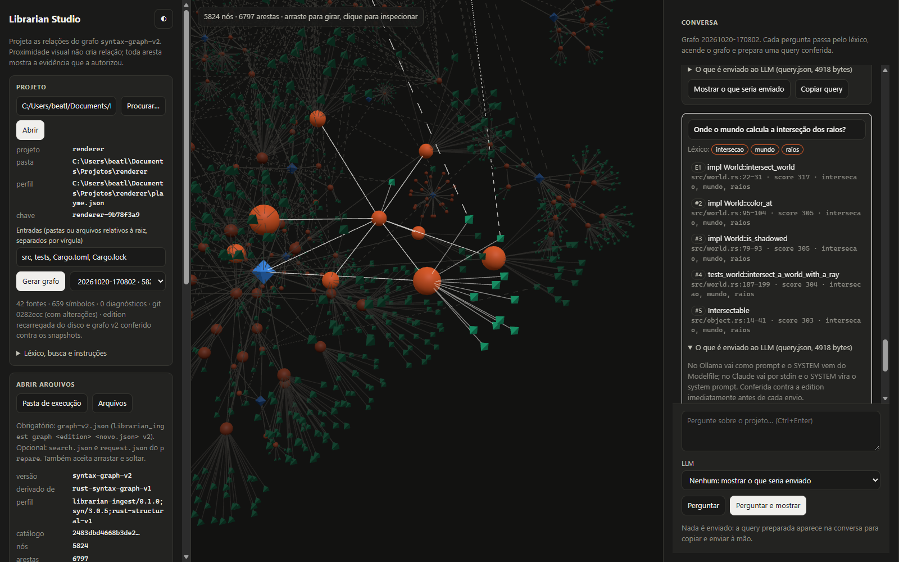
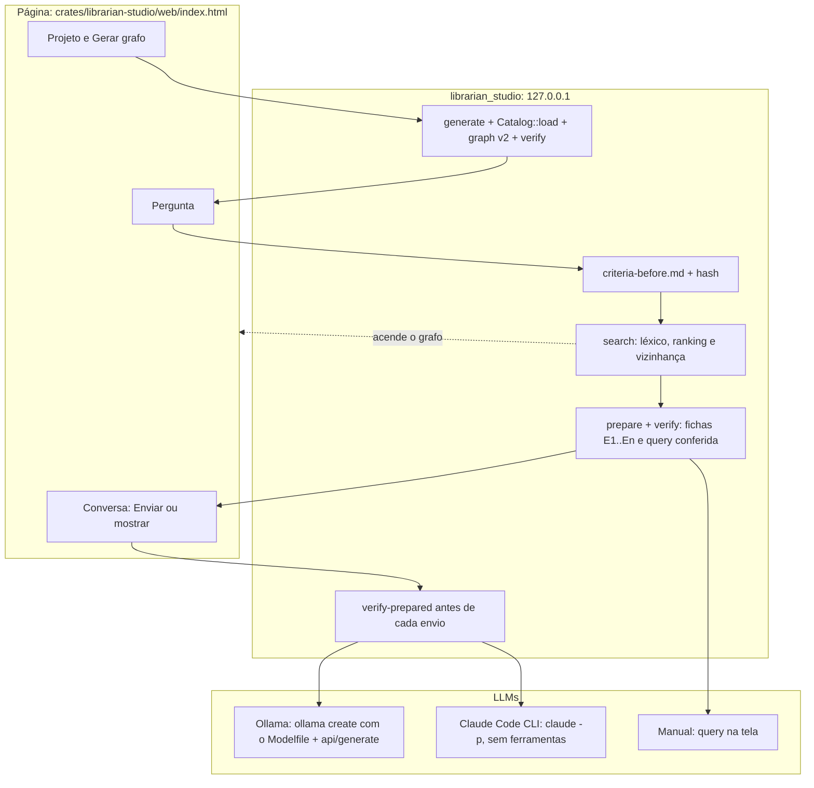

# Librarian Studio: como iniciar e como funciona



O Librarian Studio é a página web por onde se usa o Librarian. Nela você escolhe um
projeto, gera o grafo, faz perguntas, vê acender no grafo o que o léxico alcançou e
envia a query conferida a um LLM, ou só vê o que seria enviado. Ele substitui o antigo
PLAYME.

## Iniciar

Requisitos:

- Rust/Cargo;
- para enviar: [Ollama](https://ollama.com) e/ou o Claude Code instalado e logado;
- na primeira abertura, conexão para baixar Three.js do jsDelivr.

Na raiz do Librarian, dê **duplo clique em `STUDIO.cmd`**. Ele compila em release, sobe
o servidor e abre <http://127.0.0.1:8765/>. Para encerrar, feche a janela do terminal ou
pressione Ctrl+C.

Sem o atalho:

```powershell
cargo run --release --locked -p librarian-studio            # porta 8765
cargo run --release --locked -p librarian-studio -- --port 9000
```

O servidor só aceita conexões da própria máquina (`127.0.0.1`).

## Usar, passo a passo

### 1. Abrir o projeto

O studio analisa projetos **Rust** e **Python**, inclusive os mistos. Digite a pasta no
card **Projeto** ou clique em **Procurar…** e navegue até ela. As pastas aparecem
marcadas como `Cargo` ou `Python` (`pyproject.toml`, `setup.py`, `setup.cfg` ou
`requirements.txt`). Depois clique em **Abrir**.

- Se a pasta tiver um [`librarian.json`](#perfil-do-projeto-librarianjson), entradas,
  léxico, instruções, critérios e parâmetros vêm dele.
- Se não tiver e houver `Cargo.toml`, as entradas são as que existirem entre `src`,
  `tests`, `benches`, `examples`, `Cargo.toml` e `Cargo.lock`.
- Nos outros casos (por exemplo, Python), as entradas são todas as pastas e arquivos
  `.py`/`.rs` do topo, sem ocultos, ambientes virtuais, caches e `node_modules`.
- O léxico começa vazio e as instruções são as padrão do Graph Engine. Sem léxico, os
  termos da pergunta precisam aparecer nos identificadores: num projeto em inglês,
  pergunte em inglês ou crie grupos como `["menor", "shortest"]`.

**Limpar**, ao lado de **Abrir**, fecha o projeto e zera a tela: grafo, conversa e caminho. Ele não apaga nada em `.studio`; reabrindo a pasta, os grafos e as perguntas voltam.

As configurações ficam em **Léxico, busca e instruções**. Editadas ali, valem para as
próximas perguntas e são guardadas no `.studio` (o `librarian.json` do projeto não muda).

**Sugerir léxico com o LLM** (depois de gerar o grafo):

1. O Librarian tira da edition, sem LLM, os 80 termos mais frequentes nos nomes do código.
2. O LLM escolhido na Conversa propõe até 40 grupos de palavras em português. No Ollama,
   o studio usa o Modelfile `lexico` sozinho. Com **Nenhum**, o pedido aparece para copiar, e a resposta de
   qualquer LLM pode ser colada em **Conferir resposta**.
3. Cada grupo é conferido. Ele é recusado se tiver menos de duas palavras, se nenhuma
   palavra existir no código ou se as palavras não forem únicas; palavras já usadas
   noutro grupo saem.
4. Você vê aceitos e recusados, com o motivo, e clica em **Aplicar** para juntar os
   aceitos ao léxico. Pedido, resposta e conferência ficam em
   `.studio/projects/<projeto>/lexicon/`.

**Salvar no projeto…** grava as configurações na pasta do projeto: o `librarian.json`
mais as entradas, o léxico, as instruções e os critérios. Antes, mostra a lista de
arquivos (novo, sobrescreve ou sem mudança) e pede confirmação. Se já houver um
`librarian.json`, os caminhos que ele aponta são mantidos; um projeto novo usa
`ai/librarian/`. É a única ação do studio que escreve no projeto.

### 2. Gerar o grafo

**Gerar grafo** faz o que a CLI faz: gera a edition (snapshots, símbolos, trechos e
diagnósticos), recarrega do disco, monta o `syntax-graph-v2` e o confere contra os
snapshots. Abaixo do botão aparecem fontes, símbolos, diagnósticos e o commit do Git.
Grafos gerados antes ficam no seletor ao lado.

O que o grafo mostra:

- **Nós:** fonte (octaedro), símbolo (esfera) e ocorrência (tetraedro). Formato e cor
  identificam a categoria; a legenda traz as contagens e serve de filtro.
- **Arestas:** `declares`, `contains`, `observes` e `name_candidate` (tracejada, não
  resolvida), cada uma com filtro próprio.
- **Inspeção:** clique num nó para ver categoria, kind, linguagem, ID e relações. Clique
  numa relação ou numa aresta para ver **qual evidência autorizou a ligação**: arquivo,
  linhas, bytes e hashes.
- **Encontrar** por rótulo, kind ou ID. `F` enquadra, `Esc` limpa e o botão ◐ alterna o tema.

O layout de forças é só para leitura: proximidade visual não cria relação, e o layout
muda entre aberturas. Os destaques usam somente IDs, então homônimos não se confundem.

### 3. Perguntar

Escolha o **LLM** no painel, escreva a pergunta e clique no botão abaixo (ou Ctrl+Enter).
Há um botão só, e ele segue o LLM escolhido: com **Nenhum** vira **Perguntar (sem
enviar)** e só mostra a query; com Ollama ou Claude vira **Perguntar e enviar** e já
envia.

1. Os **critérios prévios** do projeto são gravados com a pergunta, antes de existir query
   ou resposta, e o hash deles fica no registro.
2. A pergunta passa pelo **léxico**. Cada termo vira um chip: realçado se tocou algum
   resultado, riscado se não tocou nenhum.
3. Os resultados (E1…En são os que viram fichas) e a vizinhança do primeiro **acendem no
   grafo**: os resultados crescem e ganham rótulo, a vizinhança fica visível, o resto
   quase apaga e a câmera enquadra o conjunto. Clicar num resultado foca o nó.
4. O `prepare` monta a query (fichas estruturais, fontes conferidas contra os snapshots,
   linhas numeradas, instruções do projeto) e a confere em seguida.

Se o léxico não alcançar nada ou a edition tiver diagnósticos, a busca continua visível
e a recusa do `prepare` aparece na pergunta. Clicar numa pergunta antiga a acende de novo.
**Apagar**, no bloco, remove a pergunta, a query e as respostas, inclusive os arquivos
em `.studio`, depois de confirmar.

### 4. Enviar ao LLM, ou só ver

Cada pergunta tem o botão **Enviar**, que usa o LLM escolhido no momento. Serve para
reenviar a mesma query a outro LLM ou com outro Modelfile. A query é conferida de novo
contra a edition imediatamente antes de cada envio.

| Opção | O que faz |
| --- | --- |
| Nenhum: mostrar o que seria enviado | Não envia. Abre a `query.json` exata; **Copiar query** leva para a área de transferência. |
| Ollama (Modelfile) | Copia o Modelfile para a pasta do envio, roda `ollama create librarian-<nome>` e envia ao Ollama em `127.0.0.1:11434`. |
| Claude (Claude Code CLI) | `claude -p` com a sua sessão do Claude Code, sem ferramentas, sem MCP e sem sessão salva. Modelo `sonnet`, `opus` ou `haiku`. O `SYSTEM` do Modelfile escolhido vira o system prompt. Cobra pela sua conta, e o custo aparece na resposta. |
| Claude (API), DeepSeek | Listados como "em breve"; ainda não enviam. |

A resposta aparece na conversa com provedor, Modelfile, modelo, estado, custo e tempo.
`completed` descreve o transporte; **a avaliação semântica continua pendente** e é feita
por você, com os critérios gravados antes.

O executável do Claude é procurado em `LIBRARIAN_CLAUDE`, depois no `PATH`, depois na
extensão mais recente do VS Code. Se o Ollama não responder, inicie o aplicativo e tente
de novo.

### 5. Modelfiles

O seletor **Modelfile** mostra o resumo do escolhido (FROM, PARAMETER, SYSTEM).
**Editar** abre o conteúdo para alterar e salvar; **Novo…** cria outro (por exemplo,
`performance` ou `cenas`). Eles ficam na biblioteca [`modelfiles/`](modelfiles/README.md)
e dá para usar um diferente em cada pergunta.

## Perfil do projeto (`librarian.json`)

Opcional, na raiz do projeto analisado. Caminhos relativos partem da pasta do perfil. O
studio lê o arquivo ao abrir a pasta pela primeira vez. Exemplo real:
[renderer/librarian.json](https://github.com/ViniciusSJV/renderer/blob/master/librarian.json).

```json
{
  "project_root": ".",
  "sources_config": "ai/acervo/renderer-sources.json",
  "lexicon": "ai/acervo/renderer-lexicon.json",
  "instructions": "ai/librarian/instructions.json",
  "criteria": "ai/librarian/criteria-before.md",
  "search": { "top": 5, "depth": 2, "hits": 1 },
  "prepare": { "radius": 0, "numbered_lines": true }
}
```

| Campo | Uso |
| --- | --- |
| `project_root`, `sources_config` | Raiz e arquivos que formam a edition (`{"project", "inputs"}`) |
| `lexicon` | Vocabulário da pergunta: `groups` de sinônimos (por exemplo, português → identificadores) e `stop_words` |
| `instructions` | Array JSON enviado como `instructions` na query: a política de explicação |
| `criteria` | Texto gravado como `criteria-before.md` em cada pergunta, antes da resposta |
| `search.top`, `search.depth` | Corte do ranking (1–10) e profundidade da vizinhança acesa (0–3) |
| `search.hits` | Quantos primeiros resultados viram fichas E1…En (padrão 1) |
| `prepare.radius`, `prepare.numbered_lines` | Linhas extras de contexto e linhas com o número original do arquivo |

Instruções e critérios entram nos bytes da query e dos hashes. Marque-os `-text` no
`.gitattributes` do projeto.

## Como funciona



1. O projeto escolhe os arquivos; o Librarian preserva os bytes e confere a edition. O
   grafo registra pertencimento, tipos escritos, chamadas observadas e candidatos por
   nome, com intervalos e hashes de origem. Não há resolução por compilador.
2. A pergunta é normalizada e expandida pelo léxico explícito. O ranking encontra
   símbolos e o grafo amplia a vizinhança do primeiro resultado.
3. O `prepare` transforma os primeiros resultados em fichas estruturais (onde está cada
   declaração, linhas a–b), confere as fontes contra os snapshots e monta a query.
   **O grafo e os demais resultados não entram na query.**
4. No Ollama, o Modelfile vale por `ollama create`; editar o arquivo sozinho não aplica
   nada. No Claude, só o `SYSTEM` vale.
5. Nenhuma resposta, hipótese ou relação candidata vira fato do acervo.

## Onde ficam os dados

Tudo fica em `.studio/`, na raiz do Librarian, ignorado pelo Git. Nada é escrito dentro do
projeto analisado.

```text
.studio/projects/<projeto>-<hash>/
  project.json                     configurações editadas na página
  runs/<AAAAMMDD-HHMMSS>/
    edition/  graph-v2.json  run.json
    turns/<NN>/
      question.json                pergunta, data, hash dos critérios, recusa do prepare
      criteria-before.md           critérios gravados antes da resposta
      search.json                  o que o léxico tocou e a vizinhança
      prepare-request.json         pedido autocontido do prepare
      prepared/                    request.json, search.json, bundle/ (dossier, question, query, origin)
      sends/<NN>-<provedor>/       query, request, resposta bruta e texto, Modelfile usado, send.json
```

Para começar do zero, apague a pasta do projeto em `.studio/projects/`.

## Limites

- Extractors de Rust e Python; outras linguagens entram por novos extractors.
- Arquivos Python que o parser não aceita (sintaxe acima de cerca do 3.12, como
  `except A, B:` do 3.14) viram diagnóstico. Com diagnósticos, a busca funciona, mas o
  `prepare` só monta a query depois de marcar **Aceitar edition com diagnósticos**.
- Projetos grandes funcionam, com espera. O TheAlgorithms/Python (1.608 arquivos, 59 mil
  nós e 75 mil arestas, `graph-v2.json` de 107 MB) gera em cerca de 13 s e carrega em
  cerca de 1,5 s. O layout leva cerca de 1 min até estabilizar, mas a página responde
  durante esse tempo.
- **Contexto do Ollama:** o Ollama corta, sem erro, a entrada que passa do `num_ctx` do Modelfile, e o envio ainda termina como `completed`. O studio estima o tamanho da query em tokens (bytes ÷ 3,5, mostrado em "O que é enviado ao LLM") e pede confirmação antes de enviar uma query maior que 3/4 do `num_ctx`. Depois do envio, compara o que o Ollama processou (`prompt_eval_count`) com o tamanho da query e marca a resposta em vermelho como "Entrada possivelmente truncada". Um prefixo em cache também reduz a contagem, por isso é uma suspeita, não uma prova. O `analista` usa `num_ctx` 16384; com `hits` maior, reduza `hits` ou aumente o contexto.
- Um envio dura até 300 s e bloqueia só a própria requisição.
- O status do Ollama é lido quando a página abre; recarregue a página depois de iniciá-lo.
- A avaliação semântica é manual; o checker de afirmações ([CLAIMS](crates/librarian-llm-engine/CLAIMS.md)) ainda não faz parte desta trilha (fase L, passo 2).
- Aberta com duplo clique (`file://`), a página só visualiza um `graph-v2.json` escolhido
  em **Abrir arquivos**, sem projeto nem conversa. Para inspeção automatizada, `#debug`
  expõe `window.viewerDebug`.

Detalhes técnicos do servidor: [crates/librarian-studio](crates/librarian-studio/README.md).
