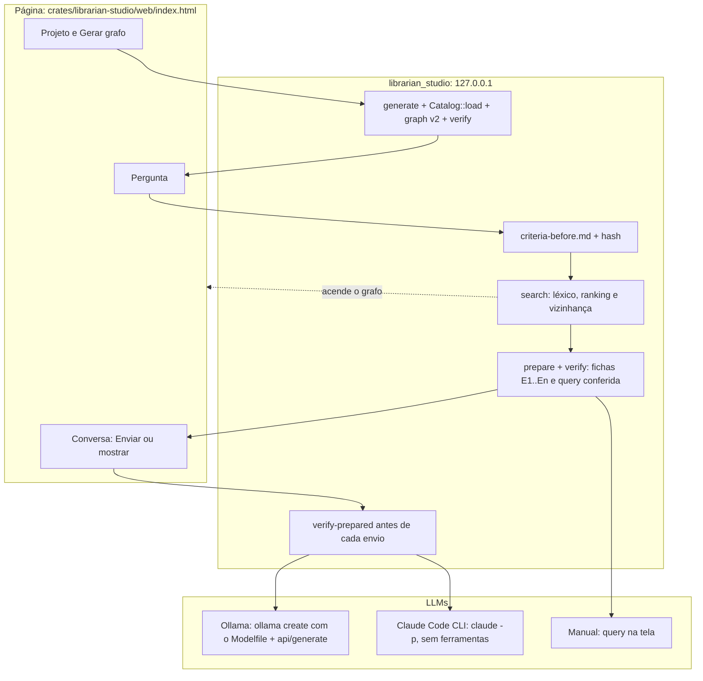

# Librarian Studio: como iniciar e como funciona


O Librarian Studio é a página web por onde se usa o Librarian. Nela você escolhe um
projeto, gera o grafo, faz perguntas, vê acender no grafo o que o léxico alcançou e
envia a query conferida a um LLM, ou só vê o que seria enviado. Ele substitui o antigo
PLAYME.

## Iniciar

Requisitos:

- Rust/Cargo;
- para enviar: [Ollama](https://ollama.com) e/ou o Claude Code instalado e logado;
- na primeira abertura, conexão para baixar Three.js do jsDelivr.

Na raiz do Librarian, dê **duplo clique em `STUDIO.cmd`**. Ele compila em release, sobe
o servidor e abre <http://127.0.0.1:8765/>. Para encerrar, feche a janela do terminal ou
pressione Ctrl+C.

Sem o atalho:

```powershell
cargo run --release --locked -p librarian-studio            # porta 8765
cargo run --release --locked -p librarian-studio -- --port 9000
```

O servidor só aceita conexões da própria máquina (`127.0.0.1`).

## Usar, passo a passo

### 1. Abrir o projeto

O studio analisa projetos **Rust** e **Python**, inclusive os mistos. Digite a pasta no
card **Projeto** ou clique em **Procurar…** e navegue até ela. As pastas aparecem
marcadas como `Cargo` ou `Python` (`pyproject.toml`, `setup.py`, `setup.cfg` ou
`requirements.txt`). Depois clique em **Abrir**.

- Se a pasta tiver um [`librarian.json`](#perfil-do-projeto-librarianjson), entradas,
  léxico, instruções, critérios e parâmetros vêm dele.
- Se não tiver e houver `Cargo.toml`, as entradas são as que existirem entre `src`,
  `tests`, `benches`, `examples`, `Cargo.toml` e `Cargo.lock`.
- Nos outros casos (por exemplo, Python), as entradas são todas as pastas e arquivos
  `.py`/`.rs` do topo, sem ocultos, ambientes virtuais, caches e `node_modules`.
- O léxico começa vazio e as instruções são as padrão do Graph Engine. Sem léxico, os
  termos da pergunta precisam aparecer nos identificadores: num projeto em inglês,
  pergunte em inglês ou crie grupos como `["menor", "shortest"]`.

**Limpar**, ao lado de **Abrir**, fecha o projeto e zera a tela: grafo, conversa e caminho. Ele não apaga nada em `.studio`; reabrindo a pasta, os grafos e as perguntas voltam.

As configurações ficam em **Léxico, busca e instruções**. Editadas ali, valem para as
próximas perguntas e são guardadas no `.studio` (o `librarian.json` do projeto não muda).

**Sugerir léxico com o LLM** (depois de gerar o grafo):

1. O Librarian tira da edition, sem LLM, os 80 termos mais frequentes nos nomes do código.
2. O LLM escolhido na Conversa propõe até 40 grupos de palavras em português. No Ollama,
   o studio usa o Modelfile `lexico` sozinho, a menos que outro `lexico-…` esteja escolhido. Se o nome
   do Modelfile termina em `-en` (por exemplo `lexico-deepseek-en`), o pedido vai em inglês e pede
   palavras em inglês. Com **Nenhum**, o pedido aparece para copiar, e a resposta de
   qualquer LLM pode ser colada em **Conferir resposta**.
3. O pedido leva também as palavras das perguntas do projeto que não tocaram nenhum resultado
   (`missed_terms`, com quantas perguntas as usaram), e o LLM pode devolver `stop_words`: as
   palavras de ligação ("fica", "durante") vão para lá; as do domínio entram num grupo.
4. Cada grupo é conferido. Ele é recusado se tiver menos de duas palavras, se nenhuma
   palavra existir no código ou se as palavras não forem únicas; palavras já usadas
   noutro grupo saem.
5. Cada stop word também é conferida, porque ela some de toda pergunta e pode esconder
   resultados sem aviso. Ela é recusada se aparece em nomes, nomes qualificados ou caminhos
   do código, se está num grupo ou se já é stop word; se só aparece no corpo do código,
   passa com um aviso.
6. Você vê aceitos e recusados, com o motivo, e clica em **Aplicar** para juntar os
   aceitos ao léxico. Pedido, resposta e conferência ficam em
   `.studio/projects/<projeto>/lexicon/`.

**Salvar no projeto…** grava as configurações na pasta do projeto: o `librarian.json`
mais as entradas, o léxico, as instruções e os critérios. Antes, mostra a lista de
arquivos (novo, sobrescreve ou sem mudança) e pede confirmação. Se já houver um
`librarian.json`, os caminhos que ele aponta são mantidos; um projeto novo usa
`ai/librarian/`. É a única ação do studio que escreve no projeto.

### 2. Gerar o grafo

**Gerar grafo** faz o que a CLI faz: gera a edition (snapshots, símbolos, trechos e
diagnósticos), recarrega do disco, monta o `syntax-graph-v2` e o confere contra os
snapshots. Abaixo do botão aparecem fontes, símbolos, diagnósticos e o commit do Git.
Grafos gerados antes ficam no seletor ao lado.

O que o grafo mostra:

- **Nós:** fonte (octaedro), símbolo (esfera) e ocorrência (tetraedro). Formato e cor
  identificam a categoria; a legenda traz as contagens e serve de filtro.
- **Arestas:** `declares`, `contains`, `observes` e `name_candidate` (tracejada, não
  resolvida), cada uma com filtro próprio.
- **Inspeção:** clique num nó para ver categoria, kind, linguagem, ID e relações. Clique
  numa relação ou numa aresta para ver **qual evidência autorizou a ligação**: arquivo,
  linhas, bytes e hashes.
- **Encontrar** por rótulo, kind ou ID. `F` enquadra, `Esc` limpa e o botão ◐ alterna o tema.

O layout de forças é só para leitura: proximidade visual não cria relação, e o layout
muda entre aberturas. Os destaques usam somente IDs, então homônimos não se confundem.

### 3. Perguntar

Escolha o **LLM** no painel, escreva a pergunta e clique no botão abaixo (ou Ctrl+Enter).
Há um botão só, e ele segue o LLM escolhido: com **Nenhum** vira **Perguntar (sem
enviar)** e só mostra a query; com Ollama ou Claude vira **Perguntar e enviar** e já
envia.

1. Os **critérios prévios** do projeto são gravados com a pergunta, antes de existir query
   ou resposta, e o hash deles fica no registro.
2. A pergunta passa pelo **léxico**. Cada termo vira um chip: realçado se tocou algum
   resultado, riscado se não tocou nenhum.
3. Os resultados (E1…En são os que viram fichas) e a vizinhança do primeiro **acendem no
   grafo**: os resultados crescem e ganham rótulo, a vizinhança fica visível, o resto
   quase apaga e a câmera enquadra o conjunto. Clicar num resultado foca o nó.
4. O `prepare` monta a query (fichas estruturais, fontes conferidas contra os snapshots,
   linhas numeradas, instruções do projeto) e a confere em seguida.
5. No formato **claims** (veja abaixo), o studio deriva desse bundle conferido a query de
   claims, que é a enviada.

Se o léxico não alcançar nada ou a edition tiver diagnósticos, a busca continua visível
e a recusa do `prepare` aparece na pergunta. Clicar numa pergunta antiga a acende de novo.
**Apagar**, no bloco, remove a pergunta, a query e as respostas, inclusive os arquivos
em `.studio`, depois de confirmar.

### 4. Enviar ao LLM, ou só ver

Cada pergunta tem o botão **Enviar**, que usa o LLM escolhido no momento. Serve para
reenviar a mesma query a outro LLM ou com outro Modelfile. A query é conferida de novo
contra a edition imediatamente antes de cada envio.

Cada envio grava o **vínculo** com o que foi conferido (`link` no `send.json`): o hash da
query enviada, a origem (`edition:<hash>`), as fichas selecionadas, os hashes do
`origin.json`, do dossiê e, em claims, do `context.json`, além do hash dos critérios.
Critérios editados depois da pergunta recusam o envio. O Ollama e o Claude CLI comparam
os bytes que vão enviar com o hash do vínculo e, se a query mudou entre a conferência e
o envio, nada é enviado (`input_rejected`). A resposta mostra "Vínculo: enviou a … (sha256
…) conferida contra a edition antes do envio". O vínculo é registro do studio, não
assinatura. Envios feitos antes dele não têm `link`.

| Opção | O que faz |
| --- | --- |
| Nenhum (só preparar para copiar) | Não envia. Abre a `query.json` exata; **Copiar query** leva para a área de transferência. Em claims, a caixa **Resposta colada** recebe a resposta trazida de fora: a pergunta é reconferida, a resposta é ligada à query pelo hash e passa pela mesma conferência mecânica. Aparece como "Resposta colada", porque o studio não sabe quem a escreveu. |
| Ollama (Modelfile) | Copia o Modelfile para a pasta do envio, roda `ollama create librarian-<nome>` e envia ao Ollama em `127.0.0.1:11434`. |
| Claude (Claude Code CLI) | `claude -p` com a sua sessão do Claude Code, sem ferramentas, sem MCP e sem sessão salva. Modelo `sonnet`, `opus` ou `haiku`. O `SYSTEM` do Modelfile escolhido vira o system prompt. Cobra pela sua conta, e o custo aparece na resposta. |
| Claude (API), DeepSeek | Listados como "em breve"; ainda não enviam. |

A resposta aparece na conversa com provedor, Modelfile, modelo, estado, custo e tempo.
`completed` descreve o transporte; **a avaliação semântica continua pendente** e é feita
por você, com os critérios gravados antes.

O executável do Claude é procurado em `LIBRARIAN_CLAUDE`, depois no `PATH`, depois na
extensão mais recente do VS Code. Se o Ollama não responder, inicie o aplicativo e tente
de novo.

### Formato da resposta: claims ou prosa

Em **Léxico, busca e instruções**, o campo **Formato da resposta** vale por projeto e fica
gravado em cada pergunta no momento em que ela é feita. Trocar depois não muda as
perguntas antigas. Projetos novos começam em **claims**; os abertos antes desta opção
continuam em **prosa**.

| Formato | O que vai ao LLM | O que volta |
| --- | --- | --- |
| Prosa | A query do Graph Engine (`prepared/bundle/query.json`) | Texto livre; a conferência é feita à mão |
| Claims | A query do [checker de afirmações](crates/librarian-llm-engine/CLAIMS.md) (`claims/query.json`) | Um JSON de claims (FACT, LACUNA e, se permitidas, INFERENCE e HYPOTHESIS), conferido automaticamente |

Como a query de claims é montada:

- **Evidência:** as janelas de contexto do bundle conferido, com o mesmo texto que a prosa
  mostraria. Uma ficha só vira a evidência `E1`; várias viram os blocos `CTX_1`, `CTX_2`…
- **Símbolos:** as declarações da edition cujo trecho cabe na janela. A linha da
  declaração é a primeira linha de código do trecho em que o nome aparece como
  identificador inteiro; atributos (`#[...]`), comentários e decorators (`@...`) são
  pulados.
  Com símbolos, cada FACT precisa de `location` (símbolo, linha da declaração, linhas da
  operação) e de citar a declaração e a operação.
- **Limites:** os `unknowns` do dossiê vão em `evidence.limits`.
- **Instruções:** as fixas do checker valem sempre. As do projeto vão à parte, em
  `project_instructions`, e não podem relaxar as fixas.
- **Política:** **permitir INFERENCE** e **permitir HYPOTHESIS** vêm desligadas. Com elas
  desligadas, o checker recusa essas categorias mesmo que a pergunta as peça.

Antes de cada envio, `claims/context.json` e `claims/query.json` são derivados de novo do
bundle e comparados byte a byte; qualquer diferença recusa o envio.

Depois do envio, a resposta passa pela **conferência mecânica**:

- JSON no schema, um claim por afirmação, ids únicos;
- cada citação aponta para uma evidência existente, com path certo, linhas dentro da
  janela e quote igual às linhas da fonte;
- `location` aponta para um símbolo da evidência, com a operação dentro dele, e a
  declaração e a operação estão citadas;
- INFERENCE tem premissas, HYPOTHESIS tem plano de verificação e as outras categorias não
  têm nenhum dos dois;
- o texto só afirma o que as citações do claim mostram (`strict_text`): todo número de
  linha escrito no texto está numa citação do claim, e todo trecho entre crases aparece
  nas linhas citadas. Uma resposta que diz "na linha 88 faz `Ray::new(...)`" sem citar
  a linha 88 é recusada. As perguntas feitas antes desta regra continuam conferidas sem
  ela;
- a operação aponta um trecho da função, não a função inteira (`precise_location`):
  começar na linha da declaração, ou cobrir todo o corpo, é recusado, exceto em funções
  ou corpos de uma linha. Também vale só para as perguntas novas.
- com **Claims: permitir patch numa HYPOTHESIS** (opção do projeto, gravada com cada
  pergunta, junto com **permitir HYPOTHESIS**), uma hipótese pode trazer a mudança
  proposta como **edições de linhas** (`edits`: troque as linhas X–Y por estas, insira
  depois da linha Z). As edições precisam ficar dentro das linhas entregues, citar cada
  linha que trocam e não se sobrepor. O studio monta o diff, mostra em **Mudança
  proposta** e grava `patch-<id>.diff` na pasta do envio, para você aplicar com
  `git apply` numa branch do projeto. O studio nunca aplica nada, e encaixar não prova que
  compila nem que ficou mais rápido. É a etapa de performance da cadeia, com os Modelfiles
  `performance` (DeepSeek) e `performance-qwen`. As perguntas feitas antes desta mudança
  continuam com o diff unificado (`patch`), conferido como antes.

A resposta mostra **Mecânica: aprovada** ou **recusada**, com os problemas por claim (cada um com uma frase simples e um **?** que explica), e a
lista de claims com location e citações. A resposta bruta fica em **Resposta bruta**. Se
o JSON vier dentro de uma única cerca de Markdown (` ```json `), ele é extraído e isso
aparece na resposta e no `check.json`.

Antes da conferência, o Librarian completa as citações a partir da evidência: cita a
declaração e as linhas da operação que o modelo escreveu em `location` e não citou, e move
uma citação cujo trecho transcrito está, exatamente e uma só vez, em outras linhas (a
operação vai junto, se apontava as mesmas linhas). Nenhuma regra é afrouxada; o que foi
completado aparece em **Completado pelo Librarian a partir da evidência**, fica em
`resolutions` no `check.json` e vai junto com o fato aprovado. A resposta bruta não muda.
Detalhes em [CLAIMS.md](crates/librarian-llm-engine/CLAIMS.md#citações-completadas-a-partir-da-evidência).

**Aprovada na mecânica não quer dizer correta.** Quer dizer só que a resposta aponta para
linhas reais da edition no formato pedido. O sentido continua pendente (`semantic_status:
pending`, `accepted: false`) e é avaliado por você, com os critérios gravados antes.

### Revisar e promover a fato (L4)

Cada FACT de uma resposta em claims tem **Aprovar como fato** e **Recusar**. Ao aprovar,
você escreve na nota por que o item é verdadeiro. O studio só promove o item se ele
passar por quatro portões, refeitos no momento da aprovação:

1. **Mecânico:** a resposta preservada (`response.txt`) é a mesma que foi conferida e
   passa de novo na conferência, contra o contexto conferido agora.
2. **Vínculo:** o envio tem o vínculo da L3, a pergunta ainda confere contra a edition, a
   query dela é a que foi enviada e a cópia preservada no envio tem o hash do vínculo.
3. **Revisão humana:** a sua decisão, com a nota, por item.
4. **Registro:** o fato entra no **Acervo de fatos** do projeto com enunciado, arquivo,
   linhas, trechos citados, autoria "revisão humana no Librarian Studio" e origem
   (edition, execução, pergunta, envio, item, hashes do item e da resposta, vínculo).

Só FACT é promovido; LACUNA, INFERENCE e HYPOTHESIS nunca viram fato. Uma resposta
recusada na mecânica ou um envio sem vínculo mostram o motivo no lugar do botão. Um item
já promovido mostra **Aprovado como fato F<n>** e **Revogar**: revogar registra a recusa
e marca o fato como revogado, sem apagá-lo. Aprovar de novo cria outro número.

O **Acervo de fatos** (no bloco do projeto) lista os fatos e os reconfere contra a
edition da execução escolhida: **vigente** quando cada trecho citado continua igual, no
mesmo arquivo e nas mesmas linhas; **desatualizado** quando não (o fato não é apagado nem
procurado em outra linha); **revogado** quando você recusou depois. Vigente confere o
texto, não o sentido. Os fatos entram nas perguntas só pela cadeia (abaixo).

### Continuar em cadeia

Uma pergunta em claims com ao menos uma resposta aprovada na mecânica ganha o botão
**Continuar em cadeia**. Escolha antes o LLM e o Modelfile da próxima etapa (por exemplo,
`analista` para achar a função e outro Modelfile para a etapa seguinte), clique e escreva a
próxima pergunta. O studio cria uma pergunta nova e a envia como as outras:

- **Evidência:** as declarações (`location`) dos FACT das respostas que passam **de novo**
  na conferência mecânica, contra a pergunta conferida agora. Não há busca: o `prepare`
  acha cada declaração na edition pelo arquivo, nome e linha, e tira as linhas de novo da
  estante. Declaração que não existe mais recusa a pergunta.
- **Fatos revisados:** os fatos **vigentes** do acervo sobre essas declarações entram
  como fichas F (autoria "revisão humana no Librarian Studio"), com os trechos conferidos
  contra a edition. No formato claims, eles aparecem em `evidence.reviewed_facts`, com a
  instrução de que orientam a resposta, mas não são citáveis.
- **Contexto do dono** (grafo gerado no perfil v4): quando a declaração é um método, entram
  também o tipo dono (a struct com o nome do `impl`, ou a classe que contém o método em
  Python) e os métodos que escrevem os campos que esse método lê (por `self.campo = …` ou
  por um literal do tipo, como `Self { campo: .. }`). Assim uma etapa de performance vê
  onde guardar um valor num campo novo. No máximo 8 declarações. Escritas por outra
  variável (`camera.transform = …`) não entram, porque o tipo dela não é conhecido; a faixa
  diz quantas foram.
- **O que não passa:** o texto das respostas anteriores. Elas ficam ligadas por hash
  (`chain` no `question.json`: pergunta de origem, envios, itens usados, hash da resposta,
  declarações e fatos).

A pergunta nova mostra a faixa **cadeia ← NN** com a evidência, os fatos e as respostas
usadas (e, no v4, a faixa **contexto do dono**), e pode ser continuada de novo. No teste real, o DeepSeek copiou um fato revisado
como resposta, com a função inteira como operação, e a conferência mecânica recusou.

### Comparar respostas

Quando uma pergunta em claims tem duas ou mais respostas (por exemplo, a mesma pergunta
enviada ao Ollama e ao Claude), aparece o bloco **Comparar respostas**, atualizado a cada
envio. Para isso, pergunte uma vez e use o botão **Enviar** da própria pergunta para cada
LLM; perguntar de novo cria outra pergunta, que não entra na comparação. O bloco não
compara a redação, compara o **conteúdo** de cada item:

- o tipo (FACT, LACUNA…);
- com `location`: a função e as linhas da operação;
- sem `location`: as linhas citadas.

Cada linha da tabela é um conteúdo encontrado em alguma resposta, e cada coluna é uma
resposta:

| Marca | Significado |
| --- | --- |
| `=` | a resposta diz exatamente isso |
| `≈` | parcial: a mesma função com linhas que se cruzam, ou as mesmas linhas com outro tipo |
| `·` | a resposta não diz isso |

Não há tolerância: uma linha a mais já é parcial. As respostas recusadas na mecânica
entram marcadas, porque podem apontar o lugar certo com a forma errada (o caso do qwen,
que acerta a linha 86 sem citar a declaração). A comparação é recalculada dos
`check.json` já gravados.

**Concordância é sinal, não prova.** Modelos diferentes podem errar juntos.

### Onde é usado? (vista Caminho)

Clique num símbolo do mapa (ou num resultado de **Encontrar**) e, na **Inspeção**, em
**Onde é usado?**. A vista **Caminho** cobre o mapa e mostra, da esquerda para a direita:
o ponto escolhido, quem lê, escreve ou chama o nome dele, quem usa esses, e assim por
diante, até a **profundidade** escolhida (padrão 2).

- **Caixas** são a classe (ou impl) de cada função, ou o arquivo quando não há classe.
- **Linha cheia:** o nome escrito só combina com aquele ponto. **Tracejada:** combina
  também com homônimos, então pode ser outro.
- **Clique numa linha** para ver o texto escrito e o arquivo e linha. **Clique num ponto**
  para inspecioná-lo; **duplo clique** recomeça a vista a partir dele.
- **Esconder testes** (ligado) tira funções e arquivos de teste pela convenção de nomes;
  **só usos sem homônimos** tira as linhas tracejadas.
- Há um teto de 120 pontos; acima dele, a vista avisa.

Exige um grafo gerado com o perfil v3 ou v4 (desde a G6). No v4, também aparecem quem
constrói o tipo (`Camera { .. }`), quem preenche ou escreve um campo (`self.transform = …`)
e o `impl` que implementa o tipo. É um mapa de candidatos pelo nome
escrito, não um grafo de chamadas resolvido.

**Quando não aparece nada, ou aparece menos do que existe:**

- o grafo é anterior à G6: gere de novo;
- o nome tem mais de 8 homônimos (`new`, `get`, `__init__`): nenhuma ligação é desenhada,
  e a inspeção da ocorrência mostra a contagem;
- os filtros esconderam os usos (a vista avisa quantos);
- o uso está escrito numa forma que ainda não é registrada: em Rust, dentro de macros
  (`assert_eq!`, `println!`), em padrões, e usos de constantes e variantes de enum (os
  literais, como `Vehicle { placa: x }`, só a partir do perfil v4); em Python, argumentos
  nomeados (`User(email=...)`) e `getattr`;
- o nome não aparece escrito em outro lugar, ou só em outra linguagem.

**Ausência na vista não prova que ninguém usa.**

### O que ele chama? (vista Caminho, para a frente)

Ao lado de **Onde é usado?**, na **Inspeção**. A mesma vista, no sentido contrário: o ponto
escolhido à esquerda, o que ele chama, o que esses chamam, até a profundidade escolhida.
Serve para achar o caminho de uma operação (por exemplo, de `render` até `shade_hit` e
`lighting`) quando a busca por nome não chega lá.

Uma chamada só é **seguida** (linha cheia) quando o nome escrito aponta uma declaração:

- **única:** só existe uma declaração com esse nome;
- **receptor:** é chamada do próprio receptor (`self.shade_hit(...)`) e só um dos homônimos
  está na mesma classe ou `impl` de quem chama (exige o perfil v4);
- **escolhida:** você escolheu.

Se o nome combina com vários homônimos (`world.color_at(...)` combina com sete `color_at`),
a linha fica **tracejada** e o caminho para ali. Clique nela: o detalhe mostra o nome
completo (`impl World::color_at`) e **Seguir por este** continua a partir dele.
**Limpar escolhas** desfaz todas; **duplo clique** num ponto recomeça a vista dele mantendo
as escolhas. **Só chamadas seguidas** esconde as tracejadas.

É um mapa pelo nome, sem compilador: não prova que a chamada acontece nem quantas vezes.

### 5. Modelfiles

O seletor **Modelfile** mostra o resumo do escolhido (FROM, PARAMETER, SYSTEM).
**Editar** abre o conteúdo para alterar e salvar; **Novo…** cria outro (por exemplo,
`performance` ou `cenas`). Eles ficam na biblioteca [`modelfiles/`](modelfiles/README.md)
e dá para usar um diferente em cada pergunta.

## Perfil do projeto (`librarian.json`)

Opcional, na raiz do projeto analisado. Caminhos relativos partem da pasta do perfil. O
studio lê o arquivo ao abrir a pasta pela primeira vez. Exemplo real:
[renderer/librarian.json](https://github.com/ViniciusSJV/renderer/blob/master/librarian.json).

```json
{
  "project_root": ".",
  "sources_config": "ai/acervo/renderer-sources.json",
  "lexicon": "ai/acervo/renderer-lexicon.json",
  "instructions": "ai/librarian/instructions.json",
  "criteria": "ai/librarian/criteria-before.md",
  "search": { "top": 5, "depth": 2, "hits": 1 },
  "prepare": { "radius": 0, "numbered_lines": true },
  "answer": { "format": "claims", "allow_inference": false, "allow_hypothesis": false }
}
```

| Campo | Uso |
| --- | --- |
| `project_root`, `sources_config` | Raiz e arquivos que formam a edition (`{"project", "inputs"}`) |
| `lexicon` | Vocabulário da pergunta: `groups` de sinônimos (por exemplo, português → identificadores) e `stop_words` |
| `instructions` | Array JSON enviado como `instructions` na query: a política de explicação |
| `criteria` | Texto gravado como `criteria-before.md` em cada pergunta, antes da resposta |
| `search.top`, `search.depth` | Corte do ranking (1–10) e profundidade da vizinhança acesa (0–3) |
| `search.hits` | Quantos primeiros resultados viram fichas E1…En (padrão 1) |
| `search.exclude_tests` | **Busca sem testes**: deixa de fora as funções que o catálogo marca como teste e o que está escrito dentro delas (padrão `false`); auxiliares fora de uma função de teste continuam |
| `prepare.radius`, `prepare.numbered_lines` | Linhas extras de contexto e linhas com o número original do arquivo |
| `answer.format` | `claims` ou `prose`; sem o campo, um projeto novo começa em `claims` |
| `answer.allow_inference`, `answer.allow_hypothesis` | Política do formato claims (padrão `false`) |

Instruções e critérios entram nos bytes da query e dos hashes. Marque-os `-text` no
`.gitattributes` do projeto.

## Como funciona



1. O projeto escolhe os arquivos; o Librarian preserva os bytes e confere a edition. O
   grafo registra pertencimento, tipos escritos, chamadas observadas e candidatos por
   nome, com intervalos e hashes de origem. Não há resolução por compilador.
2. A pergunta é normalizada e expandida pelo léxico explícito. O ranking encontra
   símbolos e o grafo amplia a vizinhança do primeiro resultado.
3. O `prepare` transforma os primeiros resultados em fichas estruturais (onde está cada
   declaração, linhas a–b), confere as fontes contra os snapshots e monta a query.
   **O grafo e os demais resultados não entram na query.**
4. No Ollama, o Modelfile vale por `ollama create`; editar o arquivo sozinho não aplica
   nada. No Claude, só o `SYSTEM` vale.
5. Nenhuma resposta, hipótese ou relação candidata vira fato do acervo.

## Onde ficam os dados

Tudo fica em `.studio/`, na raiz do Librarian, ignorado pelo Git. Nada é escrito dentro do
projeto analisado.

```text
.studio/projects/<projeto>-<hash>/
  project.json                     configurações editadas na página
  facts.jsonl                      acervo de fatos: promoções e revogações, só acrescentadas
  runs/<AAAAMMDD-HHMMSS>/
    edition/  graph-v2.json  run.json
    last-turn.txt                  maior número de pergunta já usado (não é reutilizado)
    turns/<NN>/
      question.json                pergunta, data, formato, hash dos critérios, recusas
      criteria-before.md           critérios gravados antes da resposta
      search.json                  o que o léxico tocou e a vizinhança
      prepare-request.json         pedido autocontido do prepare
      prepared/                    request.json, search.json, bundle/ (dossier, question, query, origin)
      claims/                      context.json e query.json (só no formato claims)
      sends/<NN>-<provedor>/       query, request, resposta bruta e texto, Modelfile usado,
                                   send.json (com o vínculo) e, em claims, check.json e
                                   reviews.jsonl (as suas decisões por item)
```

Para começar do zero, apague a pasta do projeto em `.studio/projects/`.

## Limites

- Extractors de Rust e Python; outras linguagens entram por novos extractors.
- Arquivos Python que o parser não aceita (sintaxe acima de cerca do 3.12, como
  `except A, B:` do 3.14) viram diagnóstico. Com diagnósticos, a busca funciona, mas o
  `prepare` só monta a query depois de marcar **Aceitar edition com diagnósticos**.
- Projetos grandes funcionam, com espera. O TheAlgorithms/Python (1.608 arquivos, 59 mil
  nós e 75 mil arestas, `graph-v2.json` de 107 MB) gera em cerca de 13 s e carrega em
  cerca de 1,5 s. O layout leva cerca de 1 min até estabilizar, mas a página responde
  durante esse tempo.
- **Contexto do Ollama:** o Ollama corta, sem erro, a entrada que passa do `num_ctx` do Modelfile, e o envio ainda termina como `completed`. O studio estima o tamanho da query em tokens (bytes ÷ 3,5, mostrado em "O que é enviado ao LLM") e pede confirmação antes de enviar uma query maior que 3/4 do `num_ctx`. Depois do envio, compara o que o Ollama processou (`prompt_eval_count`) com o tamanho da query e marca a resposta em vermelho como "Entrada possivelmente truncada". Um prefixo em cache também reduz a contagem, por isso é uma suspeita, não uma prova. O `analista` usa `num_ctx` 16384; com `hits` maior, reduza `hits` ou aumente o contexto.
- Um envio dura até 300 s e bloqueia só a própria requisição.
- O status do Ollama é lido quando a página abre; recarregue a página depois de iniciá-lo.
- A conferência do formato claims é só mecânica. A avaliação semântica continua manual, e
  nada é promovido a Fact pelo studio (fase L, passo 4). O `strict_text` não vê uma
  paráfrase sem número de linha nem crase, e não confere se há uma só afirmação por
  claim.
- A linha da declaração de um símbolo ainda é achada no texto, não pelo parser. Linhas
  de atributo, comentário e decorator são puladas; um nome repetido numa linha de código
  antes da declaração (raro) ainda seria tomado por ela.
- Para o formato claims, use o Modelfile `verificavel`; o `analista` foi escrito para
  prosa. Com o qwen 14B, nenhum dos dois fez o modelo citar a declaração em cada item.
- Aberta com duplo clique (`file://`), a página só visualiza um `graph-v2.json` escolhido
  em **Abrir arquivos**, sem projeto nem conversa. Para inspeção automatizada, `#debug`
  expõe `window.viewerDebug`.

Detalhes técnicos do servidor: [crates/librarian-studio](crates/librarian-studio/README.md).
