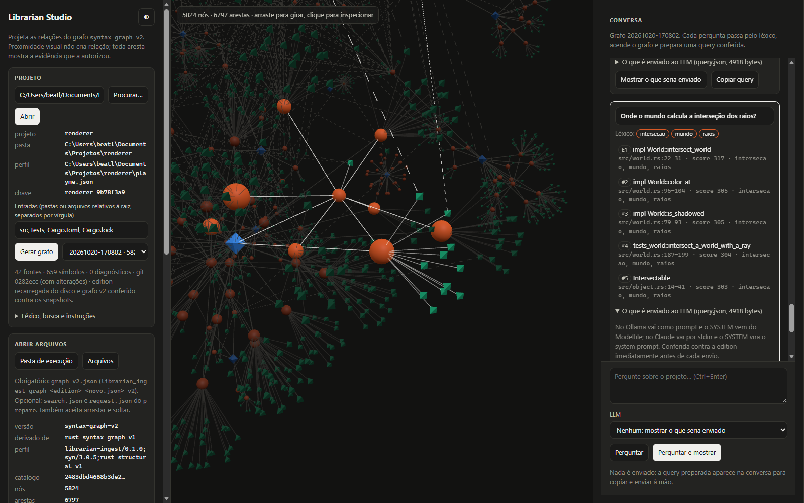
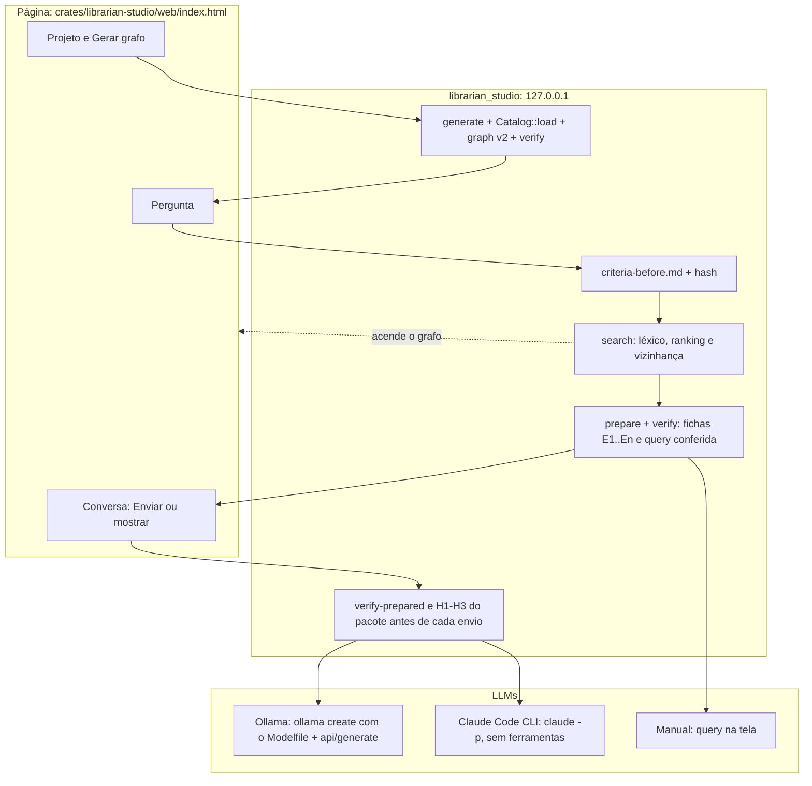

# Librarian Studio: como iniciar e como funciona



O Librarian Studio é a página web por onde se usa o Librarian. Nela você escolhe um
projeto, gera o grafo, faz perguntas, vê acender no grafo o que o léxico alcançou e
envia a query conferida a um LLM, ou só vê o que seria enviado. Ele substitui o antigo
PLAYME.

## Iniciar

Requisitos:

- Rust/Cargo;
- para enviar: [Ollama](https://ollama.com) e/ou o Claude Code instalado e logado;
- na primeira abertura, conexão para baixar Three.js do jsDelivr.

Na raiz do Librarian, dê **duplo clique em `STUDIO.cmd`**. Ele compila em release, sobe
o servidor e abre <http://127.0.0.1:8765/>. Para encerrar, feche a janela do terminal ou
pressione Ctrl+C.

Sem o atalho:

```powershell
cargo run --release --locked -p librarian-studio            # porta 8765
cargo run --release --locked -p librarian-studio -- --port 9000
```

O servidor só aceita conexões da própria máquina (`127.0.0.1`).

## Usar, passo a passo

A tela tem três colunas. A da esquerda segue as etapas do método, em abas: **Projeto**
(abrir, gerar o grafo e as configurações das perguntas), **Léxico**, **Régua** (os comandos
do projeto e as execuções), **Acervo** (os fatos aprovados) e **Mapa** (encontrar, inspeção
e busca sobreposta). No meio fica o grafo, com a legenda recolhida no canto. À direita fica a
**Conversa**, com as perguntas e o campo de pergunta. Clicar num nó do grafo abre a aba
**Mapa**.

Cada ação que chama um LLM escolhe quem responde no próprio lugar: ao lado de **Sugerir
léxico**, no campo de pergunta e nos diálogos de **Continuar em cadeia**, **Enviar…** e
das perguntas do caminho. Cada tipo de ação lembra a última escolha. Os "?" de títulos
ficam sempre visíveis; os de dentro aparecem ao passar o mouse na linha.

### 1. Abrir o projeto

O studio analisa projetos **Rust** e **Python**, inclusive os mistos. Digite a pasta no
card **Projeto** ou clique em **Procurar…** e navegue até ela. As pastas aparecem
marcadas como `Cargo` ou `Python` (`pyproject.toml`, `setup.py`, `setup.cfg` ou
`requirements.txt`). Depois clique em **Abrir**.

- Se a pasta tiver um [`librarian.json`](#perfil-do-projeto-librarianjson), entradas,
  léxico, instruções, critérios e parâmetros vêm dele.
- Se não tiver e houver `Cargo.toml`, as entradas são as que existirem entre `src`,
  `tests`, `benches`, `examples`, `Cargo.toml` e `Cargo.lock`.
- Nos outros casos (por exemplo, Python), as entradas são todas as pastas e arquivos
  `.py`/`.rs` do topo, sem ocultos, ambientes virtuais, caches e `node_modules`.
- O léxico começa vazio e as instruções são as padrão do Graph Engine. Sem léxico, os
  termos da pergunta precisam aparecer nos identificadores: num projeto em inglês,
  pergunte em inglês ou crie grupos como `["menor", "shortest"]`.

**Limpar**, ao lado de **Abrir**, fecha o projeto e zera a tela: grafo, conversa e caminho. Ele não apaga nada em `.studio`; reabrindo a pasta, os grafos e as perguntas voltam.

O léxico fica na aba **Léxico**, com **Salvar léxico**. Busca, formato da resposta e
instruções ficam em **Configurações das perguntas**, na aba **Projeto**. Editadas ali, valem
para as próximas perguntas e são guardadas no `.studio` (o `librarian.json` do projeto não
muda). Hipótese e mudança proposta seguem o modo da pergunta (veja Perguntar), e os critérios
prévios ficam no campo de pergunta, no modo **Melhorar**.

**Sugerir léxico com o LLM** (na aba **Léxico**, depois de gerar o grafo):

1. O Librarian tira da edition, sem LLM, os 80 termos mais frequentes nos nomes do código.
2. O LLM escolhido ao lado do botão (de início, Ollama com o Modelfile `lexico-qwen3coder`) propõe até
   40 grupos de palavras em português. Se o nome
   do Modelfile termina em `-en` (por exemplo `lexico-claude-en`), o pedido vai em inglês e pede
   palavras em inglês. Com **Nenhum**, o pedido aparece para copiar, e a resposta de
   qualquer LLM pode ser colada em **Conferir resposta**.
3. O pedido leva também as palavras das perguntas do projeto que não tocaram nenhum resultado
   (`missed_terms`, com quantas perguntas as usaram), e o LLM pode devolver `stop_words`: as
   palavras de ligação ("fica", "durante") vão para lá; as do domínio entram num grupo.
4. Cada grupo é conferido. Ele é recusado se tiver menos de duas palavras, se nenhuma
   palavra existir no código ou se as palavras não forem únicas; palavras já usadas
   noutro grupo saem.
5. Cada stop word também é conferida, porque ela some de toda pergunta e pode esconder
   resultados sem aviso. Ela é recusada se aparece em nomes, nomes qualificados ou caminhos
   do código, se está num grupo ou se já é stop word; se só aparece no corpo do código,
   passa com um aviso.
6. Você vê aceitos e recusados, com o motivo, e clica em **Aplicar** para juntar os
   aceitos ao léxico. Pedido, resposta e conferência ficam em
   `.studio/projects/<projeto>/lexicon/`.

**Salvar no projeto…** grava as configurações na pasta do projeto: o `librarian.json`
mais as entradas, o léxico, as instruções e os critérios. Antes, mostra a lista de
arquivos (novo, sobrescreve ou sem mudança) e pede confirmação. Se já houver um
`librarian.json`, os caminhos que ele aponta são mantidos; um projeto novo usa
`ai/librarian/`. É a única ação do studio que escreve no projeto.

### 2. Gerar o grafo

**Gerar grafo** faz o que a CLI faz: gera a edition (snapshots, símbolos, trechos e
diagnósticos), recarrega do disco, monta o `syntax-graph-v2` e o confere contra os
snapshots. Abaixo do botão aparecem fontes, símbolos, diagnósticos e o commit do Git.
Grafos gerados antes ficam no seletor ao lado.

O grafo aparece no **Mapa** como uma **cidade**:

- **Bairro:** um arquivo. **Prédio:** uma função ou método. As posições são fixas, em grade, e
  proximidade não quer dizer relação.
- **Com "Medir tudo":** só as funções com contagem acima de zero. A altura é a contagem observada (em escala
  log), e só é número de chamadas quando a linha é a instrução de entrada do Medir tudo, a cor é o tempo, de azul (pouco) a vermelho (muito), e um anel vermelho marca trava,
  espera ou E/S dentro de laço.
- **Sem medição** (ainda não medido, ou uma linguagem que a medição não conta, como Python):
  todas as funções, com a altura pelo tamanho e uma cor só. A barra no topo diz qual é o caso.
- **Clique num prédio:** ele e os ligados a ele mantêm a cor, o resto fica apagado e os arcos
  mostram quem chama e quem é chamado. Sem medição, os arcos são pelo nome escrito e podem
  incluir homônimos.
- **Inspeção** (aba **Mapa**): categoria, kind, linguagem, ID e relações do que foi clicado.
  Clique numa relação para ver **qual evidência autorizou a ligação**: arquivo, linhas, bytes
  e hashes.
- **Encontrar** por rótulo, kind ou ID: o que não é função (um tipo, uma ocorrência) leva ao
  prédio que o contém ou ao bairro do arquivo. `F` enquadra, `Esc` limpa e o botão ◐ alterna o
  tema. Os destaques usam somente IDs, então homônimos não se confundem.


### 3. Perguntar

No campo de pergunta, escolha o modo, escreva a pergunta e clique no botão abaixo (ou
Ctrl+Enter):

- **Localizar** pede só fatos: onde o código faz algo, com a linha e o trecho copiado.
- **Melhorar** também aceita uma hipótese com uma mudança proposta (liga **permitir
  HYPOTHESIS** e **patch**) e mostra os **critérios prévios**, gravados com a pergunta antes
  da resposta.

Cada modo lembra quem responde (LLM e Modelfile), escolhido logo abaixo da pergunta. O
botão diz o que vai acontecer: com **Nenhum**, **Perguntar (sem enviar)** só mostra a
query; com Ollama ou Claude, **Perguntar · Ollama · verificavel-qwen3coder**, por exemplo, já envia.
Com declarações no envelope (veja Pergunta com declarações juntadas), o botão vira
**Perguntar com o envelope (N)**.

1. Os **critérios prévios** do projeto são gravados com a pergunta, antes de existir query
   ou resposta, e o hash deles fica no registro.
2. A pergunta passa pelo **léxico**. Cada termo vira um chip: realçado se tocou algum
   resultado, riscado se não tocou nenhum.
3. Os resultados (E1…En são os que viram fichas) e a vizinhança do primeiro **acendem no
   grafo**: os resultados crescem e ganham rótulo, a vizinhança fica visível, o resto
   quase apaga e a câmera enquadra o conjunto. Clicar num resultado foca o nó.
4. O `prepare` monta a query (fichas estruturais, fontes conferidas contra os snapshots,
   linhas numeradas, instruções do projeto) e a confere em seguida.
5. No formato **claims** (veja abaixo), o studio deriva desse bundle conferido a query de
   claims, que é a enviada.

Se o léxico não alcançar nada ou a edition tiver diagnósticos, a busca continua visível
e a recusa do `prepare` aparece na pergunta. Clicar numa pergunta antiga a acende de novo.
Cada bloco começa com um resumo: o veredito da última resposta, quem respondeu, os fatos
aprovados e o custo. A evidência fica recolhida quando passa de três declarações, e as
respostas anteriores ficam recolhidas sob a última. Uma pergunta já respondida e validada
(com um fato aprovado a partir dela) aparece recolhida: só a pergunta e o resumo. A seta ao
lado da pergunta abre e recolhe, e a pergunta ativa fica sempre aberta. **Apagar**, atrás do **⋯** no fim do
bloco, remove a pergunta, a query e as respostas, inclusive os arquivos em `.studio`,
depois de confirmar.

### 4. Enviar ao LLM, ou só ver

Cada pergunta tem o botão **Enviar…** (ou **Enviar de novo…**, depois da primeira
resposta), que abre um diálogo para escolher quem responde. Serve para reenviar a mesma
query a outro LLM ou com outro Modelfile. A query é conferida de novo
contra a edition imediatamente antes de cada envio.

Cada envio grava o **vínculo** com o que foi conferido (`link` no `send.json`): o hash da
query enviada, a origem (`edition:<hash>`), as fichas selecionadas, os hashes do
`origin.json`, do dossiê e, em claims, do `context.json`, além do hash dos critérios.
Critérios editados depois da pergunta recusam o envio. O Ollama e o Claude CLI comparam
os bytes que vão enviar com o hash do vínculo e, se a query mudou entre a conferência e
o envio, nada é enviado (`input_rejected`). A resposta mostra "Vínculo: enviou a … (sha256
…) conferida contra a edition antes do envio". O vínculo é registro do studio, não
assinatura. Envios feitos antes dele não têm `link`.

Numa pergunta com [pacote de evidências](#pacote-de-evidências-etapa-4), a conferência
antes do envio inclui o pacote: H1, H2 e H3. Se algum recusa, nada é enviado, e a
mensagem diz o nível. O `link` grava então o `evidence_sha256` do pacote conferido.

| Opção | O que faz |
| --- | --- |
| Nenhum (só preparar para copiar) | Não envia. Abre a `query.json` exata; **Copiar query** leva para a área de transferência. Em claims, a caixa **Resposta colada** recebe a resposta trazida de fora: a pergunta é reconferida, a resposta é ligada à query pelo hash e passa pela mesma conferência mecânica. Aparece como "Resposta colada", porque o studio não sabe quem a escreveu. |
| Ollama (Modelfile) | Copia o Modelfile para a pasta do envio, roda `ollama create librarian-<nome>` e envia ao Ollama em `127.0.0.1:11434`. |
| Claude (Claude Code CLI) | `claude -p` com a sua sessão do Claude Code, sem ferramentas, sem MCP e sem sessão salva. Modelo `sonnet`, `opus` ou `haiku`. O `SYSTEM` do Modelfile escolhido vira o system prompt. Cobra pela sua conta, e o custo aparece na resposta. |
| Claude (API), DeepSeek | Listados como "em breve"; ainda não enviam. |

A resposta aparece na conversa com provedor, Modelfile, modelo, estado, custo e tempo.
`completed` descreve o transporte. O Librarian não avalia o sentido, e a tela diz **Sentido não
avaliado**: essa avaliação é feita por você, com os critérios gravados antes.

O executável do Claude é procurado em `LIBRARIAN_CLAUDE`, depois no `PATH`, depois na
extensão mais recente do VS Code. Se o Ollama não responder, inicie o aplicativo e tente
de novo.

### Formato da resposta: claims ou prosa

Em **Configurações das perguntas**, o campo **Formato da resposta** vale por projeto e fica
gravado em cada pergunta no momento em que ela é feita. Trocar depois não muda as
perguntas antigas. Projetos novos começam em **claims**; os abertos antes desta opção
continuam em **prosa**.

| Formato | O que vai ao LLM | O que volta |
| --- | --- | --- |
| Prosa | A query do Graph Engine (`prepared/bundle/query.json`) | Texto livre; a conferência é feita à mão |
| Claims | A query do [checker de afirmações](crates/librarian-llm-engine/CLAIMS.md) (`claims/query.json`) | Um JSON de claims (FACT, LACUNA e, se permitidas, INFERENCE e HYPOTHESIS), conferido automaticamente |

Como a query de claims é montada:

- **Evidência:** as janelas de contexto do bundle conferido, com o mesmo texto que a prosa
  mostraria. Nas perguntas novas, o texto vai uma vez só, em `evidence.line_map`; as gravadas antes
  continuam como foram feitas. Uma ficha só vira a evidência `E1`; várias viram os blocos `CTX_1`, `CTX_2`…
- **Símbolos:** as declarações da edition cujo trecho cabe na janela. A linha da
  declaração é a primeira linha de código do trecho em que o nome aparece como
  identificador inteiro; atributos (`#[...]`), comentários e decorators (`@...`) são
  pulados.
  Com símbolos, cada FACT precisa de `location` (símbolo, linha da declaração, linhas da
  operação) e de citar a declaração e a operação.
- **Limites:** os `unknowns` do dossiê vão em `evidence.limits`.
- **Instruções:** as fixas do checker valem sempre. As do projeto vão à parte, em
  `project_instructions`, e não podem relaxar as fixas.
- **Política:** **permitir INFERENCE** vem desligada (em **Configurações das perguntas**), e
  **permitir HYPOTHESIS** segue o modo: desligada em **Localizar**, ligada em **Melhorar**.
  Desligadas, o checker recusa essas categorias mesmo que a pergunta as peça.

Antes de cada envio, `claims/context.json` e `claims/query.json` são derivados de novo do
bundle e comparados byte a byte; qualquer diferença recusa o envio.

Depois do envio, a resposta passa pela **conferência mecânica**:

- JSON no schema, um claim por afirmação, ids únicos;
- cada citação aponta para uma evidência existente, com path certo, linhas dentro da
  janela e quote igual às linhas da fonte;
- `location` aponta para um símbolo da evidência, com a operação dentro dele, e a
  declaração e a operação estão citadas;
- INFERENCE tem premissas, HYPOTHESIS tem plano de verificação e as outras categorias não
  têm nenhum dos dois;
- o texto só afirma o que as citações do claim mostram (`strict_text`): todo número de
  linha escrito no texto está numa citação do claim, e todo trecho entre crases aparece
  nas linhas citadas. Uma resposta que diz "na linha 88 faz `Ray::new(...)`" sem citar
  a linha 88 é recusada. As perguntas feitas antes desta regra continuam conferidas sem
  ela;
- a operação aponta um trecho da função, não a função inteira (`precise_location`):
  começar na linha da declaração, ou cobrir todo o corpo, é recusado, exceto em funções
  ou corpos de uma linha. Também vale só para as perguntas novas.
- com **Claims: permitir patch numa HYPOTHESIS** (ligada no modo **Melhorar** e gravada com
  cada pergunta, junto com **permitir HYPOTHESIS**), uma hipótese pode trazer a mudança
  proposta como **edições de linhas** (`edits`: troque as linhas X–Y por estas, insira
  depois da linha Z). As edições precisam ficar dentro das linhas entregues, citar cada
  linha que trocam e não se sobrepor. O studio monta o diff, mostra em **Mudança
  proposta** e grava `patch-<id>.diff` na pasta do envio, para você aplicar com
  `git apply` numa branch do projeto. O studio nunca aplica nada, e encaixar não prova que
  compila nem que ficou mais rápido. É a etapa de performance da cadeia, com os Modelfiles
  `performance-<modelo>` (por exemplo `performance-qwen3coder`). As perguntas feitas antes desta mudança
  continuam com o diff unificado (`patch`), conferido como antes.

A resposta mostra **Mecânica: aprovada** ou **recusada**, com os problemas por claim (cada um com uma frase simples e um **?** que explica), e a
lista de claims com location e citações. A resposta bruta fica em **Resposta bruta**. Se
o JSON vier dentro de uma única cerca de Markdown (` ```json `), ele é extraído e isso
aparece na resposta e no `check.json`.

Antes da conferência, o Librarian completa as citações a partir da evidência: cita a
declaração e as linhas da operação que o modelo escreveu em `location` e não citou, e move
uma citação cujo trecho transcrito está, exatamente e uma só vez, em outras linhas (a
operação vai junto, se apontava as mesmas linhas). Nenhuma regra é afrouxada; o que foi
completado aparece em **Completado pelo Librarian a partir da evidência**, fica em
`resolutions` no `check.json` e vai junto com o fato aprovado. A resposta bruta não muda.
Detalhes em [CLAIMS.md](crates/librarian-llm-engine/CLAIMS.md#citações-completadas-a-partir-da-evidência).

**Aprovada na mecânica não quer dizer correta.** Quer dizer só que a resposta aponta para
linhas reais da edition no formato pedido. O sentido continua pendente (`semantic_status:
pending`, `accepted: false`) e é avaliado por você, com os critérios gravados antes.

### Revisar e promover a fato (L4)

Cada FACT de uma resposta em claims tem **Aprovar como fato** e **Recusar**. Ao aprovar,
você escreve na nota por que o item é verdadeiro. O studio só promove o item se ele
passar por quatro portões, refeitos no momento da aprovação:

1. **Mecânico:** a resposta preservada (`response.txt`) é a mesma que foi conferida e
   passa de novo na conferência, contra o contexto conferido agora.
2. **Vínculo:** o envio tem o vínculo da L3, a pergunta ainda confere contra a edition, a
   query dela é a que foi enviada e a cópia preservada no envio tem o hash do vínculo.
3. **Revisão humana:** a sua decisão, com a nota, por item.
4. **Registro:** o fato entra no **Acervo de fatos** do projeto com enunciado, arquivo,
   linhas, trechos citados, autoria "revisão humana no Librarian Studio" e origem
   (edition, execução, pergunta, envio, item, hashes do item e da resposta, vínculo).

Uma HYPOTHESIS com mudança derivada (edições que passaram) tem **Aprovar a mudança como
fato**, com um portão a mais: a mudança precisa ter rodado na Régua (**Rodar … com esta
mudança**) com sucesso pelo menos uma vez. O fato, do tipo **CHANGE**, guarda o diff e os
arquivos, quem propôs (provedor, Modelfile, custo em US$ e modelos que o CLI informou), cada
execução com a mudança e a comparação com a linha de base. LACUNA e INFERENCE nunca viram fato. Uma resposta recusada na mecânica ou um
envio sem vínculo mostram o motivo no lugar do botão. Um item
já promovido mostra **Aprovado como fato F<n>** e **Revogar**: revogar registra a recusa
e marca o fato como revogado, sem apagá-lo. Aprovar de novo cria outro número.

O **Acervo de fatos** (aba **Acervo**) lista os fatos e os reconfere contra a
edition da execução escolhida: **vigente** quando cada trecho citado continua igual, no
mesmo arquivo e nas mesmas linhas; **desatualizado** quando não (o fato não é apagado nem
procurado em outra linha); **revogado** quando você recusou depois. Vigente confere o
texto, não o sentido. Um fato de mudança é **mudança aplicada** quando todas as linhas que
ela acrescenta estão nos arquivos da edition, **mudança aprovada, ainda não aplicada**
enquanto o código citado continua igual, e **desatualizado** quando o código mudou de outro
jeito. Os fatos entram nas perguntas só pela cadeia (abaixo).

### Continuar em cadeia

Uma pergunta em claims com ao menos uma resposta aprovada na mecânica ganha o botão
**Continuar em cadeia**. O diálogo pede a próxima pergunta, o modo (de início, **Melhorar**)
e quem responde nesta etapa (por exemplo, Ollama com `performance-qwen3coder`). O studio cria uma pergunta nova e a envia como as outras:

- **Evidência:** as declarações (`location`) dos FACT das respostas que passam **de novo**
  na conferência mecânica, contra a pergunta conferida agora. Não há busca: o `prepare`
  acha cada declaração na edition pelo arquivo, nome e linha, e tira as linhas de novo da
  estante. Declaração que não existe mais recusa a pergunta.
- **Fatos revisados:** os fatos **vigentes** do acervo sobre essas declarações entram
  como fichas F (autoria "revisão humana no Librarian Studio"), com os trechos conferidos
  contra a edition. No formato claims, eles aparecem em `evidence.reviewed_facts`, com a
  instrução de que orientam a resposta, mas não são citáveis.
- **Contexto do dono** (grafo gerado no perfil v4 ou posterior): quando a declaração é um método, entram
  também o tipo dono (a struct com o nome do `impl`, ou a classe que contém o método em
  Python) e os métodos que escrevem os campos que esse método lê (por `self.campo = …` ou
  por um literal do tipo, como `Self { campo: .. }`). Assim uma etapa de performance vê
  onde guardar um valor num campo novo. No máximo 8 declarações. Escritas por outra
  variável (`camera.transform = …`) não entram, porque o tipo dela não é conhecido; a faixa
  diz quantas foram.
- **O que ele chama** (perguntas novas, com o contexto do dono): cada declaração também
  traz as que ela chama quando a chamada tem uma só declaração com esse nome, ou uma no
  mesmo bloco pelo próprio receptor (`self.is_invertible()`), como em **O que ele chama?**.
  Homônimos ficam de fora. Entram no mesmo limite de 8. Sem isso, uma mudança em `inverse`
  não via o que `is_invertible` faz, e o modelo respondeu com uma lacuna.
- **O que não passa:** o texto das respostas anteriores. Elas ficam ligadas por hash
  (`chain` no `question.json`: pergunta de origem, envios, itens usados, hash da resposta,
  declarações e fatos).

A pergunta nova mostra a faixa **cadeia ← NN** com a evidência, os fatos e as respostas
usadas (e, a partir do v4, a faixa **contexto do dono**), e pode ser continuada de novo. No teste real, o DeepSeek copiou um fato revisado
como resposta, com a função inteira como operação, e a conferência mecânica recusou.

### Comparar respostas

Quando uma pergunta em claims tem duas ou mais respostas (por exemplo, a mesma pergunta
enviada ao Ollama e ao Claude), aparece o bloco **Comparar respostas**, atualizado a cada
envio. Para isso, pergunte uma vez e use o botão **Enviar** da própria pergunta para cada
LLM; perguntar de novo cria outra pergunta, que não entra na comparação. O bloco não
compara a redação, compara o **conteúdo** de cada item:

- o tipo (FACT, LACUNA…);
- com `location`: a função e as linhas da operação;
- sem `location`: as linhas citadas.

Cada linha da tabela é um conteúdo encontrado em alguma resposta, e cada coluna é uma
resposta:

| Marca | Significado |
| --- | --- |
| `=` | a resposta diz exatamente isso |
| `≈` | parcial: a mesma função com linhas que se cruzam, ou as mesmas linhas com outro tipo |
| `·` | a resposta não diz isso |

Não há tolerância: uma linha a mais já é parcial. As respostas recusadas na mecânica
entram marcadas, porque podem apontar o lugar certo com a forma errada (o caso do qwen,
que acerta a linha 86 sem citar a declaração). A comparação é recalculada dos
`check.json` já gravados.

**Concordância é sinal, não prova.** Modelos diferentes podem errar juntos.

### Onde é usado? (vista Caminho)

Clique num símbolo do mapa (ou num resultado de **Encontrar**) e, na **Inspeção**, em
**Onde é usado?**. A vista **Caminho** cobre o mapa e mostra, da esquerda para a direita:
o ponto escolhido, quem lê, escreve ou chama o nome dele, quem usa esses, e assim por
diante, até a **profundidade** escolhida (padrão 2).

- **Caixas** são as funções, com a classe (ou impl) ou o arquivo como subtítulo; com "Medir
  tudo", também as chamadas e o tempo. As setas seguem a ordem das linhas de quem chama.
- **Linha cheia:** o nome escrito só combina com aquele ponto. **Tracejada:** combina
  também com homônimos, então pode ser outro.
- **Clique numa linha** para ver o texto escrito e o arquivo e linha. **Clique num ponto**
  para inspecioná-lo; **duplo clique** recomeça a vista a partir dele.
- **Esconder testes** (ligado) tira funções e arquivos de teste pela convenção de nomes;
  **só usos sem homônimos** tira as linhas tracejadas.
- Há um teto de 120 pontos; acima dele, a vista avisa.

Exige um grafo gerado com o perfil v3 ou posterior (desde a G6). No v4, também aparecem quem
constrói o tipo (`Camera { .. }`), quem preenche ou escreve um campo (`self.transform = …`)
e o `impl` que implementa o tipo. A partir do v5 (o atual é o v8), também aparecem:

- **nomes usados como valor:** `Depends(get_db)`, `with _lock:`, `let f = helper;`,
  `MAX_DEPTH`, `Shape::Plane` (**usa o nome**);
- **variáveis de módulo** em Python, como declarações: `SessionDep`, `settings`, `_cache`.
  Uma anotação que cita uma delas (`session: SessionDep`) é uso dela, então
  `get_db` ← `SessionDep` ← as rotas;
- **escritas de um nome do módulo:** `global contador; contador += 1` e `_cache[k] = v`
  (**escreve**). Uma chamada que muda o objeto (`_cache.update(...)`) conta como leitura;
- **argumentos nomeados:** `Delivery(day=3)` preenche o campo `day` (**preenche pelo nome**);
- em Rust, **variantes de enum** como declarações, e **padrões**: `let Camera { transform } = c`
  (**desmonta** e **lê ao desmontar**), `Shape::Sphere(r) =>`.

Um nome simples só conta quando não é local da função (parâmetro, atribuição, padrão) e
casa com uma declaração. Em Python, ele liga à declaração do próprio arquivo quando ela
existe, como no escopo de módulo; senão, a todos os homônimos. É um mapa de candidatos pelo
nome escrito, não um grafo de chamadas resolvido.

**Quando não aparece nada, ou aparece menos do que existe:**

- o grafo é anterior à G6: gere de novo (os usos do v5 exigem um grafo no v5 ou posterior, e um grafo novo sai no perfil atual);
- o nome tem mais de 8 homônimos (`new`, `get`, `__init__`): nenhuma ligação é desenhada,
  e a inspeção da ocorrência mostra a contagem;
- os filtros esconderam os usos (a vista avisa quantos);
- o uso está escrito numa forma que ainda não é registrada: em Rust, dentro de macros
  (`assert_eq!`, `println!`); em Python, `getattr`, nomes em texto e o `import` (o nome
  importado não é seguido até o arquivo de origem);
- o nome não aparece escrito em outro lugar, ou só em outra linguagem.

**Ausência na vista não prova que ninguém usa.**

### O que ele chama? (vista Caminho, para a frente)

Ao lado de **Onde é usado?**, na **Inspeção**. A mesma vista, no sentido contrário: o ponto
escolhido à esquerda, o que ele chama, o que esses chamam, até a profundidade escolhida.
Serve para achar o caminho de uma operação (por exemplo, de `render` até `shade_hit` e
`lighting`) quando a busca por nome não chega lá.

Uma chamada só é **seguida** (linha cheia) quando o nome escrito aponta uma declaração:

- **única:** só existe uma declaração com esse nome;
- **receptor:** é chamada do próprio receptor (`self.shade_hit(...)`) e só um dos homônimos
  está na mesma classe ou `impl` de quem chama (exige o perfil v4 ou posterior);
- **escolhida:** você escolheu.

Se o nome combina com vários homônimos (`world.color_at(...)` combina com sete `color_at`),
a linha fica **tracejada** e o caminho para ali. Clique nela: o detalhe mostra o nome
completo (`impl World::color_at`) e **Seguir por este** continua a partir dele.
**Limpar escolhas** desfaz todas; **duplo clique** num ponto recomeça a vista dele mantendo
as escolhas. **Só chamadas seguidas** esconde as tracejadas.

É um mapa pelo nome, sem compilador: não prova que a chamada acontece nem quantas vezes.

### Execução (comandos do projeto)

A aba **Régua** lista os comandos que o próprio projeto declara no
`librarian.json`, em `commands` (veja o [perfil](#perfil-do-projeto-librarianjson)). O
Librarian não sabe o que um comando faz nem qual ferramenta ele chama: guarda a lista de
argumentos, o código de saída, o tempo de cada repetição e a saída inteira.

1. **Aprovar comando** mostra exatamente o que vai rodar. A aprovação vale para aquela versão
   do comando (o hash do nome, dos argumentos, do tempo máximo, das repetições e dos arquivos
   gerados). Mudar o comando no perfil pede aprovação de novo.
2. **Rodar** executa numa cópia do projeto: um `git worktree` no commit da edition escolhida,
   na pasta temporária do sistema (ou em `LIBRARIAN_COPIES`). Ela fica fora do Librarian porque
   as ferramentas procuram os arquivos de projeto nas pastas acima, e uma cópia dentro de outro
   projeto seria lida como parte dele. Antes, cada fonte da edition é conferida na cópia, byte a byte. Uma
   edition gerada com mudanças sem commit não tem cópia fiel, e a execução é recusada. Uma
   fonte que difere só no fim de linha (CRLF/LF, por `core.autocrlf`) é o mesmo texto e
   aparece listada à parte.
   Nada roda na sua pasta, e uma execução de cada vez.
3. Sem shell: os argumentos vão como estão, sem expansão. Ao estourar o tempo máximo, o
   processo é encerrado. A primeira repetição que falhar interrompe as outras.

O resultado mostra a mediana, o mínimo e o máximo do tempo de parede e de cada linha
`librarian-measure nome=valor unidade` que o programa imprimir. É assim que o projeto
informa os próprios números, sem o Librarian conhecer o formato de uma ferramenta de
medição. Para cada arquivo em `outputs`, o resultado mostra o sha256 depois de cada
repetição: um hash só quer dizer o mesmo conteúdo em todas.

Uma linha pode dizer de onde no código o número vem, com `at=caminho:linha` (caminho
relativo à raiz do projeto): `librarian-measure queries_per_report=400 at=app/repositories/attempts.py:15`.
Cada origem vira uma série própria (`queries_per_report@app/repositories/attempts.py:15`), ao
lado do total, e a aba **Investigar** põe o número ao lado da operação daquela linha. Quem conta
é o projeto (no logistica-api, a API anota em cada consulta a linha mais interna do app na
pilha); o Librarian guarda o `at` como foi escrito, sem conferir.

As execuções desta edition ficam na aba **Régua** como histórico, uma linha cada: comando,
horário, repetições com sucesso, se foi linha de base ou a mudança de qual pergunta, a
variação de cada número contra a linha de base (com "ruído" quando as faixas se sobrepõem)
e se os arquivos gerados são os mesmos. Clicar na linha abre o detalhe. O resultado de
**Rodar «comando» com esta mudança** aparece também embaixo da própria mudança, na conversa.

Um tempo medido vale para aquela máquina, com o que mais estiver rodando nela. Ele não
prova a causa de uma diferença.

**Rodar com uma mudança.** Embaixo de cada mudança proposta que passou na conferência
(a do formato claims com edições), cada comando aprovado ganha o botão **Rodar «comando»
com esta mudança**. O diff que o Librarian derivou das edições é aplicado com `git apply`
numa cópia separada, no mesmo commit; a cópia da linha de base não muda, e as fontes que a
mudança não toca continuam conferidas contra a edition. A execução guarda qual mudança
rodou (pergunta, envio, item, sha256 do diff e arquivos) e se compara com a **última linha
de base** do mesmo comando nesta edition:

- para cada número: a mediana antes e depois, a variação em %, e se as faixas (mínimo a
  máximo) **se sobrepõem**, ou seja, se a diferença cabe na variação entre repetições;
- para cada arquivo em `outputs`: o mesmo conteúdo da linha de base, ou diferente.

Faixas separadas não provam a causa, e faixas sobrepostas não provam que não há diferença.
Para comparar sem a deriva da máquina, alterne linha de base e mudança, como no teste real:
uma primeira comparação deu −4%, que intercalada virou −1%, dentro da variação.

As cópias são feitas com os arquivos como o repositório os guarda, sem a conversão de fim
de linha do `core.autocrlf`: os diffs são escritos com as linhas da edition e precisam
encaixar.

### Pergunta com declarações juntadas

Na inspeção (aba **Mapa**), **Juntar à pergunta** põe a declaração selecionada no
**envelope**, que aparece acima do campo de pergunta, com um × em cada declaração. Com o
envelope cheio, o botão vira **Perguntar com o envelope (N)** e cria uma pergunta só, com
todas como evidência, na ordem em que foram juntadas: nada é buscado e nada é acrescentado (nem
o contexto do dono). A pergunta mostra a faixa **juntadas (N)**, e o `search.json` diz
"Gathered step". Até 16 declarações.

O que você junta antes de qualquer sugestão vira **alvo**; depois de uma sugestão, não. O botão
**+alvo** de cada declaração marca e desmarca. Sem alvo, **Sugerir envelope** e a pergunta param com
o aviso "Nenhum alvo selecionado", que some quando você escolhe um ou o envelope fica vazio. Tirar
um alvo não transforma outra declaração em alvo. Com uma investigação aberta, **Juntar à pergunta**
fica desligado, porque ela envia só o que está marcado nela.

Serve para uma mudança que o grafo não liga pelo nome: guardar a inversa de cada objeto no
`World` precisou da struct, de `new`, de `default`, de `intersect_world`, do método do trait
que calcula a inversa, do `transform` do `Object` e da struct `Matrix`. Faltando `default`
e `Matrix`, a mudança não compilou; com elas, passou nos 210 testes do renderer, com a
imagem idêntica e o render cerca de 30% mais rápido.

**Sugerir envelope.** Com ao menos um alvo no envelope, o botão **Sugerir envelope**
lista o que uma mudança nelas provavelmente precisa ver, cada item com o motivo e a linha onde
a ligação está escrita:

| Motivo | O que entra |
| --- | --- |
| tipo dono | o tipo de um método, e os campos dele que o método lê |
| escreve o campo | quem escreve esses campos (`self.campo = …` ou um literal do tipo) |
| chama | o que a declaração chama, quando o nome aponta uma declaração só |
| tipo devolvido / tipo de | o tipo que a chamada devolve, e o tipo dono do método chamado |
| chama a declaração | quem a chama, sem homônimos |
| escreve o tipo | os tipos escritos nela (assinatura, anotações), quando o nome aponta um só |
| topo do arquivo | as linhas antes da primeira declaração do arquivo, onde ficam os imports |

É tudo pelo nome escrito: o que não está escrito pelo nome não aparece (um `Depends(get_db)` não é
uma chamada de `get_db`). Uma chamada com homônimos só entra quando o **Medir tudo** viu um deles
rodar e os outros não.

Dessas candidatas, regras fixas sobre o grafo e a medição escolhem o que vai, sem modelo. Cada uma
recebe um papel, e os papéis preenchem 6 KB de código, com no máximo 16 declarações, nesta ordem:

| Papel | O que é |
| --- | --- |
| alvo | as declarações escolhidas; vão sempre, mesmo passando do limite |
| origem do valor | o tipo dono, quem escreve os campos lidos e a implementação do trait no caminho, mais o topo do arquivo: é onde um valor calculado pode ser guardado |
| custo | o que ela chama e rodou na medição, do mais chamado ao menos chamado |
| caminho | quem a chama, do mais chamado ao menos chamado |
| apoio | tipos escritos e devolvidos, e o que ela chama quando não há medição |
| restrição | os testes que a chamam: ficam de fora, porque o portão já os roda |

Uma função que a medição contou e que não teve passagens observadas fica de fora, salvo se for origem do valor: um construtor
roda antes da parte medida e é justamente onde a mudança guarda o valor. Sem medição, a ordem vem só
da estrutura, e a tela avisa.

A sugestão não muda o envelope sozinha. A caixa de cada item mostra se ele está no envelope: marcar
junta e desmarcar tira, na hora. **Juntar as sugeridas (N)** traz de uma vez as selecionadas que ainda
não estão, sem as que você tirou e sem descartar o que você juntou à mão. Abaixo dela:

- **Ficaram de fora:** cada item com o motivo (sem passagens na medição, teste, não coube no orçamento ou passou de
  16). Marcar um deles o traz para o envelope.
- **O que o grafo não resolveu:** chamadas e tipos com homônimos, campos escritos por um receptor de
  tipo desconhecido, campos lidos sem quem escreva e origens que não couberam.
- **O que está escrito e precisa ser preservado:** laços, operações do inventário, escritas de campo e
  testes dos alvos e dos custos. Condições, caminhos alternativos e invariantes ainda não são
  extraídos, e chamadas dentro de macros não são vistas.

**Estado de cobertura.** Com medição, cada item da sugestão e do que ficou de fora mostra o `coverage_state` que `/api/envelope/suggest` deu a ele: **contada com passagens observadas**, **contada sem passagens observadas** (com o motivo de `zero_evidence`) ou **sem cobertura** (com o motivo de `exclusion_reason`). A tela não calcula o estado nem consulta `/api/hotspots` para isso. Sem medição, o servidor diz `no_coverage` com motivo nulo, e a tela não repete isso: fica só o aviso de que não há medição. O que não é função e um estado que a tela não conhece ficam sem etiqueta. Veja [a semântica do zero](#semântica-do-zero).

A seleção e o estado não usam o mesmo critério: a seleção lê a mediana da linha contada, e o estado, qualquer repetição. Quando a seleção deixa de fora como `did_not_run` uma função com outro estado (mediana zero com máximo positivo, ou `shared_line`), a linha diz "a seleção não encontrou contagem acima de zero", em vez de "sem passagens na medição". Só o texto da tela muda: o registro continua com `did_not_run`.

**Limite:** uma falha ao ler a medição chega à sugestão como `measured: false` e `coverage: null`, e o painel diz "Sem medição", enquanto Onde pesa diz que não conseguiu ler a medição.

Essas listas e os estados não vão ao modelo. A pergunta grava o estado final da seleção, com o orçamento, o que
ficou de fora, o que você tirou e as lacunas: veja [Registro da seleção](#registro-da-seleção-originselection-formato-2).

O **topo do arquivo** é uma faixa de linhas, não uma declaração: entra como ficha só na pergunta
juntada, e a mudança proposta pode editar essas linhas (por exemplo, acrescentar um import). Sem
ele, um import faltando só aparece quando os testes quebram. **Levar os fatos aprovados**, no
envelope, faz a pergunta levar os fatos vigentes do acervo sobre as declarações juntadas, como a
cadeia faz.

No renderer de antes da mudança, a sugestão a partir de `intersect_world` e do método do trait
que calcula a inversa traz `World::default` (escreve `objects`, que `intersect_world` lê) e
`Matrix` (o tipo do `inverse` que é chamado): as duas peças que faltaram.

### Investigar (inventário de operações)

Na aba **Investigar**, **Montar inventário** percorre o grafo da execução aberta atrás de
lugares onde vale a pena perguntar. O bibliotecário não diz que algo é lento: ele aponta
características verificáveis no código, cada uma achada por uma regra declarada.

- **Operações:** acesso ao banco, leitura de relação carregada sob demanda, matemática,
  arquivo, rede, `sleep`, processo externo, trava, escrita num nome do módulo. Cada uma vem
  com a regra que a achou, o arquivo e a linha, o texto escrito e a marca **em laço** quando
  está dentro de um laço da própria declaração.
- **Operações por declaração:** quem tem operações, quem essas chamam e por quem são
  chamadas (só chamadas sem homônimos).
- **Laços:** o que cada laço tem dentro, **direto** ou **pela cadeia** de chamadas sem
  homônimos (até 4), com cada passo e a linha da chamada. Por exemplo, no logistica-api:
  `plan_route` → laço da linha 58 → `zone_of` (linha 74) → `address.area`, uma relação.
  Também mostra laços dentro do laço, nomes chamados mais de uma vez e as chamadas não
  seguidas porque o nome tem homônimos.
- **Percorre inteira a cada volta:** um laço alcançado por uma chamada feita dentro do laço
  (a uma chamada de distância) que itera um parâmetro, quando o argumento escrito na chamada
  não usa nada atribuído dentro do laço de fora. No logistica-api: `driver_indicators`
  (`daily_report.py:69`, uma vez por motorista) percorre `deliveries` inteira na linha 12, e
  `driver_name` (linha 52, uma vez por entrega) percorre `drivers` inteira.
- **Busca em lista** (`list_scan`): `x in nome` quando a função atribui `nome` só a listas
  (`[...]`, compreensão, `list()`, `sorted()`), com a linha da atribuição. No logistica-api:
  `delivery.id in routed` na linha 54, lista da linha 36, dentro do laço da linha 44.
- **Medido:** quando a última execução sem mudança de um comando trouxe medidas com `at=`
  (veja a [Régua](#execução-comandos-do-projeto)), cada operação daquela linha mostra o número
  ao lado, com borda tracejada: no relatório diário, 200 em `delivery.address`, 200 em
  `address.area` e 400 em `session.exec` do histórico. O número é da linha, somando todos os
  caminhos que chegam nela, e não diz que a operação é a causa. As linhas medidas que não
  têm operação do inventário aparecem listadas no topo.
- O filtro escolhe um tipo de operação; o nome de uma declaração leva ao mapa.

As regras genéricas são do bibliotecário. As do projeto ficam no `librarian.json`, em
`inventory`, lidas a cada uso:

```json
"inventory": { "rules": [
  { "id": "db.session", "operation": "database", "match": "call",
    "names": ["exec", "get", "add", "commit"], "receivers": ["session"] },
  { "id": "db.relationship", "operation": "database", "match": "field_declared_with",
    "calls": ["Relationship"] }
] }
```

- `call`: uma chamada com um destes nomes. Com `receivers`, o nome escrito logo antes
  (`session` em `self.session.exec(...)`) precisa ser um deles; `""` quer dizer sem
  receptor (`open(...)`).
- `field_declared_with`: a leitura ou escrita de um campo cuja declaração chama um destes
  nomes.
- `module_write`: a escrita de um nome do módulo (já é uma regra do bibliotecário).

O que nenhuma regra cobre fica fora e é contado. Estar dentro de um laço é estrutura: quantas
vezes o laço roda e quanto tempo a operação leva, só a Régua mede. O mesmo inventário sai na
linha de comando: `librarian_ingest investigate inventory <edition> [regras.json|-] [saida.json]`.

### Onde pesa (Medir tudo)

O cartão **Onde pesa**, no topo da aba **Investigar**, mostra a contagem observada em cada linha de
uma medição, com o tempo instrumentado como referência, sem que ninguém precise saber onde olhar.
Em `entry_calls`, a linha é a instrução que o Medir tudo pôs na entrada da função, e o número é o de
chamadas observadas: uma frequência, não um custo. Nas [outras origens](#limitações-conhecidas-dos-números-por-função)
ele é um valor observado naquela linha e não é apresentado como número exato de chamadas da função.
O nome do cartão fica, mas nada nele diz qual função é a mais pesada: a medição não tem esse dado. O projeto diz só *como* contar uma passagem
por uma função, numa linha do perfil (`instrument`, veja o [perfil](#perfil-do-projeto-librarianjson)).
O Librarian decide *onde*.

O cartão separa **não disponível neste projeto** (sem `instrument` válido, sem o comando que ele
indica ou sem fonte Rust), **falta aprovar o comando**, **ainda não medido** e **falha ao ler a
medição**. A capacidade vem de `measure_all`, em `GET /api/commands`, e `GET /api/hotspots` responde
404 enquanto a edition não tem medição. Sem fonte Rust na edition, o motivo é a fonte, mesmo sem `instrument`: declará-lo não resolveria. Para saber disso, `/api/commands` carrega o catálogo também em projeto sem `instrument`, como já fazia nos outros: observado cerca de 0,46 s por chamada no TheAlgorithms-Python, com 1.608 arquivos, contra 0,002 s antes. Capacidade não é cobertura: veja
[Medição: capacidade não é cobertura](#medição-capacidade-não-é-cobertura).

Sem Medir tudo e com [contagens manuais](#medição-capacidade-não-é-cobertura) nesta edition, o cartão, a resposta da conversa e o painel da sugestão dizem que elas existem e apontam Investigar, em vez de dizer só que não há medição. Elas não entram no ranking nem na seleção.

- **Medir tudo** põe essa instrução logo depois da chave que abre o corpo de cada função Rust
  da edition, na mesma linha, numa cópia (a sua pasta não muda), e roda o comando aprovado
  de `instrument.command`. Ficam de fora os testes, as `const fn`, as funções sem corpo, as
  que já contam e os caminhos em `instrument.skip`. Como nenhuma linha muda de lugar, cada
  `at=` aponta para a função. No renderer, 236 funções contadas num frame de 128×72.
- **Como esta contagem foi feita** mostra a medição de uma função por vez: a linha antes e
  depois na cópia, com o contador destacado, o comando que rodou e o que o programa imprimiu
  para aquela linha. Abre na função mais chamada que recebeu o contador (uma que já contava não
  recebe nada, e a tela diz isso) e guarda o diff inteiro e a saída inteira, como foram gravados.
- O **ranking** lista cada linha contada com a função, a contagem observada naquela linha e o
  tempo instrumentado. A ordem é pela contagem, que é exata. O que o número diz depende da origem
  da linha; veja [as limitações](#limitações-conhecidas-dos-números-por-função).
  Em contagens iguais, decide o maior tempo e depois o
  lugar (`at`), para que um empate caia sempre do mesmo jeito. O tempo é inclusivo, somado das
  threads e inflado pela própria contagem, o que pode mudar a ordem entre as funções: não é o custo
  próprio dela e serve só de referência. Cada linha mostra
  **quem chama** (pelo nome escrito, com a contagem observada de cada chamador) e as chamadas
  escritas no corpo que levam a funções contadas. O título diz **Top 20**: são até 20 linhas contadas, não
  todas as funções com passagens observadas.
- **Contadas sem passagens observadas** e **Sem cobertura**, duas listas recolhidas abaixo do ranking,
  vêm dos estados de `coverage.functions`, em `/api/hotspots`. Cada função aparece com o arquivo e o motivo
  (`zero_evidence` ou `exclusion_reason`), sem quantidades. Ausência de contagem observada não é prova de
  ausência de execução, e sem cobertura não diz se a função executou: veja [a semântica do zero](#semântica-do-zero).
  O estado aberto ou fechado se mantém quando a pessoa escolhe uma função em Separar. Sem medição, as listas
  não aparecem.

  **Limites destas listas:** as funções com passagens fora do Top 20 não aparecem nelas; ficam no seletor de
  Separar. Não há número de linha, porque `coverage.functions` não traz esse dado. Uma linha contada sem
  função só aparece no ranking, pelo lugar. Com mediana zero e máximo positivo, a função tem passagens
  observadas e não entra em "sem passagens"; como o seletor de Separar lê a mediana, ela também não está nele.
  Trocar o idioma não redesenha este cartão: os textos mudam na próxima vez que ele é desenhado.
- **Operações estruturais:** uma operação do inventário que não é conta matemática (trava,
  espera, E/S) dentro de um laço de uma função que rodou na medida. Ela é cara pelo tipo,
  não pela frequência: a `canvas_mutex.lock()` do laço de pixels da câmera.
- **Separar para o qwen:** o Librarian não escolhe o alvo, e não há limite de chamadas: a pessoa
  escolhe a função numa lista, na ordem das chamadas. Aparecem os chamadores que têm ao menos 5% da
  contagem dela. Essa comparação usa a contagem de cada chamador, não as chamadas que ele faz a
  ela. Para cada linha de um chamador que chama essa
  função, uma pergunta pequena ao qwen, só com aquela declaração ("o que a linha 88 calcula a
  cada chamada, e de que valores depende?"). Para cada valor lido de `self` nessa linha, o
  Librarian segue quem escreve o campo (o contexto do dono; por um método de trait, nos tipos
  que mais rodaram por ele) e pergunta que valor ele recebe: foi assim que apareceu
  "`Triangle::new` cria a transformação como `Matrix::identity()`".
- **Aprovar em lote:** os FACTs dessas perguntas que passaram na conferência mecânica,
  aprovados de uma vez com uma nota; um a um continua na conversa.
- **A mesma pergunta na conversa:** o campo da conversa reconhece "quais funções pesam?",
  "onde otimizar?" e "otimize o Groups::intersect" por regras sobre as palavras, depois do
  léxico, sem modelo. A resposta sai da medição, num cartão na própria conversa, com os botões
  para conferir fatos com o modelo local e para pedir a mudança. "Quais funções pesam?" e "onde
  otimizar?" dão duas listas separadas, **maior contagem observada** e **maior tempo instrumentado
  observado**, e dizem quanto a medição observou; sem uma função nomeada, nenhuma pergunta nem
  mudança é montada, porque a escolha é da pessoa. Uma função nomeada sem chamadas tem resposta
  conforme a evidência (veja [a semântica do zero](#semântica-do-zero)): nenhum desses casos prova
  que ela não rodou.

  **O alvo é resolvido antes da medição**, entre todas as funções da edition, com ou sem contagem.
  Vale o nome inteiro; depois, o nome com o tipo dono (`Stripe::default` para `Default for
  Stripe::default`); e só numa pergunta sem nome qualificado, o último nome. Um nome qualificado não
  encontrado não vira outro com o mesmo último nome: a resposta diz isso. Várias funções com o nome
  pedido são uma ambiguidade, e a pessoa escolhe. Se os nomes forem idênticos, a pergunta ainda não
  consegue separá-las pelo arquivo. Um arquivo citado na pergunta (`src/app.py`) não conta como nome
  de função.

  **Vários nomes qualificados na mesma pergunta** são resolvidos um a um, e nenhum é ignorado. Se todos
  levam à mesma função, ela é o alvo. Senão, a resposta diz o que aconteceu com cada um, e nada é
  montado com só uma parte do pedido: o Librarian trata uma função por vez. Só nomes qualificados são
  reconhecidos assim: em "otimize Tuple::dot e cross", `cross` é só uma palavra da pergunta.

  **Falsos nomes.** Uma palavra que começa com letra e tem `::` ou um ponto no meio é lida como nome
  qualificado, salvo se for um arquivo. Por isso, `v1.2` e `e.g.` em "otimize dot na v1.2" ou "otimize dot,
  e.g. depressa" viram um nome não encontrado, mesmo que `dot` exista. Nada é montado, e a resposta diz qual
  nome não foi encontrado: basta perguntar de novo sem essa expressão.

  Sem medição, o cartão oferece o
  **Medir tudo** ou diz por que não dá para medir. **Perguntar ao modelo mesmo assim** manda a mesma pergunta a quem está escolhido
  na conversa, para quando as regras reconheceram uma pergunta que não era sobre isso. Uma
  pergunta com envelope ou que as regras não reconhecem vai direto ao modelo. O cartão é
  calculado da medição gravada e não fica salvo: some ao recarregar a página.
- **Otimizar** recomeça o envelope do zero e monta o sugerido da função (com os fatos aprovados),
  uma pergunta só com o que foi contado, sem a solução, e marca a escada. Fecha uma investigação
  aberta, e o registro conta as fontes como inclusão em bloco.

O envelope de um método padrão de trait também traz o `impl Trait for T` do tipo que a cadeia
do inventário percorre até ele (`child.intersect` com `child` em `Vec<Object>` traz
`impl Intersectable for Object`); depois de um Medir tudo, só os tipos cujo chamador rodou.

### Escada (Claude Haiku)

No modo **Melhorar**, com um envelope juntado, a opção **Escada** manda a pergunta ao Claude Haiku.
Com ela ligada, o seletor de modelo some, porque ela não o usa.
O qwen saiu das mudanças por enquanto, porque nenhuma resposta dele passou, e continua nos fatos. O
servidor aceita mais de um modelo em ordem: o próximo só responde se nada passar. Cada mudança proposta passa pelo
**portão**: os comandos aprovados rodam com ela, e ela passa quando todos têm sucesso, toda
saída é igual à da linha de base, alguma contagem cai 5% ou mais (ou um número medido pelo
projeto melhora 10% com as faixas separadas; o `wall_ms` da Régua não conta) e nenhuma contagem
sobe 5%. Linhas de base que faltam são rodadas antes.

Sem declaração, só o tempo e a contagem dizem algo ao portão. O projeto declara os outros números
em `measures`, no perfil, com o que cada um significa e para que lado é melhor:

```json
"measures": {
  "memory_end_mb": { "better": "lower", "means": "memória no fim" },
  "queries_per_plan": { "better": "lower", "means": "consultas por rota" },
  "plans_per_s": { "better": "higher", "means": "rotas por segundo" }
}
```

Uma medida declarada vale como um tempo: precisa mudar 10% com as faixas separadas, e não vale em
comando que conta. Um número que piora assim, seja um tempo ou uma medida declarada, **não recusa a
mudança**, porque um cache pode gastar memória de propósito: aparece em vermelho no registro, ao
lado da decisão e, se for a mudança escolhida, também no título ("com piora a avaliar"), e quem
decide é a pessoa. Uma declaração inválida interrompe a execução, em vez
de ser ignorada. O perfil já é protegido: a mudança não pode alterar a própria declaração.

O que é medido não pode ser o que muda. Isso vale para qualquer linguagem que imprima essas
medidas, mesmo onde o **Medir tudo** não sabe colocar os contadores:

- **Contagem e tempo são evidências separadas.** Um comando que conta (imprime `calls@`, ou é o
  `instrument.command`) só prova contagem. O tempo dele inclui os contadores, e um contador a
  menos deixa a execução mais rápida sem melhorar nada.
- **Um contador que some é investigado.** Se a série existia na linha de base e não aparece com
  a mudança, há três casos: o diff apagou o contador (recusa), apagou a função inteira junto
  (sem recusa e sem contar como queda) ou o contador continua escrito e não foi mais alcançado
  (a contagem foi a zero, e isso conta como queda). Uma linha que só mudou de lugar não some.
- **A medição declarada é protegida.** A mudança é recusada se tocar no perfil, em um caminho de
  `instrument.protect`, ou se adicionar ou apagar a instrução de `instrument.statement`, salvo
  quando ela sai junto com a função.

- A resposta pode trazer até três mudanças (uma HYPOTHESIS cada); o portão confere todas. Das que
  passam, fica a de maior ganho: a maior melhora em % de um número medido pelo projeto ou, num
  projeto que só conta, do total das contagens. O ganho compara números diferentes pela %, então uma
  queda grande de memória vence uma queda menor de tempo, mesmo numa pergunta sobre tempo. As outras aparecem no registro como "ganho menor". Uma mudança
  vale por si: os próprios edits geraram o diff, nenhum problema a cita e nenhum problema é da
  resposta inteira.
- **A tela envia `retries: 0` e `lacuna_rounds: 0`:** cada pergunta é uma rodada só, sem mudar o que
  foi enviado. O servidor continua aceitando valores maiores, e são eles que ligam a nova tentativa
  e a rodada de lacuna dos dois itens abaixo. A escada real com esses valores zerados ainda não foi
  executada pela tela.
- Uma **LACUNA** precisa dizer entre crases o que falta. Com `lacuna_rounds` maior que 0, o Librarian procura esses nomes no
  catálogo (tipos primeiro, só os que rodaram na medida; um enum traz os tipos das variantes
  que rodaram), junta ao envelope (até 16 declarações) e pergunta de novo ao mesmo modelo. Um
  método que dois traits declaram não é adivinhado: só vem escrito com o trait. Com as 16
  declarações já ocupadas, nada sai para dar lugar: o registro diz que não houve espaço, e a
  rodada termina ali.
- Com `retries` maior que 0, uma recusa ganha uma nova tentativa, com as propostas recusadas e o porquê na pergunta.
- O registro da escada fica abaixo do compositor: cada passo, quem respondeu, o custo e o
  motivo de cada recusa. Cada envio fica na conversa como qualquer outro.

A escada é o que a pessoa faria à mão; ela não julga sentido. O que passou continua uma
HYPOTHESIS até alguém aprovar a mudança como fato.

### 5. Modelfiles

O seletor **Modelfile** mostra o resumo do escolhido (FROM, PARAMETER, SYSTEM).
**Editar** abre o conteúdo para alterar e salvar; **Novo…** cria outro (por exemplo,
`performance-gemma4` ou `cenas`). Eles ficam na biblioteca [`modelfiles/`](modelfiles/README.md),
com nomes `<tarefa>-<modelo>` (SYSTEM em português) e `<tarefa>-<modelo>-en` (em inglês),
e dá para usar um diferente em cada pergunta.

## Perfil do projeto (`librarian.json`)

Opcional, na raiz do projeto analisado. Caminhos relativos partem da pasta do perfil. O
studio lê o arquivo ao abrir a pasta pela primeira vez. Exemplo real:
[renderer/librarian.json](https://github.com/ViniciusSJV/renderer/blob/master/librarian.json).

```json
{
  "project_root": ".",
  "sources_config": "ai/acervo/renderer-sources.json",
  "lexicon": "ai/acervo/renderer-lexicon.json",
  "instructions": "ai/librarian/instructions.json",
  "criteria": "ai/librarian/criteria-before.md",
  "search": { "top": 5, "depth": 2, "hits": 1 },
  "prepare": { "radius": 0, "numbered_lines": true },
  "answer": { "format": "claims", "allow_inference": false, "allow_hypothesis": false },
  "commands": {
    "testes": { "argv": ["cargo", "test", "--release", "--quiet"], "timeout_s": 1800 },
    "medir": {
      "argv": ["cargo", "run", "--release", "--quiet", "--bin", "librarian_measure", "--", "librarian-cap11.png", "1280", "676"],
      "timeout_s": 900, "repeat": 5, "outputs": ["librarian-cap11.png"]
    }
  }
}
```

| Campo | Uso |
| --- | --- |
| `project_root`, `sources_config` | Raiz e arquivos que formam a edition (`{"project", "inputs"}`) |
| `lexicon` | Vocabulário da pergunta: `groups` de sinônimos (por exemplo, português → identificadores) e `stop_words` |
| `instructions` | Array JSON enviado como `instructions` na query: a política de explicação |
| `criteria` | Texto gravado como `criteria-before.md` em cada pergunta, antes da resposta |
| `search.top`, `search.depth` | Corte do ranking (1–10) e profundidade da vizinhança acesa (0–3) |
| `search.hits` | Quantos primeiros resultados viram fichas E1…En (padrão 1) |
| `search.exclude_tests` | **Busca sem testes**: deixa de fora as funções que o catálogo marca como teste e o que está escrito dentro delas (padrão `false`); auxiliares fora de uma função de teste continuam |
| `prepare.radius`, `prepare.numbered_lines` | Linhas extras de contexto e linhas com o número original do arquivo |
| `answer.format` | `claims` ou `prose`; sem o campo, um projeto novo começa em `claims` |
| `answer.allow_inference`, `answer.allow_hypothesis` | Política do formato claims (padrão `false`) |
| `commands` | Comandos que o painel **Execução** roda numa cópia do projeto, depois da sua aprovação: `argv` (programa e argumentos, sem shell), `timeout_s` (padrão 600, até 3600), `repeat` (padrão 1, até 20) e `outputs` (arquivos gerados, relativos à cópia, com o sha256 guardado). O studio lê os comandos do arquivo a cada uso e nunca os escreve; **Exportar perfil** mantém os que já estão lá |
| `inventory` | Regras do projeto para o inventário de operações (aba **Investigar**): `rules`, cada uma com `id`, `operation`, `match` (`call`, `field_declared_with` ou `module_write`) e os nomes. O studio lê o arquivo a cada uso e nunca o escreve; **Exportar perfil** mantém as regras |
| `instrument` | Como o projeto conta uma passagem por uma função, para o **Medir tudo**: `statement` (uma instrução de uma linha, terminada em `;`, como `crate::count!();`), `command` (o comando aprovado que imprime as contagens com `at=`) `skip` (prefixos de caminho deixados de fora, como `src/bin/`) e `protect` (caminhos que fazem parte da medição, que uma mudança da escada não pode tocar). Lido a cada uso; **Exportar perfil** mantém |

O idioma do contrato de claims fica nas configurações do projeto no studio (`language`:
`en` para inglês; vazio é português) e é gravado com cada pergunta; ainda não tem controle na
tela.

Instruções e critérios entram nos bytes da query e dos hashes. Marque-os `-text` no
`.gitattributes` do projeto.

## Como funciona



1. O projeto escolhe os arquivos; o Librarian preserva os bytes e confere a edition. O
   grafo registra pertencimento, tipos escritos, chamadas observadas e candidatos por
   nome, com intervalos e hashes de origem. Não há resolução por compilador.
2. A pergunta é normalizada e expandida pelo léxico explícito. O ranking encontra
   símbolos e o grafo amplia a vizinhança do primeiro resultado.
3. O `prepare` transforma os primeiros resultados em fichas estruturais (onde está cada
   declaração, linhas a–b), confere as fontes contra os snapshots e monta a query.
   **O grafo e os demais resultados não entram na query.**
4. No Ollama, o Modelfile vale por `ollama create`; editar o arquivo sozinho não aplica
   nada. No Claude, só o `SYSTEM` vale.
5. Nenhuma resposta, hipótese ou relação candidata vira fato do acervo sozinha: só com a
   sua aprovação, e uma mudança só depois de rodar na Régua.

## Onde ficam os dados

Tudo fica em `.studio/`, na raiz do Librarian, ignorado pelo Git. Nada é escrito dentro da
pasta do projeto analisado. A cópia para os comandos é um `git worktree` fora do Librarian
(pasta temporária do sistema ou `LIBRARIAN_COPIES`), que o Git do projeto registra em `.git/worktrees` (`git worktree list` mostra; `git worktree remove`
apaga).

```text
.studio/projects/<projeto>-<hash>/
  project.json                     configurações editadas na página
  facts.jsonl                      acervo de fatos: promoções e revogações, só acrescentadas
  commands.jsonl                   aprovações de comandos, cada uma com o hash do comando
  runs/<AAAAMMDD-HHMMSS>/
    edition/  graph-v2.json  run.json
    executions/<NN>-<comando>/     execution.json, stdout-N.txt, stderr-N.txt
    suggestions/<sha256>.json      registros de sugestão, pelo hash dos próprios bytes (nunca sobrescritos)
    last-turn.txt                  maior número de pergunta já usado (não é reutilizado)
    turns/<NN>/
      question.json                pergunta, data, formato, hash dos critérios, recusas, origem enviada,
                                   o que foi pedido (`asked`) e a marca do pacote (`evidence`)
      evidence.json                pacote de evidências da pergunta (desde a Etapa 4)
      selection.json               registro da seleção conferida pelo servidor (formato 2), quando houver
      criteria-before.md           critérios gravados antes da resposta
      search.json                  o que o léxico tocou e a vizinhança
      prepare-request.json         pedido autocontido do prepare
      prepared/                    request.json, search.json, bundle/ (dossier, question, query, origin)
      claims/                      context.json e query.json (só no formato claims)
      sends/<NN>-<provedor>/       query, request, resposta bruta e texto, Modelfile usado,
                                   send.json (com o vínculo) e, em claims, check.json e
                                   reviews.jsonl (as suas decisões por item)
```

Para começar do zero, apague a pasta do projeto em `.studio/projects/`.

## Registro da seleção (`origin.selection`, formato 2)

Contrato do registro: formato 1 implementado em `99f69f3`; formato 2 desde a Etapa 4 (Passo 10).

A página monta o registro (`selectionOnRecord`, em `web/index.html`) no momento em que a pergunta é preparada, e o envia em `origin.selection`, que fica em `question.json`, em `gathered.origin.selection`, como foi enviado. **O servidor confere o registro antes de criar qualquer pergunta**, em `/api/gathered-question` e na entrada de `/api/ladder`, contra os registros de sugestão da execução (`runs/<run>/suggestions/`) e contra a edition:

- forma, listas e códigos, com campo desconhecido recusado;
- `included` igual a `nodes`, na mesma ordem;
- partição sem repetição e `seeds` dentro de `included`;
- ids, caminhos, linhas, `kind` e bytes iguais aos da edition;
- cada hash de `suggestions` existe na execução e confere;
- o que as sugestões citadas dão, absorvidas na ordem enviada, é o que o registro diz (`role`, `calls`, `facts`, `why`, motivos, lacunas, orçamento);
- `included_bytes` igual à soma.

O que não confere é recusado com o motivo, e nenhuma pergunta é criada. O que passa vira `turns/<NN>/selection.json`, com o que o servidor conferiu (`checked_by_server`, inclusive a medição de cada sugestão citada), o que o cliente declarou (`declared_by_client`: ordem das sugestões, `decision`, `decision_scope`, fontes `manual`) e o registro recebido. O pacote de evidências nomeia esse arquivo pelo hash. O servidor **não afirma** que alguém clicou, viu ou decidiu algo: decisões e ordem continuam declarações do cliente.

**Não confundir** com `selection` de `origin.json` e de `send.link`, que descreve o bundle preparado e é outra estrutura.

### Quando existe

| Situação | `origin` | Onde está o que foi enviado |
|---|---|---|
| Envelope à mão, sem nenhuma sugestão | `null` | `gathered.nodes` e a query |
| Houve ao menos uma sugestão, ou Otimizar, ou cartão de desempenho | Com `selection` | `selection.included`, `gathered.nodes` e a query |
| Investigação do inventário | `{ inventory, kind, summary }`, sem `selection` | `gathered.nodes` e a query |
| Fatos do lote de Separar | `{ kind: "hot", summary }`, sem `selection` | `gathered.nodes` e a query |

`origin: null` significa só que nada foi sugerido. Não significa que não há registro da pergunta: `gathered.nodes` continua dizendo o que foi.

### Fonte conhecida

**Fonte conhecida** é toda fonte que, desde o início do envelope atual, a pessoa juntou ou removeu, ou que uma sugestão mencionou (selecionada ou deixada de fora).

- O envelope atual começa no primeiro gesto: juntar à mão, Otimizar ou o cartão de desempenho.
- **Otimizar e o cartão de desempenho recomeçam do zero**, assim como trocar de grafo ou abrir uma investigação.
- **Envelope que fica vazio recomeça do zero**: o que se sabia dele é descartado. Isso inclui "Limpar".

### Regras

1. **Partição total.** Toda fonte conhecida está em exatamente uma destas listas: `included`, `removed`, `left_out`, `not_joined`.
2. **`included` é o estado de inclusão e é o envio.** Mesmos ids e mesma ordem de `gathered.nodes`.
3. **Origem, estado e decisão são coisas separadas.** A lista diz o estado atual. `provenance` diz de onde a fonte veio. `decision` diz a última ação da pessoa.
4. **Sem `notes`.** O servidor recusa `notes` em qualquer forma e em qualquer profundidade do corpo inteiro de `/api/gathered-question`, `/api/ladder` e `/api/path-questions` (`refuse_notes`, em `store.rs`), antes de criar ou rodar qualquer coisa. Até o Passo 10 da Etapa 4, a proteção era só da página; registros antigos com `notes` continuam como foram gravados (veja [Registros antigos](#registros-antigos)).
5. **O que o modelo recebeu é a query.** O registro explica a seleção; a prova do envio é `claims/query.json` e `sends/*/query.json`.

### As quatro listas

| Lista | Significado | Como se decide |
|---|---|---|
| `included` | Está no envelope agora | Está em `gathered` |
| `removed` | A pessoa tirou | Fora de `gathered`, com última ação `removed` |
| `left_out` | A seleção deixou de fora | Fora de `gathered`, sem remoção, e a **última sugestão que mencionou a fonte** a deixou de fora |
| `not_joined` | Sugerida e não trazida | Fora de `gathered`, sem remoção, e a última sugestão que a mencionou a selecionou |

Uma fonte mencionada só por uma sugestão anterior mantém o que essa sugestão disse. Uma sugestão nova que não a mencione não muda a classificação dela.

### `provenance`: de onde veio

Fixada no momento em que a fonte passa a ser conhecida. **Não muda depois**, nem mesmo se a fonte for removida, devolvida ou mencionada por outra sugestão.

| Valor | Regra |
|---|---|
| `manual` | A pessoa a juntou antes de qualquer sugestão a mencionar. Vale também se uma sugestão depois a mencionar |
| `suggested` | Apareceu primeiro como selecionada numa sugestão |
| `left_out` | Apareceu primeiro como deixada de fora numa sugestão |

Com Otimizar e o cartão de desempenho, as fontes têm `suggested` ou `left_out`, inclusive a função escolhida como alvo: elas nascem da sugestão daquele clique.

### `decision` e `decision_scope`: a última ação da pessoa

| Campo | Valores | Significado |
|---|---|---|
| `decision` | `included`, `removed`, `null` | **Última ação humana registrada.** Não é o estado atual (esse é a lista) nem o histórico |
| `decision_scope` | `single`, `bulk`, `null` | Granularidade dessa ação |

**Não há histórico.** Removida e depois devolvida termina como `included`/`single`, sem marca da remoção. A pergunta "foi removida antes?" não tem resposta neste formato.

Marcar ou desmarcar uma fonte como alvo (`+alvo`) não é registrado em `decision`: aparece em `seeds`.

### Tabela de combinações

| # | Situação | Lista | `provenance` | `decision` | `decision_scope` |
|---|---|---|---|---|---|
| 1 | Veio com Otimizar ou com o cartão de desempenho | `included` | `suggested` | `included` | `bulk` |
| 2 | Deixada de fora pela sugestão, sem toque | `left_out` | `left_out` | `null` | `null` |
| 3 | Deixada de fora, e a pessoa trouxe | `included` | `left_out` | `included` | `single` |
| 4 | Sugerida, e a pessoa tirou | `removed` | `suggested` | `removed` | `single` |
| 5 | Removida e devolvida | `included` | a de antes | `included` | `single` |
| 6 | Juntada pelo mapa, com sugestão existente | `included` | `manual` | `included` | `single` |
| 7 | Juntada à mão antes da primeira sugestão | `included` | `manual` | `included` | `single` |
| 8a | Sugerida e não trazida | `not_joined` | `suggested` | `null` | `null` |
| 8b | Entrou por "Juntar as sugeridas" | `included` | `suggested` | `included` | `bulk` |
| — | Removida antes da primeira sugestão | `removed` | `manual` | `removed` | `single` |

**Remoção antes da primeira sugestão:** fica guardada e aparece em `removed` quando houver sugestão. Se não houver sugestão, não há registro nenhum (`origin: null`), e essa remoção não fica gravada.

### Campos de topo

| Campo | Tipo | Obrigatório | Significado |
|---|---|---|---|
| `kind` | `"selection_record"` | Sim | Formato 2: o nome do artefato, para que o número não seja lido como o de outro |
| `format_version` | `2` | Sim | `1` ou ausente é registro antigo: recusado numa pergunta nova, nunca reescrito numa antiga |
| `suggestions` | hashes | Sim | Formato 2: os registros de sugestão citados, na ordem em que foram absorvidos |
| `seeds` | ids | Sim | Alvos atuais, todos em `included`. Vazio só em estado que a página não deixa enviar |
| `suggested_from` | ids | Sim | De onde partiu a última sugestão; pode não coincidir com `seeds` |
| `measured` | booleano | Sim | Existe medição nesta edition. **Não diz nada sobre cobertura** (veja [Medição: capacidade não é cobertura](#medição-capacidade-não-é-cobertura)) |
| `budget_bytes`, `suggested_bytes` | número | Sim | Orçamento e uso da última sugestão |
| `included_bytes` | número | Sim | Soma só o que tem tamanho conhecido; fonte sem sugestão conta 0 |
| `included`, `removed`, `left_out`, `not_joined` | fontes | Sim | A partição |
| `gaps` | lista | Sim | União das sugestões feitas; fora da partição |

**Não existe a lista `added`.** Para saber o que a pessoa incluiu, filtre `included` por `decision`.

### Campos de cada fonte

| Campo | Tipo | Pode ser nulo | Significado |
|---|---|---|---|
| `id`, `name` | texto | Não | Identidade |
| `reasons` | lista | Não; vazia sem sugestão que a mencione | Motivos, **somados** entre sugestões |
| `role` | texto | Sim | Papel na **sugestão mais recente que mencionou a fonte**. **Não acompanha a mudança de alvo**: `+alvo` não muda `role` |
| `calls` | número | Sim | Contagem na mesma sugestão. Nulo não distingue "sem passagens" de "sem cobertura" |
| `facts` | ids | Não; pode ser vazia | Fatos conhecidos na mesma sugestão. **Não é o que foi enviado**: isso depende de `with_facts` e está na query |
| `provenance` | texto | Não | Ver acima |
| `left_out_why` | texto | Sim | **Histórico:** o primeiro motivo pelo qual uma sugestão a deixou de fora. Não muda, e não decide a lista |
| `why` | texto | Só existe em `left_out` | **Estado:** o motivo dado pela última sugestão que a mencionou |
| `decision`, `decision_scope` | texto | Sim | Ver acima |
| `path`, `start_line`, `end_line`, `bytes`, `kind` | vários | Sem sugestão que a mencione | A página não conhece esses dados. `kind` vem do grafo, quando a fonte está nele |

### Exemplos

```jsonc
// Veio com Otimizar
{ "id": "src:…", "name": "Matrix", "path": "src/matrix.rs", "kind": "struct", "start_line": 6, "end_line": 9,
  "role": "origin", "bytes": 109, "calls": null, "facts": [],
  "reasons": [{ "code": "owner_type", "for_target": "impl Matrix<4>::inverse", "fields": ["…"], "lines": [193] }],
  "left_out_why": null, "provenance": "suggested", "decision": "included", "decision_scope": "bulk" }

// Estava de fora, e a pessoa trouxe
{ "name": "parse_obj_smooth", "left_out_why": "did_not_run", "provenance": "left_out", "decision": "included", "decision_scope": "single", "…": "…" }

// Pelo mapa, sem sugestão que a mencione
{ "id": "src:…", "name": "impl World::color_at", "path": null, "kind": "method", "start_line": null, "end_line": null,
  "role": null, "bytes": null, "calls": null, "reasons": [], "facts": [], "left_out_why": null,
  "provenance": "manual", "decision": "included", "decision_scope": "single" }

// Removida: mantém os motivos
{ "name": "Matrix", "role": "origin", "reasons": ["…"], "left_out_why": null, "provenance": "suggested", "decision": "removed", "decision_scope": "single" }

// De fora, sem toque
{ "name": "impl Groups::len", "role": "cost", "why": "max_items", "left_out_why": "max_items", "provenance": "left_out", "decision": null, "decision_scope": null }

// De fora na primeira sugestão, selecionada na segunda, não trazida: not_joined, sem `why`
{ "name": "Computations", "left_out_why": "budget", "provenance": "left_out", "decision": null, "decision_scope": null }
```

### Registros antigos

Não há migração. Formas encontradas nas raízes verificadas (arquivo `rodadas-20261104` e produção do vídeo 12):

| Forma | Onde | Tratamento |
|---|---|---|
| Sem `selection` | `root`, `root2`, `rootpy`, vídeo 12 | A tela usa `origin.kind` e `summary` |
| `{ "notes": [...] }` | 200 registros em `root` (experimentos) | Idem; as notas foram enviadas naqueles experimentos |
| `budget_bytes`, `used_bytes`, `left_out` curto, `gaps` | Nenhum registro encontrado | Presumido pela leitura do código |

Nenhum registro antigo tem `format_version`, e o campo é o que distingue o formato novo. O formato entrou em commit só em `99f69f3`, então 1 é o primeiro valor.

**Formato 1 depois da Etapa 4.** Os registros de formato 1 já gravados em `question.json` ficam como estão: não são migrados, reescritos nem conferidos de novo. Uma pergunta nova com registro de formato 1, ou sem `kind`, é recusada na entrada (`Seleção recusada (forma: kind não é selection_record)`), e nada é criado.

### Compatibilidade

| Consumidor | Situação |
|---|---|
| Tela, com registros sem `selection` | Comprovada: renderizados nos testes |
| Tela, com registros `{notes}` | Comprovada: renderizados nos testes, sem erro de página |
| Servidor, preparando pacote com o formato 1 (antes da Etapa 4) | Comprovada: servidor real, sem notas, `nodes` = `included`, registro gravado = registro calculado |
| Servidor, conferindo o formato 2 (Etapa 4) | Comprovada por testes de API e mutações, e pelas baterias de tela com a página real |
| Forma intermediária | Não comprovada: sem registros |
| Scripts arquivados (`cond.js`, `gen.js`, `foco.js` escrevem `{notes}`; `q.js` imprime `origin`) | Desde a Etapa 4, o servidor recusa `{notes}`: esses scripts não criariam perguntas. Não reexecutados |
| Consumidores futuros | Não comprovada: dependem de este contrato ser adotado |

## Pacote de evidências (Etapa 4)

Toda pergunta nova que chega à preparação ganha um **pacote de evidências**, em `turns/<NN>/evidence.json`. É o registro, feito pelo servidor, de onde veio cada parte da query preparada e de como ela se liga à edition, sem horários e sem copiar trechos: só hashes.

**O pacote não é:** o envelope do envio (o `SYSTEM` e as skills ficam de fora), o que o modelo leu, a verdade de algum fato, a qualidade ou a suficiência da seleção, nem a prova de que uma pessoa agiu. Uma pergunta recusada antes da preparação não tem pacote; a recusa continua registrada em `question.json`.

### O que ele registra

| Parte | Conteúdo |
|---|---|
| `kind`, `format_version` | `"evidence_package"` e o formato (1 ou 2, abaixo) |
| `versions` | `normalization: "lines-v1"` (como o texto de uma unidade sai do snapshot), `rules` (versão das regras do envelope, hoje `envelope-1`) e `builder`: o commit e o `git_dirty` do Librarian que montou o pacote, gravados na compilação por `build.rs`, ou `status: "unknown"` sem Git |
| `edition` | `edition:<hash>`, hash do catálogo, extractor, `git_head` e `git_dirty` do projeto analisado |
| `route`, `origin_kind`, `representation` | Por onde a pergunta veio, a origem declarada e claims ou prosa |
| `fichas` | O que foi escolhido, com linhas, papel, motivos e `declared_by` (`client`, ou `server_lacuna` para o que a Escada acrescentou) |
| `units` | O texto que entra na query, por hashes: `source_sha256` (bytes da fonte), `text_sha256` (as linhas numeradas) e, em claims, `excerpt_sha256`. Toda ficha aponta para uma unidade, e toda unidade tem ficha |
| `query` | Hash da query e a classe de cada campo dela: código, fatos revisados, limites (com produtor e versão), texto da pessoa (`declared_by: "client"`), acréscimos do servidor em novas tentativas (`declared_by: "server_retry"`, em ordem), contrato fixo e instruções do projeto |
| `measure` | A medição lida quando a pergunta foi gravada (`at_question`), aquela em que a seleção se apoiou (`selection_basis`) e o que se diz das duas (depende do formato, abaixo). A medição mais recente da edition não é gravada |
| `selection` | O `selection.json` da pergunta pelo hash, e as sugestões citadas, `declared_by: "server"` |
| `server_additions` | O que uma rodada de lacuna da Escada acrescentou: rodada, pergunta e envio de origem, motivo e regra (`ladder::resolve`) |
| `bound` | Hashes dos arquivos da pergunta: pedido, busca, dossiê, query do bundle, contexto de claims e critérios |

### Vínculos

- `question.json` guarda a **marca** `evidence: { format_version, sha256 }`. Se a construção falhou, guarda `evidence: { error }`, e o envio é recusado.
- `selection.json` fica ao lado do pacote. Os registros de sugestão ficam em `runs/<run>/suggestions/<sha256>.json`, um por conteúdo, e nunca são sobrescritos.
- Cada envio de pergunta grava no `link` do `send.json` o `evidence_sha256` do pacote conferido, as conferências feitas (`evidence_h1`, `evidence_h2`, `evidence_h3`) e `purpose: "question"`. O léxico grava `purpose: "lexicon"` e não tem pacote.
- Uma pergunta anterior às marcas (sem `evidence` em `question.json`) segue a conferência de antes, sem pacote e sem migração.

### Formatos 1 e 2

| | Formato 1 | Formato 2 |
|---|---|---|
| Quem grava | O código anterior à P1 (até 11/11/2026). Esses pacotes nunca são reescritos | Toda pergunta nova |
| Campo em `measure` | `measure_diverges` | `measure_divergence` |
| O que o campo diz | Sempre `false`, gravado **sem comparar nada**. Esse `false` não prova que as duas medições sejam iguais | As duas medições comparadas (tabela abaixo) |
| Conferência | Lido, conferido e refeito (H3) pela regra antiga | Refeito com a comparação |
| Consulta e tela | O valor como gravado, com o aviso `measure_diverges_not_computed` | O estado e, quando houver, os motivos |

A marca e o pacote precisam declarar **o mesmo formato**: se não, H1 recusa ("o formato da marca não é o do pacote"). Cada formato tem só o seu campo em `measure`: um pacote sem nenhum dos dois, com os dois, ou com o do outro formato é recusado em H1.

**`measure_divergence`.** A identidade de uma medição é `read_status`, `execution` e `execution_sha256` (o hash dos bytes de `execution.json`). A sugestão que a nomeou não faz parte dela.

| Estado | Quando |
|---|---|
| `same` | As duas nomeiam a mesma execução com os mesmos bytes, ou as duas dizem que não havia medição (`none`) |
| `diverges` | Execução ou bytes diferentes, ou um lado `ok` e o outro `none` |
| `not_comparable` | Um lado não pôde ser lido (`unreadable`) ou a seleção não tem a medição registrada (`not_recorded`). `reasons` diz qual lado (`at_question` ou `selection_basis`) e por quê, o da pergunta primeiro |
| `not_applicable` | A pergunta não tem seleção |

A divergência é informativa: **não bloqueia o envio**. O cálculo usa só o que está gravado, e H1 confere que o estado gravado é o das duas leituras.

### Conferências H1 a H4

| Nível | O que confere | Depende de | No portão de envio |
|---|---|---|---|
| **H1, integridade** | A marca, os bytes e a forma do pacote, a coerência interna (inclusive o formato e, no formato 2, o estado da comparação), os arquivos da pergunta, a pergunta registrada, a edition, o registro da seleção e as complementações da Escada | Registros e hashes | Sim |
| **H2, fonte** | Cada unidade refeita do snapshot da edition guardada com a execução, por `lines-v1`. Nunca lê o projeto analisado | A edition | Sim |
| **H3, rederivação** | O código atual refaz a query e o pacote **no formato gravado** e compara byte a byte. Só o `builder` pode diferir | O código do Librarian | Sim |
| **H4, reprodução** | Refaz cada sugestão citada pela seleção a partir do registro dela: regras, edition, inventário e a execução lida | Regras, edition, execução | **Não: só informa** |

H4 diz `reproduced`, `not_applicable` (sem seleção ou sem pacote) ou `not_replayable`, com o motivo de cada sugestão: `suggestion_missing`, `execution_missing`, `execution_differs`, `rules_version_differs` ou `output_differs`. Nesse caso, informa o `builder` da pergunta e se o código é recuperável (commit sem mudanças não gravadas). H4 compara sem os fatos de cada item (`facts: "recorded_not_reproduced"`), que dependem do acervo. **H4 reproduz a sugestão, não a decisão da pessoa nem a verdade do que ela diz**, e nunca compila código antigo.

### Portão de envio

Antes de enviar, colar uma resposta, continuar em cadeia ou aprovar um item de uma pergunta com pacote, o servidor confere H1, H2 e H3, nessa ordem: `/api/send` e `/api/ladder` (pelo envio), `/api/paste`, `/api/continue` (a pergunta de origem) e `/api/review` (a aprovação, pelos portões). A recusa diz o nível (`H1: …; nada foi enviado`), e nada é regravado nem corrigido. Recusar um item em `/api/review` só é registrado, sem conferência. A conferência é refeita a cada envio.

### Consultar: `GET /api/evidence`

`GET /api/evidence?key=<projeto>&run=<execução>&turn=<pergunta>`. **Só lê**: nada é gravado, nem nos arquivos da pergunta. Parâmetro ausente, execução ou pergunta desconhecida respondem 400.

| Campo | O que é |
|---|---|
| `turn`, `mark`, `package`, `selection` | **O que foi gravado, como foi gravado**: a marca, o pacote e o registro da seleção. Arquivo ilegível vem `null` |
| `checks.h1`, `checks.h2`, `checks.h3` | **Conferido agora**, pelo caminho do envio, sem enviar: `{status, why}`, com `passed`, `refused`, `not_run` (um nível anterior recusou) ou `not_applicable` (pergunta anterior às marcas) |
| `h4` | **Feito de novo agora**, como acima; `null` se o pacote não pôde ser lido |
| `latest_measure` | A medição mais recente da edition, lida agora e não gravada: `ok`, `none` ou `unreadable` |
| `warnings` | `["measure_diverges_not_computed"]` num pacote de formato 1; vazio nos demais |

### Na conversa

Cada pergunta tem a seção recolhida **Pacote de evidências e conferências**, que busca `/api/evidence` quando é aberta. Ela mostra H1 a H3 conferidos agora e H4 à parte, com a nota de que H4 só informa; os avisos; as fichas com `declared_by` sempre visível; as classes dos campos da query; o texto da pessoa e os acréscimos do servidor; as complementações; a seleção e as declarações do cliente; a medição gravada (no formato 1, o valor e o aviso; no formato 2, o estado e os motivos); a medição mais recente, à parte; e os limites. Em português e inglês, no tema escuro e em tela estreita. A tela diz "conferido", nunca "aprovado".

### Limites do pacote

- Os hashes provam consistência entre os arquivos, não autoria. Apagar o pacote e a marca faz uma pergunta nova parecer anterior às marcas, e converter um pacote de formato 1 em formato 2 de forma coerente, com a marca, passa nas conferências.
- `at_question` não é relido na conferência: um valor alterado de forma coerente, com o estado da comparação, passa (limitação aceita desde o Passo 9).
- Pacotes de formato 1 mantêm a limitação de `measure_diverges`: o `false` deles nunca foi calculado.
- H4 refaz a sugestão com as regras de inventário gravadas no registro, mas o mapa de medição anotado nela vem de `hotspots_of`, cuja parte estrutural usa as regras de inventário do perfil atual. H4 informa o `builder` da pergunta, não o de quem consulta.
- A medição escrita no texto da pergunta não é conferida; o texto da pessoa é declaração.
- `SYSTEM`, skills, CLI e léxico ficam fora do pacote; tentativas recusadas não têm pacote.
- A anomalia `\r\r\n` (o `excerpt` guarda o `\r`, o `line_map` não) fica registrada pelos dois hashes, sem correção.
- A exceção `trait_impls` (nomes de Rust no núcleo do envelope) continua, nomeada no teste de independência de linguagem.

## Limites

- Extractors de Rust e Python; outras linguagens entram por novos extractors.
- Arquivos Python que o parser não aceita (sintaxe acima de cerca do 3.12, como
  `except A, B:` do 3.14) viram diagnóstico. Com diagnósticos, a busca funciona, mas o
  `prepare` só monta a query depois de marcar **Aceitar edition com diagnósticos**.
- Projetos grandes funcionam, com espera. O TheAlgorithms/Python (1.608 arquivos, 59 mil
  nós e 75 mil arestas, `graph-v2.json` de 107 MB) gera em cerca de 13 s e carrega em
  cerca de 1,5 s. O layout leva cerca de 1 min até estabilizar, mas a página responde
  durante esse tempo.
- **Contexto do Ollama:** o Ollama corta, sem erro, a entrada que passa do `num_ctx` do Modelfile, e o envio ainda termina como `completed`. O studio estima o tamanho da query em tokens (bytes ÷ 3,5, mostrado em "O que é enviado ao LLM") e pede confirmação antes de enviar uma query maior que 3/4 do `num_ctx`. Depois do envio, compara o que o Ollama processou (`prompt_eval_count`) com o tamanho da query e marca a resposta em vermelho como "Entrada possivelmente truncada". Um prefixo em cache também reduz a contagem, por isso é uma suspeita, não uma prova. O `analista` usa `num_ctx` 16384; com `hits` maior, reduza `hits` ou aumente o contexto.
- Um envio dura até 300 s e bloqueia só a própria requisição.
- O status do Ollama é lido quando a página abre; recarregue a página depois de iniciá-lo.
- A conferência do formato claims é só mecânica. A avaliação semântica continua manual:
  um item só vira fato pela sua aprovação, com nota (veja "Revisar e promover a fato"). A
  autoria do fato é sempre "revisão humana no Librarian Studio", mesmo quando quem revisou
  foi outro modelo. O `strict_text` não vê uma
  paráfrase sem número de linha nem crase, e não confere se há uma só afirmação por
  claim.
- A linha da declaração de um símbolo ainda é achada no texto, não pelo parser. Linhas
  de atributo, comentário e decorator são puladas; um nome repetido numa linha de código
  antes da declaração (raro) ainda seria tomado por ela.
- Para o formato claims, use um `verificavel-<modelo>`; o `analista-<modelo>` foi escrito para
  prosa. Com o qwen2.5-coder 14B (removido em 31/10/2026), nenhum dos dois fez o modelo citar a declaração em cada item.
- Aberta com duplo clique (`file://`), a página só visualiza um `graph-v2.json` escolhido
  em **Abrir arquivos**, sem projeto nem conversa. Para inspeção automatizada, `#debug`
  expõe `window.viewerDebug`.

Detalhes técnicos do servidor: [crates/librarian-studio](crates/librarian-studio/README.md).

### Medição: capacidade não é cobertura

**Regra: capacidade do projeto não significa cobertura de todas as funções.**

| Nível | Pergunta | De onde vem |
|---|---|---|
| Capacidade do projeto | Dá para rodar o Medir tudo? | `measure_all` em `/api/commands` |
| Contagem manual | Um comando comum imprimiu contagens por linha? | `manual_counts` em `/api/commands` |
| Instrumentação por linguagem | Esta linguagem recebe contador? | `LANGUAGE` em `instrument.rs`; hoje só Rust |
| Cobertura da função | Esta medição observou a função? | `coverage.functions` em `/api/hotspots` |
| Medição da função | Qual contagem cada linha teve? | `hot.rows` |

#### Campos de cobertura

`/api/hotspots` traz `coverage`, e `/api/envelope/suggest` traz o mesmo resumo, sem a lista de funções, ou nulo sem medição. A regra fica só em `coverage()`, em `instrument.rs`. Cada função tem:

| `coverage_state` | Significa | Não significa |
|---|---|---|
| `counted_and_ran` | Alguma observação é maior que zero, em qualquer repetição e linguagem | Que tenha pesado, nem que o maior valor seja o número de chamadas |
| `counted_no_passes` | Tem contagem ou instrução, e a medição não observou passagens positivas. `zero_evidence` diz qual é o caso | Que ela não tenha rodado |
| `no_coverage` | Não há evidência de contagem sobre a função | Que ela não tenha rodado |

**Dois números que não são o mesmo:**

| Campo | O que conta | No `renderer` |
|---|---|---|
| `coverage.instrumented` | Quem recebeu a instrução. Igual a `hot.functions` e ao tamanho da lista `hot.counted` | 236 |
| `coverage.counted` | Quem tem contagem ou instrução: os instrumentados, mais quem imprimiu a própria contagem sem receber a instrução. Fica de fora quem recebeu a instrução numa linha dividida com outra função e com passagens: elas não podem ser atribuídas a nenhuma das duas sem mais evidência, e essa função vai para `no_coverage`, com o motivo `shared_line` | 244 |

`coverage.counted` é um número, e `hot.counted`, uma lista: apesar do nome igual, medem coisas diferentes. `total` é igual a `counted` mais `no_coverage`.

**Motivos, só em `no_coverage`** (`exclusion_reason`; total por motivo em `coverage.excluded`): `test`, `skipped_path`, `no_body`, `const_fn`, `already_counts` e `language_not_supported`, que vêm do plano, e `shared_line`, calculado na leitura: a função recebeu a instrução, mas divide a linha com outra, e as passagens nela podem ser de qualquer uma das duas. Nas novas medições, os motivos do plano ficam em `instrumentation.excluded` no `execution.json`.

**Três ausências diferentes:**

| Valor | Quando | Leitura |
|---|---|---|
| `not_recorded` | O registro não tem `instrumentation.excluded` | Medição antiga. O motivo não é reconstruído |
| `not_classified` | O registro tem a lista, mas não esta função | Medição nova sem classificação. Não é esperado: uma edition carregada sempre dá source e trecho a cada função |
| Nulo | Não há medição | Nada foi deixado de fora de nada |

`coverage.reasons_recorded` diz se o registro guarda os motivos. A escolha entre `not_recorded` e `not_classified` depende só dele, tanto em `/api/hotspots` quanto em `/api/envelope/suggest`.

`already_counts` sem contagem impressa fica em `no_coverage`: o contador aparece no texto, mas pode ser um comentário.

#### Semântica do zero

**Zero não é "não rodou".** No `renderer`, a macro `count!` registra a linha na primeira passagem, e `cena_video` chama `reset()` depois de montar a cena. O relatório imprime essa linha com zero: `Camera::new`, `World::new` e outras rodaram no comando, fora da janela contada. O mesmo vale para qualquer projeto que zere as contagens durante a execução.

`coverage.functions` traz `zero_evidence`, calculado na leitura, sem mudar o que é gravado. `coverage.zero_evidence` traz o total de cada valor:

| `zero_evidence` | Quando | O que dá para dizer |
|---|---|---|
| `entry_zero` | Linha da instrução de entrada com zero | A instrução contou zero nesta medição. Não prova que a função não rodou |
| `no_line` | Recebeu a instrução e não há linha impressa | A medição não imprimiu contagem para ela. Depende de como o projeto imprime |
| `own_zero` | Contador próprio com zero | Nada passou por aquela linha na medição |
| `several_zero` | Várias linhas contadas, todas com zero | Nada passou por nenhuma delas na medição |
| `unknown_zero` | Zero de origem desconhecida, ou linha dividida com outra função e com zero | Só que há uma contagem zero |

Continua em `counted_no_passes`, porque há evidência de contagem. Ausência de linha sem instrução continua `no_coverage`, e sem medição não há estado nenhum.

**Mediana zero com máximo positivo é `counted_and_ran`.** Ao menos uma repetição observou passagem. O máximo prova só isso e não é apresentado como número de chamadas; o número da linha continua sendo a mediana, e a resposta explica a divergência.

**Duas funções na mesma linha, com contagem positiva:** uma fica com a linha, e a outra fica em `no_coverage`, com o motivo `shared_line`, porque não dá para saber de quem são as passagens.

**`did_not_run` no envelope é um nome interno.** O código continua em `envelope.rs`, em `origin.selection` e nas rodadas gravadas, e quer dizer "sem passagens observadas na medição", não "não rodou". A tela diz "sem passagens na medição". A seleção não mudou: a função sem passagens fica de fora como fria, o que faz sentido para a janela medida. Ela usa a mediana, e também vale para contador próprio com zero. O limite em inglês de `envelope.rs` ("what did not run cannot be told apart") ficou como está.

#### O que chega ao modelo

Depois da Etapa 3, Passo 2, o pedido de mudança do cartão traz a contagem observada, nomeada conforme a origem da linha, o tempo instrumentado (ou "não registrado", nunca zero), como ler esses dois números e o resumo de cobertura. Não diz mais "a função que mais roda" nem "chamada principalmente por". O texto de **Otimizar** também perdeu "o que ela chama e mais pesa".

**Resultados de escada anteriores a essa mudança não são comparáveis com os novos:** o texto enviado ao modelo mudou. O envelope não mudou.

**Contagem manual** é uma linha `calls` com `at=` (`calls@`) impressa por um comando comum, sem Medir tudo. Ela fica na execução daquele comando e aparece em Investigar, ao montar o inventário, mas não entra em `rows`, em `measured` nem em Onde pesa, por maior que seja, mesmo numa linha que o ranking tem.

A nota que aponta Investigar, na conversa, em Onde pesa e no painel da sugestão, vem de `manual_counts`, que lê a execução que Investigar mostra para cada comando: a última sem mudança, com qualquer resultado. Se ela falhou, nem Investigar mostra as linhas nem a nota aparece, mesmo que uma execução anterior tenha contado. Com mais de um comando, a nota soma as linhas de cada um, e a mesma linha impressa por dois conta duas vezes.

**Limite do que a nota considera:** só `calls` com `at=`. `cpu_ms@` e outras medidas com `at=`, como `queries_per_report@`, também aparecem em Investigar e também ficam fora de `rows`, de `measured` e de Onde pesa, mas não acionam a nota. Num projeto que só imprime essas medidas, a resposta continua dizendo que não há a medição de quantas vezes cada função roda.

`hotspots` lê um único registro: o último Medir tudo com sucesso. O contador que o projeto já tinha e que é impresso durante o Medir tudo faz parte dessa medição, com a mesma execução, saída e repetições, e por isso fica no ranking. Uma linha não diz, por si, se veio da instrução inserida ou de um contador próprio.

#### Limitações conhecidas dos números por função

**O número é uma contagem observada, não necessariamente a frequência exata da função.** O que ele pode dizer depende da origem da linha, não de quantas linhas a função tem. Cada linha de `/api/hotspots` traz `count_kind`, calculado só em `instrument.rs` a partir de `instrumentation.functions`, e a tela, as respostas e os textos ao modelo leem esse campo:

| `count_kind` | Quando | Como é apresentado |
|---|---|---|
| `entry_calls` | O `at` é a linha que o plano registra para aquela função, e só para ela. O Medir tudo põe a instrução logo depois da chave que abre o corpo | Chamadas observadas |
| `own_counter` | O `at` não está no plano: a instrução não foi inserida ali, e o contador é do próprio projeto. Vale também com uma linha só, porque ela pode estar num laço ou num desvio | Passagens pela linha |
| `several_lines` | A função tem mais de uma linha contada | A contagem da linha; no número da função, a maior entre as linhas |
| `unknown` | O registro não tem um plano legível, ou mais de uma função está na mesma linha e elas dividem a série | Contagem observada |

No `renderer`, os contadores próprios (`Groups::intersect`, `Matrix::inverse` e outros) aparecem como passagens, mesmo estando na primeira linha do corpo: a medição não registra onde a linha está, e o Librarian não deduz isso do texto do código. `entry_calls` confia em que a instrução declarada pelo projeto conta uma passagem por execução, sem amostragem: o Librarian não verifica o que ela faz.

**Maior contagem não é número de entradas.** Uma linha conta as passagens por ela, e o registro não diz onde ela está na função. Quando uma função tem mais de uma linha, `calls_by_symbol` consolida ficando com a maior. O envelope (`measure_of`) e a tela já faziam o mesmo, e a regra fica assim por decisão. A alternativa de usar a linha de entrada não foi adotada.

Não somamos porque a mesma chamada seria contada uma vez por linha. A maior contagem evita isso, mas também não garante o número real de entradas:

| Linhas de uma função chamada 100 vezes | Maior | Soma |
|---|---|---|
| Na entrada (100) e num desvio (30) | **100, certo** | 130, errado |
| Na entrada (100) e num laço de 5 (500) | 500, errado | 600, errado |
| Uma em cada desvio exclusivo (60 e 40) | 60, errado | **100, certo** |

O que vale sempre é que qualquer linha acima de zero quer dizer que a função rodou. Nas três medições do `renderer` consultadas, cada função tem uma única linha, então essa limitação não afeta os resultados atuais.

**O que aparece na tela e nas respostas:**

| Onde | `entry_calls` | `own_counter` | `several_lines` | `unknown` |
|---|---|---|---|---|
| Ranking e Separar | N vezes | N vezes na linha L | N vezes na linha L | contagem observada: N |
| Cidade e sugestão | N chamadas | N passagens pela linha contada | maior contagem entre as linhas: N | contagem observada: N |
| Fluxograma | N × | N × na linha L | ≤ N × | contagem: N |
| Respostas e textos ao modelo | N chamadas | N passagens pela linha L, de um contador do próprio projeto | N passagens pela linha L, uma de K linhas contadas | contagem observada de N |

Uma linha com zero diz só que a medição não observou passagens por ela: veja [a semântica do zero](#semântica-do-zero). A nota opcional do envelope ("N chamadas na medição") e os números de "Quem chama" usam a maior contagem sem esse aviso por função; o aviso geral está em `limits`.

**O filtro de 5% de "Quem chama" compara grandezas diferentes.** Ele compara a contagem do chamador com a do alvo, não as chamadas que aquele chamador faz ao alvo. Um chamador que roda poucas vezes e chama o alvo muitas vezes num laço pode ficar de fora. A resposta diz quantos ficaram de fora. A correção fica para o passo que revisar "Quem chama".

#### O que a Etapa 2 não resolve

Reproduzido num projeto com 2 funções em Rust e 2 em Python, e no `renderer`. **O mapa fica para a [etapa própria de evolução visual](PLANO-MULTILINGUAGEM-E-VISUALIZADOR.md#evolução-visual-cidade-e-fluxograma-planejada-em-06112026). O resumo de cobertura "N de M" depende de decisão específica. O [Passo 4 da Etapa 3](PLANO-MULTILINGUAGEM-E-VISUALIZADOR.md#escopo-registrado-do-passo-4), concluído nas entregas 4A e 4B, levou os estados à tela Onde pesa e ao painel da sugestão. As ressalvas abaixo continuam valendo, salvo onde o próprio item diz o contrário.**

- **Mapa:** com medição, mostra só as funções com contagem acima de zero. Arquivos sem cobertura somem, sem aviso.
- **"Onde pesa":** diz "N funções contadas", sem dizer de quantas. No `renderer`: 236 contadas de 487 no grafo; 251 sem contagem (214 testes, 17 em caminhos excluídos, 12 sem corpo, 8 que já contavam).
- **Sugestão:** `measured: true` numa edition medida, mesmo com alvo sem cobertura. O estado de cada item vem em `coverage_state`, e o painel da sugestão o mostra.
- **`calls: null`:** sozinho, não distingue "contada e sem passagens" de "sem cobertura". Na sugestão, `coverage_state` distingue; no registro `origin.selection`, não.

#### Fluxograma: efeito indireto da correção de `bodiless`

**O que estava errado:** `bodiless` usava `body_brace`, que só lê a sintaxe de Rust, em toda linguagem. No teste, 5 de 7 funções Python viravam "sem corpo", e as outras 2 só escapavam porque tinham uma `{` no texto. A tela tratava as 5 como paradas.

**O que mudou:** `bodiless` agora só avalia Rust. O fluxograma não foi alterado, mas `idle` (`index.html`) depende desse campo, então o que ele mostra mudou. Só em projeto com medição e fonte que não seja Rust:

| No projeto misto de teste | Antes | Agora |
|---|---|---|
| "Só o que teve contagem" (antes "Só o que rodou") | Escondia as funções Python | Mostra as funções Python |
| Caixa de função Python | "não rodou" (hoje "sem contagem") | Sem essa etiqueta |
| Função Rust contada e não executada | Parada | Parada |
| Assinatura de trait sem corpo | Parada | Parada |

**O que continua pendente, sem reformulação nesta correção:**
- "Só o que teve contagem" agora também mostra funções **sem cobertura**, que a medição não observou. O nome do filtro fica impreciso nesse caso.
- A caixa de uma função sem cobertura ainda não diz "sem cobertura": fica sem etiqueta, o que não afirma nada de falso, mas também não informa.
- Pela leitura do código, um homônimo Python deixa de ser desempatado pelo fluxograma se o outro candidato não foi contado, porque `measuredPicks` exige que os demais estejam parados. Não foi executado. O desempate do envelope é outro, e não mudou.

**Enquanto o fluxograma e o mapa não mudarem, leia assim:** em projeto misto, a medição descreve apenas as funções Rust contadas, não o projeto. Nenhum dos dois projetos de teste atuais é misto.

**Python:** sem instrumentação por função. O projeto aparece como "não disponível", sem convite a medir, com o motivo `no_source` também quando não declara `instrument`. Não há suporte novo nesta etapa.

### Envelope e investigação

Aceitos na Etapa 2, e nenhum foi agravado por ela. Ficam para a [Etapa 5](PLANO-MULTILINGUAGEM-E-VISUALIZADOR.md#etapa-5-pacote-e-revisão).

- **Juntar durante o carregamento da investigação se perde sem aviso.** Enquanto a resposta não chega, o inspetor ainda aceita juntar; quando ela chega, o envelope é substituído pela investigação.
- **Duas investigações no mesmo grafo:** vence a que responde por último, não a pedida por último. `sameRun` protege contra troca de grafo, não contra isso.
- **Sem proteção de grafo (`sameRun`), risco não reproduzido:** `askFacts`, `askHotFacts`, `continueTurn`, `askPath`, `drawPath` e outros caminhos sem a guarda.
- **Sem histórico de decisões:** só a última ação fica registrada (veja [Registro da seleção](#registro-da-seleção-originselection-formato-2)).

O cartão de desempenho e **Separar** ainda enviam sem revisão do pacote (também [Etapa 5](PLANO-MULTILINGUAGEM-E-VISUALIZADOR.md#etapa-5-pacote-e-revisão)).
