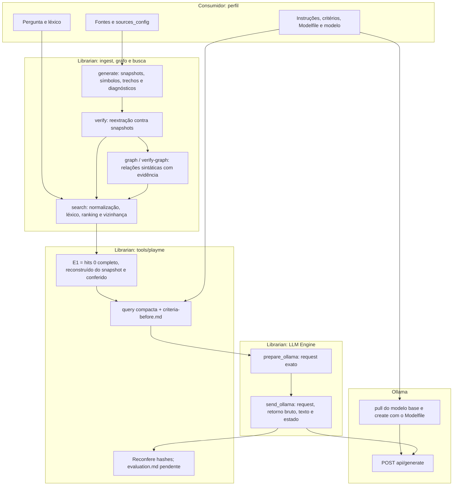

# Workflow: Librarian e consumidores

O Librarian executa toda a trilha da consulta. O consumidor (renderer, xadrez ou
outro projeto) fornece apenas um **perfil**: fontes, vocabulário, Modelfile, modelo,
instruções de explicação e critérios prévios. O Librarian não conhece o domínio.

## Executar

A partir do consumidor, com os checkouts lado a lado:

```powershell
powershell -NoProfile -ExecutionPolicy Bypass -File ..\librarian\tools\playme\PLAYME.ps1 `
  -ProfilePath .\playme.json -Question 'Onde a câmera calcula a direção dos raios?'
```

`-PrepareOnly` gera edition, grafo, busca, query e request sem iniciar Ollama nem enviar.
`-OutputDirectory` escolhe um destino novo; por padrão, `output_root/playme-<data>-<id>`.
O renderer expõe o mesmo comando como `PLAYME.cmd`/`PLAYME.ps1`, que só repassam
o seu perfil. Saída 0 indica transporte concluído ou preparação concluída, não aprovação.

## Perfil do consumidor

Caminhos relativos partem da pasta do perfil. Exemplo real: [renderer/playme.json](../renderer/playme.json).

| Campo | Pertence ao consumidor porque |
| --- | --- |
| `project_root`, `sources_config` | Define quais arquivos formam o acervo |
| `lexicon` | Vocabulário da pergunta (por exemplo, português → identificadores) |
| `modelfile`, `model`, `ollama_base_url` | Configuração e nome do modelo local |
| `instructions` | Array JSON enviado como `instructions` na query: política de explicação |
| `criteria` | Critérios gravados em `criteria-before.md` antes da resposta |
| `output_root`, `question_prompt` | Onde preservar as consultas; texto da pergunta interativa |
| `search.top`, `search.depth` | Corte do ranking e profundidade da vizinhança |
| `send.timeout_ms`, `send.max_response_bytes` | Limites do transporte |

Instruções e critérios entram nos bytes do prompt. Marque-os `-text` no consumidor.

## Fluxo



## Artefatos de uma execução

| Etapa | Arquivos |
| --- | --- |
| Entrada | `sources-config.json`, `lexicon.json`, `question.txt` |
| Edition | `edition/` com `manifest.json`, `sources.jsonl`, `symbols.jsonl`, `chunks.jsonl`, `diagnostics.json` e `snapshots/` |
| Grafo | `graph.json` (nós indexados por ID; arestas com evidência em bytes/linhas/hashes) |
| Busca | `search.json`, `lexicon-trace.json`, `retrieved-excerpts.txt`, `graph-trace.json` |
| Consulta | `query-ollama.json`, `prompt.txt`, `criteria-before.md`, `request-ollama.json` |
| Modelo | `Modelfile.requested`, `model-parameters.txt`, `model-modelfile.txt`, `server-tags.json` |
| Tentativa | `ollama-01/` com `query.json`, `request.json`, `response.bin`, `response.txt`, `result.json` |
| Auditoria | `commands.jsonl`, `logs/`, `playme.log`, `run.json`, `evaluation.md` |

## Como ler o fluxo

1. O consumidor escolhe arquivos; o Librarian preserva bytes e confere o acervo.
   O grafo registra pertencimento, tipos escritos, chamadas observadas e candidatos
   por nome, com intervalos/hashes de origem. Não há resolução por compilador.
2. A pergunta é normalizada e expandida pelo léxico explícito. O ranking encontra
   símbolos; o grafo amplia a vizinhança do primeiro resultado. `search` deriva
   esse grafo em memória dos snapshots; `graph.json` é exportação, não banco.
3. Sem candidato não há evidência para enviar; diagnósticos na edition também
   interrompem a trilha antes do envio.
4. E1 é o primeiro trecho completo, reconstruído dos bytes preservados e comparado
   com a busca. **O grafo e os demais resultados não entram no envelope compacto.**
5. Ollama recebe o Modelfile por `ollama create`; editar o arquivo não aplica nada.
6. `completed` é conclusão de transporte. A avaliação semântica é separada e manual;
   nenhuma resposta, hipótese ou relação candidata vira fato do acervo.

## Fronteira atual

O cliente HTTP não reconfere fontes no envio (`evidence_rechecked=false`); a
conferência ocorre antes, no PLAYME. O envelope não é um bundle `PreparedQuery`, e a
ponte automática da busca ao dossiê/bundle continua pendente. O checker de afirmações
([CLAIMS.md](crates/librarian-llm-engine/CLAIMS.md)) ainda não faz parte desta trilha;
seus experimentos ficam em `experiments/`.
A [referência formal de dossiês 0.1](crates/librarian-graph-engine/WORKFLOW-V0.1.md)
preserva as regras de PreparedQuery como documentação técnica separada.
